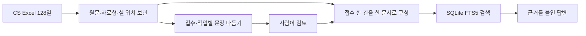

# CS Excel 검토 RAG

여러 사람이 작성한 CS Excel의 문장을 다듬고, 채택한 문장을 검색에 반영하고 사내 여러 브라우저에서 순서대로 질문할 수 있는 데모입니다. 기존 CSList 128열과 누적 CS 28열 양식을 지원합니다. 샘플과 자동 검사 자료는 모두 창작한 가상 사례입니다.

## 누적 CS 28열 파일 추가하기

시트명은 **`19~26년 누적_2600831`**입니다. `CS NO`는 기존 `CS 접수번호`와 같은 업무 번호로 조회하지만, 두 양식의 원문은 별도 문서로 보관합니다. 같은 번호를 검색하면 양쪽 자료를 찾고, 전체 접수 건수에서는 한 건으로 셉니다. 자료 목록의 건수는 원본 문서 수이므로 접수 건수와 다를 수 있습니다.

1. **자료 → 새 파일 전체 경로 → 입력 검사**에서 새 시트와 **28열**을 확인합니다. 일반 파일, Windows에서 열린 DRM 파일, `.rag.jsonl.gz` 변환 파일 모두 지원합니다.
2. **DB에 추가·갱신**으로 원문을 저장합니다. 기존 CSList 자료와 검토 결과를 유지합니다.
3. **DB 문장 다듬기**를 실행합니다. 새 양식에서는 중국어·영어 설명을 한국어로 번역하면서 정리합니다. 일반 실행은 제안만 저장하므로 검토 화면의 일괄 채택 또는 기존 야간 자동 처리를 사용합니다.
4. 채택한 번역은 단어 검색과 벡터 입력에 반영됩니다. 자동 벡터 갱신을 켰다면 이후 질문 화면에서 검색합니다. 답변은 한국어이고 인용은 원래 중국어·영어·한국어 셀과 위치입니다.

번역 대상은 제목, 설비, 설비군 간소화, 공정, 공정간소화, 기인 모듈, 기인 Unit(부품), Defect 유형·상세, 유형, 현상, 원인, 조치, 설비 타입입니다. CS NO·제번·Site·작업처·라인·날짜·집계 수치는 원문을 유지합니다. 서술 셀 안의 모델명·식별자와 숫자·단위도 유지하며, `2小时`처럼 숫자에 붙은 단위는 번역하지 않습니다. 빈칸을 추측해서 채우지 않습니다. 자동 검사는 의미 전체를 보증하지 않으므로 주요 번역은 원문과 대조하세요.

파일에 CSList가 없고 새 시트가 있으면 자동 선택합니다. 두 시트가 모두 있으면 웹 UI는 CSList를 우선합니다. 이때 새 시트만 읽으려면 CLI에서 다음처럼 지정합니다.

```powershell
.\.venv\Scripts\python.exe demo.py --schema cslist_schema.json --output cslist-ui-output --excel "C:\자료\누적.xlsx" --sheet "19~26년 누적_2600831" --import-only
```

같은 양식에서 다른 파일의 같은 번호에 다른 내용이 있으면 기존 충돌 검사를 적용해 등록을 중단합니다. 행 번호로 임의 병합하지 않습니다. 실제 파일은 제공된 경로에서 등록해야 하며, 프로그램 업데이트만으로 자료가 자동 입수되지는 않습니다.

## 보고 문서와 GitHub에서 시작하기

저장소는 [pmh10401/cs-excel-rag](https://github.com/pmh10401/cs-excel-rag)입니다. 2026년 9월 27일 기준 **비공개 저장소**이며 기본 브랜치는 `main`입니다. 접근 권한이 있는 GitHub 계정으로 인증한 뒤 소스를 받습니다.

```sh
git clone https://github.com/pmh10401/cs-excel-rag.git
cd cs-excel-rag
```

- [임원 보고서](docs/임원보고서.md): 목적, 업무 흐름, 현재 기능, 검증 결과와 시범 운영 과제를 쉽게 설명합니다. [Word 보고서](docs/CS-RAG-임원보고서-20260922.docx)도 제공합니다.
- [전체 프로그램 흐름도](docs/전체-프로그램-플로우.md): 등록부터 질문까지의 처리와 오류·재시도 경로를 보여 줍니다.
- [2026년 9월 22일 검증 기록](docs/검증기록-20260922.md): 확인한 결과와 아직 검증하지 않은 환경을 구분합니다.

GitHub에는 코드, 창작 샘플, 예제 설정과 설명 문서를 보관합니다. 실제 Excel, 운영 DB, 개인별 설정과 요청·응답 로그는 포함하지 않습니다. 기능 변경 시 문서와 흐름도를 함께 갱신하고, 검증한 버전을 커밋·푸시합니다.

처음 받은 소스에서는 예제 설정을 복사합니다. **기존 설정이 있으면 덮어쓰지 않습니다.**

```sh
# Mac 프로젝트 루트
cp -n mac_config.example.json mac_config.json
cp -n windows-demo/config.example.json windows-demo/config.json
python3.14 -m venv .venv
.venv/bin/python -m pip install --upgrade pip
.venv/bin/python -m pip install -r requirements.txt
.venv/bin/python windows-demo/test_demo.py
.venv/bin/python cs_rag.py --ui
```

Windows용 압축 파일에는 실행 설정이 포함됩니다. GitHub 소스를 직접 받았다면 루트의 PowerShell에서 아래처럼 설정을 준비한 뒤 배포본을 만듭니다. Python 3.14 x64와 `py`가 필요합니다.

```powershell
if (!(Test-Path windows-demo/config.json)) { Copy-Item windows-demo/config.example.json windows-demo/config.json }
py -3.14 -m venv .venv
.\.venv\Scripts\python.exe -m pip install --upgrade pip
.\.venv\Scripts\python.exe -m pip install -r requirements.txt
.\.venv\Scripts\python.exe package_windows.py
```

생성된 `outputs/RAG-Windows-CS128-날짜-시각.TXT`를 `.zip`으로 바꾸어 풀고 `start.bat`을 실행합니다. 예제의 답변 서버 주소·모델 이름과 임베딩 모델 ID는 실제 서버에 맞게 설정하세요. `web_host`는 웹 UI 접속 주소이고 `base_url`은 답변 모델의 API 주소입니다. 실제 API 키는 예제 파일에 저장하거나 GitHub에 올리지 않습니다.

## 구조 정리 (2026-09-26)

검토 저장을 기존의 **변경된 접수만 갱신하는 경로**로 통일했습니다. 한 접수를 검토할 때 DB 전체의 원문·제안을 다시 읽고 검색 문서를 모두 재생성하던 작업을 없앴습니다. 모든 접수를 한꺼번에 검토할 때는 기존 전체 갱신 방식을 사용합니다. 개별·일괄·야간 검토에 같은 저장 함수를 사용하며, 구형 색인이면 먼저 한 번 이관합니다. 원문·셀 위치·검토 이력과 검색 규칙은 유지합니다. [처리 흐름도](docs/전체-프로그램-플로우.md)와 [검증 결과](docs/임원보고서.md)를 함께 확인할 수 있습니다.

- DB 조회를 공통 함수로 모으고, CLI의 같은 원문 중복 읽기와 원문 등록 시 불필요한 다듬기 지문 계산을 제거했습니다. 전체 HTML 보고서는 검토하지 않은 접수도 포함합니다.
- 빈 검토는 저장을 생략합니다. 손상된 제안은 일괄 채택의 실패 목록에 남기고 정상 제안은 계속 처리합니다. 검토 저장과 한국어·영어 검색 자료 및 벡터 원문 동기화는 함께 확정하거나 롤백합니다. 이후 모델을 호출하는 번역·임베딩 단계는 기존처럼 별도로 진행합니다.
- 의존성 버전은 `windows-demo/requirements.txt` 한 곳에서 관리하고 루트 파일은 이를 참조합니다. 새 의존성·DB 테이블·사용자 설정은 추가하지 않았습니다. 설치·실행 명령은 같습니다.

## 로컬 웹 UI

Mac에서는 프로젝트 폴더에서 `.venv/bin/python cs_rag.py --ui`를 실행합니다. Windows에서는 `setup.bat` 설치 후 프로그램 폴더의 PowerShell에서 `.\.venv\Scripts\python.exe demo.py --ui`를 실행합니다. 브라우저가 자동으로 열리며 기본 주소는 `http://127.0.0.1:8765/`입니다. 포트가 사용 중이면 `--port 8766`을 붙이세요. 실행한 터미널에서 Ctrl+C로 종료합니다.

1. **자료**: Excel 전체 경로와 읽기 방식을 선택하고 **입력 검사 → DB에 추가·갱신 → DB 문장 다듬기**를 누릅니다. DRM 파일은 먼저 Windows Excel에서 열고 인증한 뒤 **Windows Excel에서 열린 파일**을 선택합니다.
2. **문장 검토**: 접수를 선택하고 작업별 원문·제안을 비교합니다. 여러 셀의 **일괄 검토에 포함** 또는 **현재 접수 전체 선택**을 체크한 뒤 **수정문 일괄 채택 / 원문 일괄 유지 → 검토 저장**으로 한 번에 반영합니다. 개별 **직접 편집**도 함께 저장할 수 있습니다. 저장 대상은 현재 접수에서 변경한 모든 셀이며, 다른 접수는 바꾸지 않습니다. 보존 열·빈 셀은 일괄 선택에서 제외하며, 제안 없는 셀이 선택되어 있으면 일괄 채택을 막습니다.
3. **질문**: 질문을 입력합니다. 답변 아래 근거를 누르면 정확한 원문 셀과 Excel 주소가 펼쳐집니다. 원문이 바뀌면 자료를 갱신하고 다시 검토합니다.

2,000건처럼 많은 결과를 테스트하려면 **문장 검토 → 현재 자료 전체 처리 → 미검토 제안 전체 채택·저장**을 누릅니다. 목록의 검색 조건이나 페이지와 관계없이 현재 DB 전체를 처리하고, 별도의 검토 저장 없이 검색에 반영합니다. 기존 채택·원문 유지·직접 편집·재검토 대상은 보존합니다. 빈 셀·보존 열은 제외하고 제안 없는 접수와 검사 실패 접수는 건너뛰며 결과에 제외 건수·오류를 표시합니다. 저장하지 않은 화면 편집이 있으면 먼저 검토 저장을 누르세요.

전체 채택은 이미 생성된 제안을 사용하므로 LLM을 다시 호출하지 않습니다. 등록된 DB의 원문을 사용하므로 Excel 파일이나 DRM 연결이 필요하지 않습니다. 검토 저장과 검색 갱신은 한 번에 수행하며 DB·색인 저장이 실패하면 채택도 롤백합니다. 다시 누르면 남은 미검토 제안만 처리합니다. 문장 다듬기 작업의 일부 실패 결과는 기존대로 중간 저장소에 있으며 전체 정리가 성공해야 검토 대상 자료로 전환됩니다.

UI는 Mac에서 `outputs/mac-cslist-ui/`, Windows에서 `cslist-ui-output/`에 저장합니다. 기존 콘솔 결과와 별도이며 `--output "결과 폴더"`로 바꿀 수 있습니다. 입력 검사만으로 기존 수정 제안을 지우지 않습니다. 동시 처리 수는 설정 화면에서 변경합니다. 모델·서버·추론 옵션은 화면에서 확인하고, 변경은 `mac_config.json` 또는 Windows의 `config.json`에서 합니다. 아래의 기존 콘솔 메뉴도 계속 사용할 수 있습니다.

## 새 자료 누적 등록과 Excel 삭제

여러 파일은 **자료 → 여러 파일 등록 대기열**에서 전체 경로를 한 줄에 하나씩 입력하고 **대기열 등록 시작**을 누릅니다. 한 번에 최대 100파일을 순서대로 처리합니다. 프로그램이 실행되는 PC의 경로를 사용하며, 다른 PC에서 웹 화면에 접속해도 파일 업로드 기능은 아닙니다.

```text
C:\CS자료\기존자료.xlsx
C:\CS자료\누적자료.xlsx
C:\CS자료\변환자료.rag.jsonl.gz
```

위쪽의 읽기 방식이 전체 목록에 적용됩니다. DRM 파일은 모두 Windows Excel에서 인증 후 열어 두고 셀 편집을 끝내세요. 변환 파일은 선택한 방식과 관계없이 Excel 없이 읽습니다. CSList 128열과 누적 CS 28열을 함께 등록할 수 있습니다.

- 파일별 **대기·처리 중·등록 완료·실패·경로 중복 제외**와 추가·갱신·동일 건수를 표시합니다.
- 같은 파일 경로는 한 번만 처리합니다. 같은 양식의 접수번호와 원문이 모두 같으면 기존 자료를 재사용합니다. 번호가 다르면 내용이 같아도 별도 사례입니다.
- 한 파일 안의 중복 번호, 잘못된 양식, 다른 파일과의 내용 충돌은 **해당 파일 전체 등록을 실패**로 처리합니다. 앞에서 완료한 파일은 보존하고 다음 파일을 계속 처리합니다.
- 문제를 수정한 뒤 **실패 파일만 재시도**를 누르면 완료한 파일은 다시 요청하지 않습니다. 열 대응이 필요하면 해당 경로를 위쪽 입력 검사에 넣어 수정하세요.
- 브라우저를 닫아도 실행되며 다시 접속해 진행 상황을 확인할 수 있습니다. 프로그램을 재시작하면 대기 목록은 사라집니다. 같은 목록을 다시 등록해도 이미 저장된 동일 자료는 재사용합니다.

임베딩 자동 갱신이 켜져 있으면 파일 등록을 모두 시도한 뒤 벡터를 한 번 갱신합니다. 벡터 생성 실패는 파일 등록 결과와 별도로 표시합니다. 등록 중에는 다른 자료 변경이나 질문을 함께 실행하지 않습니다. 등록 후 **DB 문장 다듬기** 또는 **야간 자동 실행**으로 이어갑니다.

자료 화면에서 **DB에 추가·갱신**을 누르면 모델을 호출하지 않고 원문 셀·자료형·파일명·시트명·셀 주소를 SQLite에 저장합니다. 임베딩 자동 갱신이 켜져 있으면 등록 후 누락 벡터도 생성합니다. 화면에 추가·갱신·동일·DB 누적 건수를 표시합니다. **등록 완료 후에는 Excel을 삭제해도 됩니다.** 파일 변환이나 입력 검사만 한 상태는 DB 등록 완료가 아닙니다.

- 새 접수번호는 추가하고, 이번 파일에 없는 기존 접수는 삭제하지 않습니다.
- 같은 원문은 제안·검토·번역·벡터를 재사용합니다. 복사본의 내용이 같으면 기존 출처를 유지합니다.
- 같은 원본 파일에서 내용이 바뀐 접수는 그 건만 갱신합니다. 기존 검토는 재검토로 표시하고 오래된 번역·벡터는 검색에서 제외합니다.
- 다른 파일에서 같은 접수번호의 내용이 다르면 덮어쓰지 않고 등록을 중단합니다. 접수번호를 확인하세요.

이후 **DB 문장 다듬기 → 검토**, 또는 **자동 채택하고 검색까지 준비**를 실행합니다. 두 기능은 등록된 DB 전체를 대상으로 하며 동일 원문·설정의 완료 작업을 재사용합니다. 질문·번역·벡터·검토에도 Excel을 다시 읽지 않습니다. 답변 근거는 DB에 보존한 한국어 원문이며, 표시되는 Excel 주소는 등록 당시의 위치입니다. 파일을 수정해도 재등록 전까지 DB는 바뀌지 않습니다.

원본을 삭제하기 전에 등록 건수와 원문을 확인하세요. 프로그램을 종료한 뒤 설정 파일과 출력 폴더 전체를 백업하면 됩니다. UI와 콘솔에서 같은 자료를 쓰려면 **같은 `--output` 폴더**를 지정하세요.

```sh
# Mac: 등록만 수행한 뒤, Excel 없이 같은 DB를 다듬고 질문합니다.
.venv/bin/python cs_rag.py --output outputs/mac-cslist-ui --excel "추가자료.xlsx" --import-only
.venv/bin/python cs_rag.py --output outputs/mac-cslist-ui --saved --normalize-only
.venv/bin/python cs_rag.py --output outputs/mac-cslist-ui --saved --question "펌프 누수의 과거 조치는?"
```

## 조치별 결과와 원문 근거

답변의 인용 번호를 누르면 **조치 → 결과 → 원문 셀·Excel 주소**를 확인할 수 있습니다. 예를 들어 “센서 교체 후에도 동일 증상 발생. 배선 접촉 불량 확인하여 수정 후 정상화.”는 센서 교체의 **증상 지속**과 배선 수정의 **정상화**를 따로 보여 줍니다. 답변 본문에는 원문을 중복해서 붙이지 않습니다.

연결 정보는 원본 `조치내용(n)`에서만 만들며 채택문이나 번역으로 결과를 추정하지 않습니다. 명확한 “조치 후 결과”를 **정상화·일부 개선·증상 지속**으로 구분하고, 부정·예정·복합 경과·관찰 제한은 **결과 미확인**으로 보류합니다. 이는 자동 연결이 불확실하다는 뜻이며, 원문에 결과가 없다는 뜻은 아닙니다. 묶여 기록된 여러 조치의 효과를 개별 조치에 나누지 않습니다.

같은 셀의 후속 정상화를 앞선 실패 조치에 붙인 명시적 답변은 검사에서 거부하고, 원문 조치와 오류를 알려 기존 보정 요청을 한 번 수행합니다. 이 검사는 직접 대응하는 표현을 대상으로 하며 생략·의역·대명사를 포함한 모든 인과관계를 증명하지는 않습니다.

기존 DB는 다음 검색 색인 확인 때 파생 근거를 한 번 갱신합니다. 원문·검토 이력은 보존되며 이 변경 때문에 문장 다듬기나 번역을 다시 실행할 필요는 없습니다. 새 Windows 배포 파일의 `check.bat`에도 조치별 결과 회귀 검사가 포함됩니다.

## Excel을 한 번 변환하고 반복 실험하기

**자료 → Excel 경로 입력 → 실험용 파일로 변환**을 누릅니다. 출력 폴더의 `inputs/파일명.rag.jsonl.gz`에 원문을 저장하고 해당 파일을 입력으로 자동 선택합니다. 이후 **입력 검사 → 문장 다듬기 → 검토 → 질문**은 변환 파일만 읽습니다. 이전 변환 파일의 전체 경로를 직접 입력해도 됩니다. 압축을 풀 필요가 없습니다.

변환 중에는 **현재 단계·시트 처리 행 수·변환 건수·경과 시간**을 표시합니다. 진행률은 현재 단계 기준이며 전체 행 수를 확인하기 전에는 대기 막대를 표시합니다. 빈 행은 처리 행 수에 포함되지만 변환 건수에서는 제외합니다. 압축 파일 저장이 끝나야 100%가 됩니다. DRM 읽기가 멈춘 것처럼 보이면 **Excel 셀 편집을 Enter로 확정하거나 Esc로 취소하고 열린 대화상자를 처리**하세요. 프로그램이 대신 편집을 확정하거나 취소하지는 않습니다.

파일 변환 자체는 모델을 호출하지 않으며 원문 128열 또는 28열, 빈칸, 날짜·숫자 형식, 원본 Excel 주소와 식별 정보를 보존합니다. 같은 원본으로 만든 기존 검토·정리 결과도 연결됩니다. DRM 파일은 처음 변환할 때 Windows Excel에서 인증하고 열린 파일 읽기를 선택합니다. 변환 후에는 Excel을 닫을 수 있습니다. 자동 벡터 생성이 켜져 있으면 파일 저장 후 임베딩 모델을 사용해 검색 자료를 갱신합니다. 변환 파일은 **변환 시점의 원문**이므로 Excel 내용이나 열 대응을 변경했다면 원본 경로를 다시 선택해 재변환하세요. 파일은 성공한 변환으로만 교체됩니다.

```sh
.venv/bin/python cs_rag.py --excel "자료.xlsx" --convert-input "자료.rag.jsonl.gz"
.venv/bin/python cs_rag.py --excel "자료.rag.jsonl.gz" --normalize-only
```

Windows에서는 앞부분을 `.\.venv\Scripts\python.exe demo.py --schema cslist_schema.json`으로 바꿉니다. Excel 읽기 비용을 줄이는 기능이며 LLM 추론·DB 색인 시간은 별도입니다.

## 벡터 검색 추가하기

기존 SQLite 키워드 검색을 유지하며 FAISS FlatIP로 의미가 비슷한 현상을 찾습니다. Mac과 Windows 기본 임베딩은 LM Studio의 `Qwen3-Embedding-0.6B Q8_0`입니다. Mac 모델 ID는 `cs-embedding`, Windows 기본값은 `text-embedding-qwen3-embedding-0.6b`입니다. 답변 모델과 임베딩 모델은 별도입니다.

**LM Studio 설치·모델 다운로드·설정을 마쳤다면 다음부터 `start.bat`만 실행합니다.** 웹 UI가 로컬 임베딩 서버를 확인하고 필요할 때 시작·모델 로드를 수행합니다. 이미 실행 중인 서버는 재사용합니다. 저장된 DB의 누락 벡터를 이어서 만들며, 파일 변환·검토 저장 후에도 새 자료나 변경된 내용만 자동 생성합니다. 처음에는 키워드 + 벡터 검색이 선택됩니다. 자료 화면에서 자동 준비 상태와 실패 이유를 확인할 수 있습니다.

변환 후 자동 색인에서는 새 접수를 누적 등록합니다. 기존 접수의 원문이 달라졌다면 기존 제안·검토를 덮지 않고 갱신 필요를 알립니다. 이때는 DB에 추가·갱신으로 등록하고 다시 다듬으세요. 임베딩 실패로 이미 저장한 변환 파일·문장·검토가 취소되지는 않습니다. 성공 벡터는 보관하며 다음 시작이나 벡터 버튼으로 실패분을 재시도합니다. `embedding.auto_start: false`는 로컬 서버 자동 시작을, `embedding.auto_index: false`는 웹 UI의 자동 벡터 생성을 끕니다. 원격 임베딩 서버는 연결만 사용하며 로컬 프로그램을 실행하지 않습니다.

1. 기본 자동 생성 외에 수동 시험은 **자료 → 벡터 검색 자료 → 벡터 생성 / 이어서 실행**에서 20개로 진행할 수 있습니다. DB가 없으면 입력 전체를 원문으로 등록합니다. 문장 다듬기는 호출하지 않으며 기존 제안·검토도 덮어쓰지 않습니다.
2. **질문 → 검색만 비교**로 한국어 키워드·벡터·결합 후보를 확인합니다. 이 버튼은 임베딩 서버만 호출합니다.
3. **검색 방식 → 키워드 + 벡터 검색 → 질문하기**로 원문 근거를 가진 답변을 받습니다. 전체 검색을 시험하려면 자료 화면에서 **남은 문서 전체**를 생성하세요.

임베딩 입력은 제목·문제현상·현상·제품군·UNIT명·알람코드의 원문과 채택문입니다. 미채택 제안은 제외합니다. 원인·조치·원문 셀 주소는 검색된 접수 문서에서 가져옵니다. 같은 내용은 한 번만 임베딩하므로 생성한 고유 벡터 수와 검색 가능한 접수 수는 다를 수 있습니다. 성공한 배치를 즉시 저장하고 실패한 배치는 다음 실행에서 재시도합니다. 원문·채택문 변경 시 해당 접수의 이전 벡터는 즉시 제외하며, 다시 생성할 때 갱신합니다.

키워드 + 벡터 결합 검색에서 질문의 “송풍기”는 `fan`, “뜨겁다”는 “온도·고온”, “대기압으로 복귀/돌아오다”는 `vent·벤트`도 키워드 후보로 찾습니다. 원래 질문·원문·인용 검사는 유지하고, 키워드 단독 검색, 코드·날짜의 정확 조회와 영어를 함께 쓰는 검색에는 추가하지 않습니다. 이 보완은 앱을 재시작하면 적용되며 자료나 벡터를 다시 만들 필요가 없습니다. 정상·부정 조건과 실제 관련성은 원문을 대조해야 합니다.

결합 검색은 각 방식의 상위 후보(최소 20건) 순위를 RRF로 합칩니다. 기본 3건이며 질문 UI에서 1~100건 또는 문맥 길이에 맞춰 자동 선택할 수 있습니다. 접수번호·코드·날짜는 정확 검색, 건수 질문은 기존 SQL 집계를 사용합니다. 벡터 전용 검색 실패는 오류로 표시하며 결합 검색은 키워드로 진행하고 안내를 표시합니다. 후보가 모두 무관할 수 있으므로 유사도 값은 정확도나 해결 확률이 아닙니다.

벡터는 SQLite BLOB에 보관하고 FAISS 색인은 메모리에 재생성합니다. `embedding.revision`(기본 `1`)을 변경하면 같은 모델 ID의 가중치를 교체했을 때도 새 벡터를 만들 수 있습니다. 모델·서버·접두사가 바뀌면 이전 벡터는 새 검색에 쓰지 않습니다. 배치 수는 `embedding.batch_size`, 최소 유사도는 `embedding.min_score`로 조정합니다. 문장 다듬기·영어 번역 동시 처리 수와는 별개입니다.

```sh
.venv/bin/python cs_rag.py --excel "자료.rag.jsonl.gz" --build-vectors --vector-limit 20
.venv/bin/python cs_rag.py --excel "자료.rag.jsonl.gz" --build-vectors --vector-limit 0
.venv/bin/python cs_rag.py --excel "자료.rag.jsonl.gz" --saved --search-mode hybrid --question "압력이 목표까지 내려가지 않습니다"
```

Windows 배포본에는 로컬 LM Studio 주소 `http://127.0.0.1:1234/v1`와 Qwen 임베딩 설정이 들어 있습니다. 기존에 준비한 `config.json`은 유지해도 됩니다. 기존 `gpt-4` 답변 서버는 문장 다듬기·답변에 사용합니다. 다른 임베딩 서버를 쓴다면 `embedding.base_url`, `model`, `api_key`와 모델에 맞는 `query_prefix`를 한 번 지정하세요. 임베딩 키는 답변용 키에서 복사하지 않습니다. 기존 키워드 검색은 그대로 사용할 수 있습니다.

## 문장 다듬기의 숫자 오류 보정

숫자·단위 검사를 유지하면서 오류에 원문과 응답의 숫자 목록을 표시합니다. 예를 들어 `1.SCW132 11.8 STEP Thinner Attack 불량 점검`에서 앞의 `1.`을 없애면 원문 `[1, 132, 11.8]`과 응답 `[132, 11.8]`이 달라 실패합니다. `11.8 STEP`을 두 단계로 풀어 쓰거나 장비 코드의 뜻을 추측하지 않습니다.

정상 종료된 첫 응답에서 숫자 오류가 나면 실패한 셀만 분리해 한 번 보정합니다. 숫자·단위·숫자가 포함된 식별자를 임시 표시자로 보호하고, 응답의 표시자 순서·개수를 확인한 뒤 원문 조각을 복원해 다시 검사합니다. 다른 셀의 통과한 제안은 유지합니다. 보호 표시자가 틀리거나 숫자를 추가하면 실패로 남깁니다. 연결 오류·잘린 응답은 이 보정 대상이 아닙니다. 이 변경만으로 성공한 기존 행을 다시 생성하지 않습니다.

## 한국어 원문과 영어 검색 함께 사용하기

질문 화면의 **영어 번역 질문 함께 사용**은 기본으로 켜져 있습니다. 한국어 질문 전체를 한 번 번역해 **한국어 원문 + 영어 번역 + 검색한 원문 근거**를 답변 모델에 함께 전달합니다. 답변의 **영어 번역 질문 확인**을 펼치면 실제 번역문을 볼 수 있습니다. 끄면 한국어 단독 질문과 비교할 수 있습니다. 별도 모델·DB·문서 재처리는 필요하지 않습니다.

영어 키워드 검색도 활용하려면 **자료 → 영어 검색 자료 → 남은 자료 중 20건 → 영어 변환 / 이어서 실행**으로 문서 번역을 준비합니다. 영어 색인이 있으면 같은 질문 번역을 키워드·결합 검색에 재사용하고, 일부만 번역했다면 영어 검색은 그 접수만 대상으로 합니다. **검색 방식과 후보 비교**에는 두 검색의 후보 접수번호가 표시됩니다.

결과를 확인한 뒤 처리 범위를 **남은 자료 전체**로 바꾸면 2,000건도 일괄 처리합니다. 번역은 현재 설정의 LLM으로 병렬 실행하며 학습·임베딩 모델은 사용하지 않습니다. 성공 건을 즉시 DB에 저장하고 같은 내용·설정의 번역은 재사용합니다. 개별 모델 실패는 건너뛰며 같은 버튼으로 재시도합니다. 실패 목록이 있으면 전체 번역 완료가 아닙니다. 문장 다듬기와 영어 번역은 같은 동시 처리 설정을 사용합니다(기본 200, 최대 1,000).

번역 대상은 **제목과 현상·원인·조치 등 기존 수정 대상 열**의 현재 유효한 값입니다. 채택·직접 편집한 값이 있으면 그 값을, 없으면 한국어 원문을 사용합니다. 빈칸을 채우거나 미채택 제안을 번역하지 않습니다. 원본 128열·셀 위치·검토 이력은 그대로 두며, 번역은 `english_translations`, 검색용 파생 값은 `rag_english_documents`에 보관합니다. 검토나 원문 변경으로 번역 대상 셀이 달라지면 이전 영어 색인에서 제외하고 다시 변환할 때 반영합니다. DB 백업에는 번역도 함께 포함됩니다.

영어 색인에는 SQLite의 Porter 어형 처리를 사용합니다. 두 색인의 검색 순위를 합치되 명시적인 코드·날짜 조회와 건수 집계는 기존 경로를 유지합니다. 벡터 검색의 임베딩 입력은 원문 질문을 유지하며 영어 질문은 답변 이해를 보조합니다. 영어 문서가 없어도 질문 번역은 답변에 사용할 수 있습니다. 영어로 입력한 질문은 다시 번역하지 않으며, 없는 코드 조회나 건수 집계에는 불필요한 번역을 하지 않습니다.

질문 번역이 비었거나 잘렸거나 숫자·부호·단위·식별자 검사에 실패하면 원문 질문만으로 계속 처리합니다. 번역문은 별도 사실 근거가 아니며, 두 언어의 내용이 다르면 한국어 질문을 우선합니다. **답변 생성과 인용 검사는 항상 한국어 원문 셀을 사용**합니다. 보정 요청에도 같은 번역을 재사용하고, 자동 참고 사례 수는 영어 질문 길이까지 포함해 계산합니다. 질문 번역은 요청별 결과에만 남고 문서·검토 이력·벡터는 변경하지 않습니다.

품질 향상은 보장되지 않습니다. 같은 업무 질문을 옵션 켜기·끄기로 비교하면서 상위 사례의 관련성, 조치별 결과 연결, 부정·미실시·관찰 조건의 보존, 응답 시간을 함께 확인하세요. 숫자 검사가 번역 의미 전체의 정확성을 보장하지는 않습니다. 아래의 과거 실험은 검색어 변환 방식의 결과이며 이번 전체 질문 병용 방식의 실측 성능은 아닙니다.

Mac 콘솔에서도 같은 기능을 사용할 수 있습니다. 기존 DB와 동일한 Excel·출력 폴더를 지정하세요.

```sh
.venv/bin/python cs_rag.py --excel "자료.xlsx" --output "결과 폴더" --translate-english --translation-limit 20
.venv/bin/python cs_rag.py --excel "자료.xlsx" --output "결과 폴더" --translate-english --translation-limit 0
.venv/bin/python cs_rag.py --excel "자료.xlsx" --output "결과 폴더" --saved --bilingual --question "냉각수 순환량이 부족합니다. 과거 조치와 결과는?"
```

Windows에서는 `.venv/bin/python cs_rag.py` 대신 `.\.venv\Scripts\python.exe demo.py --schema cslist_schema.json`을 사용합니다. Windows의 출력 상한은 GPT-OSS 120B 공식 사양을 기준으로 131,072토큰입니다. 실제 요청에서는 설정 문맥 한도에서 입력 예약량을 제외합니다.

개발 중 Mac의 gpt-oss-20b/high로 가상 사례 20건 중 5건을 실제 번역하고 질문 5개를 비교했습니다. 기존·확장 검색 모두 상위 3건 안에서 기대 사례를 찾았으며, 야간 소음 사례는 2위에서 1위로 올라왔습니다. 영어 검색어 생성에는 약 7~21초가 추가됐습니다. 번역의 관찰 사실을 지시로 오해한 1건은 프롬프트를 보완한 뒤 다시 확인했습니다. 이 소규모 결과로 전체 업무 자료의 정확도 향상을 단정할 수는 없습니다. 2,000건 자동 검사는 모의 번역으로 저장·재사용·무효화 동작을 확인한 것이며, 2,000건 전체 실제 번역과 Windows 실행 검증은 별개입니다.

## 문제 현상으로 과거 조치 찾기

질문 화면에 증상과 발생 조건을 입력합니다. 예: “진공 알람이 반복됩니다. 과거 조치 사례와 관찰 결과를 찾아주세요.” 접수 한 건씩 **과거 현상 → 당시 조치 → 관찰 결과·한계**로 답하며, 효과 없던 조치와 후속 조치를 구분합니다. 재발·장기 미확인·교체 미실시도 본문에 남기도록 요청합니다. 과거 기록을 현재 설비에 바로 적용할 지시로 바꾸지 않습니다. 특정 값이나 완료 여부만 묻는 질문에는 해당 항목에 직접 답합니다.

SQLite 검색 색인은 현상·알람·설비·조치 필드를 나눕니다. 현상과 알람에 높은 가중치를 주고, 원문과 채택한 수정문을 함께 검색합니다. 열 제목이나 화면 안내 문구는 검색 점수에 넣지 않습니다. 원본 Excel의 열을 옮기거나 바꿀 필요는 없습니다.

CS 검색은 Kiwi로 조사·어미를 구분한 단어를 사용합니다. 예를 들어 `냉각수를`는 `냉각수`로 검색하고 `니다`는 검색어로 쓰지 않습니다. DB의 `keywords`에는 단어가, `grams`에는 보조 두 글자 조각이 들어갑니다. 단어 검색이 비었을 때만 보조 검색하며, 각 단어의 모든 조각이 순서대로 일치해야 합니다. 관련 사례가 없으면 결과를 억지로 채우지 않습니다.

`물이 샙니다/샌다/새요 → 누수·누설`, `웅웅/윙윙/달그락 → 소음·이상음`, `떨림/떨려요 → 진동`도 검색 후보로 연결합니다. 이 확장은 답변의 원문 인용 검사와 분리되어 있으며, 원인·해결·부정 여부를 확정하지 않습니다. 형태소 분석과 검색에는 LLM 호출·사용자 데이터 학습이 필요하지 않습니다.

업데이트할 때 Mac은 `.venv/bin/python -m pip install -r requirements.txt`, Windows는 앱을 닫고 `setup.bat`을 다시 실행한 뒤 `start.bat`을 실행합니다. Kiwi 사전은 설치 시 내려받고 이후 로컬에서 사용합니다. 다음 질문·검토 저장 시 검색 색인을 자동으로 바꾸므로 문장 다듬기를 다시 할 필요는 없습니다. 구형 DB를 직접 조회하는 호환 경로와 CS 양식이 없는 초기 데모는 기존 문자 조각 검색을 유지합니다.

2026-09-11 가상 자료 2,000건 검증에서는 기존 검색 2,230개를 모두 통과했고, 별도 자연어 질문 31개는 23개에서 30개로 개선됐습니다. 각 결과가 허용한 사례에 속하는지 확인했고, 관련 사례가 없어야 하는 질문도 포함했습니다. 남은 실패는 “무상 자재 금액이 0인가요”로, 수치 열 이름과 값의 조건을 해석하는 기능이 필요합니다. 이 결과는 실제 업무 자료의 정답률이나 LLM 답변 품질을 보장하지 않습니다. 작은 재현 검사는 `.venv/bin/python -m tests.test_korean_search`로 실행합니다.

소음/이상음/noise, 누수/누설/leak/leakage, 진동/vibration을 연결합니다. 이 증상과 함께 펌프/pump 또는 팬/fan을 명시하면 증상과 설비가 모두 언급된 기록으로 후보를 좁힙니다. 여러 증상을 함께 쓰면 그중 하나를 포함한 사례를 찾습니다. 예를 들어 샘플의 “펌프 소음”은 결과 없음으로 처리하며 펌프 누수 사례로 대신 답하지 않습니다. 접수번호를 명시한 질문은 해당 접수의 전체 기록을 보여 줍니다.

이 규칙은 위 표현에만 적용됩니다. “소음 없음”이나 “누설 미확인”도 관련 기록으로 검색되므로, 검색 일치가 증상 발생이나 해결을 뜻하지는 않습니다. 한 접수 안의 여러 장비·증상 관계와 다른 동의어는 자동 판정하지 않습니다. 답변의 원문 셀에서 조건을 확인하세요.

문장 다듬기는 구체적인 증상을 “이상”으로 줄이지 않고 발생 위치·운전 조건·빈도·재현 여부·관찰 시간·재발을 보존하도록 개선했습니다. 발주 완료와 교체 완료를 구별하고, 원인·조치·결과를 다른 셀로 옮기지 않습니다. 자동 검사는 기존 열·숫자·단위·빈칸 검사를 유지하며 전체 의미는 사람이 검토합니다. 답변에서 소음·누수/누설·진동을 설명하면 해당 증상 표현이 있는 원문 셀도 인용해야 합니다. 이 검사는 표현의 존재를 확인하며 인과관계나 의미 전체를 증명하지 않습니다. 발주와 교체 미실시가 함께 기록된 셀을 인용하면서 발주만 설명하면 미실시 상태를 보완하도록 요청합니다.

업데이트 후 질문하거나 검토를 저장하면 검색 색인만 자동 갱신합니다. 기존 원문·제안·채택 이력은 보존하며 갱신 실패 시 이전 색인으로 복구합니다. 문장 다듬기를 다시 실행하면 변경된 프롬프트로 제안을 새로 생성하므로 이전 완료 체크포인트를 재사용하지 않습니다.

추가한 문장 평가 3건은 `evaluate.py --start 75 --limit 3`으로 실행합니다. 검색에서 결과가 없어야 하는 평가에는 `"expect_no_match": true`와 `"expected_ids": []`를 함께 지정합니다.

## 문장 다듬기·영어 번역 동시 처리 수

웹 UI의 **설정 → 문장 다듬기·영어 번역 동시 처리 수 → 동시 처리 수 저장**에서 1~1000건을 선택합니다. 기본값은 200건이며 문장 다듬기와 영어 번역에 공통 적용합니다. 실행 중에는 변경할 수 없으며, 저장한 값은 다음 작업부터 적용됩니다. 서버가 요청을 순차 처리하거나 자원을 나누면 숫자를 늘려도 빨라지지 않을 수 있습니다.

선택한 값은 출력 폴더의 `cslist_settings.json`에 보관하며 프로그램을 다시 열어도 유지됩니다. 콘솔/CLI에서는 모델 설정 파일(`mac_config.json` 또는 `config.json`)에 `"normalization_workers": 2`를 추가할 수 있습니다. UI에 저장한 값이 있으면 그 값이 해당 UI의 기본 설정보다 우선합니다.

모델 요청만 접수별로 병렬 실행합니다. 검사를 통과한 수정 결과 JSON은 **먼저 완료한 행부터 DB에 자동 중간 저장**하므로 JSON 파일을 가져올 필요가 없습니다. 이 결과는 수정 제안이며 자동 채택하지 않습니다. DB 쓰기는 한 스레드에서 처리하고, 최종 목록은 원래 입력 순서를 유지합니다.

한 행의 모델 요청이나 응답 검사가 실패해도 나머지 행을 끝까지 처리합니다. UI에는 처리·성공·실패 건수와 실패 접수번호별 오류를 표시합니다. 같은 원본·설정으로 이어서 실행하면 실패한 행만 재시도합니다. 입력 파일 오류나 DB 저장 오류는 작업을 중단합니다. 전체 성공 후에만 이번 다듬기의 제안을 확정하며, 기존 등록 자료는 보존합니다. 동시 처리 수만 변경해도 이전 완료 행은 그대로 재사용합니다.

## 열 이름 연결과 중단 후 재개

입력 검사에서 처음 보는 열 이름이 나오면 **열 이름 대응**에서 원본 열과 양식 열을 선택하고 **열 대응 저장**을 누릅니다. 저장 후 같은 파일을 다시 검사합니다. 예를 들어 `현장 증상`을 `현상`에 연결할 수 있습니다. 원본 Excel의 열 이름이나 값은 바꾸지 않습니다. 같은 양식 열로 들어오는 열이 두 개이면 합치지 않고 오류로 표시합니다.

연결 규칙은 결과 폴더의 `column_aliases.json`에 저장됩니다. 화면에서 변경·삭제할 수 있고, 같은 `--output`을 쓰는 콘솔 메뉴와 CLI에서도 사용합니다. UI와 콘솔은 기본 출력 폴더가 다릅니다. 손상되거나 다른 양식의 규칙 파일은 오류로 알리며 임의 초기화하지 않습니다.

문장 다듬기는 검사를 통과한 행마다 SQLite의 `normalization_checkpoints`에 중간 저장합니다. 실패하거나 프로그램을 다시 시작했으면 **문장 다듬기 / 이어서 실행**을 누릅니다. 같은 원본·접수번호·내용·모델 설정·규칙의 완료 행을 재사용하며, 화면에 완료 건수·재사용 건수·실패 접수번호가 표시됩니다. 실패한 행은 처음부터 다시 처리합니다. 전체 행이 성공해야 이번 제안을 확정하므로 중간 결과가 검색에 섞이지 않습니다. 원본과 검토 결과는 별도로 유지합니다.

## 추가 품질 사례 실행

문장 평가 자료는 77건이며, `EVAL-051`부터 Grok 4.6/xhigh와 함께 만든 24건입니다. 빈칸과 0, 부정·추정, 발주와 교체, 일시 정상 후 재발, 모순되는 셀, 약어·오탈자·줄바꿈, 단위·부호, 같은 장비의 다른 접수, 자료에 없는 답, 셀 안의 지시문을 포함합니다. 참고 문장과 검토 기준은 모델에 보내지 않습니다.

Mac에서 새 사례만 실제 LM Studio로 평가합니다.

```sh
.venv/bin/python windows-demo/evaluate.py --config mac_config.json --start 51 --limit 24 --output outputs/quality-evaluations
```

Windows에서는 프로그램 폴더에서 실행합니다.

```powershell
.\.venv\Scripts\python.exe evaluate.py --start 51 --limit 24
```

보고서에는 메모와 결과 등 수정 대상 셀의 원문·제안·검토 기준을 함께 표시합니다. 자동 검사는 대표 단위의 추가·삭제·변경과 숫자별 단위 이동을 거절합니다. `12V → 12 V`는 허용하지만 `11.8 L/min → 11.8 L/s`는 거절합니다. 한글 단위는 `10개 → 10개월`처럼 더 긴 단어의 앞부분을 같은 단위로 읽지 않도록 구분합니다. 셀 안의 지시문은 수행할 계획으로 바꾸지 않고 지시가 기록되어 있다는 인용 표현으로 다듬도록 요청합니다. 단위 목록 밖 표기와 부정·추정·완료 여부의 의미 보존은 사람이 확인해야 합니다. 이 보고서의 성공은 자동 검사 통과를 뜻하며, 정답률을 뜻하지 않습니다.

## 이 Mac에서 시작하기

LM Studio 서버와 `openai/gpt-oss-20b`를 사용합니다. 프로젝트 폴더에서 다음 명령 하나로 웹 UI를 엽니다.

```sh
.venv/bin/python cs_rag.py
```

자료 화면에 자신의 Excel 또는 `windows-demo/cslist_sample.xlsx`의 전체 경로를 입력합니다. **입력 검사 → 문장 다듬기 → 문장 검토에서 검토 저장 → 질문** 순서입니다. JSON 파일을 다운로드하거나 다시 넣을 필요가 없습니다. 읽기 방식은 **일반 파일**을 선택합니다.

Mac의 웹 UI 결과는 `outputs/mac-cslist-ui/`에 저장합니다. 기존 콘솔 결과 `outputs/mac-cslist/`는 그대로 남습니다. 기존 콘솔은 `.venv/bin/python cs_rag.py --menu`로 열 수 있으며 아래 CLI 조회 예제는 콘솔 결과 폴더를 사용합니다.

검색 후보가 있어도 답변 모델이 관련 근거가 없다고 판단하면 **근거 부족**을 표시합니다. 예를 들어 펌프 소음 질문에 누수 기록만 검색된 경우입니다. 전체 DB에 기록이 없다는 뜻은 아니므로 설비·부품·발생 조건을 보완해 다시 검색할 수 있습니다. 관련 사례의 일부 셀이 비어 있거나 특정 접수의 빈 항목만 물어도 미기재로 답하도록 요청합니다. 빈칸과 0을 구별합니다. 웹 답변 본문은 모델의 설명과 짧은 인용 번호만 표시합니다. 인용 번호를 누르면 해당 접수의 원문이 펼쳐집니다. 직접 인용한 셀은 인용 근거에, 그 외 조치·결과 셀은 접힌 추가 참고 원문에 한 번씩 표시합니다. 관찰 시간·실패·재발·미실시가 담긴 원문은 그대로 보존합니다. 명령줄·기존 보고서는 원문 보완 출력을 유지합니다. 추가 모델 호출이나 DB 재생성은 필요하지 않습니다. JSON·인용·수치 검사 실패는 계속 오류로 표시하며 근거 부족으로 바꾸지 않습니다.

Windows 배포 설정은 GPT-OSS 120B 기준으로 `max_tokens: 131072`, `context_window: 131072`를 사용합니다. 문장 다듬기·영어 번역·답변·보정 요청마다 입력 JSON의 UTF-8 바이트 수와 대화 형식 여유 1,024를 빼고 출력 한도를 계산합니다. 정확한 토큰화가 아닌 보수적 예약입니다. 서버의 실제 문맥이 더 작으면 `context_window`도 그 값으로 낮춰야 합니다. 기존 설정 파일에는 두 값을 반영하고, 별도 `answer_max_tokens`가 있으면 답변 출력에 우선 적용됨을 확인하세요. `temperature: 1`, `top_p: 1`, 추론 `high`, 서버 주소·요청 모델 이름 `gpt-4`·요청 대기 600초는 유지합니다. 입력 근거의 24,000자 제한은 별도입니다. 생성 설정을 바꾸고 문장 다듬기를 다시 실행하면 체크포인트를 다시 계산하지만, 이미 저장된 제안을 일괄 채택할 때는 재생성하지 않습니다.

Mac의 문장 다듬기와 답변은 `reasoning_effort: "high"`으로 추론을 사용합니다. 답변은 추론과 최종 JSON이 잘리지 않도록 `answer_max_tokens: 8192`로 설정했고, `answer_temperature: 1`을 사용합니다. gpt-oss 전환 후 기존 temperature=0 설정에서 긴 추론과 출력 잘림이 확인되어 답변 설정을 변경했습니다. 토큰 제한은 응답 시간 보장이 아니며, 한도에서 잘린 답변은 사용하지 않습니다. LM Studio에 보내는 검사는 한 번에 하나씩 실행하세요. 시간 초과가 발생하면 질문·검색 원문·오류를 결과 화면에 남깁니다. 네트워크 오류는 자동 재시도하지 않습니다.

```sh
# API 없이 입력과 문서 검색 확인
.venv/bin/python cs_rag.py --search-only --question "CS-DEMO-001의 마지막 조치는?"
# 2번 처리를 마친 뒤 실제 답변 / 모델 호출 없는 정확 건수
.venv/bin/python cs_rag.py --saved --question "CS-DEMO-001의 마지막 조치는?"
.venv/bin/python cs_rag.py --saved --question '전체 접수는 총 몇 건인가요?'
# 검토 후 같은 질문의 검색 비교
.venv/bin/python cs_rag.py --compare-search --cases windows-demo/cslist_cases.json
```

이 Mac은 M2 Max·32GB입니다. Mac 테스트 모델은 gpt-oss-20b(MXFP4), 추론은 high입니다. Windows 운영 모델은 사용자가 알려 준 gpt-oss-120b이며, 같은 계열이어도 20b의 결과가 120b의 답변 품질을 대신하지 않습니다. Windows API의 요청 모델 이름은 기존 서버 별칭 `gpt-4`를 그대로 두었습니다. 실제 서버가 다른 이름을 요구하면 그 환경의 `config.json`만 변경하세요.

## Windows에서 시작하기

`outputs/RAG-Windows-CS128-YYYYMMDD-HHMMSS.TXT`의 확장자를 `.zip`으로 바꾸고 전부 압축 해제한 뒤 **`start.bat` 하나만 실행**합니다. 파일명의 날짜와 시각은 배포 파일 생성 시점의 한국 시간입니다. Windows x64용 Python 3.14와 `py` launcher가 필요합니다. 첫 실행은 `setup.bat`을 호출하여 가상환경 생성, pip 업데이트, 패키지 설치, 오프라인 검사를 진행합니다.

1. `start.bat`이 웹 UI를 엽니다. **자료** 화면에서 Excel 경로와 읽기 방식을 선택하고 **입력 검사 → 문장 다듬기**를 실행합니다.
2. **문장 검토**에서 원문과 제안을 비교하고 **수정문 채택·원문 유지·직접 편집**을 선택합니다.
3. **검토 저장**을 누르면 DB에 바로 반영합니다. JSON 파일 전달은 필요하지 않습니다.
4. **질문** 화면에서 질문하고 근거 셀을 확인합니다.

예전 콘솔 메뉴는 `.\.venv\Scripts\python.exe demo.py --menu`로 실행할 수 있습니다. 정적 HTML의 검토 파일 다운로드·재입력은 이 구형 경로에만 남아 있습니다. 웹 UI 결과는 `cslist-ui-output/`, 기존 콘솔 결과는 `cslist-output/`에 따로 보관합니다. 상세 안내는 `windows-demo/MANUAL.html`에 있습니다.

서버 설정은 `windows-demo/config.json`의 `http://23.43.51.216:6100/v1`, 키 `EMPTY`, 모델 `gpt-4`, 추론 `high`를 유지합니다. 모델 학습이나 임베딩 모델은 필요하지 않습니다. 수정 대상 문장과 필요한 같은 작업의 문맥은 지정한 서버로 전송됩니다.

## DRM 파일을 xlwings로 읽기

1. 새 버전의 `setup.bat`을 한 번 실행하여 `xlwings==0.37.0`과 Windows 의존성을 설치합니다. 기존 가상환경이 있으면 `start.bat`만 다시 여는 것으로는 새 패키지가 설치되지 않습니다.
2. 같은 Windows 사용자 계정으로 데스크톱 Excel을 실행하고 DRM 파일을 직접 엽니다. 인증과 대화상자를 처리하여 `CSList` 시트의 값을 볼 수 있는 상태로 둡니다.
3. `start.bat` → **자료**에서 해당 파일의 전체 경로와 **Windows Excel에서 열린 파일**을 선택합니다.
4. **입력 검사**로 연결을 확인한 뒤 **문장 다듬기 → 문장 검토·검토 저장 → 질문**으로 진행합니다.

샘플처럼 보호되지 않은 파일은 읽기 방식 **일반 파일(openpyxl)**를 선택할 수 있습니다. 최초 샘플 설정도 openpyxl입니다. 선택한 읽기 방식은 `cslist_settings.json`에 저장됩니다. 같은 통합문서가 여러 Excel 프로세스에 열려 있으면 하나만 남겨야 합니다.

프로그램은 이미 열린 통합문서를 전체 경로로 찾아 현재 셀 값을 읽습니다. 파일을 새로 열거나 저장·닫기, Excel 종료, 보안 설정 변경을 하지 않습니다. 저장하지 않은 편집 내용도 읽힐 수 있으므로 읽는 동안 셀을 편집하지 마세요. Windows Excel 연결은 수식의 계산 완료 값을 읽습니다. 계산 중이거나 재계산 대기이면 Excel에서 F9로 계산을 마친 뒤 재실행하도록 안내합니다. 일반 파일(openpyxl)은 수식을 계산하지 않으므로 수식 셀이 있으면 Excel 연결 방식을 안내합니다. 병합·실제 오류 값은 계속 거절합니다. 날짜·시각과 누적 시간, 숫자, 빈 값과 0을 구분합니다.

현장 양식의 `Part Desc(1/2)`, `UNIT(CIS)`, `Line` 등 확인된 13개 열 이름 차이는 기존 내부 이름에 연결합니다. [열 이름 대응표](windows-demo/README.txt)를 참고하세요. 원본 Excel을 수정하지 않고 실제 열 이름과 셀 주소를 보존합니다. 등록되지 않은 이름이나 같은 열을 가리키는 중복 열은 자동 추정하지 않고 오류로 알립니다.

입력 오류 알림에는 파일명·시트명·셀 주소·원인·수정 방법을 표시합니다. 예를 들어 `A1, B1: 중복 열 이름 'CS NO'`, `C1: 열 이름이 비어 있거나 문자가 아닙니다`, `AD3: 값이 있지만 AD1에 열 이름이 없습니다`를 구분합니다. 오류가 나면 자료 등록 영역을 펼치고 알림으로 이동합니다. 뒤쪽에서 제목과 모든 값이 비어 있는 열만 제외하며, 중간 빈 제목이나 데이터가 있는 무제목 열은 자동 삭제하지 않습니다.

수식은 수식 문자열 대신 읽은 시점의 계산값과 자료형·셀 주소를 DB 및 변환 파일에 저장합니다. 프로그램이 수식을 재계산하거나 외부 링크를 갱신하지 않으므로 필요한 계산은 Excel에서 먼저 마치세요. 계산 중·대기는 [Microsoft의 계산 상태 정의](https://learn.microsoft.com/en-us/office/vba/api/excel.xlcalculationstate)에 따라 구분합니다.

DRM 인증을 해제하는 기능은 아닙니다. Excel에서 볼 수 있어도 해당 환경이 COM 자동화 읽기를 막으면 실패를 표시합니다. 이 경우 자동으로 다른 방식으로 읽지 않습니다. Windows Excel과 실제 DRM 제품의 호환 여부는 사용자 환경에서 확인해야 합니다.

서버를 호출하지 않고 연결·검색만 검사하는 명령입니다. 해당 파일을 Excel에서 먼저 열어 두세요.

```powershell
.\.venv\Scripts\python.exe demo.py --schema cslist_schema.json --reader xlwings --excel "C:\자료\업무기록.xlsx" --sheet CSList --search-only --question "배기 튜브 조치는?"
```

이 구성은 Python에서 Excel로 연결하므로 xlwings Excel 추가 기능은 필요하지 않습니다. [xlwings 설치 안내](https://docs.xlwings.org/en/stable/installation.html), [통합문서 연결 API](https://docs.xlwings.org/en/stable/api/book.html)를 기준으로 구현했습니다. 오프라인 검사는 COM 경계를 모의 객체로 대체하며, 실제 DRM 파일의 연결 성공을 보장하지 않습니다.

## RAG에 맞춘 구조



접수 한 건을 검색 문서 하나로 구성하고, 문서 안에서 `접수`, `작업1`, `작업2`와 각각의 근거 ID를 유지합니다. `원인(1)`은 `조치내용(1)`과 연결하고, `원인(2)`는 `조치내용(2)`와 연결합니다. 값이 모두 비어 있는 작업은 만들지 않습니다. 문장 다듬기 요청은 계속 작업별로 분리합니다.

SQLite FTS5에 한국어 단어를 우선 색인하고 BM25로 상위 3개 근거를 찾습니다. 두 글자 조각은 단어 검색이 비었을 때만 보조로 사용합니다. 전체 원문, 모델 제안, 사람의 검토 선택은 구분해서 보관합니다. 검색에는 원문과 채택한 수정문만 들어갑니다. 빈 셀과 0은 구분하며, 누락된 사실을 자동으로 채우지 않습니다.

| 저장 대상 | 내용 |
|---|---|
| `normalized_records` | 접수번호별 원문 128열, 자료형, 셀 위치, 모델 제안 |
| `cell_reviews` | 원본 파일·접수번호·열별 최근 검토 선택과 채택문 |
| `rag_documents` | 원문+채택문으로 구성한 접수 문서와 원문 셀 근거 |
| `rag_original_documents` | 같은 시점의 원문만으로 구성한 비교용 문서 색인 |

작업별 중복 색인 `rag_chunks`는 제거했습니다. 기존 DB는 첫 검색 자료 확인 시 해당 파생 색인과 FTS5 내부 테이블만 정리하며 접수 문서·원문·검토·벡터를 재생성하지 않습니다. DB 도구에서 보이는 `_content`, `_data`, `_idx`, `_docsize`, `_config` 접미사 테이블은 SQLite가 관리하는 FTS5 내부 자료이므로 개별적으로 삭제하지 마세요.

`normalization_checkpoints`는 중단 후 재개용, `normalization_fallbacks`는 숫자·단위 보정 실패로 원문을 유지한 셀의 사유입니다. 정상 행에는 빈 오류 정보를 새로 저장하지 않습니다. `english_translations`와 `english_failures`는 번역 결과·재시도 상태, `vector_sources`와 `vector_embeddings`는 임베딩 입력·재사용 벡터를 관리합니다. 이 테이블들은 현재 기능에서 사용합니다. `rag_document_ids`, `rag_search_meta`, `vector_meta`는 빠른 조회와 갱신 여부 확인용입니다.


답변 모델은 주장마다 원문 열과 작업 ID를 선택합니다. 프로그램이 선택한 셀 전체를 공백·개행까지 그대로 붙이고 인용·숫자·대표 단위를 검사합니다. 모델이 이전 형식으로 quote를 직접 반환하면 원문 전체와 정확히 같아야 합니다. 답변 생성이 출력 한도에 도달하면 잘린 응답은 버리고 같은 근거·추론 설정으로 짧은 JSON을 한 번 재요청합니다. 근거 검사 보정을 포함해 최대 두 번만 호출하며 계속 실패하면 답변을 거절해 보고서에 남깁니다. 인용 셀을 펼쳐 실제 의미도 확인하세요. 셀 일치 검사는 의미적 함의나 질문 항목의 완전한 답변을 보장하지 않습니다.

모델에는 근거 셀을 먼저 선택하고 그 셀로 뒷받침되는 내용만 작성하도록 요청합니다. 증상·원인·위치 등을 다른 열에서 가져오면 그 열도 함께 인용하고, 다음 점검 예정에서 현재 점검의 미완료를 추정하지 않도록 했습니다. 보정 요청에는 실패한 응답 본문과 검사 오류를 함께 전달합니다. 이런 지시만으로 의미·인용의 정확성을 보장하지는 않으므로 실제 응답을 원문과 대조합니다.

같은 접수의 현상·원인·조치 등 서술 셀에서 문장을 옮겼는데 인용 근거에 없으면 보정을 요청합니다. 공백과 문장부호를 제외한 6자 이상의 직접 재사용을 검사하며, 짧은 표현이나 의역까지 판정하지는 않습니다. 예를 들어 답변에 `원점 복귀 실패·반복 기동 중 정지`를 쓰면서 `현상` 셀을 인용하지 않았다면 그 셀을 추가하거나 해당 설명을 삭제하도록 요청합니다.

한 주장의 근거가 모두 예정·계획이고 원문에는 현재·미완료 상태가 적혀 있지 않으면, 답변에 추가한 `현재`, `아직`, `미완료` 등의 표현을 보수적으로 거절합니다. `다음 점검 때 상태 확인 예정`은 `현재 점검이 미완료`의 근거가 아닙니다. 실행 기록이 섞이거나 다른 표현으로 바뀐 모든 경우를 판정하는 규칙은 아닙니다.

답변의 `2026-09-01`과 `2026년 9월 1일`은 날짜 전체가 같을 때만 같은 값으로 봅니다. 다른 날짜나 측정값의 부호 변경은 거절합니다. 원문에 없는 `회복`·`정상화` 표현도 보수적으로 거절하고 측정값과 관찰 사실만 다시 답하도록 요청합니다. 이는 관찰된 오류를 막는 제한된 검사이며, 부정·인과관계 등 모든 의미 변화를 판정하지 않습니다. 원문이나 문장 다듬기의 숫자 보존 규칙은 바꾸지 않습니다.

`cslist_cases.json`의 `required`와 `forbidden` 정규식은 알려진 수치 누락·예정/완료 혼동 등을 재검사합니다. 기준은 모델에 보내지 않습니다. 지정 표현 검사가 실패하면 결과를 저장하고 실패로 종료합니다. 기대 근거가 없는 질문은 검색 점수를 계산하지 않습니다.

건수 질문은 검색 결과 3개를 세지 않고 전체 원본을 SQL로 집계합니다. 지원 예시는 `전체 접수는 총 몇 건인가요?`, `설비코드="DEMO-ETCH-01" 접수는 몇 건인가요?`입니다. 명시 조건 열은 CS 접수번호·설비코드·접수일자·고객사명·제품군·유/무상입니다. 같은 열의 복수 조건, 자연어 기간·재발·완료 조건은 임의 해석하지 않고 안내합니다. 집계 범위는 현재 DB에 저장된 입력 파일·시트입니다.

모델 입력은 기본 24,000자로 제한하며 `max_context_chars`로 조절합니다. 실제 토큰 수와는 다릅니다. 초과하면 원문을 조용히 자르지 않고 질문 범위를 좁히도록 안내합니다.

원본 Excel을 덮어쓰지 않습니다. DB의 검색 구조를 재구성하므로 기존 입력 양식의 열 순서를 바꿀 필요는 없습니다. 입력 열 순서를 바꿔도 읽을 수 있으며, 실제 순서와 셀 위치를 보존합니다.

## 입력·수정 규칙

`cslist_schema.json`이 CS 양식의 기준입니다. 첫 행은 정확한 128개 열 이름이어야 하며, 한 행은 고유한 문자열 **CS 접수번호**를 가진 기록입니다. 별도 `id` 열은 넣지 않습니다. 중복 접수번호를 임의로 합치지 않고 오류로 알려 줍니다. CS 입력의 기본 시트는 `CSList`입니다. 메뉴에서는 시트 이름을 따로 묻지 않습니다.

다듬는 열은 `재발방지대책`, `문제현상`, `발생원인`, `현상`, `원인(1)`, `조치내용(1)`, `원인(2)`, `조치내용(2)`입니다. 나머지는 보존합니다. 빈 셀과 실제 숫자·날짜·참/거짓 셀은 수정 대상이어도 보존합니다. 부품명·코드·일정·금액·수량 등은 보호하며 원래 자료형도 저장합니다.

수정 응답의 열 누락, 새 열, 빈칸 채우기, 숫자 변경을 검사합니다. 검사 실패는 오류를 알려 한 번 보정을 요청하고, 계속 실패하면 해당 행의 오류를 기록하고 나머지 행을 계속 처리합니다. 연결·인증·잘린 응답 등은 자동 재시도하지 않습니다. 대표 단위와 숫자의 짝도 검사합니다. 목록 밖 단위·문장 의미·인과관계는 사람이 확인해야 합니다.

원문이 같으면 저장된 검토문을 재사용합니다. 같은 행의 문맥·값이 바뀌면 이전 검토문은 남기고 재검토를 표시합니다. 파일 경로·시트가 달라지면 다른 원본으로 취급합니다. 전체 행 처리 실패 시 이전 검색 DB를 유지합니다.

## 검사와 배포

```sh
python3 -m venv .venv
.venv/bin/python -m pip install --upgrade pip
.venv/bin/python -m pip install -r requirements.txt
.venv/bin/python test_excel.py
.venv/bin/python demo.py --self-check
.venv/bin/python windows-demo/test_demo.py
.venv/bin/python package_windows.py
```

`test_demo.py`는 기존 검사와 CS 검사를 모두 실행합니다. CS 검사는 128열·고유 접수번호·누락·0·날짜·작업별 요청/검색 분리·검토 저장·원문 변경·실패 시 DB 보존·콘솔 메뉴를 확인합니다. `cslist_cases.json`의 15개 질문으로 필요한 근거가 상위 3개에 포함되는지도 확인합니다. 모의 API는 실제 모델의 문장 품질을 평가하지 않습니다.

Windows에서 샘플 질문 10개를 실제 서버로 실행하려면 압축을 푼 폴더의 PowerShell에서:

```powershell
.\.venv\Scripts\python.exe demo.py --schema cslist_schema.json
```

원문 검색만 확인하려면 같은 명령에 `--search-only`를 붙입니다. 이 옵션은 임시 DB를 사용하여 저장된 검토문과 출력 파일을 변경하지 않습니다.

## 코드·결과 위치

| 파일 | 역할 |
|---|---|
| `ragkit/records.py` | 공통 입력 검사, 고유번호·자료형·위치 보존 |
| `ragkit/excel_app.py` | Windows Excel의 열린 통합문서를 xlwings로 읽기 |
| `ragkit/cslist.py` | 양식 검사, 작업별 문맥 분리, 검색 자료 생성 |
| `ragkit/llm.py` | 문장 다듬기·검사·근거 기반 답변 |
| `ragkit/storage.py`, `search.py` | SQLite 저장·검토 반영·검색 |
| `ragkit/menu.py`, `cli.py` | Windows 메뉴와 실행 흐름 |
| `ragkit/report.py`, `assets/` | Apple 스타일 검토 화면·다운로드 |
| `tests/test_cslist.py`, `test_windows.py` | 모의 전체 흐름 검사 |
| `package_windows.py` | 배포 ZIP 생성·독립 압축 해제 검사 |

CS 결과는 `cslist-output/demo.sqlite3`, `demo_results.json`, `demo.html`에 저장됩니다. 현재 CS 입력을 다른 파일로 바꾸고 처리하면 검색 자료는 새 파일로 갱신됩니다. 각 파일의 최근 검토 선택은 보관됩니다. 전체 변경 이력을 관리하는 시스템은 아닙니다.

## 검사·평가 자료와 로컬 예제

### Mac에서 CSList 2,000건으로 LM Studio 테스트

`outputs/01a083b4/benchmark-2000/cslist_2000.xlsx`는 `CSList` 시트 하나, 기존 128열, 가상 접수 2,000건으로 구성됩니다. 20가지 상황의 날짜·설비·수치·작성 문체·누락 항목을 바꿨습니다. 실제 고객 자료나 실제 업무 분포를 반영한 데이터는 아닙니다. 기존 8건 샘플은 유지합니다.

LM Studio의 로컬 서버를 켜고 설치된 모델을 준비한 뒤 프로젝트 루트에서 실행합니다.

```sh
lms load openai/gpt-oss-20b --identifier openai/gpt-oss-20b --context-length 32768 --parallel 2 --yes
.venv/bin/python benchmark_cslist.py
```

이 명령은 `http://127.0.0.1:1234/v1`, 모델은 `mac_config.json`에서 읽으며(현재 `openai/gpt-oss-20b`) 추론·답변 생성 한도·temperature·대기 시간은 `mac_config.json`에서 읽습니다. 현재 추론은 `high`입니다. 현재 설치된 OpenAI SDK의 HTTP 라이브러리는 `httpx2`이며 SDK와 함께 설치됩니다. Windows 설정은 바꾸지 않습니다. LM Studio가 반환하는 실제 모델 이름·토큰 사용량과 오류도 결과에 저장합니다. 모델의 샘플링 설정에 따라 문장과 실행 시간은 달라질 수 있습니다. 과거 `none` 실험 결과는 당시 설정의 기록으로 보존합니다.

검사는 Excel 전체 256,000개 셀의 값 대조 → 2,000건 SQLite 저장 → 접수별 2,000개 검색 문서 생성 → 2,230개 질문 검색 → 대표 20건의 실제 문장 다듬기 → 실제 RAG 답변 순서입니다. 접수번호·설비와 날짜 질문은 필요한 근거가 **모두** 상위 3개에 있는지 확인합니다. 증상 탐색은 해당 유형의 조치 근거가 하나 이상 있는지, 없는 번호는 검색 결과가 없는지 검사합니다. 검색에서 실패한 증상 질문도 모델에 보내 결과를 확인합니다.

2,000건 전체를 LLM으로 다듬는 실험은 아닙니다. 20건의 수정문은 제안으로만 저장하고 자동으로 채택하지 않으므로, 답변 평가는 원문을 검색한 결과를 사용합니다. 자동 인용 검사는 근거 ID의 존재를 확인하며 의미의 정확성을 보장하지 않습니다. 엑셀은 보호되지 않은 가상 파일이므로 이 실험에서 Windows DRM·xlwings 연결은 검사하지 않습니다.

`lmstudio-results.html`에서 질문·실제 답변·원문 근거·문장 수정 전후를 볼 수 있습니다. `lmstudio-results.json`은 전체 검색 결과와 API 실행 기록입니다. `lmstudio-results.sqlite3`에는 전체 원문과 검색 색인이 있습니다. 같은 이름으로 다시 실행하면 해당 실험 결과를 갱신합니다. 이전 실행을 보관하려면 `--name second-run`처럼 새 이름을 지정하세요.

서버 없이 검색만 다시 검사하려면 다음 명령을 사용합니다.

```sh
.venv/bin/python benchmark_cslist.py --search-only --name search-check
```

현재 벤치마크도 운영 UI와 동일하게 접수 문서 검색만 사용합니다. 작업별 원문과 근거 ID는 문서 안에 유지하며 PDF나 Word 파일 2,000개를 따로 만들지 않습니다. 예전 `--document-mode` 옵션은 명령 호환용으로 남아 있으며 검색 방식은 바뀌지 않습니다. 이전 작업별 실험 결과 파일이 없어도 실행할 수 있습니다. 과거 보고서는 당시 결과로 보존합니다.

이번 실험에서 발견한 코드·날짜 혼동은 공통 검색 함수에 수정했습니다. `CS-2026-00001`, `DEMO-ETCH-01`처럼 하이픈·밑줄과 숫자가 있는 코드는 전체 값으로, 날짜는 `YYYY-MM-DD` 형식으로 범위를 제한합니다. 같은 접두사의 코드는 OR, 다른 접두사와 날짜는 AND로 적용하고 접수번호는 실제 부모 ID도 대조합니다. 현재 CS 일반 문장은 Kiwi 단어 검색을 우선 사용합니다. 이전 DB는 같은 원문으로 질문하거나 검토를 적용할 때 문서 색인을 재구성합니다.

PostgreSQL로 옮기는 결정은 검색 문서 구조와 별개입니다. 현재는 개인용 SQLite에서 문서 구성과 답변 품질을 먼저 검증합니다. 여러 사용자가 동시에 접근해야 하면 [PostgreSQL의 동시성 제어](https://www.postgresql.org/docs/current/mvcc-intro.html)를 활용할 수 있습니다. 옮길 때는 접수번호·설비코드·접수일을 일반 열로, 원문 셀과 자료형·셀 위치를 [JSONB](https://www.postgresql.org/docs/current/datatype-json.html)로, 검색 문서를 text로 저장하는 구성을 고려합니다. JSONB의 키 순서는 원본 열 순서를 보장하지 않으므로 스키마와 셀 위치를 별도로 유지해야 합니다.

[pgvector](https://github.com/pgvector/pgvector#hybrid-search)를 추가하면 임베딩 벡터 검색과 키워드 검색을 결합할 수 있습니다. 벡터를 생성할 임베딩 모델은 별도로 필요합니다. PostgreSQL 설치만으로 검색 의미를 이해하거나 LLM의 사실 누락·잘못된 인용이 해결되는 것은 아닙니다. 이번 실험은 PostgreSQL을 설치하거나 그 성능을 비교한 실험이 아닙니다.

실행용 배치 파일은 `start.bat`(CS 작업), `setup.bat`(설치·업데이트), `check.bat`(오프라인 검사)만 남겼습니다. 기본 6건·현실형 15건 샘플과 문장 평가 77건은 회귀검사와 품질 비교에 사용하므로 보관합니다. 별도 평가는 Windows 프로그램 폴더에서 `.\.venv\Scripts\python.exe evaluate.py`로 실행합니다.

일반 샘플은 `.\.venv\Scripts\python.exe demo.py --excel realistic_data.xlsx --cases realistic_cases.json`으로 실행할 수 있습니다. 이 경로는 `column_rules.json`, `id`, `점검기록` 시트를 사용하며 출력은 프로그램 폴더 바로 아래에 저장합니다. 검토 JSON은 `.\.venv\Scripts\python.exe demo.py --apply-reviews "검토 JSON 경로"`로 적용합니다. **CS 작업은 `start.bat`의 웹 UI를 사용합니다.**

루트 `demo.py`는 기존 LM Studio 임베딩 예제입니다. `http://127.0.0.1:1234/v1`, 대화 모델 `qwen/qwen3.8-27b`/추론 `none`, 임베딩 `text-embedding-nomic-embed-text-v1.5`를 사용합니다. 서버 상태와 모델 로드는 실행 환경에서 확인해야 합니다. 이 경로는 Windows CS 검토와 별개입니다.

## GLiNER 검색 보조 실험 (2026-09-26)

`GLiNER2.5-multi-Decide`를 별도 Python 환경에서 실제 실행해 고정된 합성 질문 50개와 기존 검색 후보 883건을 비교했습니다. 상위 최대 5건의 평균 적합성은 72.0% → 72.4%였지만, 정답이 있는 44문항의 첫 결과 적중은 40건 → 38건으로 감소했고 평균 1.008초가 추가됐습니다. 이 방식은 **운영에 적용하지 않았습니다**. 원문·DB·UI·임베딩 및 기존 설치 의존성을 보존했습니다.

[실험 결과와 재현 명령](docs/GLiNER-실험-20260926.md), [독립 실험 코드](experiments/gliner_decide.py), [안전성 검사](tests/test_gliner_decide.py)를 참고하세요. 10만 건의 자료에서 이전에 수집한 후보를 재사용한 평가이며, 새로운 현업 정답률이나 현재 검색 속도 측정은 아닙니다. 모델 다운로드와 실행 로그는 Git에 포함하지 않습니다.

같은 날 [추가 비교](docs/GLiNER-추가실험-20260926.md)에서 태그 가점 2%, 직접 관련성 가점·정렬, 새 16조건 × 3언어 48문항과 배치 일관성을 검사했습니다. 직접 정렬은 기존 50문항의 상위 5건 적합성을 78%로 높였지만 상위 3건 정답 포함은 44/44 → 39/44로 낮아졌습니다. 숫자·부정 조건 오류와 잘못된 근거 부족 판단도 확인되어 운영 미적용을 유지합니다. 새 문항은 합성 진단이며 독립 현업 평가가 아닙니다.

[영어 번역 후 비교](docs/GLiNER-영어번역-실험-20260926.md)도 완료했습니다. 질문·사례를 모두 영어로 번역하고 기존 순위에 최대 10% 가점을 주면 기존 50문항의 첫 결과 적중은 40/44 → 41/44, 상위 3건 정답 포함은 44/44를 유지했습니다. 직접 정렬은 평균 적합성 83.6%였지만 상위 3건에서 정답 2개를 놓쳤습니다. 별도 다국어 조건 검사에서는 전체 개선이 일관되지 않았고 숫자·부정 오류 및 번역 오역이 남아 운영 적용은 보류합니다. 번역 캐시·숫자 보호·실패 보완·비교 코드는 `experiments/gliner_translation.py`에 있으며 운영 DB와 UI에는 연결하지 않았습니다.

## CLM 비교 완료 (2026-09-27)

[CLM](https://github.com/Contrastive-LM/CLM)의 공식 Qwen3-8B·비교 모듈과 저장된 영어 입력으로 **98문항 비교를 완료했습니다.** [독립 코드](experiments/clm_rerank.py)는 CPU에서 FP16 변환을 끝낸 뒤 같은 자료형으로 GPU에 복사하도록 적재 경로를 개선했습니다. 6입력 CPU·GPU 확률 차이는 최대 **0.220%p**로 고정 허용치 2%p를 통과했습니다. 92문항·976후보쌍을 두 방식으로 비교하고 정확 검색·빈 결과 6문항을 보존했습니다. 실행 실패·누락은 0건이며 원문 기준 순위·지표 784개를 재계산해 일치를 확인했습니다.

관련성 정렬은 기존 정답 질문의 첫 결과 41/44, 조건 질문 31/36이었고, LEV는 각각 44/44·36/36이었습니다. 기존 질문의 CLM 판단 시간은 평균 3.479초로 LEV 49.373초보다 짧았지만 기존 검색이 상위 3건에서 찾던 정답을 3개 놓쳤고, 정답 없는 조건 질문 12개도 거절하지 못했습니다. 후보 직접 비교는 첫 결과 35/44·20/36으로 더 낮았습니다. **이번 조건에서는 운영 도입을 보류합니다.** 합성 자료의 순위 비교이며 실제 업무 정확도·전체 답변 속도 측정은 아닙니다.

9월 26일의 BF16 대조 실패(4.561%p), FP16 직접 GPU 적재 정체와 이후 Mac 재시작 기록은 보존했습니다. 이번 경로의 성공으로 이전 재시작 원인이 확정된 것은 아닙니다. [실험 결과·흐름도·재현 조건](docs/CLM-비교실험-20260926.md)에 품질 오류와 실행 검증을 구분했습니다. 운영 DB·UI·설치 의존성은 변경하지 않았습니다.

## LEV와 M2 GPU 실험 (2026-09-26)

같은 영어 번역과 고정 후보로 LEV를 비교하는 [독립 실행 코드](experiments/lev_rerank.py)를 추가했습니다. Apple M2 Max 30코어 GPU에서 PyTorch MPS로 실제 실행했습니다. 별도 6입력의 기본 경로 비교에서는 CPU 4스레드 평균 45.415초, GPU 평균 1.844초였고 선택한 라벨은 같았습니다. 이 수치는 전체 RAG 속도나 최적화된 모든 CPU 설정과의 비교가 아닙니다.

98문항 비교와 전체 결과 대조를 완료했습니다. 직접 정렬의 첫 결과 적중은 기존 질문에서 40/44 → 44/44, 별도 다국어 조건에서 영어 GLiNER 28/36 → LEV 36/36이었습니다. 다만 기존 질문의 판단 단계가 평균 49.373초였고, 부적합한 일부 후보에도 높은 점수를 주어 운영 도입은 보류합니다. 합성 자료의 순위 평가이며 현업 답변 정확도를 입증하지 않습니다.

입력·모델·코드의 해시를 확인하고 문항마다 저장하므로 같은 조건으로 중단 후 재개할 수 있습니다. 동일 문항의 같은 영어 입력은 한 번만 계산하고 모든 원문 후보를 유지합니다. 후보를 묶고 마지막 위치만 계산한 별도 시도는 확률 차이가 사전 허용 범위를 넘어 제외했습니다. [결과·흐름도·실행 방법](docs/LEV-M2-GPU-실험-20260926.md)에 장치 비교와 검증 범위를 기록합니다. 운영 DB·UI·설치 의존성에는 연결하지 않았습니다.

## 범위와 검증 한계

검색은 SQLite를 사용하며 FTS5 지원이 필요합니다. Windows Excel 연결에는 xlwings와 pywin32가 필요하며 설치 시 함께 준비됩니다. 한국어 단어 검색과 등록한 현장 표현 밖의 의미 검색은 보장하지 않습니다. 실제 업무 데이터에서 검색 누락과 답변 정확성을 별도로 평가해야 합니다. 병합 셀·실제 오류 값·일반 파일의 수식 계산·암호화/DRM 해제·다중 사용자 검토·수정문 Excel 내보내기는 지원하지 않습니다. Windows Excel 연결에서는 이미 계산된 수식 값을 읽습니다.

이 버전은 macOS에서 오프라인 검사, 모의 API, 브라우저 흐름과 독립 배포 검사를 수행합니다. 실제 Windows 및 원격 모델은 이번 변경에서 직접 재검증하지 않았습니다.


검색 속도와 처리 시간
--------------------
검색 자료는 원문 등록·검토 반영 때 갱신합니다. 이전 버전 DB는 첫 사용 때 한 번 이관하며 원문·제안·검토·저장 벡터는 유지합니다. 질문마다 전체 검색 자료를 다시 만들지 않고, 검색된 후보의 근거는 문서 ID로 조회합니다.
질문은 DB에 등록된 원문을 사용합니다. Excel·변환 파일을 삭제하거나 Excel을 닫아도 질문할 수 있습니다. 파일 수정은 DB에 추가·갱신으로 다시 등록하기 전까지 반영되지 않습니다.
결합 검색은 기존 RRF 점수를 유지하고 동점일 때 벡터 검색 순위로 정렬합니다. 접수번호·코드·날짜의 정확 검색은 유지합니다.
명시적인 “팬 소음이 아니라 벨트 파손”은 뒤의 실제 현상을 검색합니다. 영어의 “not A but B”도 처리하며, 답변 모델에는 전체 원래 질문과 전체 번역을 전달합니다. “뿐만 아니라”, 일반 부정문, 여러 대조가 섞인 문장은 그대로 사용합니다. 복잡한 문장의 의미 전체를 판정하는 기능은 아닙니다.
접수번호만 다르고 원문·채택 셀이 같은 후보는 하나만 사용하고, 빈 자리는 최대 100위 안에서 보충합니다. 날짜·설비·수치·조치 등 다른 셀이 있으면 별개 사례로 유지합니다. 접수번호·코드·날짜의 정확 조회는 중복 제외를 적용하지 않습니다. 원문 DB나 저장 벡터를 변경하지 않으므로 재색인이 필요하지 않습니다.
결합·벡터 검색은 같은 증상 입력과 기존 조치 상태 분류, 질문 단어의 일치 조건 안에서 서로 다른 원인·조치·재발 방지 문구를 먼저 보여 줍니다. 각 그룹의 첫 후보와 다른 증상이 차지하는 순위는 유지합니다. 숫자·모델 번호가 있는 질문은 기존 순서대로 조회합니다. 후보나 근거를 삭제하지 않는 순서 조정이며, 추가 모델 호출이나 재색인은 필요 없습니다. 조치 상태의 “결과 미확인”은 성공·실패를 확정한 분류가 아니므로 원문의 제한 사항을 함께 확인해야 합니다.
질문 또는 검색만 비교 실행 후 검색 상세에서 원문 확인, 자료 준비, 키워드 검색, 질문 임베딩, 벡터 검색, 근거 조회, 답변 생성의 시간을 확인할 수 있습니다. 검색 전체와 전체 시간은 하위 단계의 합계이므로 표시된 모든 시간을 다시 더하지 마세요.

## 검토·번역 자동 연결과 검색 평가

설정의 '검토 저장 후 영어 자동 갱신'은 기본으로 켜져 있습니다. 개별 검토 저장 또는 전체 제안 채택이 끝나면, 설정된 벡터를 먼저 갱신한 뒤 이번에 검토한 접수만 영어로 번역합니다. 원문과 채택한 문장을 사용하며 미채택 제안은 번역하지 않습니다. 앱 시작이나 문장 다듬기만으로 기존 전체 자료를 영어로 번역하지 않습니다.
같은 내용의 성공 번역은 재사용합니다. 번역 실패도 해당 접수에 기록하고 다음 접수를 처리합니다. 후속 번역·벡터 실패는 이미 저장한 검토를 취소하지 않습니다. 자료 화면의 '실패한 번역만 다시 실행'은 실패 기록이 있는 접수만 대상으로 합니다. 원문을 바꿨다면 먼저 자료를 갱신하세요.
목록과 접수 상세에 검토 대기 셀 수, 영어 준비·대기·실패, 벡터 준비 상태를 표시합니다. 검토 완료는 사람이 선택을 저장했다는 뜻이며 사실 정확도를 자동 보증하지 않습니다.
검토 화면의 '중요 변경 먼저', '변경된 셀만', '동일 원문·제안 묶기'를 사용하면 숫자·단위·부정·예정·미수행 표현과 반복 문장을 먼저 확인할 수 있습니다. 묶기는 현재 접수 안에서만 적용하며 다른 접수를 자동 채택하지 않습니다. 강조는 문자 비교이며 의미 검사를 대신하지 않습니다.

답변 진단과 실제 질문 평가
-------------------------
질문할 때 출력 폴더의 answer_diagnostics.jsonl에 질문, 후보 ID, 모델 응답(호출당 최대 8,000자), 검사 범주·대상 열, 보정 결과와 호출 시간을 로컬로 기록합니다. API 키는 기록하지 않습니다. 원문 인용 검사·숫자 검사·추론 설정과 최대 2회 호출은 유지합니다. 이 기록은 학습이나 정답 자동 생성에 사용하지 않습니다.
workflow_cases.json의 30문항은 기존 가상 상황에 대응하는 SYNTHETIC 초안입니다. 실제 업무 정확도가 아닙니다. 실제 평가에는 입력했던 질문을 선택하고 사람이 기대 접수번호를 지정한 JSON을 준비하세요. expected_ids가 빈 배열이면 '검색 결과가 없어야 한다'는 뜻이며, 정답을 아직 모른다는 뜻으로 사용하면 안 됩니다.
예시 구조(접수번호는 본인 자료에 맞게 변경):
{"provenance":"담당자가 기대 접수를 확인한 업무 질문", "cases":[{"id":"Q001","question":"진공은 정상인데 벤트만 늦습니다. 과거 조치는?","expected_ids":["CS-2026-02001"]}]}
번호·질문·정답 기준은 평가 전에 고정하며 모델에는 정답 라벨을 보내지 않습니다.

Windows 검색 비교 명령
----------------------
.\.venv\Scripts\python.exe evaluate_search.py --cases "업무질문.json" --db "cslist-ui-output\demo.sqlite3" --config config.json --live --output "검색비교-01.json"
영어 검색 자료는 미리 준비해야 합니다. 영어가 없으면 비교를 생략했다고 보고하며 영어의 효과로 세지 않습니다. 기존 DB는 읽기 전용으로 열며 원문·번역·벡터를 만들거나 변경하지 않습니다. 질문 임베딩과 영어 질문 변환은 서버를 호출합니다. --answers를 추가하면 실제 답변도 생성합니다. --output에는 기존 파일과 다른 이름을 사용하세요.
한국어 결합 검색만 평가: 위 명령에 --methods korean_hybrid 추가.
조치 우선 순위 실험: --prefer-action 추가. 기존 상위 3개 중 제한된 조건에서 순서만 바꾸는 평가이며 운영 검색에는 적용하지 않습니다. 누락된 조치 자료를 새로 찾는 기능은 아니며, 실패·계획 사례를 삭제하지 않습니다.
평가에는 상위 3개 관련 사례, 조치 기록 유무, 첫 번째 관련 조치 사례, 검색 시간, 영어 검색 실패를 함께 표시합니다. 조치 판정은 보수적인 문구 검사이며 해결 성공을 증명하지 않습니다.

Mac에서는 `.venv/bin/python windows-demo/evaluate_search.py`를 사용하고 `--config mac_config.json --db outputs/mac-cslist-ui/demo.sqlite3`를 지정합니다.

영어 번역 병렬 처리와 요청·응답 보기 (2026-09-14)

설정의 문장 다듬기·영어 번역 동시 처리 수는 1~1,000건, 기본값은 200건입니다. 기존에 저장한 설정은 유지되며 설정 화면에서 바꿀 수 있습니다.
자료 → 영어 검색 자료 → 이번 처리 범위에서 20건, 1,000건, 남은 자료 전체를 선택합니다. 처리 범위와 동시 처리 수는 별개입니다. 예를 들어 1,000건을 선택하고 동시 처리 200건으로 실행할 수 있습니다.
검토 저장 후 자동 영어 번역과 실패 건 재시도에도 같은 동시 처리 수를 적용합니다. 성공 건은 즉시 저장하고 같은 내용은 재사용합니다. 요청은 설정한 건수씩 묶어 보내므로 한 묶음이 끝난 후 다음 묶음을 처리합니다. 모델 서버가 실제로 병렬 처리하는 개수는 서버 설정에 따라 달라집니다.

왼쪽 메뉴의 LLM 요청·응답을 누르면 웹 UI에서 보낸 최근 30개 요청을 확인할 수 있습니다. 항목을 펼쳐 실제 요청 JSON(시스템 프롬프트·입력·추론 설정)과 응답을 보고, 새로고침으로 대기 중 요청을 갱신합니다. 서버가 응답에 포함한 경우에만 추론 내용을 표시합니다. 응답 수신은 내용 검사를 통과했다는 뜻이 아닙니다. 재보정 요청도 별도 항목으로 남습니다.
기록은 출력 폴더의 llm_messages.jsonl에 저장합니다. API 키는 마스킹하며 DB 테이블은 추가하지 않습니다. 파일은 약 10MB마다 교체하고 이전 파일 1개를 보관합니다. 요청 100,000자·응답 200,000자를 넘으면 일부를 생략하고 화면에 표시합니다. 기록에는 원문 셀 내용이 포함됩니다. 콘솔 실행과 임베딩 요청은 이 화면의 기록 대상이 아닙니다.

영어 번역 오류 보정 (2026-09-14)
------------------------------
번역 대상은 제목·문제현상·현상·발생원인·원인(1/2)·조치내용(1/2)·재발방지대책입니다. 검토에서 채택·반영한 문장이 있으면 그 문장, 없으면 원문을 번역하며 빈칸과 미채택 제안은 제외합니다.
빈 응답, 영어 단어 없음, 출력 길이 초과, JSON 오류, 정상 종료 실패를 구분해 표시합니다. 영문 한 글자나 코드만 있는 셀은 그대로 유지해도 정상입니다.
한 요청에서 검사를 통과한 셀은 유지하고 실패·누락 셀만 최대 3회 자동 보완합니다. 매번 직전 검사 사유와 보완 회차를 전달하고 숫자·측정 단위·숫자 포함 장비 코드를 임시 표시자로 보호한 후 복원해 다시 검사합니다. 보정 요청도 LLM 요청·응답 화면에서 확인할 수 있습니다.
입력 JSON이 max_context_chars(기본 24,000자)를 넘으면 셀별로 나누고, 긴 단일 셀은 공백 경계에서 나누어 순서대로 번역합니다. 숫자와 측정 단위 사이는 자르지 않습니다. 안전한 분할 지점이 없는 긴 문자열은 원문을 버리지 않고 실패로 표시합니다. 분할은 문맥을 줄일 수 있으므로 긴 사례의 번역 품질은 별도 확인하세요.
시간 초과는 같은 요청 묶음이 끝난 뒤 최대 한 번 자동 재시도합니다. 다음 묶음부터 이번 실행의 동시 처리 수를 절반(최소 1)으로 줄이고 2초 쉬며, 진행 문구에 현재 동시 처리 수를 표시합니다. 저장된 기본값은 변경하지 않습니다. 추론 설정은 유지하며 출력 토큰은 공통 생성 설정을 따릅니다.
끝내 실패한 접수는 영어 실패 목록에 남고 다른 접수는 계속 처리합니다. 접수의 일부 셀만 성공했다고 전체 영어 번역 성공으로 저장하지 않습니다. 이번 실행에서 통과한 셀은 보정 중 재요청하지 않지만 시간 초과로 접수를 재시도하거나 나중에 다시 실행할 때는 다시 요청될 수 있습니다.
Windows 적용: 실행 중인 앱을 종료하고 업데이트 파일을 반영한 뒤 start.bat으로 시작합니다. 기존 DB·검토 결과·config.json·저장 설정은 유지하세요. 자료 → 영어 검색 자료에서 실패한 번역만 선택해 다시 실행합니다.

GPT-OSS 120B 토큰 설정 (2026-09-14)
--------------------------------
공식 문서: https://developers.openai.com/api/docs/models/gpt-oss-120b
모델 카드: https://deploymentsafety.openai.com/gpt-oss/a2
모델 사양은 문맥 131,072 / 출력 상한 131,072토큰입니다. 입력·추론·답변은 같은 문맥 공간을 사용합니다. 이 앱의 max_tokens는 생성(추론 포함)의 상한이며 매번 그만큼 생성하라는 뜻이 아닙니다.
Windows config.json에 "max_tokens": 131072, "context_window": 131072를 설정합니다. 실제 출력 요청은 min(max_tokens, context_window - 입력 JSON UTF-8 바이트 수 - 1024)입니다. Byte BPE 토큰 수를 보수적으로 예약하는 방식이며 정확한 서버 토큰 수는 아닙니다. 입력을 버리지 않고 예약량이 문맥을 넘으면 요청 전에 오류로 안내합니다. 입력 길이 24,000자 제한은 토큰 한도와 별개이며 유지합니다.
서버 호출 model 값 gpt-4는 기존 API 별칭을 유지합니다. 서버의 실제 모델 로드 길이가 131,072인지는 이 Mac에서 확인하지 못했습니다(모델 목록 조회 시간 초과). 이 설정 파일만으로 서버의 로드 문맥을 늘리지는 않습니다. 서버를 131,072로 로드하거나 앱의 context_window를 실제 서버 값으로 낮춰야 합니다.
LM Studio를 쓰는 경우의 로드 설정 문서: https://lmstudio.ai/docs/cli/local-models/load
예: lms load <lms ls에서 확인한 모델 키> --context-length 131072
호환 API의 max_tokens 요청과 모델 로드 시 context length는 다른 설정입니다. 600초 시간 초과는 그대로이며 최대 토큰 증가가 시간 초과 해결을 보장하지 않습니다.
기존 Windows 설정의 서버 주소·API 키·model 별칭·embedding은 유지한 채 두 토큰 항목을 반영하세요. 별도 answer_max_tokens가 있으면 답변은 그 값과 남은 문맥 중 작은 값을 씁니다. 생성 설정이 바뀌면 기존 번역·다듬기 캐시의 프로필이 달라질 수 있습니다. 자료 → 영어 검색 자료에서 남은 자료 중 20건으로 먼저 확인하세요.

영어 번역 자동 보완 3회 (2026-09-14)
---------------------------------
최초 번역에서 내용 검사를 통과하지 못한 셀만 최대 3회 자동 보완합니다. 세 번째 보완에서 성공할 수도 있으며, 통과하면 남은 보완은 보내지 않습니다. 정상 셀은 그대로 유지하고 보완 대상에서 제외합니다. 한 접수의 전체 셀을 매번 다시 번역하지 않습니다.
보완 프롬프트에는 회차와 직전 오류를 넣습니다. 비어 있는 값·영어 단어 없음·지나친 길이·JSON 형식·숫자/단위/표시자 오류가 바뀌면 다음 요청의 진단도 바뀝니다. 영어 문자열과 정확한 열 이름, 간결한 JSON, 사실·부정·불확실성 보존을 명시합니다. 오류에 포함된 인증 값은 모델에 다시 보내기 전에 마스킹합니다.
3회 보완까지 실패하면 접수별 실패 목록에 남기고 나머지 접수를 계속 처리합니다. 일부 셀만 성공했다고 접수 전체를 성공 처리하지 않습니다. 시간 초과는 기존처럼 동시 처리 수를 줄여 접수 단위로 한 번 재시도하며, 내용 검사 보완 3회와는 별도입니다. 인증·연결 설정·안전한 분할 지점 부재는 프롬프트 반복만으로 해결하지 않습니다.
이전 실행의 실패는 같은 원문 해시·모델/생성 설정으로 다시 실행할 때 기존 실패 사유를 첫 프롬프트에 포함합니다. 성공 시 실패 기록을 지웁니다. 앱을 켜는 것만으로 과거 전체 실패를 무조건 재실행하지는 않습니다. 자료 → 영어 검색 자료의 영어 변환/이어서 실행 또는 검토 저장 후 자동 번역을 시작하면 해당 실행 대상에 자동 보완이 적용됩니다. 이전 실패만 다시 시작하려면 실패한 번역만 버튼을 사용합니다.
왼쪽 LLM 요청·응답에서 Correction attempt 1 of 3, 2 of 3, 3 of 3과 전달된 최신 오류를 볼 수 있습니다. 실패한 원문을 영어 성공으로 대체하거나 새 DB 테이블을 만들지 않습니다. Windows는 앱을 종료하고 수정 코드를 반영한 뒤 start.bat으로 다시 시작합니다. 기존 config.json과 결과 폴더는 보존하세요.

검토 반영 후 벡터 갱신 (2026-09-14)
--------------------------------
문장 다듬기 직후에는 벡터를 생성하지 않습니다. 제안을 확인해 개별 또는 일괄로 검토를 반영하면, 임베딩 자동 갱신 설정에 따라 벡터를 먼저 갱신한 뒤 영어 자동 번역을 실행합니다. 영어 번역이 길어지거나 실패해도 앞서 완료한 벡터 갱신과 검토 저장은 유지됩니다. 벡터 갱신이 실패해도 영어 번역은 진행하며 두 실패를 별도로 표시합니다.
벡터에는 제목·문제현상·현상·제품군·UNIT명·알람코드의 원문과 채택문을 사용합니다. 미채택 제안은 사용하지 않습니다. 입력이 바뀌지 않은 벡터는 재사용합니다. 원인·조치만 변경했다면 벡터 입력이 달라지지 않을 수 있습니다.
프로그램 시작 시 기존 자료의 벡터 준비, 파일 변환 후 원문 기반 벡터 준비, 수동 벡터 생성은 유지합니다. 검토 이전에도 이 경로를 선택하면 원문으로 검색할 수 있습니다. 전체 후속 작업이 끝날 때까지 기존 작업 잠금은 유지하므로 벡터 완료 직후 영어 번역과 동시에 질문할 수 있게 바꾼 것은 아닙니다.
Windows는 기존 설정·DB를 보존하고 업데이트 코드를 반영한 뒤 start.bat으로 다시 시작하세요. 자료의 문장 다듬기 → 검토 반영 → 벡터 갱신 → 영어 번역 순서로 사용합니다.


야간 자동 실행 (2026-09-22)
--------------------------
자료 화면의 “1. 자료 등록”에서 DB 등록을 마친 뒤 “자동 채택하고 검색까지 준비”를 누르세요. 이미 등록된 자료가 있으면 파일 입력 영역을 접고 준비 현황과 야간 실행을 먼저 보여 줍니다. 별도의 시간 예약 없이 즉시 시작합니다. 문장 다듬기 → 검사 통과 제안 자동 채택 → 벡터 → 영어 검색 자료를 순서대로 준비합니다. 야간 실행을 선택하면 평소 영어 자동 갱신·벡터 자동 색인 설정과 관계없이 이 단계를 실행합니다. 임베딩 모델을 설정하지 않은 경우에는 한국어·영어 키워드 검색만 준비하며 벡터 생성을 생략했다고 표시합니다.

실패한 다듬기 행은 최신 오류를 포함한 보완 프롬프트로 다시 요청합니다. 성공 체크포인트는 재사용합니다. 번역에는 기존 셀별 보완 3회와 접수별 시간 초과 재시도가 적용되며, 그래도 실패하면 야간 실행이 해당 접수를 다시 요청합니다. 성공한 번역·벡터는 재생성하지 않습니다. 실패가 남으면 60초부터 최대 300초까지 간격을 늘려 중지할 때까지 반복합니다. 벡터·번역 중 한쪽의 오류가 다른 쪽 처리를 막지 않습니다. 자료 읽기, 자동 채택, 최종 검색 색인, 인증·요청·DB 오류도 실행을 종료하지 않고 다시 시도합니다. 자동 채택 검사에서 거절된 접수는 해당 오류를 넣어 다듬기부터 보완하며, 정상 접수는 재사용합니다. 실행 전 입력·설정 검증은 유지합니다.

기존 채택·원문 유지·직접 편집은 보존합니다. 숫자·단위 보정에 실패해 원문으로 돌린 셀은 원문을 유지합니다. 자동 채택은 프로그램 검사를 통과했다는 뜻이며 사람이 의미를 확인한 것은 아닙니다. 원문·셀 주소는 답변 근거로 계속 보존합니다.

6단계 진행 표시와 재시도 남은 시간을 확인하고, “시도 횟수와 오류 상세”를 펼쳐 원인을 확인하세요. 진행 막대는 완료한 단계 수이며 전체 처리 시간의 비율은 아닙니다. “저장 후 중지”는 진행 중인 행·묶음을 저장한 뒤 새 요청을 보내지 않습니다. 서버 응답 시간 제한까지 중지가 지연될 수 있습니다. 실패·중지를 검색 준비 완료로 표시하지 않습니다. 인증·주소·파일 권한 등 외부 원인이 그대로면 계속 실패할 수 있습니다. 설정 파일을 수정해야 한다면 중지 후 프로그램을 재시작하세요. 성공분은 보존되어 같은 파일·설정으로 다시 누르면 이어서 처리합니다. 프로그램 종료나 PC 재시작 후에는 버튼을 다시 눌러야 합니다. 준비 완료 후 “질문으로 이동”을 누르세요. 벡터·영어 번역만 실행하려면 “개별 실행”을 펼칩니다. 상태 파일 저장 실패는 경고로 남기며 DB 작업은 계속합니다.

브라우저를 닫아도 서버 프로세스는 계속 실행됩니다. 프로그램 터미널·LM Studio를 켜 두고 PC 절전을 해제하세요. 야간 실행은 등록된 DB 전체를 사용하므로 Excel 파일·DRM 연결이 필요하지 않습니다.

아침에는 “검색 준비 완료”를 확인한 뒤 질문 화면으로 이동하세요. 완료 시간은 모델 속도·데이터·오류에 따라 달라져 다음 날까지의 완료를 보장하지 않습니다. 실패가 계속되면 진행 화면에 남습니다. 실행 상태와 결과는 기존 출력 폴더의 overnight_result.json에 저장합니다. 이 파일은 진단용이며 성공 데이터는 기존 SQLite에 저장됩니다. 새 DB 테이블이나 별도 배치 파일은 필요하지 않습니다.

Windows 업데이트 시 기존 config.json과 결과 폴더/DB를 보존하고 코드를 반영한 뒤 start.bat으로 다시 실행하세요.

### 참고 사례 수와 자동 문맥 예산

참고 사례 수 설정
질문 화면에서 직접 지정(1~100건) 또는 문맥 길이에 맞춰 자동을 선택하세요.
질문하기 또는 검색만 비교를 누르면 해당 브라우저에 설정이 저장되며, 같은 주소의 브라우저 저장소가 유지되면 재시작 후에도 유지됩니다. 기존 기본값은 3건입니다.
자동은 상위 100건 안에서 순위대로 사례 전체를 선택하고 원문 셀을 자르지 않습니다.
LM Studio의 답변 모델 loaded_instances[].config.context_length를 조회합니다(연결·읽기 타임아웃 3초).
실제 서버 문맥과 config.json의 context_window가 모두 있으면 작은 값을 사용합니다.
조회 실패·미지원 서버는 설정 문맥, 설정도 없으면 max_context_chars(기본 24,000자)를 사용하며 화면에 미확인을 표시합니다.
GPT-OSS는 동봉한 o200k_harmony 사전으로 입력을 계산하고 대화 형식 여유 1,024토큰을 더합니다.
Windows의 gpt-4 별칭은 실제 GPT-OSS 120B에 맞춰 answer_tokenizer: o200k_harmony로 지정했습니다.
다른 모델로 변경하면 이 설정도 확인하세요. 사전/라이브러리가 없으면 UTF-8 바이트 수로 보수적으로 추정합니다.
서버 템플릿 차이 때문에 이 계산은 최종 서버 토큰 수와 정확히 일치하지 않을 수 있습니다.
문맥을 아는 경우 답변·추론에 문맥의 절반(최대 8,192토큰, 명시한 출력 상한 이내)을 예약합니다.
문자 제한도 함께 적용합니다. 최상위 사례 한 건도 들어가지 않으면 전송 전에 안내합니다.
결과 아래에서 실제 전달 사례 수·문맥 한도 출처·입력 및 출력 예약량을 확인하세요.
수동 지정은 최대 사례 수이며 관련 후보가 적으면 더 적게 전달합니다. 입력 분량이 초과되면 기존처럼 안내합니다.
검색만 비교는 후보 수에만 적용하며 답변 분량 계산은 하지 않습니다. 전체 건수 집계는 이 제한과 무관합니다.
사례 수는 근거로 전달한 접수 건수이며, 답변의 주장 수(최대 5개)나 인용 셀 수와 다릅니다.
업데이트 후 setup.bat을 다시 실행해 tiktoken을 설치하세요. 사전은 배포본에 들어 있어 별도 다운로드가 필요 없습니다.

공식 근거: [LM Studio 모델 목록 API](https://lmstudio.ai/docs/developer/rest/list), [GPT-OSS 토크나이저](https://github.com/openai/tiktoken/blob/main/tiktoken/model.py).


여러 PC에서 질문하기
기본 실행은 서버 PC에서만 접속할 수 있습니다. 같은 사내망에서 사용할 때 서버 PC의 실제 IPv4가 192.168.0.50이라면 config.json의 최상위 항목에 "web_host": "192.168.0.50"을 추가하고 start.bat으로 다시 실행하세요. 다른 PC에서는 http://192.168.0.50:8765/ 에 접속합니다. 서버 Windows 방화벽에서 해당 사설망의 TCP 8765 연결을 허용해야 할 수 있습니다.
PowerShell에서 이번 실행에만 지정할 수도 있습니다:
.\.venv\Scripts\python.exe demo.py --ui --host 192.168.0.50
실제 서버 주소로 바꿔 사용하세요. 0.0.0.0 대신 구체적인 IPv4를 지정하며, 허용한 Host·Origin 검사를 유지합니다. 답변·임베딩 API 주소는 웹 접속 주소와 별개입니다.

브라우저별로 질문·답변·질문 LLM 기록을 분리합니다. 동일 브라우저의 탭은 같은 세션이며, 서로 다른 브라우저/프로필은 별도 세션입니다. 질문은 접수 순서대로 한 건씩 처리합니다. 한 브라우저에서 한 건만 대기/처리할 수 있고 전체 대기 한도는 50건(실행 중인 한 건 제외)입니다. 최대 세션은 128개이며, 질문이 없고 24시간 사용하지 않은 세션은 만료됩니다.
내 질문이 대기 중이면 순서를 표시하고 새로고침 후에도 이어서 확인할 수 있습니다. 한 질문이 실패해도 다음 질문을 계속 처리합니다. 질문이 대기/처리 중이면 자료 변경이 제한되고, 자료 갱신 중이면 질문 접수가 제한됩니다. 참고 사례 수는 브라우저 저장소에 보관하므로 다른 사용자의 설정을 바꾸지 않습니다.
질문 대기열과 결과는 메모리에만 보관하므로 서버 종료·재시작 시 초기화됩니다. 질문 목록·영구 대화 이력은 제공하지 않습니다. 자료 작업 상태는 공유하며 로그인·관리자 권한 구분은 없습니다. 데이터 조회·검토·공유 설정은 접속자 모두 사용할 수 있으므로 신뢰할 수 있는 사내 사용자용입니다.
macOS의 다중 클라이언트 HTTP·브라우저 검사 대상이며 실제 Windows 방화벽·다른 PC의 LAN 연결은 해당 환경에서 확인해야 합니다.
