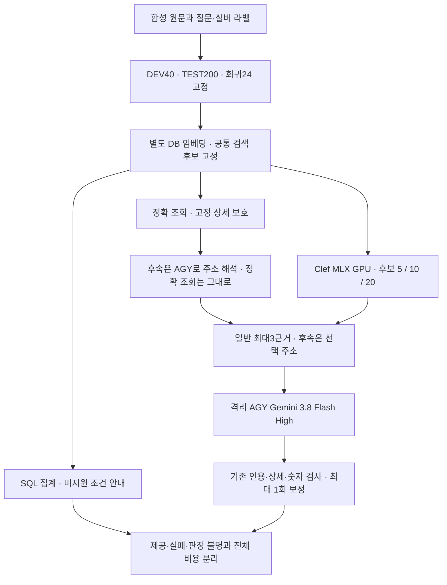

# 질문 유형 확대와 임시 AGY 답변 모델 평가

기준: 2026-10-14 KST. 운영 적용이 아닌 별도 합성 실험이다. 사용자가 `gemini-3.8-flash-high`의 임시 사용을 승인했다.

이전 후보 수 비교는 24문항의 좁은 질문군이었다. 이번에는 서로 다른 업무 요청 유형을 늘리고, 실패·근거 없음·미지원 기능도 분모에서 숨기지 않는다. GPU 재정렬576회·우회216기록과 예정한280답변 흐름·24후속 기록을 모두 보존했다. 마지막 통신 실패로 실행 상태는interrupted/complete=false이며 성공으로 고치지 않았다. 최종 집계일은2026-10-15 KST다. 운영 설정은 교체하지 않았다.

|유형|DEV|신규 TEST|
|---|---:|---:|
|현상에 맞는 실제 조치·결과|4|20|
|운전 조건과 부정 구분|4|20|
|같은 CS의 다른 부품·작업|4|20|
|예정·미실시·완료·재발·결과 미기재|4|20|
|숫자·부호·측정 단위|4|20|
|표현 변형·영어·중국어 원문|4|20|
|답할 근거가 없는 질문|4|20|
|CS 번호의 전체 상세 조회|4|20|
|집계와 미지원 자연어 조건|4|20|
|이전 사례를 가리키는 후속 질문|4|20|
|합계|40|200|

이전 24문항은 별도 회귀 세트다. 264문항을 신규 264문항이라고 발표하지 않는다. 새 자료는 하드웨어 계열별 DEV 4군·TEST 20군으로 묶는다. 한 계열의 10과제를 독립 사건 10개로 세지 않는다. DEV/TEST의 원본 사건과 하드웨어·질문 문구는 분리하지만 공통 규칙으로 만든 합성 자료라는 한계는 남는다. 사람의 독립 라벨이나 현장 정확도는 없다.

## 고정한 비교

- 원문 corpus는 기존 합성 2,038상세와 신규 합성 960상세, 총 2,998상세다. 운영 DB는 열지 않는다.
- 원문을 직접 등록·색인하며 LLM 문장 다듬기나 영어 보완 자료 생성은 실행하지 않는다. 다국어 유형은 원문에 영어·중국어가 있는 직접 검색 조건이다. 운영의 선택적 번역 보완까지 적용한 품질이나 실제 Excel/DRM 처리 성과가 아니다.
- 키워드+벡터의 공통 상위 20건을 먼저 고정하고 Clef 후보 5·10·20건을 비교한다. 일반 답변 근거는 최대3건이며 특정 후속 사례는 선택한 주소에 한정한다. 집계는 답변 모델을 호출하지 않는다. 처음 후보에 정답이 없는 질문도 남긴다.
- 접수번호·코드·날짜 등 실제 코드가 보호하는 정확 조회, 집계와 고정 상세 후속 질문은 기존 경로를 유지한다. 숫자가 포함된 모든 질문을 우회하는 것은 아니다. 보호 경로의 성공을 Clef의 조건 이해로 해석하지 않는다.
- DEV 40문항은 후보 5건에서 답변 경로를 실행한다. TEST는 사전에 고른 유형별 8문항, 총 80문항을 세 구성에서 답변한다. 표본은 모든 TEST 하드웨어 20군에 걸친다. 최대 280답변 시도이며 집계는 원래처럼 LLM을 호출하지 않는다.
- 후속 질문은 고정한 창작 대화·원문 주소를 기존 `resolve_follow_up`으로 해석한다. 24문항을 모두 검사하고 같은 해석 결과를 세 구성에서 공유한다. 역사 자체를 실제 첫 답변 생성으로 만들지는 않았으므로 전체 다중 턴 서비스 검증은 아니다.
- 첫 답변과 최대 1회 보정만 허용한다. 모델·프롬프트·라벨을 TEST 결과에 맞춰 바꾸지 않는다. 상한은 답변 생성 560호출·후속 해석 24호출이며 사전 연결 시험은 별도로 기록한다.

## 구현과 실행 경계

실험 코드: `experiments/agy_cases.py`, `experiments/agy_client.py`, `experiments/agy_clef_worker.py`, `experiments/agy_breadth.py`. 오프라인 검사는 `tests/test_agy_breadth.py`다.

AGY 어댑터는 CLI에서 실제 반환한 모델 ID·구조화 결과·작업 이벤트를 검사한다. `finish`는 결과 포장을 위한 내부 호출로만 허용하고 파일·웹·외부 도구 호출은 결과에서 거절한다. 별도 macOS 샌드박스로 CLI 프로세스의 Documents·CloudStorage·Codex 폴더 읽기를 차단하고, 빈 임시 작업 공간에서 합성 근거만 전달한다. 이 로컬 읽기 검사를 원격 서비스 전체의 격리 인증으로 확대하지 않는다. TEST 정답 표는 전달하지 않는다. 운영의 OpenAI 클라이언트와 개인 설정은 교체하지 않는다.

CLI의 모델·high effort·JSON schema를 고정한다. 현재 인터페이스로 강제할 수 없는 temperature·출력 토큰·문맥 한도를 지원한다고 가장하지 않는다. 후속 질문 함수가 요청하는 토큰 한도도 별도 미매핑 항목으로 기록한다. 전체 CLI wall과 제공자가 보고한 처리 시간을 나누며 내부 시스템 문맥을 포함한 토큰 사용량도 보존한다. 로컬 GPT-OSS와 같은 모델·프롬프트 토큰·배포 장치 조건의 속도 비교가 아니다.

기존 RAG의 역할별 메시지는 CLI 프롬프트 안에 JSON으로 전달한다. 제공자의 원래 system/user 역할 API를 직접 사용한 것은 아니다. 어댑터의 `finish_reason=stop`은 CLI 성공과 구조화 결과 확인으로 만든 연결 계약이며 제공자의 원래 종료 신호가 아니다. CLI 한 번 안의 모델 호출 횟수는 상한으로 통제하지 못하므로, 실행 횟수는 CLI 시도로 표현하고 내부 사용량·처리 시간을 별도로 기록한다.

품질 평가의 GPU 실행은 검증된 8bit Clef MLX 로더를 상주시켜 사용한다. 이는 별도 실험 프로토타입이며 운영의 요청별 모델 적재·교대 시간으로 제시하지 않는다. 적재·순수 계산·GPU 추론 피크·RSS·전체 배치 wall을 나누며 메모리를 중복 합산하지 않는다. AGY 원격 장치 메모리는 알 수 없다.

원래 24시간 납기와 14시간 모델 중단 시각을 유지한다. 2026-10-15 00:17 KST 이후에는 새 모델 실험을 시작하지 않는다. 다른 모델이 나타나거나 메모리 압박이 생기면 이 실험의 GPU 자식만 중단한다. AGY 통신 실패가 반복되면 남은 문항을 미실행으로 남기며 성공할 때까지 무한 재시도하지 않는다.

실행기 검토에서 종료된 GPU 자식의 출력이 남아 있을 때 마지막 결과를 놓칠 수 있는 문제와, 통신 실패 후 재개하면 완료로 표시될 수 있는 문제를 확인했다. EOF까지 출력 보존과 실패 완료 구분의 회귀 검사 2건을 통과했다. 원래 실행 폴더 `outputs/agy-breadth-20261014-173202`는 보존하고, `outputs/agy-breadth-20261014-182700-r2`에서 동일한 자료·후보·모델·프롬프트와 완료한 GPU 125회의 체크포인트를 해시 확인해 재사용했다. 중단·재적재 비용을 포함하며 새 독립 TEST로 세지 않는다.

AGY 최초 180초 제한에서는 첫 DEV 후속 요청이 빈 부분 결과로 끝났다. 단순 연결은 성공했지만 후속 재진단·포장 변경·일반 RAG 진단도 제한 시간 내 완료되지 않았다. 이후 긴 제한의 동일 DEV RAG는 **310.551초·추론 토큰47,013개**로 완료하고 기존 원문 검사를 통과했다. 후속 진단에는 eligibility 확인의 503 오류도 발생했다. 따라서 시간 제한과 외부 서비스 오류를 구분하며 모델 전체가 불가능하다고 단정하지 않는다. 이 진단들은 TEST 답변 성과에 합치지 않는다.

`outputs/agy-breadth-20261014-200000-r3`에서 CLI 상한600초·최대6개 병렬로 이어 실행한다. GPU792기록과 이전 실패·비용은 재사용·보존한다. 새 CLI 호출과 보정 전에 원래 중단 시각을 다시 확인한다. 후속 실패도 결과 행으로 저장하며 다른 유형의 답변을 막지 않는다. 답변 단계의 한 묶음에서 통신 실패가2개 이상이면 남은 요청은 미실행으로 보존한다. 276개의 첫 CLI 호출에 DEV 관측311초·6병렬을 적용한 단순 계산은 약3시간58분이며, 추가 보정·외부 경합이 있으면 원래 예산 안에 완료하지 못할 수 있다.

이 재개 전에 GPU TEST 순위는 이미 확인했다. 운영상 시간·병렬·실패 보존만 조정했고 원문·질문·후보·모델·지시문·스키마·라벨은 바꾸지 않았다. TEST의 AGY 답변 추론 전에 새 실행 조건을 고정했으며 새 독립 순위 평가로 세지 않는다. [r2 부분 결과](experiments/agy-breadth-20261014/report.md)를 보존한다.

CLI 제한은 처리 중인 턴의 부분 결과를 반환할 수 있다. 원격 턴 취소는 이 인터페이스에서 확인하지 못했으므로 CLI 종료가 원격 계산 종료나 전체 과금 비용의 확인을 뜻하지 않는다. 강제 취소·전체 원격 메모리·완전한 원격 비용을 측정했다고 표현하지 않는다.

합성 원문에는 기준일 이후의 가상 날짜와 예정 문구에 과거형 동사가 함께 있는 어색한 상태 표현이 있다. 해당 실버 라벨을 독립적인 의미 정답으로 보지 않으며 물리적·현장·시점 타당성을 주장하지 않는다. 추론 중 자료나 라벨을 고쳐 유리한 결과를 만들지 않는다.

## 분석과 공개

신규 TEST만을 주 평가로 사용하고 DEV·회귀를 별도 표로 낸다. 양성 질문에서 실버 기대 근거의 첫 선택·상위 3개 포함·입력 후보 포함을 계산한다. 같은 입력 후보 내 재정렬 전후 포함 지표 불변을 검사한다. 근거 없음·집계·정확 조회·후속 해석은 유형별 분모를 구분한다. 짝지은 양성 전체에는 정확 조회 우회도 포함하므로 Clef 효과로 합산하지 않고 유형별 표와 함께 읽는다. 변경은 질문별로 짝지어 계산하고 TEST 하드웨어 20군 단위 bootstrap 2,000회(seed 20261014)를 사용한다. 좁은 신뢰구간이나 통계적 동등성을 미리 보장하지 않는다.

답변 제공, 원문 주소·인용·숫자 검사와 제한적인 문자 기반 사실 진단은 서로 다르다. 의역을 자동 오답으로 만들지 않고 `unknown`으로 남긴다. 자동 검사 통과를 의미 정답률로 부르지 않는다. 모든 시도·실패·보정 비용과 미완료를 보존하며 성공한 응답만의 평균으로 전체 속도를 제시하지 않는다.

답변 설정의 `claim_guard_mode`는 모든 구성에서 `off`로 고정했다. 기존 규칙 기반 원문·인용·수치 검사만 적용하며, 선택적 의미 검증 모델을 실행한 성과로 설명하지 않는다.

실행 원문·DB·개인 설정·LLM 요청/응답·가중치·가상환경은 로컬에 둔다. 공개 자료에는 창작 질문·원문과 라벨, 집계·검증 코드·흐름도 및 확인한 한계를 넣는다. 사람 업무 시간 절감, 현장 고장 해결, Windows/120B 성능과 Clef 고유 우위는 이번 결과만으로 주장하지 않는다.

## 최종 산출물

[최종 비교·실패·비용](experiments/agy-breadth-20261014-r3/report.md), [검증 범위](experiments/agy-breadth-20261014-r3/audit.md), [발표 가능한 주장](experiments/agy-breadth-20261014-r3/presentation_evidence.md)을 함께 제공한다. 종료 뒤 모델을 다시 호출하지 않았다. 공개 결과 폴더에서 `python verify_results.py`로 파일 해시·분모·후보·통계를 재계산할 수 있다. TEST80질문의 검사 후 답변 제공61·57·60/80은 의미 정답률이 아니다. 모든 제공 답변의 제한적 문자 진단이unknown이어서 독립적인 최종 의미 품질 우열은 확인하지 못했다. 후속 고정 대상 해석은DEV4/4·TEST18/20이며 실제 연속 대화의 성과가 아니다.
