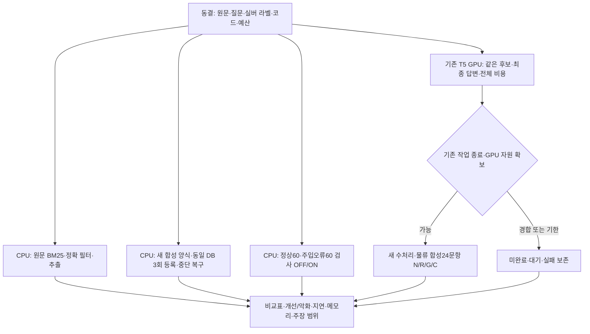

# AI 분과 전체 자동 평가

기준: 2026-10-14 KST · 축소 전 계획 · 사람 참여 없음 · 운영 변경/배포 없음

이 문서는 이전 계획·부분 기록입니다. 사용자 승인으로 v3로 전환했고, [완료 결과](experiments/architecture-v3-20261014/README.md)를 별도로 게시합니다. 아래 원시 산출물은 로컬에만 남아 있으며 GitHub에는 업로드하지 않습니다. 평가 당시의 커밋·푸시 금지와 이후 결과 게시 승인을 구분합니다.

사용자가 제공한 v2 기준(적합성30·확산성40·효과20·적용 독창성10)을 사용합니다. 공개 공지를 별도로 확인한 기준은 아닙니다. 이후 사용자가 사람 참여를 제외했으므로 실제 업무 시간·사용성·실제 타팀 도입은 이번에 평가하지 않습니다.

## 축소 전 실행 기록(로컬 비공개)

- 프로토콜: `outputs/ai-track-v2-20261014-124048-v2/protocol.md`: 비교군·입력·코드 지문·실행 예산·한계.
- 현재 자동 보고서: `outputs/ai-track-v2-20261014-124048-v2/public/report.md`: 진행 중인 수치이며 완료/계획을 함께 표시합니다.
- 주장과 증거: `outputs/ai-track-v2-20261014-124048-v2/claim_evidence_matrix.csv`: 사람·현장·Windows 성과와 기술 대리 지표를 구분합니다.
- 초기 실행 보존: `outputs/ai-track-v2-20261014-122743/report.md`: 비AI 번호 파서의 조사 처리 오류를 발견한 최초 결과. 수정 후 같은 TEST 재평가는 개발 수정이지 새 독립 검증이 아닙니다.
- 기존 T5 결과: `outputs/clef-e1-e3-20261014-105400-v3/README.md`: 기존 E1–E3 조건과 실패를 유지합니다. 기존 사람 평가 자료는 이번 자동 평가에서 사용하지 않습니다.

실험 환경은 기존 격리 런타임을 APFS COW로 별도 복사했습니다. 새 모델·패키지는 설치하지 않았습니다. 모델 실행은 기존 MLX Clef·MPS Qwen·LM Studio Metal 경로를 사용합니다. 새 전이 GPU 시험은 기존 비교의 종료와 모델 해제를 기다리며, 다른 모델·서비스를 종료하지 않습니다.

## 해석 원칙

N은 원문만 사용하는 FTS5/BM25와 필드 필터이며, 번역·임베딩·LLM·학습 형태소 모델·생성 동의어 사전을 쓰지 않습니다. 공식/수동 용어집이 제공되지 않아 사전 보강 비AI 대안은 미평가입니다. 현재 AI 기본 검색이 모든 경우에 더 낫다고 가정하지 않습니다.

자동으로 판정하는 것은 창작 사건의 실버 라벨에 맞는 근거 제공, 인용 셀 일치, 주입한 오류의 차단·오거절, 실제 처리 시간과 메모리입니다. 실제 담당자 업무 성공률·금액 절감·물리적 고장 해결·다른 팀의 도입·Windows/DRM 성능은 확인하지 않습니다. 검사 통과율을 최종 답변 정확도로 부르지 않습니다.

기존 8문항은 회귀로만 유지합니다. 신규 N은 기존 TEST 시작 뒤 추가한 탐색 대조군이며, 추가로 발견한 파서 오류를 수정한 이력도 보존합니다. 현재 결과를 새 독립 현장 검증으로 발표하지 않습니다. 실험이 끝나기 전 부분 완료 군의 비율을 전체 완료 군과 우열 비교하지 않습니다.

3회 운영은 같은 실험 DB·색인·작업 저널을 사용합니다. 세 번째 차수에서 평가기가 만든 등록 프로세스만 종료해 실제 재개를 확인합니다. 백업/복원은 문서에 있는 정지 후 전체 출력/설정 복사 절차의 자동 확인이며 신규 제품 UI가 아닙니다. 임의 양식은 미지원으로 남깁니다.
