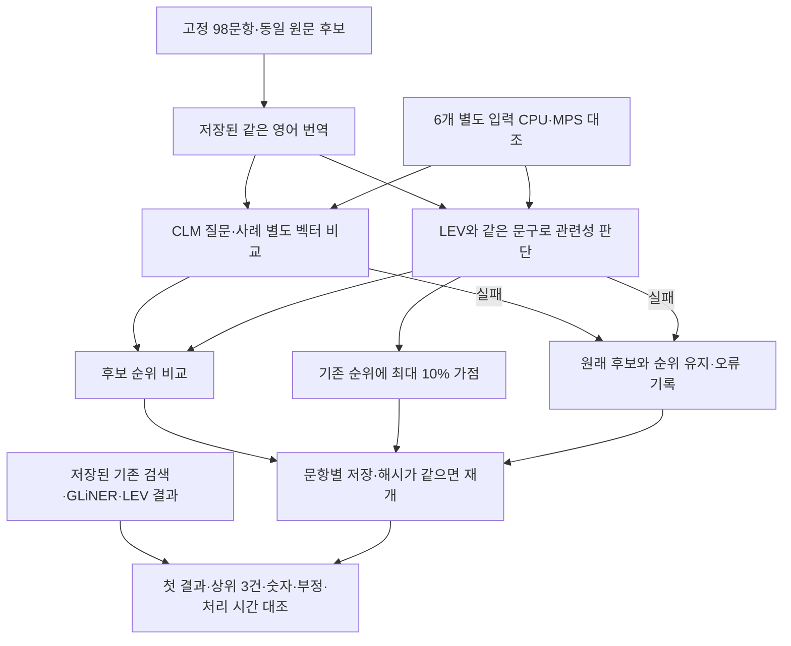

# CLM 검색 후보 비교 실험

2026년 9월 26일 기준. 고정 합성 질문과 저장된 영어 번역을 사용하는 독립 실험입니다. 운영 검색과 연결하지 않습니다.

**비교 준비는 완료했으나 실제 검색 품질·처리 시간 비교는 미완료입니다.** 같은 Mac의 다른 GPU 실험과 메모리가 경합해 첫 워밍업에서 중단했습니다. 모델의 우열이나 운영 도입 여부를 판단할 결과는 아직 없습니다.

## 비교 목적과 조건

CLM은 답변을 작성하는 모델이 아니라 입력 상태와 선택지를 비교하는 모델입니다. 이 실험에서는 기존 검색이 찾아 둔 후보의 순서만 비교합니다. 원문 셀과 인용 근거는 그대로 유지하며, 원래 후보에 없는 정답을 새로 찾지는 못합니다.

- 같은 기존 질문 50개와 조건 16개를 한국어·영어·중국어로 표현한 48문항을 사용합니다. 조건 질문은 서로 상관된 합성 표본이며, 실제 업무의 새 평가 자료가 아닙니다.
- GLiNER·LEV에서 사용한 영어 번역을 그대로 전달합니다. 알려진 번역의 의미 오류도 수정하지 않아 번역 변경 효과가 섞이지 않도록 합니다.
- **후보 직접 비교:** 질문을 state, 각 사례를 action으로 전달하는 공식 CLM 방식입니다. 질문과 사례를 따로 계산할 수 있지만 후보 집합에 대한 상대 확률이므로 근거 없음 판정에는 사용하지 않습니다.
- **관련성 판단:** LEV와 같은 질문·사례 문자열, 같은 `related`·`unrelated` 설명을 전달합니다. 직접 정렬과 기존 순위에 최대 10% 가점만 주는 방식을 함께 비교합니다. 0.5 임계값은 오류 진단용이며 후보를 삭제하지 않습니다.
- 정확 검색·빈 결과는 그대로 두고, 길이 초과나 잘못된 분포는 원래 순위로 복구해 실패를 기록합니다. 같은 문장이어도 서로 다른 원문 문서는 유지합니다.



## 실제 실행 환경과 해석 범위

| 항목 | 값 |
| --- | --- |
| 장비 | Apple M2 Max, 통합 메모리 32GB |
| CLM 공식 코드 | `bb42c6c5bf914fd449bed2f6ca65be80602cb1f7` |
| 기반 모델 | `Qwen/Qwen3-8B`, `b968826d9c46dd6066d109eabc6255188de91218` |
| 비교 모듈 | `Contrastive-LM/CLM-v0.1-8B`, `e939398d4556fcd9400c76fa8c5a513202f42b0a` |
| 계산 | 기반 모델 bfloat16, 마지막 토큰 4096차원 벡터, float32 L2 정규화, 공식 비교 모듈 |
| 실행 | Transformers SDPA·PyTorch MPS, 입력 1개씩, CPU 4스레드 |
| 길이 | 2048토큰 초과 시 자르지 않고 오류 처리 |
| Python / PyTorch / Transformers | 3.12.14 / 2.14.0 / 5.17.0 |
| Accelerate / NumPy | 1.15.0 / 2.5.3 |

공식 CLM의 비교 모듈과 점수 계산 코드를 사용하고, 임베딩 서버 호출 부분만 로컬 Transformers 실행으로 바꿉니다. 공식 vLLM 서버와의 수치 동등성까지 확인한 결과는 아닙니다. 생성용 출력층은 이 계산에 필요하지 않습니다. 다른 임베딩 모델이나 양자화된 가중치로 바꾸지 않았습니다.

같은 Mac에서 다른 프로젝트의 장시간 GPU 실험이 진행 중입니다. 모델 전체를 GPU에 두는 예비 실행은 메모리 압박 때문에 첫 입력의 워밍업 중 중단했습니다. 가중치를 필요한 부분만 GPU로 옮기는 방식과 각 층의 실행을 동기화해 해제하는 방식도 시도했으나, 첫 워밍업을 마치지 못했습니다. 스택 표본에서 Metal 메모리 복사·완료 대기가 확인됐습니다. 다른 작업을 중지하지 않았으며 CLM 실행만 종료했습니다. 성공을 확인하지 못한 메모리 절약 코드는 최종 비교 코드에서 제외하고 시도 기록을 `outputs/clm-20260926/`에 보관했습니다.

현재 상태에서 앞선 LEV·GLiNER와 속도를 비교하면 동시 작업과 메모리 경합의 영향이 섞입니다. 다른 큰 모델이 GPU를 사용하지 않는 시점에 새 결과 폴더로 실행해야 합니다. CPU·GPU의 6입력 대조와 98문항 전체 결과가 완료돼야 품질을 비교할 수 있습니다.

전체 입력을 미리 검사한 결과, 실제 비교 대상은 92문항·976개의 질문–후보 쌍입니다. 나머지 6문항은 정확 검색 또는 빈 결과를 보존합니다. 공식 스키마를 적용한 인코더 입력은 최대 182토큰이며, 특수 토큰 추가 여부는 이 입력들에서 같은 토큰열을 만들었습니다. 이는 입력 검증 결과이며 검색 품질 측정 결과가 아닙니다.

## 재현과 결과 보관

실험 코드: `experiments/clm_rerank.py`. 운영 설치 파일에는 CLM이나 vLLM 의존성을 추가하지 않습니다. 기존 별도 LEV 실험 환경의 설치된 PyTorch·Transformers·Accelerate를 재사용합니다.

```sh
.venv/bin/python -m tests.test_clm_rerank
PYTORCH_ENABLE_MPS_FALLBACK=0 HF_HUB_OFFLINE=1 \
  TORCH_FORCE_WEIGHTS_ONLY_LOAD=1 \
  outputs/lev-20260926/.venv/bin/python -m experiments.clm_rerank \
  --output outputs/clm-20260926/resident
```

모델 다운로드 파일은 Hugging Face의 고정 revision과 SHA-256 또는 Git blob 해시로 대조합니다. 공식 코드, 모델, Python 패키지 버전은 `outputs/clm-20260926/model-verification.json`에 기록합니다. 원문 후보·영어 번역·이전 결과·실험 코드의 해시가 달라지면 기존 결과에 이어 쓰지 않습니다.

`protocol.json`은 고정 조건, `device-probe.json`은 CPU·GPU 비교, `results.json`은 문항별 결과입니다. `complete: true`와 전체 문항 수·실패 수를 확인한 뒤에만 완료로 해석합니다. 같은 질문·사례의 벡터를 모두 재사용한 시간은 `warm_seconds`로 별도 기록하며 새 질문의 응답 시간으로 해석하지 않습니다. 모델·결과·로그는 `outputs/`에 보관하고 Git에는 포함하지 않습니다.

새 PC에는 이 저장소만으로 실험 모델과 고정 후보가 생기지 않습니다. 같은 합성 후보·번역·이전 실험 결과와 검증된 모델 파일을 함께 준비해야 합니다. 실제 Excel, 운영 DB, 사용자 설정, 인증 정보는 실험 입력으로 사용하지 않습니다.

## 공식 근거

- [CLM 공식 코드](https://github.com/Contrastive-LM/CLM/tree/bb42c6c5bf914fd449bed2f6ca65be80602cb1f7): 상태·선택지 분리 계산, 공식 head와 typed choice API.
- [CLM 모델 카드](https://huggingface.co/Contrastive-LM/CLM-v0.1-8B/tree/e939398d4556fcd9400c76fa8c5a513202f42b0a): Qwen3-8B와 마지막 토큰 pooling 조건, 후보 상대 확률, 공개 기본 모델과 별도 학습 결과의 구분.
- [vLLM pooling 설명](https://docs.vllm.ai/en/stable/models/pooling_models/): 마지막 토큰 pooling과 정규화의 기본 동작.
