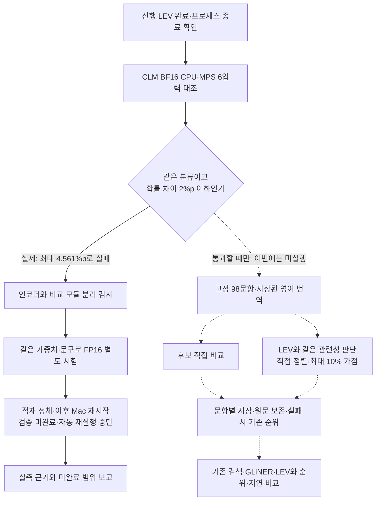

# CLM 검색 후보 비교 실험

2026년 9월 26일 22:26 KST 기준. 고정 합성 질문과 저장된 영어 번역을 사용하는 독립 실험입니다. 운영 검색과 연결하지 않습니다.

**BF16의 CPU·GPU 대조가 허용치를 초과해 전체 비교를 중단했습니다.** 별도 FP16 시험도 적재 단계에서 완료되지 않았고, 마지막 시도 중 Mac이 재시작됐습니다. 자동 재실행을 중단했습니다. 98문항의 검색 품질·처리 시간 결과는 없으므로 모델의 우열을 판단하거나 운영에 도입하지 않습니다.

선행 작업은 다른 프로젝트의 LEV 평가입니다. `job-status.json`, `results-mps.json`, 4,406줄의 `predictions.jsonl`, 완료 로그와 프로세스 종료를 대조했습니다. 22:02 KST에 4,406건 모두 처리됐고 오류·누락은 0건이었습니다. 이 선행 평가와 다른 프로젝트의 금융 CLM 결과를 아래 RAG 비교 자료에 섞지 않았습니다.

## 비교 목적과 조건

CLM은 답변을 작성하는 모델이 아니라 입력 상태와 선택지를 비교하는 모델입니다. 이 실험에서는 기존 검색이 찾아 둔 후보의 순서만 비교합니다. 원문 셀과 인용 근거는 그대로 유지하며, 원래 후보에 없는 정답을 새로 찾지는 못합니다.

- 같은 기존 질문 50개와 조건 16개를 한국어·영어·중국어로 표현한 48문항을 사용합니다. 조건 질문은 서로 상관된 합성 표본이며, 실제 업무의 새 평가 자료가 아닙니다.
- GLiNER·LEV에서 사용한 영어 번역을 그대로 전달합니다. 알려진 번역의 의미 오류도 수정하지 않아 번역 변경 효과가 섞이지 않도록 합니다.
- **후보 직접 비교:** 질문을 state, 각 사례를 action으로 전달하는 공식 CLM 방식입니다. 질문과 사례를 따로 계산할 수 있지만 후보 집합에 대한 상대 확률이므로 근거 없음 판정에는 사용하지 않습니다.
- **관련성 판단:** LEV와 같은 질문·사례 문자열, 같은 `related`·`unrelated` 설명을 전달합니다. 직접 정렬과 기존 순위에 최대 10% 가점만 주는 방식을 함께 비교합니다. 0.5 임계값은 오류 진단용이며 후보를 삭제하지 않습니다.
- 정확 검색·빈 결과는 그대로 두고, 길이 초과나 잘못된 분포는 원래 순위로 복구해 실패를 기록합니다. 같은 문장이어도 서로 다른 원문 문서는 유지합니다.



점선은 장치 검사를 통과한 뒤 실행할 예정이었던 단계입니다. 이번 실행에서는 진입하지 않았습니다.

## 실제 실행 환경과 해석 범위

| 항목 | 값 |
| --- | --- |
| 장비 | Apple M2 Max, 통합 메모리 32GB |
| CLM 공식 코드 | `bb42c6c5bf914fd449bed2f6ca65be80602cb1f7` |
| 기반 모델 | `Qwen/Qwen3-8B`, `b968826d9c46dd6066d109eabc6255188de91218` |
| 비교 모듈 | `Contrastive-LM/CLM-v0.1-8B`, `e939398d4556fcd9400c76fa8c5a513202f42b0a` |
| 계산 | BF16 실제 장치 검사, FP16 별도 시험은 미완료; 마지막 토큰 4096차원 벡터, float32 L2 정규화·비교 모듈 |
| 실행 | Transformers SDPA·PyTorch MPS, 입력 1개씩, CPU 4스레드 |
| 길이 | 2048토큰 초과 시 자르지 않고 오류 처리 |
| Python / PyTorch / Transformers | 3.12.14 / 2.14.0 / 5.17.0 |
| Accelerate / NumPy | 1.15.0 / 2.5.3 |

공식 CLM의 비교 모듈과 점수 계산 코드를 사용하고, 임베딩 서버 호출 부분만 로컬 Transformers 실행으로 바꿉니다. 공식 vLLM 서버와의 수치 동등성까지 확인한 결과는 아닙니다. 생성용 출력층은 이 계산에 필요하지 않습니다. 다른 임베딩 모델이나 양자화된 가중치로 바꾸지 않았습니다.

### BF16 장치 대조: 검사 완료, 기준 통과 실패

선행 GPU 프로세스가 종료되고 LM Studio에 로드된 모델이 없음을 확인한 뒤 `resident/`에서 실행했습니다. 여섯 예비 입력은 잡음·부정, 7.2와 72 L/min, 느린 가열, 의심과 확정의 차이를 포함합니다. 전체 평가의 정답을 사용해 프롬프트나 기준을 조정하지 않았습니다.

| 항목 | 실측 결과 |
| --- | --- |
| CPU·MPS가 선택한 분류 | 6/6 일치, 모두 `related` |
| 관련 확률 최대 차이 | 0.0456092562 = **4.561%p** |
| 사전 허용치 | 0.02 = **2%p**, 완화하지 않음 |
| GPU 평균 / CPU 평균 | 0.506초 / 9.210초, 각 6입력·워밍업 제외 |
| 최종 판단 | 장치 대조 실패, 98문항 전체 비교 미실행 |

`device-probe.json`의 `complete: true`는 여섯 입력의 검사가 끝났다는 뜻입니다. `same_labels`와 확률 차이 조건까지 충족해야 통과입니다. 위 시간은 예비 입력의 실행 시간일 뿐이며, 수치 동등성 실패 상태에서 검색 속도 개선 근거로 쓰지 않습니다.

부정과 숫자 조건을 놓칠 가능성도 보였습니다. GPU의 관련 확률은 “펌프 소음”과 “비정상 소음 없이 조용한 펌프”의 조합에서 약 0.731, “정확히 7.2 L/min”과 “72 L/min”에서 약 0.630이었습니다. 예비 관찰이며 98문항 정답률이나 보정된 신뢰도로 해석하지 않습니다.

### 차이가 발생하는 단계 분리

CPU와 GPU에서 만든 동일 입력의 벡터를 저장하고, **같은 벡터를** CPU·GPU의 비교 모듈에 각각 넣었습니다. 비교 모듈만 바꾸면 확률 차이는 최대 약 0.000003114였습니다. 비교 모듈을 CPU로 고정하고 인코더 벡터를 바꾸면 최대 약 0.045612 차이가 났습니다. 따라서 이 여섯 입력에서 관측된 차이는 주로 BF16 인코더 계산에서 발생했습니다.

벡터 사이의 코사인 유사도는 최솟값도 약 0.999941로 높았지만 최종 판단 확률까지 충분히 같지는 않았습니다. 벡터 유사도만으로 장치 동등성을 대신 판정하지 않았습니다. 근거는 `device-diagnostic/results.json`과 저장된 CPU·MPS 벡터입니다.

### 적재 실패와 시스템 재시작

| 시도 폴더 | 확인한 결과 |
| --- | --- |
| 루트, `offload/`, `offload-sync/` | 선행 LEV 실행 중 메모리 경합으로 첫 워밍업 미완료. 기록 보존 |
| `resident/` | 선행 LEV 완료 후 BF16 실제 실행. CPU·MPS 대조 실패 |
| `resident-fp16/` | 같은 가중치의 FP16 적재가 6분 이상 진행되지 않아 해당 CLM 프로세스만 종료 |
| `resident-fp16-sync/` | 설치된 Transformers의 순차 적재 옵션 사용. 적재 중 Mac 재시작, 장치 검사·전체 결과 없음 |

FP16 병렬 적재의 스택은 MPS 형 변환 작업에서 머물렀습니다. 작은 텐서만 복사하는 별도 검사에서는 병렬·순차 모두 성공했으므로, 작은 복사 검사로 모델 적재 문제가 해결됐다고 판단하지 않았습니다. 순차 시험은 설치된 `HF_DEACTIVATE_ASYNC_LOAD=1` 옵션을 사용했으며, 모델·문구·2%p 허용치는 바꾸지 않았습니다.

Mac은 22:21 KST에 재시작됐습니다. 22:22 KST에 생성된 시스템 panic 보고서에는 **`watchdogd` 90초 무응답**이 기록돼 있습니다. CLM 적재와 같은 시간대에 발생했지만 이 기록만으로 직접 인과관계를 확정할 수 없습니다. FP16은 CPU·GPU 검사를 완료하지 못했고 결과 파일도 없습니다. 성공하지 못한 FP16·적재 변경은 기본 실험 코드에 반영하지 않고 각 시도 폴더의 `runner-attempt.py`와 프로토콜에 보관했습니다.

전체 비교의 실패 수·누락 수를 0으로 보고하지 않습니다. 예정된 98문항 모두 CLM 평가 단계에 도달하지 않았으며, 이전 GLiNER·LEV 결과는 보존했습니다. 자동 모델 재실행은 중단했습니다.

전체 입력을 미리 검사한 결과, **예정 비교 대상**은 92문항·976개의 질문–후보 쌍입니다. 나머지 6문항은 정확 검색 또는 빈 결과를 보존하도록 준비했습니다. 공식 스키마를 적용한 인코더 입력은 최대 182토큰이며, 특수 토큰 추가 여부는 이 입력들에서 같은 토큰열을 만들었습니다. 이는 입력 검증 결과이며 검색 품질 측정 결과가 아닙니다.

## 검증과 결과 보관

실험 코드: `experiments/clm_rerank.py`. 운영 설치 파일에는 CLM이나 vLLM 의존성을 추가하지 않습니다. 기존 별도 LEV 실험 환경의 설치된 PyTorch·Transformers·Accelerate를 재사용합니다.

```sh
.venv/bin/python -m tests.test_clm_rerank
git diff --check
```

위 명령은 모델을 다시 실행하지 않는 코드 검사입니다. 장치 검사 실패와 재시작을 확인했으므로 동일 조건의 모델 자동 재실행 명령을 권장하지 않습니다. 각 시도의 정확한 실행 조건은 `protocol.json`, `launcher.json`, 보관한 소스에 남겼습니다. 다른 실행 환경이나 계산 경로의 시험은 별도 조건으로 먼저 검토해야 합니다.

모델 다운로드 파일은 Hugging Face의 고정 revision과 SHA-256 또는 Git blob 해시로 대조합니다. 공식 코드, 모델, Python 패키지 버전은 `outputs/clm-20260926/model-verification.json`에 기록합니다. 원문 후보·영어 번역·이전 결과·실험 코드의 해시가 달라지면 기존 결과에 이어 쓰지 않습니다.

`protocol.json`은 고정 조건, `device-probe.json`은 CPU·GPU 비교입니다. `results.json`이 완성되면 전체 문항 수·실패·누락·원문 기반 지표를 대조해야 하지만 **이번에는 해당 파일이 없습니다**. 따라서 전체 순위 검증기 `verify_results.py`도 실행할 대상이 없습니다. 대신 저장된 예비 확률로 장치 차이와 평균 시간을 다시 계산하고 입력·코드 해시 및 중단 상태를 대조했습니다. 모델·결과·로그·시도 소스는 `outputs/`에 보관하고 Git에 포함하지 않습니다.

핵심 근거는 `resident/device-probe.json`, `device-diagnostic/results.json`, 두 FP16 폴더의 `interruption.json`, 루트 `status.json`입니다. 시스템 panic 원문은 Git에 복사하지 않고 파일명·해시·관련 오류와 인과관계의 한계만 로컬 중단 기록에 남겼습니다. 운영 DB·UI·프롬프트·학습 설정은 변경하지 않았습니다.

새 PC에는 이 저장소만으로 실험 모델과 고정 후보가 생기지 않습니다. 같은 합성 후보·번역·이전 실험 결과와 검증된 모델 파일을 함께 준비해야 합니다. 실제 Excel, 운영 DB, 사용자 설정, 인증 정보는 실험 입력으로 사용하지 않습니다.

## 공식 근거

- [CLM 공식 코드](https://github.com/Contrastive-LM/CLM/tree/bb42c6c5bf914fd449bed2f6ca65be80602cb1f7): 상태·선택지 분리 계산, 공식 head와 typed choice API.
- [CLM 모델 카드](https://huggingface.co/Contrastive-LM/CLM-v0.1-8B/tree/e939398d4556fcd9400c76fa8c5a513202f42b0a): Qwen3-8B와 마지막 토큰 pooling 조건, 후보 상대 확률, 공개 기본 모델과 별도 학습 결과의 구분.
- [vLLM pooling 설명](https://docs.vllm.ai/en/stable/models/pooling_models/): 마지막 토큰 pooling과 정규화의 기본 동작.
