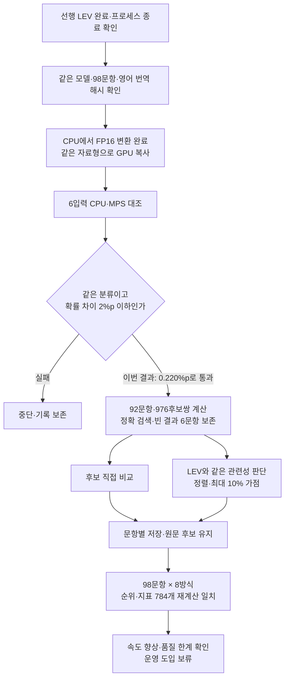

# CLM 검색 후보 비교 실험

2026년 9월 27일 기준. 9월 26일 중단 기록을 보존하고, 9월 27일 17:34~17:41 KST에 완료한 비교를 추가했습니다. 운영 검색과 분리된 독립 실험입니다.

**CPU·GPU 계산 일치 검사를 통과하고 고정 합성 98문항의 비교를 완료했습니다. CLM은 이번 실행에서 LEV보다 빨랐지만 검색 품질과 근거 부족 판정이 떨어져 운영 도입을 보류합니다.** 실행 오류가 없다는 것과 올바른 사례를 고른다는 것은 서로 다른 결과입니다.

## 검색 품질 결과

같은 기존 질문 50개와 조건 16개를 한국어·영어·중국어로 표현한 48문항을 사용했습니다. 기존 질문 중 정답이 있는 것은 44개, 조건 질문 중 정답이 있는 것은 36개입니다. 아래 첫 결과·상위 3건 수치는 이 정답 질문만 셉니다. 기존 상위 5건 평균 적합성은 정답 없는 질문도 포함한 50개 전체의 평균입니다.

| 방식 | 기존 첫 결과 /44 | 기존 상위 3건 정답 포함 /44 | 기존 상위 5건 평균 적합성 | 조건 첫 결과 /36 |
| --- | ---: | ---: | ---: | ---: |
| 기존 검색 | 40 | 44 | 72.0% | 18 |
| 영어 GLiNER 직접 정렬 | 41 | 42 | 83.6% | 28 |
| 영어 GLiNER 최대 10% 가점 | 41 | 44 | 72.4% | 24 |
| LEV 직접 정렬 | 44 | 44 | 88.0% | 36 |
| LEV 최대 10% 가점 | 42 | 44 | 77.6% | 35 |
| CLM 후보 직접 비교 | 35 | 35 | 71.2% | 20 |
| CLM 관련성 정렬 | 41 | 41 | 81.2% | 31 |
| CLM 관련성 최대 10% 가점 | 40 | 44 | 72.0% | 18 |

CLM 관련성 정렬은 기존 검색의 오답 4개를 개선했지만 정답 3개를 새로 놓쳤습니다. 기존에 상위 3건 안에 있던 정답도 3문항에서 밖으로 밀렸습니다. 후보 직접 비교는 기존 정답 8개를 악화시키고 오답 3개를 개선했습니다. 가점 방식은 위 품질 지표에서 기존 검색과 같았습니다. 하위 후보의 순서까지 모두 같다는 뜻은 아닙니다.

조건 질문의 언어별 첫 결과는 후보 직접 비교가 한국어 7/12·영어 7/12·중국어 6/12, 관련성 정렬이 10/12·11/12·10/12였습니다. 입력은 모두 이전에 저장한 영어 번역으로 전달했습니다. 같은 조건의 세 언어 표현은 서로 상관된 표본이며, 98문항은 이미 여러 실험에서 사용한 합성 자료입니다. **실제 업무 정확도나 독립된 새 평가 결과로 해석하지 않습니다.**

## 비교 목적과 고정 조건

CLM은 이 실험에서 답변을 작성하지 않고 기존 검색이 찾아 둔 후보의 순서만 정합니다. 원래 후보에 없는 정답을 새로 찾을 수 없으며, 채점과 인용 근거는 원문 셀을 기준으로 합니다.

- **후보 직접 비교:** 질문을 state, 각 사례를 action으로 전달하는 공식 CLM 방식입니다. 확률은 후보 집합 안에서의 상대값이므로 근거 없음 판정에는 사용하지 않습니다.
- **관련성 판단:** LEV와 같은 질문·사례 문자열, 같은 `related`·`unrelated` 설명을 전달합니다. 점수순 정렬과 기존 순위에 최대 10% 가점을 주는 방식을 비교합니다. 0.5 임계값은 오류 진단용이며 후보를 삭제하지 않습니다.
- GLiNER·LEV에 사용한 영어 번역과 원문 후보를 그대로 사용했습니다. 알려진 의미 오류도 수정하지 않아 번역 변경 효과가 섞이지 않게 했습니다.
- 정확 검색·빈 결과는 보존합니다. 같은 문장의 서로 다른 문서도 유지하며, 입력 길이 초과나 잘못된 분포는 원래 순위로 복구하고 실행 실패를 기록합니다.
- 모델 학습, 평가 정답에 맞춘 프롬프트·임계값 변경, 운영 DB·설정 변경과 자동 모델 채택은 하지 않았습니다.



선행 작업인 다른 프로젝트의 LEV 4,406건은 9월 26일 22:02 KST에 오류·누락 없이 완료됐고 해당 프로세스가 종료됐습니다. 상태·결과·예측 4,406줄·완료 로그를 대조했습니다. 이 선행 평가와 다른 프로젝트의 금융 CLM 결과는 위 RAG 비교에 포함하지 않았습니다.

## 숫자·부정·근거 부족 오류

관련성 판단은 평가한 **976개 질문–후보 쌍 모두에 0.5 이상의 점수**를 줬습니다. 원문 기준 부적합 후보도 기존 질문 240/240개, 조건 질문 60/60개 모두 이 기준을 넘었습니다. 따라서 이 설정의 점수를 곧바로 신뢰도나 자동 채택 기준으로 사용할 수 없습니다.

| 원문 조건과 후보 | 관련성 점수 | 확인한 문제 |
| --- | ---: | --- |
| 정확히 11.8 L/min 요청 → 1.18 / 118 L/min 기록 | 0.797 / 0.783 | 숫자 불일치를 거절하지 못함 |
| 누수 확정 요청 → 누수 의심 / 점검 예정 | 0.750 / 0.728 | 미확인을 확정 근거와 구분하지 못함 |
| 승온 지연 없이 온도 초과 → 느린 승온 / 실제 온도 초과 | 0.798 / 0.794 | 부정·방향 조건과 반대인 사례를 먼저 선택 |
| 고속 이송 위치 오차 → 실제 스테이지 오차 / 밸브·위치 센서 오류 | 0.861 / 0.867 | 단어가 비슷한 다른 문제를 먼저 선택 |

근거가 없는 기존 질문 중 모델이 실제 판단한 3개, 조건 질문 12개 모두 거절하지 못했습니다. 빈 결과 3개는 모델을 호출하지 않았으므로 이 분모에서 제외합니다. 반대로 정답 있는 질문을 0.5 미만으로 잘못 거절한 경우는 0건입니다. 이는 적절히 구분했다는 뜻이 아니라 모든 후보에 높은 점수를 준 결과입니다.

후보 직접 비교도 전원 차단 시 Z축 하강 질문에서 “전원 차단 시 위치 유지·이송 중 진동”을 먼저 골랐습니다. 벤트 조건의 세 언어 문항은 두 CLM 정렬 방식 모두 오답이었습니다. 다만 `vent-ko`의 저장 번역은 “배기는 정상”을 “The vent is normal”로 바꾼 오류를 포함합니다. 동일한 번역을 사용한 모델 비교라는 범위 안에서 해석하며, 번역 영향을 모델 자체의 오류와 단정적으로 분리하지 않습니다.

## 실제 처리 시간

문항마다 각 방식의 문장 벡터 캐시를 비웠습니다. 모델은 GPU에 준비된 상태이며, 같은 문항 안의 동일 영어 문장은 재사용합니다. 모델 준비·CPU 대조·새 질문 번역·검색·답변 생성은 아래 시간에서 제외합니다.

| 방식 | 기존 모델 호출 44문항 평균 / 95백분위 | 조건 48문항 평균 / 95백분위 |
| --- | ---: | ---: |
| CLM 후보 직접 비교 | 2.214초 / 5.547초 | 0.484초 / 0.542초 |
| CLM 관련성 판단 | 3.479초 / 8.220초 | 0.770초 / 0.832초 |
| 이전 LEV 관련성 판단 | 49.373초 / 111.722초 | 11.318초 / 11.909초 |

CLM 두 방식의 판단 시간 합계는 각각 120.652초, 190.037초입니다. 모델 적재는 37.033초였고, 이번 실행의 시작부터 프로세스 종료 확인까지는 약 431초(7.2분)였습니다. 모델 파일은 이미 준비돼 있었으며 다운로드·앞선 실패 시도는 이 시간에 포함하지 않습니다. 비교는 같은 Mac·후보·영어 입력을 사용했지만 모델 구조와 재사용 방식이 다르므로 순수한 하드웨어 가속 배율이나 전체 서비스 응답 시간으로 해석하지 않습니다.

후보 직접 비교를 **완전히 같은 입력·벡터 캐시로 바로 반복**하면 평균 0.0020초와 0.0017초였습니다. 새 질문이나 새로운 후보를 처리하는 시간은 아닙니다. 이 반복은 순위·점수 동일성을 확인하기 위한 보조 측정이며 대표 속도로 사용하지 않습니다.

## 장치 검증과 적재 개선

이전 FP16 시도는 GPU로 옮기면서 자료형도 바꾸는 적재 단계에서 진행되지 않았습니다. 이번에는 설치된 Transformers의 순차 적재를 사용하고, **CPU에서 FP16 변환을 마친 뒤 같은 자료형으로 MPS에 복사**했습니다. 먼저 실제 가중치 일부의 복사 전후 값과 유한한 계산 결과를 확인한 뒤 전체 모델로 진행했습니다. 이 경로가 이번에 동작했다는 근거이며, 이전 Mac 재시작 원인을 확정한 것은 아닙니다.

| 6입력 CPU·GPU 대조 | 9월 26일 BF16 | 9월 27일 FP16·CPU 변환 후 복사 |
| --- | ---: | ---: |
| 선택한 분류 일치 | 6/6 | 6/6 |
| 관련 확률 최대 차이 | 4.561%p | **0.220%p** |
| 고정 허용치 | 2%p | **2%p 유지** |
| GPU 평균 / CPU 평균 | 0.506초 / 9.210초 | 0.441초 / 6.291초 |
| 판단 | 실패, 전체 비교 중단 | 통과, 전체 비교 완료 |

FP16의 실제 최대 차이는 `0.002195287387082301`이며 허용치는 `0.02`입니다. GPU 예비 워밍업은 4.328초, CPU는 14.039초였습니다. 여섯 입력의 선택은 모두 `related`로 같았습니다. **장치 일치는 정답률 검사가 아닙니다.** `complete: true`뿐 아니라 같은 분류와 확률 차이 조건을 함께 확인했습니다. 이 여섯 입력의 결과가 모든 입력에서의 CPU·GPU 동등성을 보증하지는 않습니다.

| 실행 환경 | 값 |
| --- | --- |
| 장비 | Apple M2 Max, 통합 메모리 32GB |
| CLM 공식 코드 | `bb42c6c5bf914fd449bed2f6ca65be80602cb1f7` |
| 기반 모델 | `Qwen/Qwen3-8B`, revision `b968826d9c46dd6066d109eabc6255188de91218` |
| 비교 모듈 | `Contrastive-LM/CLM-v0.1-8B`, revision `e939398d4556fcd9400c76fa8c5a513202f42b0a` |
| 계산 | FP16 인코더, 마지막 토큰 4096차원 벡터, float32 L2 정규화·비교 모듈 |
| 실행 | Transformers SDPA·PyTorch MPS, 입력 1개씩, CPU 4스레드, CPU fallback 비활성화 |
| 길이 | 2048토큰 초과 시 자르지 않고 오류 처리; 실제 최대 182토큰 |
| Python / PyTorch / Transformers | 3.12.14 / 2.14.0 / 5.17.0 |
| Accelerate / NumPy | 1.15.0 / 2.5.3 |

공식 CLM의 비교 모듈·확률·스키마 코드를 사용하고 임베딩 서버 호출만 로컬 Transformers 실행으로 바꿨습니다. 공식 vLLM 서버와의 수치 동등성은 확인하지 않았습니다. 모델·토크나이저·공식 코드 파일 26개의 해시와 실행 패키지 버전을 확인했습니다. 양자화하거나 다른 기반 모델로 바꾸지 않았습니다. CLI의 기존 BF16 기본값은 유지하고 이번 실행에만 `--encoder-dtype float16`을 명시했습니다.

워밍업 뒤 MPS 텐서 할당은 14.20GiB, 드라이버 할당은 14.23GiB였습니다. 둘은 더해서 사용하는 수치가 아니며 시스템 전체 메모리 사용량도 아닙니다. 실행 중 메모리 압박과 로그 정체를 감시했으며 자동 중단·재시작 없이 종료 코드 0으로 끝났습니다. Python과 잠자기 방지 프로세스의 종료도 확인했습니다.

## 이전 중단 기록 보존

아래 결과는 9월 26일 시도이며 이번 성공 결과로 덮어쓰지 않았습니다.

| 시도 폴더 (`outputs/clm-20260926/` 아래) | 확인한 결과 |
| --- | --- |
| 루트, `offload/`, `offload-sync/` | 선행 LEV 실행 중 메모리 경합으로 첫 워밍업 미완료 |
| `resident/` | 선행 LEV 완료 후 BF16 실행. 확률 차이 4.561%p로 장치 대조 실패 |
| `device-diagnostic/` | 동일 벡터의 비교 모듈 차이 약 0.000003114, 같은 CPU 모듈에 넣은 인코더 벡터 차이 약 0.045612 |
| `resident-fp16/` | FP16 직접 GPU 적재가 6분 이상 진행되지 않아 해당 프로세스만 종료 |
| `resident-fp16-sync/` | 순차 직접 GPU 적재 중 Mac 재시작. 장치 검사·전체 결과 없음 |

BF16의 벡터 코사인 유사도는 최솟값 약 0.999941이었으나 최종 확률 차이는 허용치를 넘었습니다. 따라서 벡터 유사도로 최종 판단의 일치 여부를 대신하지 않았습니다. FP16 직접 적재의 스택은 MPS 형 변환 작업에서 머물렀습니다. 22:21 KST 재시작 후 panic 기록에는 `watchdogd` 90초 무응답이 있으나 CLM과의 직접 인과관계는 확인되지 않았습니다. 자동 반복을 중단한 후 사용자의 후속 진행 지시에 따라 별도 경로를 검사했습니다. 각 시도의 로그·프로토콜·소스를 유지합니다.

## 완료한 검증과 재현

- 전체 98문항 × 8방식의 **784개 순위·지표**를 원문 후보로 다시 계산해 저장값과 대조했습니다. 기존 검색·GLiNER·LEV의 5개 방식 결과와 후보 집합도 그대로 유지됐습니다.
- 두 CLM 방식 각각 92문항·976후보쌍을 계산했습니다. 정확 검색 3문항과 빈 결과 3문항은 보존했습니다. **실행 실패·길이 초과·복구 0건, 누락 0건**이며, 검색 품질 오류는 앞 절에 별도로 보고했습니다.
- 언어별 집계, 점수순 정렬, 동점의 원래 순서, 가점 계산, 상대 확률 합계와 근거 부족 진단을 대조했습니다. 마지막에 입력·이전 결과·실험 소스 해시 10개를 다시 확인했습니다.
- 모의 검사는 잘못된 확률 분포·번역 누락 시 기존 순위 복구, 중복 문서·원문 보존, 정확 검색 우회를 확인합니다. 실제 GPU 평가는 별도로 위 결과를 만들었습니다. 운영 코드·Windows 배포본은 변경하지 않았으며 Windows 실기기·실제 업무 자료·전체 DB 재검색·답변 생성은 검사하지 않았습니다.

```sh
.venv/bin/python -m tests.test_clm_rerank
git diff --check
```

고정 모델·입력·별도 환경을 갖춘 이번 Mac의 실행 명령은 다음과 같습니다. 다른 큰 모델이 실행 중이면 시작하지 않습니다. 출력 폴더의 프로토콜과 코드·자료 해시가 달라지면 이어 쓰지 않으며, 결과가 완료돼 있으면 다시 계산하지 않습니다.

```sh
PYTORCH_ENABLE_MPS_FALLBACK=0 HF_HUB_OFFLINE=1 TOKENIZERS_PARALLELISM=false \
TORCH_FORCE_WEIGHTS_ONLY_LOAD=1 HF_HUB_DISABLE_PROGRESS_BARS=1 HF_DEACTIVATE_ASYNC_LOAD=1 \
outputs/lev-20260926/.venv/bin/python -u -m experiments.clm_rerank \
  --encoder-dtype float16 --output outputs/clm-20260927/fp16-cpu-stage

# 아래 검증기는 고정 합성 자료와 함께 보관한 로컬 실험 파일입니다.
PYTHONPATH=. .venv/bin/python outputs/clm-20260927/verify_results.py \
  outputs/clm-20260927/fp16-cpu-stage
```

이번 근거는 `outputs/clm-20260927/fp16-cpu-stage/`의 `protocol.json`, `device-probe.json`, `results.json`, `verification.json`, `pair-diagnostics.json`, `completion-audit.json`, `runner-attempt.py`, `run.log`입니다. `results.json`의 SHA-256은 `ea731f33c7f6aad59331de5da76b1bb86f43527f45d24ec9ebb3576b6861f615`입니다. 모델·원문 후보·영어 번역·실험 로그는 Git에 포함하지 않습니다. 새 PC에는 저장소 복제만으로 이 자료나 모델이 생기지 않습니다.

운영에는 기존 검색을 유지합니다. 이번 결과로 CLM 프롬프트나 임계값을 맞추지 않습니다. 다음 도입 판단은 별도의 새 업무 질문에서 품질을 확인하고, LEV의 긴 대기 시간을 줄이는 방법을 독립적으로 검증한 뒤 해야 합니다. CLM 전체가 항상 부적합하다는 결론이 아니라 **이번 공개 모델·영어 입력·실행 조건에서는 운영 전환 근거가 부족하다**는 결론입니다.

## 공식 근거

- [CLM 공식 코드](https://github.com/Contrastive-LM/CLM/tree/bb42c6c5bf914fd449bed2f6ca65be80602cb1f7): 상태·선택지 분리 계산, 공식 head와 typed choice API.
- [CLM 모델 카드](https://huggingface.co/Contrastive-LM/CLM-v0.1-8B/tree/e939398d4556fcd9400c76fa8c5a513202f42b0a): Qwen3-8B와 마지막 토큰 pooling 조건, 후보 상대 확률.
- [PyTorch 수치 정확도 설명](https://docs.pytorch.org/docs/main/notes/numerical_accuracy.html): 장치·연산 경로 차이로 같은 입력도 비트 단위로 같지 않을 수 있어 실제 최종 확률을 대조합니다. 이 일반 설명이 이전 재시작 원인을 증명하지는 않습니다.
