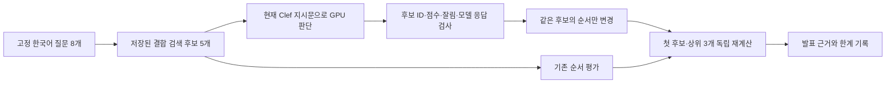

# Clef 후보 판단의 조건 구분 비교

기준: 2026-10-14 KST · SEMES Tech Fair 발표 근거 · 운영과 분리한 합성 개발 평가

## 결론과 적용 범위

기존 개발 평가 중 **‘유사 현상 구분’ 8문항 전체**에 같은 검색 후보 5개를 고정해 Clef 적용 전후를 비교했습니다. 첫 번째 후보가 정답 유형인 질문은 **5/8에서 8/8**로 늘었고, 상위 3개 안에 정답이 있는 질문은 **8/8로 동일**했습니다. 이번에 확인한 효과는 이미 검색된 정답 사례를 앞에 배치하는 것입니다.

이 결과는 한국어 현장 정확도, 최종 답변 정확도, 조치 성공률 또는 일반 RAG 제품 대비 우위를 뜻하지 않습니다. 기존 개발 질문의 한 유형을 재사용한 소규모 진단이며, 독립적인 현장 평가가 아닙니다. 최종 답변 LLM은 호출하지 않았습니다.

## 비교 설계

| 항목 | 조건 |
|---|---|
| 질문 | 2026.10.07 임베딩 평가의 `contrast-01`부터 `contrast-08`까지 8문항 전부 |
| 후보 | 같은 평가에서 저장한 EmbeddingGemma 2 결합 검색 상위 5개 |
| 원문 | 가상 10만 건에서 검색한 원문 셀과 상세·작업 ID 그대로 유지 |
| 판단 | 현재 `ragkit/clef.py`의 지시문·후보 직렬화·응답 검사를 그대로 사용 |
| 모델·장비 | `mlx-community/clef-flash-8bit`, MLX GPU, 8비트, Apple M2 Max |
| 실행 | 문항별 1회, 순차 실행. 각 문항에서 모델을 새로 적재한 뒤 해제 |
| 평가 | 고정된 합성 사례 유형과 첫 후보·상위 3개를 대조 |
| 제외 | 학습, 프롬프트 조정, 재검색, 번역, 답변 생성, 운영 DB·설정 변경 |

첫 모델 호출 전에 질문 목록·비교 방식·소스 해시를 `protocol.json`에 고정했습니다. 결과를 보고 문항을 제외하거나 성공한 실행만 고르지 않았습니다. 정답 라벨은 모델 입력에 넣지 않았습니다.

HTTP 전송 부분만 기존 로컬 GPU worker 호출로 연결했습니다. 모델 추론은 실제 GPU에서 실행했고 후보 입력·현재 프롬프트·응답 검사는 운영 코드와 같습니다. **이번 시험 자체는 HTTP 서버나 브라우저 전체 경로를 검증하지 않았습니다.** 이전의 본 화면 연결 검증은 [Clef 구성 문서](Clef-테스트-RAG-20261008.md)에서 구분해 확인할 수 있습니다.

## 전체 문항 결과

‘정답’은 질문 조건에 맞는 사전 지정 사례 유형이라는 뜻입니다. 해당 조치가 성공했다는 평가가 아닙니다.

| ID | 질문 | 적용 전 첫 정답 | 적용 후 첫 정답 | 전·후 상위 3개 정답 포함 | 호출 시간 |
|---|---|---:|---:|---|---:|
| contrast-01 | 냉각수 흐름 자체는 충분한데 식각 척에서 되돌아오는 물이 너무 뜨거워집니다. 이런 과거 사례는? | 아니요 | 예 | 모두 포함 | 35.853초 |
| contrast-02 | 질소를 쓰면서 압력이 떨어지는 문제가 아니라 밸브를 닫은 채 두었는데 후단 압력이 서서히 올라갑니다. | 예 | 예 | 모두 포함 | 31.145초 |
| contrast-03 | 챔버 진공을 만드는 동작은 괜찮은데 공기를 넣어 대기압으로 돌아오는 동작만 너무 늦습니다. | 아니요 | 예 | 모두 포함 | 32.196초 |
| contrast-04 | 배기량은 실제로 정상입니다. 코팅 컵 문을 움직일 때만 배기 부족 경보가 켜지는 사례를 찾습니다. | 예 | 예 | 모두 포함 | 30.591초 |
| contrast-05 | 실제 압력이 낮은 현상이 아니라 식각 챔버의 계기가 기준 계기보다 낮게 표시되는 사례입니다. | 예 | 예 | 모두 포함 | 30.026초 |
| contrast-06 | 웨이퍼 중심이 틀어진 문제가 아니라 얼라이너가 웨이퍼 가장자리 홈을 찾지 못합니다. | 예 | 예 | 모두 포함 | 32.093초 |
| contrast-07 | 문 열림 경보가 아니라 후면 비상 정지 스위치를 누르지 않았는데 그 회로 접점이 순간적으로 끊깁니다. | 예 | 예 | 모두 포함 | 29.516초 |
| contrast-08 | 로봇을 구동할 때 위치는 정상인데 전원을 끈 순간 팔이 아래로 처집니다. | 아니요 | 예 | 모두 포함 | 30.125초 |
| 합계 | **8문항 전부 완료** | **5/8** | **8/8** | **8/8, 8/8** | 아래 범위 참고 |

개선은 3문항, 악화는 0문항입니다. 호출 시간은 모델 적재·추론·응답 처리까지 포함한 **29.516~35.853초**, 중앙값 30.868초입니다. worker가 기록한 순수 추론은 **5.073~7.375초**였습니다. 실제 서비스의 전체 답변 지연이나 Windows 성능으로 해석하지 않습니다. 이번 비교는 추가 판단 비용을 지불해 순서를 보완한 결과이며 속도 향상의 근거가 아닙니다.

## 발표 예시: 냉각수 흐름과 환수 고온의 구분

질문은 유량이 충분한 상태에서 환수 온도가 높아지는 과거 사례를 찾습니다.

| 후보 CS 번호 | 사례 유형 | 적용 전 | 적용 후 |
|---|---|---:|---:|
| CS-2026-01622 | 냉각수 저유량 | 1위 | 4위 |
| CS-2026-82420 | 하부 전극 척 쿨링 라인 고온 경보 | 2위 | 2위 |
| CS-2026-01322 | 냉각수 저유량 | 3위 | 3위 |
| CS-2026-17340 | 하부 전극 척 쿨링 라인 고온 경보 | 4위 | 1위 |
| CS-2026-00942 | 냉각수 저유량 | 5위 | 5위 |

기존 첫 후보의 현상은 `유량 6.5 L/min.\n냉각수 부족 알람.`이며, 조치는 `스트레이너 세척.\n유량 12.4 L/min.\n필터는 교환 안함.`입니다.

Clef 적용 후 첫 후보의 현상은 다음과 같습니다.

> Etch Chamber 가동 중 척 냉각수 환수 온도가 설정 22도에서 37도까지 치솟으며 'Chuck Over Temp' 락아웃.

같은 기록의 **작업2 / 조치내용(2)** 원문은 다음과 같습니다.

> 냉매 배관 용접 보수 및 냉매 전량 완충, 펌프 오버홀 진행. 테스트 런 15분 동안 22도 유지.

원문 위치는 `cslist_100000.xlsx / CSList!BR17341`입니다. 이 발췌는 창작한 합성 자료입니다. 모델은 후보별 점수를 반환했고 선택 이유를 자연어로 설명하지 않았으므로, 해당 조치의 성공을 판단했기 때문에 선택했다고 설명하지 않습니다. 현재 설비에 같은 원인이 있다는 의미도 아닙니다.

## Clef와 관계 그래프, 원문 검사의 역할

| 구성 요소 | 하는 일 | 하지 않는 판단 |
|---|---|---|
| Clef | 질문과 후보 원문을 함께 읽어 제한된 후보의 관련성 순서 보완 | 새 근거 발견, 조치 성공 확률, 최종 답변의 진실성 보장 |
| 관계 후보 보완 | 같은 상세·작업에 함께 기록된 설비·모듈·부품 이름으로 후보 보완 | 다른 상세를 합쳐 관계를 만들거나 고장 인과관계를 추론 |
| 관계 보기 | 반환된 사례의 공통 이름을 역할별로 합쳐 표시하고 원문으로 연결 | 검색 순위 변경, 상세 원문 병합, 성공 판정 |
| 원문 셀 검사 | 근거 ID·인용·숫자·날짜 등을 실제 원문 셀과 대조 | 모든 의미 오류 차단 또는 현장 조치 적합성 확정 |

[Clef 모델 카드](https://huggingface.co/Cloudflare/clef-flash)는 상태와 질문 스키마를 함께 읽고 허용 선택지의 점수를 출력하는 판단 구조를 설명합니다. 이 프로젝트의 실행 모델은 [커뮤니티 MLX 8비트 변환본](https://huggingface.co/mlx-community/clef-flash-8bit)입니다. 공급자의 벤치마크와 지연 수치를 이 시스템의 성과로 사용하지 않았습니다.

검색 후 재정렬은 [Sentence Transformers의 Retrieve & Re-Rank 문서](https://www.sbert.net/examples/sentence_transformer/applications/retrieve_rerank/README.html)에도 소개된 기존 방법입니다. 발표에서 비교하는 ‘기본 RAG’는 재정렬과 원문 관계 보완이 없는 구성입니다. 다른 CrossEncoder나 고급 RAG 제품보다 Clef가 우수하다는 비교는 하지 않았습니다.

## 검증과 보존

- 완료 8/8, 적용 8/8, 오류·누락 0. 모든 응답에서 MLX·GPU·고정 revision·8비트·잘림 없음·생성 토큰 0을 확인했습니다.
- 저장 원문 제목과 고정 유형 매핑으로 첫 정답·상위 3개 포함 여부를 기존 평가 함수 없이 독립 재계산했습니다. 요약과 8개 상세 결과가 모두 일치했습니다.
- 적용 전후 후보 ID와 전체 원문 셀 내용은 동일했습니다. 기존 검색 결과·질문 자료·`ragkit/clef.py`의 해시도 실행 전후 같았습니다.
- 운영 DB를 열거나 수정하지 않았고 소프트웨어 코드·프롬프트·사용자 설정은 변경하지 않았습니다. 실행이 끝난 GPU worker 프로세스도 종료됐습니다.
- 공개 근거는 [평가 요약 JSON](presentations/tech-fair-20261014/evidence-summary.json)과 이 문서입니다. 요청·응답 로그와 전체 실행 결과는 Git에 올리지 않습니다.

| 자료 | SHA-256 또는 revision |
|---|---|
| 저장 검색 결과 | `fd4e5d7ad40b27af36b23423817c8ffc411ce04eebac38cbba7da80b1752b3f4` |
| 질문·유형 자료 | `58c64b6b3f4eb2995a491179af36d572eaf3745405aa48b767bad417004171ba` |
| 현재 Clef 코드 | `87dae271f0569d588e8bd90c3e5161fae606bd10623ae680d2eb0e147afaf7db` |
| MLX 모델 revision | `5a195dc147926b63b1d139691ed4480ca9f92c0e` |

로컬 원본: `outputs/tech-fair-20261014/private/clef-probe/{protocol,results}.json`, 독립 대조: `outputs/tech-fair-20261014/private/clef-verification.json`, 실행 스크립트: `outputs/tech-fair-20261014/private/clef_probe.py`. 기존 결과를 보존하기 위해 같은 출력 폴더에 재실행하지 않습니다.

다음 평가는 개발에 쓰지 않은 현장 질문을 담당자가 사전 판정한 뒤 Clef 미적용·적용, 필요하면 다른 재정렬 모델을 같은 후보에서 비교해야 합니다. 후보 순서 편향, 반복 안정성, 근거 없는 질문, 최종 답변의 잘못된 조치 안내와 대기 시간을 함께 봐야 합니다.
