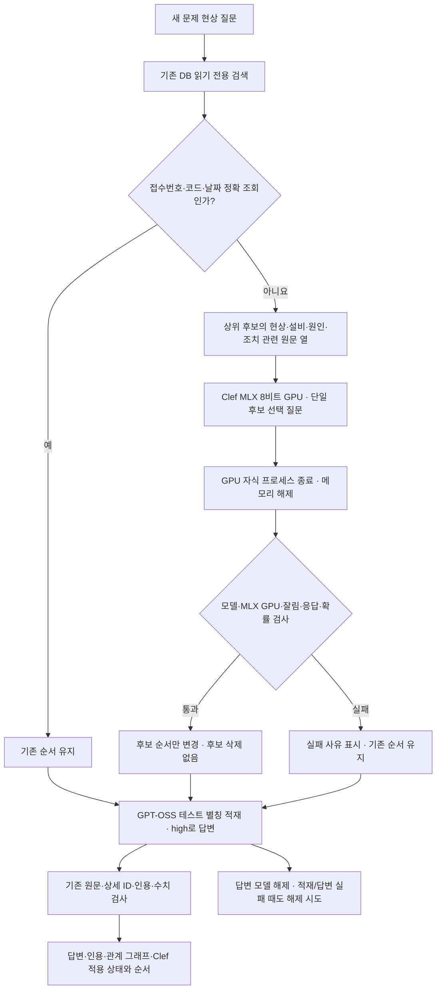

# Clef 테스트 RAG · MLX GPU

기준: 2026-10-08 · Mac M2, 메모리 32GB · 독립 실험 · 운영 기본값으로 채택하지 않음

기존 가상 10만 건 DB를 읽기 전용으로 검색하고, **Clef를 Apple GPU에서 실행해 검색 후보의 순서를 보완**하는 테스트 화면입니다. Clef는 문장을 작성하지 않습니다. 답변은 기존 GPT-OSS가 생성하며, 원문·상세 ID·숫자·인용 검사를 거칩니다. Clef 점수는 주어진 후보들 안의 상대 선택 확률이며 사실의 진실성이나 해결 성공 확률이 아닙니다.

## 구성

| 항목 | 이번 구성 |
|---|---|
| 테스트 화면 | `http://127.0.0.1:8780/` · 기존 8766 화면과 별도 프로세스 |
| 원문 | `outputs/mac-cslist-ui/demo.sqlite3` · SQLite `mode=ro` · 가상 100,000건 |
| 검색 | 기존 한국어 키워드·선택적 벡터·결합 검색 재사용 |
| 판정 모델 | Clef-flash 9B의 커뮤니티 MLX **8비트** 변환 · 27B는 사용하지 않음 |
| 모델 저장소 | `mlx-community/clef-flash-8bit` |
| 고정 revision | `5a195dc147926b63b1d139691ed4480ca9f92c0e` |
| 로더 | 공개 `clef_mlx.py` · `mlx-lm` 텍스트 백본과 전용 joint schema head |
| GPU | `mlx` 0.32.3 · Metal GPU 확인 후 사용 · CPU 대체 없음 |
| 추가 패키지 | `mlx-lm` 0.32.0 · `mlx-vlm` 0.7.4 · 독립 환경 |
| 판정 문맥 | **16,384토큰**, `truncate=False` · 초과 입력은 오류로 처리 |
| 정밀도 | 백본 8비트, 판단 헤드는 float32 · 원본 BF16과 동일 수치라고 주장하지 않음 |
| GPU HTTP 연결 | `experiments/clef_mlx_server.py` · 로컬 11436 · `/api/decide` |
| 후보 수 | 기본 5개, CLI에서 1~20개 지정 · 두 개 미만이면 생략 |
| 답변 모델 | LM Studio GPT-OSS 20B · high · `clef-rag-answer` 별칭 · 16K 문맥·동시 예측 1 |
| 메모리 관리 | Clef는 요청별 GPU 자식 프로세스 종료 후 응답. 그다음 답변 모델 적재·해제 |

가중치·런타임·원문 DB·개인 설정·모델 요청/응답은 Git에 포함하지 않습니다. 모델 파일은 외장 디스크의 `/Volumes/MacStorage/AIModels/clef-rag-test-20261008/hub-mlx`에 보관했습니다. Hugging Face CLI로 고정 revision의 **15개 파일을 검증**했고, 실행 시 revision 폴더와 공개 로더 SHA-256을 확인합니다. 로더 해시는 `852223c944819a32fad5cf798d9d1dff30419820eaf5ad1f10cb9698afec97d5`입니다. 다른 모델이나 수정한 로더에 검증 완료 표시를 붙이지 않습니다.

## Ollaya 업데이트와 GPU 실행의 관계

설치된 `ollaya` CLI를 공식 **0.12.0**으로 업데이트했습니다. 표준 명령 경로는 `/Users/mac/.local/bin/ollaya`이고, 실행 파일과 Metal 커널 추가 패키지는 `/Users/mac/.local/share/ollaya/releases/0.12.0-mlx`에 있습니다. 기본 패키지와 추가 패키지의 공식 배포 해시를 대조했습니다. `ollaya --version`으로 클라이언트 0.12.0을 확인했습니다. 데몬이 꺼져 있으면 서버 연결 경고가 함께 나올 수 있습니다.

이 버전의 Clef 경로는 ONNX CPU/CUDA를 사용합니다. Metal 패키지만 설치한다고 해당 경로가 Apple GPU로 바뀌지는 않습니다. **이번 Clef 시험은 전용 MLX 로더를 별도 HTTP 서버로 연결**합니다. 이름은 `clef:flash`를 유지하지만 이 테스트 포트의 실제 실행 주체는 MLX입니다. 이전 Ollaya 0.7.3 실험 런타임과 CPU 시험 기록은 보존했습니다.

## 처리 흐름



관련 열만 선택해 보내며 미채택 제안·영어 보조 번역은 보내지 않습니다. 다른 상세의 조치를 합치지 않고 답변에 쓰는 원문도 변경하지 않습니다. 시간 초과·입력 초과·GPU 사용 불가·잘못된 확률은 적용 실패로 표시합니다. 기존 후보와 답변 검사는 계속 유지하며 Clef 점수만으로 답변의 사실 여부를 승인하지 않습니다.

## 실행

이번 Mac에는 아래 모델과 독립 환경이 준비되어 있습니다. 저장소 루트에서 실행하세요. 각 서버는 별도 터미널에서 실행하며 기존 포트에 중복 실행하지 않습니다.

```sh
outputs/clef-rag-20261008/.venv-mlx/bin/python -u -m experiments.clef_mlx_server \
  --model-path /Volumes/MacStorage/AIModels/clef-rag-test-20261008/hub-mlx/models--mlx-community--clef-flash-8bit/snapshots/5a195dc147926b63b1d139691ed4480ca9f92c0e
```

다른 터미널에서 LM Studio 서버를 켜 두고:

```sh
.venv/bin/python -u -m experiments.clef_rag \
  --db outputs/mac-cslist-ui/demo.sqlite3 \
  --config mac_config.json --port 8780 --candidates 5 --timeout 300
```

`lms`가 PATH에 있으면 설정의 답변 모델을 테스트 별칭으로 적재하고 해제합니다. 다른 로컬 답변 서버의 이미 적재한 모델을 쓰려면 `--answer-model <식별자>`를 지정할 수 있으며, 그 모델의 메모리 관리는 직접 담당합니다. 동시에 큰 모델을 적재하지 않는 상태에서 사용하세요. 별칭 해제가 실패하면 서버 로그에 안내하고 `lms ps`로 확인합니다.

질문 번역·이어서 질문은 이번 시험에서 제외합니다. 원문 처리·자료 등록은 금지하고 참고 사례 수만 테스트 결과 폴더에 저장합니다. 답변·임베딩·Clef 주소는 로컬만 허용합니다. 기존 8766 설정 파일과 DB는 변경하지 않습니다.

새 Mac에 환경을 준비할 때의 예시입니다. 모델 저장 위치는 사용 가능한 디스크 경로로 바꾸고, CLI가 출력한 고정 revision 스냅샷 경로를 `--model-path`에 전달하세요. Apple GPU 로더이므로 Windows용 설치 명령은 아닙니다.

```sh
python3 -m venv outputs/clef-rag-20261008/.venv-mlx
outputs/clef-rag-20261008/.venv-mlx/bin/python -m pip install \
  mlx==0.32.3 mlx-lm==0.32.0 mlx-vlm==0.7.4 \
  transformers==5.19.0 huggingface_hub==1.33.0
outputs/clef-rag-20261008/.venv-mlx/bin/hf download mlx-community/clef-flash-8bit \
  --revision 5a195dc147926b63b1d139691ed4480ca9f92c0e \
  --cache-dir /Volumes/MacStorage/AIModels/clef-rag-test-20261008/hub-mlx
outputs/clef-rag-20261008/.venv-mlx/bin/hf cache verify mlx-community/clef-flash-8bit \
  --revision 5a195dc147926b63b1d139691ed4480ca9f92c0e \
  --cache-dir /Volumes/MacStorage/AIModels/clef-rag-test-20261008/hub-mlx
```

## 사용자 화면 확인

질문: **냉각수 저유량 알람이 발생했을 때 과거 조치와 결과는?**

- **검색만 비교**: 기존 키워드·벡터·결합 후보와 Clef 재정렬을 비교합니다. 답변 모델을 호출하지 않습니다.
- **질문하기**: 선택한 검색 방식 → Clef → 기존 LLM 답변 → 원문·인용·수치 검사 순서로 처리합니다.
- **처리 정보·검사 안내 → 검색 방식과 후보 비교**: `Clef: … used · mlx/gpu`와 변경 전후 순서를 확인합니다. `error`는 기존 검색으로 대체한 상태입니다.
- **인용 근거**: 실제 사용한 상세·작업·열의 원문을 확인합니다. 관계 그래프의 연결만으로 조치 성공을 판단하지 않습니다.

## 2026-10-08 검증 결과와 한계

| 구분 | 확인한 내용 |
|---|---|
| 실제 GPU 짧은 입력 | 153 입력 토큰, 출력 토큰 0, 입력 잘림 없음. `pump` 선택 0.9832. 적재 18.116초·판단 3.704초·GPU 최대 10,270,906,710바이트 |
| 실제 10만 건 검색 비교 | 한국어 질문, 5개 후보. 실제 `mlx/gpu`, 적용 `used`, 후보 삭제 없이 순서 변경. Clef 호출 26.603초·검색 전체 약 30초 |
| 실제 전체 답변 | 같은 질문의 키워드 상위 5건 재정렬 후 3건 사용. 첫 답변 요청에서 원문·인용·수치 검사 통과. 답변 생성 88.236초·전체 143.778초 |
| 답변의 근거 | 스트레이너 세척과 11.0·11.2·12.4 L/min을 각 상세의 `조치내용(1)` 셀에서 확인. 성공 여부와 문장의 의미는 별도 원문 대조 필요 |
| 최종 표시 보완 후 재확인 | 같은 질문에서 `used · mlx/gpu` 표시와 검사 통과 확인. Clef 28.042초·답변 생성 58.474초·전체 119.169초. 다른 질문의 정확도 평가가 아닌 반복 기능 확인 |
| 실제 원문 보호 | 원문 DB 100,000건 유지. SQLite 쓰기 거절. 자료 등록·다듬기·허용 외 설정 HTTP 403. GPU 서버의 외부 Origin도 403 |
| 모의 검사 | 후보·원문·정확 조회 보존, 잘림·모델·CPU 응답·확률·시간 오류 대체, 답변/적재 실패 때 별칭 해제 |
| 브라우저 검사 | GPU 상태·변경 전후 순서·시간 표시, 오류 문자 안전 표시, 이전 결과 잔여 표시 방지. 기존 관계 UI 회귀 검사 |
| 배포 검사 | 모델·DB·런타임·개인 설정 없이 소스만 포함. 독립 압축 해제 후 오프라인 검사. Mac에서 수행한 검사이며 Windows 실기기 결과가 아님 |

위 시간은 이 M2에서 이 질문을 실행한 관찰입니다. 짧은 입력과 검색 후보 판단의 시간·메모리를 서로 같은 조건으로 비교하지 않습니다. 초기 CPU 시도와 8K 답변 문맥 소진 실패는 로그에 보존했고, 단일 후보 선택 질문·관련 열 전송·답변 16K 적재로 보완했습니다.

이 결과는 **한국어 현장 정확도 향상**, 전체 10만 건에 대한 정답률, 원본 CPU 모델과 MLX의 완전한 수치 일치, 후보 순서 편향, Clef 27B, Windows 실기기, 다수 사용자 부하를 입증하지 않습니다. 기존 답변 검사는 인용·수치·상세 경계를 확인하지만 문장의 의미와 질문 항목 누락까지 보장하지 않습니다. 정식 채택에는 독립 한국어 사례로 변경 전후 정답·오답을 비교해야 합니다.

검사 명령:

```sh
.venv/bin/python -m tests.test_clef
.venv/bin/python windows-demo/test_demo.py
.venv/bin/python package_windows.py
```

실행·업데이트·검사 기록은 `outputs/clef-rag-20261008/`의 `process.json`, `probe-mlx.json`, `readonly-http-check.json`, `ollaya-update-receipt.json`, 서버 로그와 `ui/answer_diagnostics.jsonl`에 있습니다. 개인정보·원문이 포함될 수 있는 로그는 외부로 업로드하지 않습니다.

## 공개 근거

- [Cloudflare Clef-flash 모델 카드](https://huggingface.co/Cloudflare/clef-flash): 전용 판단 헤드·원본 모델·모델별 평가.
- [MLX 커뮤니티 Clef-flash 8비트](https://huggingface.co/mlx-community/clef-flash-8bit): 전용 MLX 로더와 판단 헤드. 원본 공급자의 공식 MLX 배포가 아닌 커뮤니티 변환입니다.
- [Ollaya 0.12.0 Clef 구현](https://github.com/ollaya-dev/ollaya/blob/v0.12.0/docs/families/clef.md): ONNX 실행과 문맥 제한.
- [Ollaya 0.12.0 릴리스](https://github.com/ollaya-dev/ollaya/releases/tag/v0.12.0): 업데이트한 공식 실행 파일과 Metal 추가 패키지.
