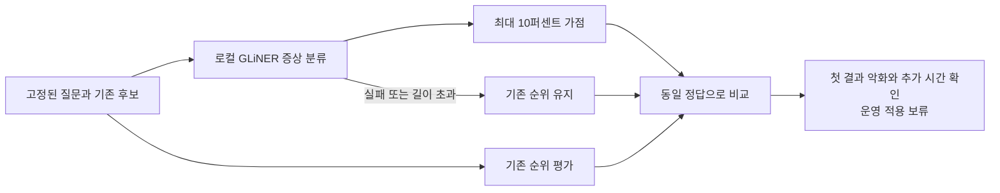

# GLiNER2.5-multi-Decide 검색 보조 실험

2026년 9월 26일 기준. **50문항 실험은 완료했으며 운영 적용은 보류합니다.**

이 문서는 첫 실험 기록입니다. 이후 진행한 가점 축소·직접 관련성·새 다국어 조건 검사는 [추가 실험 보고서](GLiNER-추가실험-20260926.md)에 별도로 정리했습니다.

증상을 같은 분류로 묶으면 과거 사례 검색에 도움이 되는지 확인했습니다. 상위 5건의 적합성은 소폭 높아졌지만, 첫 번째 정답과 상위 3건의 정답 포함률이 낮아졌습니다. 질문당 평균 약 1초도 추가됐습니다. 따라서 운영 검색과 UI, DB 및 Windows 배포본은 변경하지 않았습니다.

## 비교 결과

| 항목 | 기존 검색 | GLiNER 보조 검색 |
| --- | ---: | ---: |
| 첫 번째 결과가 정답인 질문 / 정답이 있는 44문항 | 40/44 (90.91%) | 38/44 (86.36%) |
| 상위 3건에 정답이 있는 질문 / 44문항 | 44/44 (100%) | 42/44 (95.45%) |
| 상위 최대 5건의 평균 적합성 / 전체 50문항 | 72.00% | 72.40% |
| 상위 5건에 정답이 있는 질문 / 44문항 | 44/44 (100%) | 44/44 (100%) |
| 전체 후보에 정답이 있는 질문 / 44문항 | 44/44 (100%) | 44/44 (100%) |
| 분류 적용 44문항의 추가 시간 평균 / 95백분위 | 추가 단계 없음 | 1.008초 / 1.174초 |

첫 번째 결과가 개선된 질문은 0개, 악화된 질문은 2개였습니다. 상위 5건의 적합성은 5개 질문에서 높아지고 2개에서 낮아졌습니다. 전체 순위가 달라진 질문은 8개입니다. 정답이 없는 6개 질문 중 기존에 후보가 반환되던 3개는 그대로 남았습니다. 이번 방법은 후보를 삭제하거나 근거 부족을 판단하는 기능이 아닙니다.

적합성은 반환된 상위 최대 5건 중 정답 사례의 비율을 질문별로 구한 뒤 평균했습니다. 빈 결과는 0으로 계산했습니다. `정답`은 기존 합성 데이터의 사례 유형 또는 지정 접수번호와 일치한다는 뜻이며 현업 담당자의 판정은 아닙니다. 정답이 있는 질문만 계산하면 81.82% → 82.27%입니다. 서로 다른 분모의 수치를 직접 비교하면 안 됩니다.

## 품질이 낮아진 예

다음 문장들은 창작한 평가 자료입니다.

- **플라즈마 점화 직후 반사 전력이 커져 발전기가 꺼지는 질문**: 질문을 `electrical_fault`로 분류했지만 정답인 RF 반사파 사례에는 해당 태그를 붙이지 못했습니다. 전원 전압 강하 사례가 앞서면서 첫 번째 결과가 틀렸습니다.
- **배기는 정상이고 벤트할 때만 압력이 늦게 올라오는 질문**: 질문을 `pressure_abnormal`로 분류했지만 정답인 벤트 밸브 지연 사례에는 태그를 붙이지 못했습니다. 단순 압력 흔들림 사례가 앞섰습니다.

넓은 증상 분류가 같아도 설비 상태와 발생 조건은 다를 수 있습니다. 분류 태그만으로 순위를 올리는 것은 조건 구분을 충분히 보존하지 못했습니다. 이 결과로 모델 전체가 쓸모없다고 결론 내릴 수는 없지만, 이번 설정을 운영에 채택할 근거는 부족합니다.

## 고정한 방법과 보호 조건

2026년 9월 22일 수집된 기존 합성 회귀 질문 50개, 후보 등장 횟수 합계 883건을 재사용했습니다. 같은 사례가 여러 질문의 후보로 등장할 수 있으므로 883개 고유 문서라는 뜻은 아닙니다. 원래 기준 검색은 10만 건의 벡터가 연결된 자료에서 수행됐습니다. 이번 실험은 DB를 다시 검색하지 않고 완성된 후보 스냅샷만 읽었습니다. 기준 검색의 과거 소요 시간을 이번 실행의 실측 시간으로 사용하지 않았습니다.

- 질문과 원문 제목·현상·설비 필드만 분류 모델에 전달했습니다. 정답 목록, 검색 점수, 작업자 및 조치 결과는 전달하지 않았습니다. 전체 원문을 다시 쓰거나 번역하지 않았습니다.
- `noise`, `vibration`, `leak`, `pressure_abnormal`, `flow_abnormal`, `temperature_abnormal`, `motion_failure`, `contamination`, `electrical_fault`, `communication_fault`, `other`의 11개 분류를 고정했습니다.
- 다중 분류 임계값 0.5, `other` 제외, 질문과 사례 태그의 교집합/합집합 비율을 사용했습니다. 신뢰도 0.5는 검증된 정답 확률이 아닙니다.
- 기존 순위를 `1/(60+순위)`로 표현하고 태그 일치에 최대 10% 가점만 부여했습니다. 기존 RRF 점수 자체를 수정한 실험은 아닙니다. 후보를 추가하거나 제외하지 않았습니다.
- 정확 검색과 빈 결과는 건너뛰었습니다. 분류 실패·잘못된 응답·512토큰 초과는 해당 질문의 기존 순위를 보존하도록 했습니다. 실제 실행은 분류 적용 44개, 건너뜀 6개, 오류 복구 0개였고 최대 입력은 198토큰이었습니다.
- 모델·설정·질문·스크립트 해시를 평가 전에 기록했습니다. 결과를 본 뒤 같은 질문에 맞춰 분류나 가점을 조정하지 않았습니다.



## 실행 환경과 재현

Apple M2 Max Mac에서 Python 3.12.14, CPU 4스레드, 배치 4로 실행했습니다. 모델 로드는 5.527초, 평가와 무관한 창작 문장의 초기 실행은 0.082초였습니다. 이 두 시간은 질문별 추가 시간에서 제외했습니다. 분류 외 번역·GPT OSS 답변 생성·임베딩 생성은 호출하지 않았습니다.

모델: `fastino/GLiNER2.5-multi-Decide`, revision `6bc1d43d201b0691e733626389af8c57eea3ea68`. Hub의 고정 revision과 내려받은 5개 파일의 해시를 대조했습니다.

주요 버전: `gliner2==2.0.0`, `torch==2.14.0`, `transformers==4.57.6`, `tokenizers==0.22.2`, `protobuf==7.36.2`, `sentencepiece==0.2.2`. `gliner2` 기본 설치만으로는 로컬 추론 의존성이 없으며 `[local]` 추가 설치가 필요했습니다. 토크나이저 의존성과 메타데이터 호환 경고를 확인했고 라이브러리의 호환 처리를 사용했습니다. 모델 가중치와 라이브러리 소스를 수정하지 않았습니다. SDPA 미지원으로 라이브러리가 eager attention을 사용했습니다.

프로젝트 루트에서 실행합니다. 원본 입력 스냅샷 두 파일은 로컬 `outputs/laya-coreml-20260922/`에 있어야 합니다. `outputs`는 Git 제외 대상이므로 새 PC에서는 이 합성 실험 입력도 별도로 전달해야 합니다. 모델 실행에는 클라우드 API 키가 필요 없습니다.

```sh
uv venv --python 3.12 outputs/gliner-decide-replay/.venv
uv pip install --python outputs/gliner-decide-replay/.venv/bin/python \
  'gliner2[local]==2.0.0' 'torch==2.14.0' 'transformers==4.57.6' \
  'tokenizers==0.22.2' 'protobuf==7.36.2' 'sentencepiece==0.2.2'
outputs/gliner-decide-replay/.venv/bin/hf download fastino/GLiNER2.5-multi-Decide \
  --revision 6bc1d43d201b0691e733626389af8c57eea3ea68 \
  --local-dir outputs/gliner-decide-replay/model --include '*.json' '*.safetensors'
HF_HUB_OFFLINE=1 TOKENIZERS_PARALLELISM=false \
outputs/gliner-decide-replay/.venv/bin/python -u -m experiments.gliner_decide \
  --source outputs/laya-coreml-20260922 --output outputs/gliner-decide-replay \
  --model outputs/gliner-decide-replay/model
.venv/bin/python -m tests.test_gliner_decide
```

기존 결과가 있는 출력 폴더는 거절합니다. 장시간 실행 서비스나 자동 재시도 시스템을 추가하지 않았습니다. 이번 전체 실험은 끝까지 완료됐으며 같은 설정으로 다시 추론할 필요는 없습니다.

로컬 결과 폴더 `outputs/gliner-decide-20260926/`에는 실행 전 계획(`protocol.json`), 입력 스냅샷, 실행 결과(`results.json`), 검증 기록(`verification.json`), 다운로드 검사, 패키지 버전 목록과 실행 로그가 있습니다. 모델과 로그는 Git에 포함하지 않습니다.

질문 집합 해시: `d1412d05c6823bf4f69b051a10ea1fb00ce43493ba67d9556df1e128c0b2bd56`.
후보 파일 SHA256: `b2880b5b6027b06a10b3f76459460f8e0f13c10d93c670b12877ece88cd862c8`.

## 검증 범위와 다음 판단

실제 로컬 GLiNER 추론을 완료했습니다. 별도 자동 검사에서 순위·후보·원문 보존, 정확 검색 유지, 비정상 신뢰도·응답 누락·예외 시 복구, 모델 입력에서 불필요한 필드 제외를 확인했습니다. 저장된 태그에서 모든 질문의 순위를 다시 구성하고 문항별 지표와 집계값, 입력·모델 해시를 대조했습니다. 운영 코드는 바꾸지 않아 전체 운영 회귀 검사와 Windows 패키지 생성은 반복하지 않았습니다.

이는 익숙한 합성 회귀 자료의 탐색적 평가입니다. 실제 한국어·중국어·영어 업무 파일, 독립적인 현업 질문, 최종 답변 품질, Windows 실행 성능은 확인하지 않았습니다. +0.4%p를 일반적인 품질 향상으로 해석하지 않습니다.

다음 실험을 한다면 별도의 현업 검증 질문을 먼저 정하고, 장비·발생 시점·동작 조건을 구분하는 전용 재정렬 모델과 비교하는 것이 적절합니다. GLiNER는 검토용 분류 태그 제안으로 따로 평가할 수 있지만, 이번 결과만으로 DB 태그나 운영 순위에 자동 반영하지 않습니다.

공식 자료: [모델 설명](https://huggingface.co/fastino/GLiNER2.5-multi-Decide), [라이브러리](https://github.com/fastino-ai/GLiNER2). 공개 모델 벤치마크는 본 실험 결과와 구분합니다.
