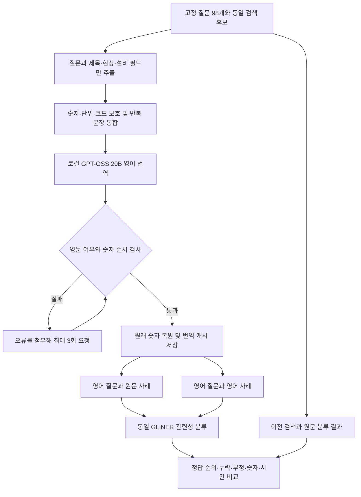

# 영어 번역 후 GLiNER 비교 실험

2026년 9월 26일 기준. 기존의 고정 합성 자료를 이용한 탐색 실험이며 실제 업무 정확도를 입증하는 평가가 아닙니다.

## 결과와 판단

**한국어 질문과 사례를 영어로 옮기는 방법은 일부 지표를 개선했지만, 운영 적용을 결정할 만큼 일관된 결과는 아니었습니다.** 기존 순위를 보존하면서 최대 10% 가점만 주는 방식이 다음 독립 평가의 후보입니다. 번역문으로 원문 근거를 대체하거나 낮은 점수의 사례를 자동 삭제하지 않습니다.

### 기존 50문항의 고정 후보 비교

| 방식 | 첫 결과 정답 / 44 | 상위 3건에 정답 / 44 | 상위 최대 5건 평균 적합성 / 50 |
| --- | ---: | ---: | ---: |
| 기존 검색 | 40 | 44 | 72.0% |
| 원문 GLiNER 직접 정렬 | 39 | 39 | 78.0% |
| 질문만 영어 번역·직접 정렬 | 40 | 41 | 81.2% |
| 질문만 영어 번역·10% 가점 | 40 | 44 | 72.4% |
| 질문과 사례 영어 번역·직접 정렬 | 41 | 42 | 83.6% |
| 질문과 사례 영어 번역·10% 가점 | 41 | 44 | 72.4% |

50문항 중 정답이 있는 44문항을 첫 결과·상위 3건 지표의 분모로 사용합니다. 평균 적합성은 정답 없는 질문과 빈 결과를 포함한 50문항에서 상위 최대 5건 중 관련 사례의 비율을 평균한 값입니다. 이는 전체 답변 정확도가 아닙니다.

질문과 사례를 모두 번역해 직접 정렬하면 기존 검색 대비 첫 결과가 4문항에서 좋아지고 3문항에서 나빠져 순증가는 1문항입니다. 최대 10% 가점은 `contrast-01` 한 문항에서 첫 결과가 개선됐고 악화는 없었습니다. 다만 이미 여러 실험에서 살펴본 합성 자료이므로 독립적인 성능 향상이나 통계적 우위를 입증하지 않습니다.

### 16개 조건 그룹의 다국어 48문항

| 직접 정렬 방식 | 한국어 질문 / 12 | 영어 질문 / 12 | 중국어 질문 / 12 | 정답이 있는 질문 합계 / 36 |
| --- | ---: | ---: | ---: | ---: |
| 번역 전 GLiNER | 9 | 10 | 10 | 29 |
| 질문만 영어 번역 | 10 | 10 | 8 | 28 |
| 질문과 사례 영어 번역 | 11 | 9 | 8 | 28 |

한국어 질문은 9/12에서 11/12로 개선됐지만, 세 언어 전체는 29/36에서 28/36으로 감소했습니다. 영어 질문은 원문을 그대로 썼으므로 영어 행의 변화는 주로 사례 번역에 따른 차이입니다. 각 언어의 12문항은 같은 조건을 번역한 상관 표본입니다. 정답 없는 질문은 별도의 12문항이며 위 표에 포함하지 않습니다. 후보 두 개의 순위만 비교하므로 여기서 상위 3건 지표는 구분력이 없습니다.

- **숫자 오류가 남습니다.** 정확히 11.8 L/min을 찾는 질문에 1.18 또는 118 L/min의 사례를 세 언어 모두 관련 있다고 판단했습니다. 번역에서 숫자를 정확하게 보존하는 것과 분류 모델이 숫자의 차이를 이해하는 것은 별개입니다.
- **부정 조건도 남습니다.** 승온 지연과 온도 초과를 구분하는 조건은 질문과 사례를 모두 영어로 바꿔도 세 언어 모두 반대 사례를 먼저 표시했습니다.
- 관련성 점수 0.5 미만을 근거 부족으로 간주하는 진단에서, 양쪽 번역은 정답 없는 12문항 중 4개만 올바르게 거절했고 정답 있는 36문항 중 8개를 잘못 거절했습니다. 번역 전은 각각 6개와 14개였습니다. 서로 다른 오류가 반대 방향으로 움직여 단일 개선 수치로 합치지 않습니다. 이 임계값은 운영 필터가 아닙니다.
- 16개 조건의 한국어·중국어 질문 및 두 사례, 총 64개 문장을 직접 대조했습니다. `vent-ko`의 “배기 정상”이 “The vent is normal”로 번역되어 배기와 벤트가 혼동된 점, `slowheat-ko`의 “heats too late”가 승온 속도보다 덜 명확한 점을 기록했습니다. 번역을 사후 수정하지 않고 자동 번역 파이프라인의 한계로 남겼습니다. 모든 오류를 GLiNER 단독의 문제로 해석할 수 없습니다.

### 처리 시간과 검증

- 공식 번역 준비의 배치 처리 시간 합계는 **438.3초(약 7.3분)**입니다. 259개 공통 문장 중 이미 영어인 17개는 그대로 사용하고 242개를 모델로 번역해, 원래 숫자를 복원한 질문·사례 426개를 저장했습니다. 중단한 초기 준비 실행, 프로세스 시작 및 실행 사이의 대기 시간은 이 수치에서 제외합니다. 전체 작업의 벽시계 시간이 아닙니다.
- 기존 50문항 중 분류를 수행한 44문항에서 질문만 번역한 GLiNER 단계는 평균 **1.533초**, 질문과 사례를 모두 번역한 단계는 평균 **1.448초**, 후자의 95백분위는 **1.624초**였습니다. 정확 검색·빈 결과 6개는 그대로 보존했습니다. 가점과 직접 정렬은 같은 점수를 사용하므로 이 시간을 중복 합산하지 않습니다.
- 후보 2개를 비교한 다국어 조건은 양쪽 번역 시 평균 **0.119초**였습니다. 최대 20후보인 기존 50문항과 직접 속도 비교하지 않습니다. GLiNER 로드 7.894초·워밍업 0.225초와 번역 API 시간은 분류 시간에서 제외했습니다. 새로운 실시간 질문의 번역 지연이나 전체 RAG 응답 속도는 측정하지 않았습니다.
- 새 질문–후보 관련성 점수 **1,952개**, 98문항 × 6방식의 결과 **588개**를 검증했습니다. 저장된 점수로 순위를 재구성하고 원문 기준 지표와 집계값을 대조했습니다. 원문·후보 보존과 입력·모델·스크립트 해시도 확인했습니다. 이번 두 번역 방식의 분류 실패·길이 초과로 인한 복구는 0건, 스키마 포함 최대 입력은 305토큰이었습니다.
- 자동 검사는 한국어 복사 응답 거절, 오류 첨부 재시도, 성공 캐시 재사용, 다른 모델 캐시 거절, 숫자만 다른 문장 공유·원래 값 복원, 질문만 번역·양쪽 번역 입력, 정확 검색과 후보 보존을 확인했습니다. 운영 코드·Windows 배포본은 수정하지 않았으며 전체 DB 재검색이나 실제 업무·Windows 검증은 이번 범위가 아닙니다.

다음 판단에는 배기·벤트 등의 용어 번역을 안정화하고, 숫자·부정 조건을 별도로 확인하는 기준을 유지한 상태에서 새 현업 질문으로 소폭 가점 방식을 비교하는 과정이 필요합니다. 이번 합성 문항에 맞춰 번역이나 분류 설정을 바꾼 결과를 독립 검증으로 보고하지 않습니다.

## 비교 방법

기존 50문항과 16개 조건을 한국어·영어·중국어로 표현한 48문항을 그대로 사용했습니다. 정답 라벨과 검색 후보는 변경하지 않았습니다. 기존 검색 및 원문 GLiNER 결과는 앞선 실험에서 재사용합니다. 새 실행은 질문만 영어로 바꾸는 방식, 질문과 사례를 모두 영어로 바꾸는 방식입니다. 각각 관련성 점수로 직접 정렬하거나 기존 순위에 최대 10% 가점을 부여합니다.



재시도 한도를 초과하면 실패를 기록하고 다음 문장을 계속 처리합니다. 번역이 전부 검증되기 전에는 비교 평가를 시작하지 않습니다. 같은 번역 명령을 실행하면 완료 문장을 재사용하고 미완료 문장만 재요청합니다. 이 경로는 실험용이며 운영 UI·DB·자동 실행 설정과 연결하지 않았습니다.

## 번역 조건과 검증 범위

- LM Studio의 `openai/gpt-oss-20b`를 사용했습니다. 일반 번역은 `reasoning_effort=low`이며 반복 실패한 마지막 2개 문장은 `high`로 보완했습니다. `temperature=0`, 출력 한도 6,000토큰, 실제 로드 문맥 8,192토큰입니다. 운영 설정 파일은 수정하지 않았습니다.
- 준비 단계에서 `high` 추론의 출력 한도 종료를 확인했습니다. 숫자를 보호한 중복 문장을 묶고 `low`를 기본으로 평가용 번역을 수행하고 반복 실패한 문장만 강한 추론으로 보완했습니다. 준비 단계 결과는 별도 보관했으며 공식 분류 비교에 사용하지 않았습니다.
- 이미 영어인 질문·코드는 그대로 유지합니다. 한국어·중국어 구절이 남거나 숫자 보호 표시자가 달라진 응답은 통과시키지 않습니다. 세 문장은 첫 실행의 3회 보완 후에도 순서 검사에 실패해 저장된 상태에서 재개했습니다. 이 중 두 문장을 high로 보완했으며 값을 바꾸거나 검사를 완화하지 않았습니다. 숫자·단위·장비 코드는 원문대로 복원하므로 `1분`과 같은 단위 표기는 남습니다.
- 영어 열 이름은 고정 대응표를 사용합니다. 원문 데이터와 정답 채점에는 번역문을 덮어쓰지 않습니다. 작업자·접수번호·조치 결과·정답 라벨은 번역·분류 입력에서 제외합니다.
- 숫자 검사는 의미 전체의 보존을 보증하지 않습니다. 현상·부정·확정 여부의 번역 예시를 직접 대조하며, 독립된 현업 번역 감수나 실제 Windows 검증은 수행하지 않았습니다.
- GLiNER는 앞선 실험과 같은 revision·모델 파일·패키지, CPU 4스레드와 배치 4를 사용합니다. 입력을 자르지 않고 스키마 포함 512토큰을 초과하거나 오류가 발생하면 기존 순위를 유지합니다.

## 재현 및 결과 파일

프로젝트 루트에서 실행합니다. 기존 `outputs/gliner-decide-20260926`의 모델·고정 입력과 `outputs/gliner-followup-20260926`의 완료 결과가 필요합니다. 이 파일들은 Git 제외 대상이므로 새 PC에서는 별도 준비해야 합니다. 번역은 프로젝트 Python 3.14.6와 OpenAI 3.10.0, GLiNER는 기존 별도 Python 3.12.14 환경을 사용했습니다. 로컬 번역 모델은 MXFP4 양자화 GPT-OSS 20B입니다.

```sh
.venv/bin/python -m tests.test_gliner_translation
lms load openai/gpt-oss-20b --context-length 8192 --yes
.venv/bin/python -u -m experiments.gliner_translation translate \
  --output outputs/gliner-translation-replay
HF_HUB_OFFLINE=1 TOKENIZERS_PARALLELISM=false \
outputs/gliner-decide-20260926/.venv/bin/python -u -m experiments.gliner_translation evaluate \
  --output outputs/gliner-translation-replay
```

번역이 미완료이면 같은 `translate` 명령을 다시 실행합니다. 정상 문장은 재사용하며 이전 오류를 보완 요청에 포함합니다. 분류 결과는 덮어쓰지 않으므로 재평가할 때는 새 출력 폴더를 사용합니다. 이 실험의 번역·분류 로그나 모델을 운영 배포 파일에 포함하지 않습니다.

코드: [번역 비교 실행](../experiments/gliner_translation.py), [자동 검사](../tests/test_gliner_translation.py).
결과 경로: `outputs/gliner-translation-20260926/`. `translations.json`은 원문–번역·설정·오류·배치 시간을, `protocol.json`은 분류 전 고정 조건과 해시를, `results.json`은 순위와 지표를 담습니다. `translation_review.json`에는 수동 대조 범위와 발견한 번역 의미 문제를 기록합니다. 준비 단계에서 중단한 실행과 번역 검증을 보완하기 전 결과는 공식 분류에 쓰지 않았습니다.

검증 기록은 같은 출력 폴더의 `verification.json`이며, 결과 SHA-256은 `9944971fbe522e5a47c8c70461763e9c33e22bc5c4ddfc744543f6a6c12ccf14`입니다. 저장된 번역으로 분류를 재현할 수 있지만 번역을 새로 생성하면 모델 파일·서버 버전·생성 과정에 따라 문장이 달라질 수 있습니다.
