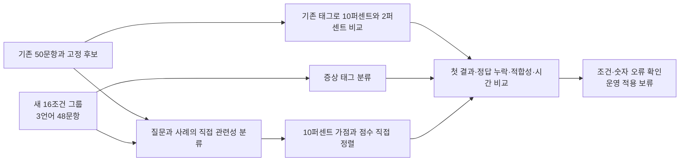

# GLiNER 추가 실험: 분류 가점·직접 관련성·다국어 조건

2026년 9월 26일. **계획한 비교와 검증을 완료했으며 운영 적용은 계속 보류합니다.**

기존 50문항과 새 합성 48문항에서 총 5개 순위 방식을 비교했습니다. 첫 실험에서 이미 결과를 본 50문항은 탐색용으로만 사용했습니다. 새 48문항은 16개 조건 그룹을 세 언어로 표현한 상관 표본이며, 독립적인 현업 시험이 아닙니다. 운영 DB·웹 UI·검색 설정은 변경하지 않았습니다.

## 1. 기존 50문항에서 비교한 결과

| 순위 방식 | 첫 결과 정답 / 44문항 | 상위 3건에 정답 / 44문항 | 상위 최대 5건 평균 적합성 / 50문항 |
| --- | ---: | ---: | ---: |
| 기존 검색 | 40/44 | 44/44 | 72.0% |
| 증상 태그 10% 가점 — 첫 실험 결과 재사용 | 38/44 | 42/44 | 72.4% |
| 증상 태그 2% 가점 | 38/44 | 44/44 | 71.2% |
| 질문–사례 관련성 점수로 최대 10% 가점 | 40/44 | 44/44 | 72.0% |
| 질문–사례 관련성 점수로 직접 정렬 | 39/44 | 39/44 | 78.0% |

가점을 작게 줄여도 첫 결과가 틀린 두 질문은 복구되지 않았습니다. 직접 관련성 점수로 정렬하면 평균 적합성이 높아지는 대신, 원래 상위 3건에서 찾던 정답을 5개 질문에서 놓쳤습니다. 첫 결과는 기존보다 3개 질문에서 개선되고 4개에서 악화됐습니다. 상위 5건 평균만으로 운영 적용을 결정할 수 없습니다.

직접 관련성 모델 단계의 추가 시간은 적용 44문항에서 평균 **1.581초**, 95백분위 **1.742초**였습니다. 정확 검색·빈 결과 6개는 분류를 건너뛰었습니다. 두 직접 관련성 방식은 같은 추론 점수를 사용하므로 각각 이 시간을 더해 합산하면 안 됩니다. 태그 2% 비교는 저장된 태그의 재계산이며 새 모델 속도를 측정한 것이 아닙니다.

적합성 정의와 분모는 [첫 실험 보고서](GLiNER-실험-20260926.md)와 같습니다. 기준 검색은 이전에 10만 건에서 수집한 후보를 재사용했습니다. 이번에는 LM Studio 서버가 응답하지 않아 새 임베딩·전체 DB 검색을 실행하지 않았습니다.

## 2. 새 다국어 조건 검사

[합성 문항 파일](../experiments/gliner_conditions.json)에 16개 조건 그룹을 작성했습니다. 질문은 한국어·영어·중국어이고, 후보 사례는 모두 한국어입니다. 12개 그룹은 둘 중 하나가 정답이고 4개 그룹은 둘 다 정답이 아닙니다. 따라서 정답이 있는 질문은 36개, 없는 질문은 12개입니다.

내용은 배기와 벤트, RF 반사파와 DC 전압 강하, 팬과 펌프 소음, 승온 지연과 온도 초과, 지속 누수와 세척 잔수, 전원 차단 시 낙하와 이송 중 진동, 자료에 없는 현상, 숫자 자릿수, 확정과 의심의 차이를 포함합니다. 정답 위치는 후보 A·B에 균형 있게 배치했습니다.

| 방식 | 한국어 첫 결과 정답 / 12 | 영어 / 12 | 중국어 / 12 | 합계 / 36 |
| --- | ---: | ---: | ---: | ---: |
| 주어진 후보 순서 | 6 | 6 | 6 | 18 |
| 증상 태그 10% 또는 2% 가점 | 8 | 6 | 6 | 20 |
| 직접 관련성 10% 가점 | 9 | 8 | 8 | 25 |
| 직접 관련성 점수로 정렬 | 9 | 10 | 10 | 29 |

이 표의 기준 50%는 사람이 균형 있게 배치한 두 후보의 순서입니다. 운영 검색 정확도가 50%였다는 뜻이 아닙니다. 후보가 두 개뿐이므로 상위 3건 포함률과 상위 5건 적합성은 순위가 바뀌어도 같아, 이 검사에서는 첫 결과와 조건 판단을 봐야 합니다. 그룹별 번역은 독립 표본이 아니므로 언어 사이 우열도 일반화하지 않습니다.

직접 관련성 분류는 질문당 후보 2개에서 평균 0.119초였습니다. 후보가 최대 20개인 기존 50문항의 1.581초와 직접 속도 비교할 수 없습니다. 모델 실행 실패는 두 평가에서 모두 0건이었습니다.

### 확인된 한계

- **숫자:** 11.8 L/min을 찾는 질문에 1.18과 118 L/min 사례를 주었을 때 세 언어 모두 관련성이 있다고 판단했습니다. 숫자·단위의 정확 비교를 이 모델로 대체하면 안 됩니다.
- **부정과 방향:** “설정값을 넘는 것이 아니라 승온이 느리다”는 질문은 세 언어 모두 반대 조건의 사례를 앞에 놓았습니다.
- **동작 조건:** 영어·중국어의 배기 실패 질문에서 벤트 지연 사례를 앞세웠고, 한국어의 지속 누수·전원 차단 시 낙하 질문에서도 오정렬이 있었습니다.
- **점수로 자동 제외:** 관련성 점수 0.5 미만이면 근거가 없다고 가정하는 별도 진단에서, 정답이 없는 12문항 중 6개만 올바르게 거절했습니다. 반대로 정답이 있는 36문항 중 14개를 잘못 거절했습니다. 점수는 보정된 정답 확률이 아닙니다. 이 임계값을 운영 필터로 적용하지 않았습니다.

## 3. 방법과 사전 고정



분류 모델은 질문과 원문 제목·현상·설비 필드만 읽습니다. 정답 라벨, 검색 점수, 작업자, 조치 결과는 전달하지 않습니다. 새 합성 정답도 채점에서만 사용했습니다. AGY의 읽기 전용 검토는 창작 문항의 번역 의미와 정답의 모호성을 확인하는 보조 검토였으며, 현업의 독립 검증을 대신하지 않습니다. 중대한 모호성은 보고되지 않았고 Codex가 문항과 결과를 확인했습니다.

직접 관련성 분류는 `related`와 `unrelated` 두 항목을 사용합니다. 질문과 사례가 증상·설비·동작 조건·부정·방향·숫자·확정 여부에서 맞는지 묻는 영어 지시문을 고정했습니다. 코드의 `PROMPT`에서 전문을 확인할 수 있습니다. 단일 분류의 두 항목 점수로 관련성 점수를 계산했고, 모델 입력 스키마에 지시문과 항목 설명이 전달되는 라이브러리 경로를 확인했습니다.

모든 방식은 후보를 추가·삭제하지 않고 순위만 바꿉니다. 정확 검색과 빈 결과는 보존하고, 오류·불완전 응답·512토큰 초과는 기존 순위로 돌아갑니다. 최대 입력은 실제 스키마를 포함해 309토큰이었으며 입력을 자르지 않았습니다. 임계값·가점·문항·스크립트와 모델 파일 해시를 실행 전에 고정했고, 결과를 본 뒤 같은 평가를 맞추도록 수정하지 않았습니다.

## 4. 검증 및 재현

Apple M2 Max, CPU 4스레드, 배치 4에서 앞선 실험의 Python 3.12.14 환경과 모델을 재사용했습니다. 모델 revision은 `6bc1d43d201b0691e733626389af8c57eea3ea68`입니다. 모델 파일 5개의 해시 및 설치된 주요 패키지 버전이 첫 실험과 같은지 확인했습니다. 모델을 새로 학습하거나 가중치를 수정하지 않았습니다.

- 실제 관련성 점수 **976개**를 계산했습니다. 이는 98개 질문에 대한 질문–후보 쌍 수이며 976개의 독립 질문이 아닙니다.
- 저장된 점수와 태그로 **98문항 × 5방식 = 490개 결과**의 순위·후보 보존·지표를 재구성하고 집계값을 대조했습니다.
- 같은 입력 12개의 배치 1과 배치 4 실행은 분류 항목이 모두 같았고 점수 최대 차이는 0이었습니다. 전체 입력·다른 하드웨어에서의 일치를 보증하는 결과는 아닙니다.
- 자동 검사에서 비정상 신뢰도·불완전 응답·예외 시 복구, 동점 순위·정확 검색·원문 보존, 모델 입력의 불필요한 필드 제외를 확인했습니다.

실험의 소스는 [후속 실행 코드](../experiments/gliner_followup.py), [합성 문항](../experiments/gliner_conditions.json), [자동 검사](../tests/test_gliner_followup.py)입니다. 아래 명령은 프로젝트 루트에서 실행합니다. 기존 실험 폴더의 모델·입력·결과가 필요하며 `outputs`는 Git 제외 대상입니다. 새 PC에서는 이 입력을 별도로 전달해야 합니다.

```sh
.venv/bin/python -m tests.test_gliner_followup
HF_HUB_OFFLINE=1 TOKENIZERS_PARALLELISM=false \
outputs/gliner-decide-20260926/.venv/bin/python -u -m experiments.gliner_followup \
  --source outputs/gliner-decide-20260926 \
  --output outputs/gliner-followup-replay \
  --challenges experiments/gliner_conditions.json
```

완성된 결과는 `outputs/gliner-followup-20260926/results.json`, 실행 전 설정은 `protocol.json`, 지표·해시 확인은 `verification.json`에 있습니다. 기존 결과가 있는 출력 폴더는 덮어쓰지 않습니다. 실제 원본 Excel, 운영 DB, 사용자 설정, 모델·실행 로그를 Git에 넣지 않습니다.

## 5. 판단

이번 검사로 GLiNER가 일부 조건을 구분할 수 있음은 확인했지만, 가점 조정이나 직접 관련성 판단만으로 기존 검색을 일관되게 개선하지는 못했습니다. 특히 숫자와 부정 조건을 모델의 확률 점수에 맡기면 정답을 놓칠 수 있습니다. 현재의 정확 검색·숫자 검사·원문 인용 검사를 유지하고 **추가 운영 기능은 넣지 않습니다**.

다음 평가에서는 독립적으로 정답을 확인한 업무 질문과 발생 조건을 포함한 후보를 준비해야 합니다. 이번 결과를 보고 같은 합성 문항에 맞춰 프롬프트를 반복 조정한 뒤 성능 향상으로 보고하지 않습니다. 전체 DB 검색, 최종 GPT OSS 답변, 실제 Windows 및 실제 다국어 업무 파일은 이번 검사 대상이 아닙니다.
