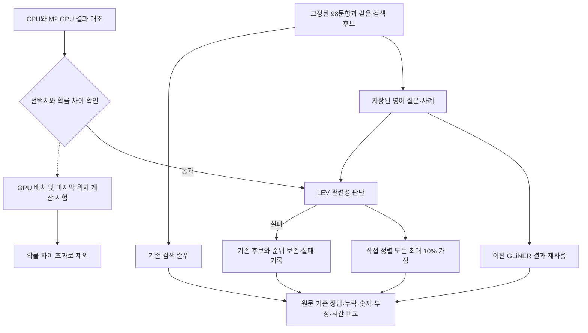

# LEV 검색 보조와 M2 GPU 비교 실험

2026년 9월 26일 기준. 고정 합성 자료를 이용한 로컬 모델 실험입니다. 실제 업무 정확도나 Windows 성능을 입증하는 평가는 아닙니다.

**M2 GPU에서 LEV가 실제 동작하며, 이번 고정 자료에서는 기존 검색과 영어 GLiNER보다 정답을 앞에 놓았습니다.** 다만 추가 지연이 크고 일부 부적합 후보에도 높은 점수를 주므로 운영에 바로 연결하지 않습니다. 속도를 개선한 실행 경로와 새 현업 질문에서 같은 비교를 통과하는 것이 다음 판단 조건입니다.

## 기존 50문항의 결과

| 방식 | 첫 결과 정답 / 44 | 상위 3건에 정답 / 44 | 상위 최대 5건 평균 적합성 / 50 |
| --- | ---: | ---: | ---: |
| 기존 검색 | 40 | 44 | 72.0% |
| 영어 GLiNER 직접 정렬 | 41 | 42 | 83.6% |
| 영어 GLiNER 10% 가점 | 41 | 44 | 72.4% |
| 영어 LEV 직접 정렬 | 44 | 44 | 88.0% |
| 영어 LEV 10% 가점 | 42 | 44 | 77.6% |

LEV 직접 정렬은 이 자료에서 기존 검색의 오답 4문항(`paraphrase-19`, `contrast-01`, `contrast-03`, `new-03`)을 개선했고 첫 결과·상위 3건의 악화는 없었습니다. 10% 가점은 이 중 2문항을 개선했습니다. 이미 이전 실험에서 확인한 합성 자료이므로 현업 정확도나 독립 검증 결과로 해석하지 않습니다.

첫 결과·상위 3건의 분모는 정답이 있는 44문항입니다. 이 중 41문항만 LEV가 다시 정렬했고, 정확 검색으로 정답을 찾은 3문항은 보존했습니다. 정답이 없는 6문항 중 빈 결과 3문항도 그대로 보존했습니다. 평균 적합성은 이 6문항을 포함한 전체 50문항에서 상위 최대 5건의 관련 사례 비율을 평균합니다.

직접 정렬의 결과가 좋아도 관련 확률을 곧바로 자동 제외 기준으로 쓰면 안 됩니다. 점수 0.5 미만을 근거 부족으로 해석하는 진단에서, LEV가 판단한 정답 없는 3문항은 모두 올바르게 거절했으나 정답 있는 41문항 중 4문항도 잘못 거절했습니다. 이 실험은 낮은 점수의 후보를 삭제하지 않습니다.

LEV를 실제 호출한 기존 질문 44문항의 평균 처리 시간은 **49.373초**, 95백분위는 **111.722초**였습니다. 기존 영어 GLiNER의 평균은 약 **1.448초**였습니다. LEV는 동일 입력을 재사용했고 GLiNER는 앞선 배치 실행 결과이므로 동일한 계산 방식의 처리량 비교는 아닙니다. 이번 Mac 실행에서 LEV가 추가하는 사용자 대기 시간이 크다는 점은 확인했습니다. 모델 준비·워밍업·새 질문 번역·검색·답변 생성은 이 시간에서 제외합니다.

## 별도 48문항의 조건 검사

| 질문의 원래 언어 | 영어 GLiNER 직접 정렬 / 12 | 영어 LEV 직접 정렬 / 12 | 영어 LEV 10% 가점 / 12 |
| --- | ---: | ---: | ---: |
| 한국어 | 11 | 12 | 12 |
| 영어 | 9 | 12 | 11 |
| 중국어 | 8 | 12 | 12 |
| 합계 | 28 / 36 | 36 / 36 | 35 / 36 |

정답 있는 조건 12개를 세 언어로 표현한 36문항의 첫 결과 적중입니다. 각 질문의 두 후보는 같고, LEV와 GLiNER에는 같은 저장 영어 번역을 전달했습니다. 후보가 두 개여서 상위 3건 지표는 모두 정답을 포함하며 비교 의미가 없습니다. 10% 가점은 `moving-en`에서 원래 1순위의 오답을 충분히 내리지 못했습니다.

정답이 없는 나머지 12문항에서는 LEV의 최대 관련 확률이 모두 0.5 미만이었고, 정답 있는 36문항을 잘못 거절한 경우는 없었습니다. 11.8 L/min을 찾는데 1.18 또는 118 L/min인 사례만 제시한 세 문항도 근거 부족으로 구분했습니다. 승온 지연과 온도 초과를 구분하는 세 문항에서는 모두 정답을 먼저 표시했습니다. 이 결과만으로 다른 숫자나 부정 조건까지 해결됐다고 볼 수는 없습니다.

**첫 결과가 맞는 것과 모든 후보를 정확히 분류하는 것은 다릅니다.** 전체 96개 질문–후보 쌍에서 정답 후보 36개는 모두 0.5 이상이었지만, 부적합 후보 60개 중 6개도 0.5 이상이었습니다. `pumpdown-ko`, 전원 차단 조건의 세 언어 문항, `moving-en`, `moving-zh`에서 발생했습니다. 따라서 높은 점수를 사실 확인이나 자동 채택 근거로 사용하지 않습니다. 숫자·부정·확정 여부는 원문 근거를 함께 확인해야 합니다.

이 구간은 문항당 평균 **11.318초**, 95백분위 **11.909초**였습니다. 후보 두 개의 판단 시간이며 20후보 구간과 구별합니다. 세 언어는 같은 조건의 상관 표본이고 자동 번역의 기존 의미 오류도 포함하므로 독립적인 현업 성능 수치가 아닙니다.

## 완료한 검증

- 98문항 × 5방식의 결과 **490개**를 저장하고 점수에서 순위·원문 기준 지표·언어별 집계를 다시 계산해 대조했습니다.
- LEV는 **92문항의 후보 976쌍**에 점수를 부여했습니다. 실제 계산은 **468회**, 동일 입력 재사용은 **508개**였고, 정확 검색·빈 결과 6문항은 보존했습니다. 실패·길이 초과로 기존 순위에 복구한 경우는 0건, 스키마 포함 최대 입력은 291토큰이었습니다.
- 공식 실행의 판단 시간 합계는 **2,715.675초(약 45.3분)**입니다. 모델 다운로드·준비, 장치 비교, 제외한 배치 시도, 중단한 예비 실행, 실행 사이 대기는 포함하지 않습니다. 전체 작업의 벽시계 시간이나 서비스 응답 시간은 아닙니다.
- CPU 로딩은 4.532초, 공식 GPU 워밍업은 3.444초였습니다. 워밍업 직후 MPS 텐서 할당은 약 8.01GiB, 드라이버 할당은 약 9.31GiB였습니다. CPU와 GPU가 공유하는 전체 시스템 메모리의 여유량과는 다릅니다. 추론 중 시스템 GPU 사용률 94%를 한 차례 관측했으며 평균이나 LEV 프로세스만의 사용률로 해석하지 않습니다.
- 자동 검사는 LEV의 라벨 확률 사용, 비정상 분포 거절, 원문·후보 보존, 실패 시 원래 순위 복구를 확인했습니다. 기존 GLiNER 관련성·번역 검사도 통과했습니다. 운영 코드와 Windows 배포본은 변경하지 않았으며 실제 업무 자료·Windows·전체 DB 재검색은 이번 검증 범위가 아닙니다.

전체 결과 SHA-256: `c72b0007fb22d6e462617719102a04560f68c924639d2d79742d54c44dea0820`.
`verification.json`은 전체 순위·점수 대조 결과, `pair-diagnostics.json`은 후보별 임계값 오류, `cache-parity.json`은 동일 입력 재사용 전·후 대조를 기록합니다. 이 파일들은 `outputs/lev-20260926/`에 보관하며 모델·원문·요청 로그와 함께 Git 제외 대상입니다.

## 목적과 범위

LEV는 문장을 생성하거나 임베딩을 만드는 모델이 아니라, 정해진 선택지에 대한 확률을 반환하는 모델입니다. 이 실험에서는 검색으로 찾은 과거 사례가 질문의 증상·설비·조건에 맞는지를 `related`와 `unrelated`로 판단합니다. 관련 확률을 이용해 후보를 다시 정렬하거나 기존 순위에 최대 10% 가점만 줍니다. 점수가 낮아도 후보를 삭제하지 않습니다.

앞선 GLiNER 실험의 98문항과 저장된 영어 번역을 그대로 재사용합니다. 50개 기존 질문과 16개 조건을 3개 언어로 표현한 48문항으로 구성되며, 후자의 언어별 질문은 서로 독립된 표본이 아닙니다. 정답·후보·번역·모델 파일의 해시를 확인합니다. 운영 DB를 열거나 원문·검토 결과·UI·배포 의존성을 변경하지 않습니다.

질문과 사례를 합친 영어 입력이 완전히 같을 때에만 판단 결과를 재사용하며, 원문 후보는 각각 유지합니다. 재사용 전·후에 완료한 같은 3문항의 후보 점수 60개는 모두 일치했습니다. 반복 패턴이 많은 합성 자료이므로 실제 업무 자료에서도 같은 비율로 계산이 줄어든다고 볼 수 없습니다.



## M2를 사용하는 방법

- **GPU:** PyTorch의 MPS 경로로 모델과 입력을 명시적으로 이동합니다. 설치된 LEV 로더는 CUDA와 CPU를 자동 선택하므로 별도의 MPS 지정이 필요합니다. 이 Mac에서 MPS 사용 가능 여부와 실제 모델 실행을 확인합니다.
- **통합 메모리:** 이 기기는 Apple M2 Max, GPU 30코어, 메모리 32GB입니다. 앞선 번역 실험에 사용했던 대기 중 GPT-OSS 20B를 내려 공간을 확보합니다. 답변 모델·임베딩·분류 모델을 동시에 올렸을 때의 처리량은 별도 측정 대상입니다.
- **기본 계산 경로 유지:** 후보 한 쌍의 선택지 순서 2개를 한 번에 계산하고 평균하는 공식 LEV 경로를 사용합니다. 스키마를 포함해 512토큰을 넘으면 잘라서 평가하지 않고 실패로 기록합니다.
- **묶음·출력 계산 최적화는 제외:** 후보 4쌍을 묶고 Qwen의 `logits_to_keep`로 마지막 위치만 계산하는 경로를 시험했습니다. 예비 6입력의 라벨은 같았으나 기본 GPU 경로와 관련 확률 차이가 최대 0.0510으로, 사전 허용 범위 0.02를 넘었습니다. 6입력의 처리 시간도 11.06초에서 12.11초로 줄지 않았습니다. 이 경로는 전체 평가와 최종 코드에서 제외했고 실험 기록만 보관합니다.
- **결과 확인:** 평가 정답과 별개인 6개 입력으로 CPU와 기본 GPU를 대조했습니다. 라벨은 6개 모두 같았고 관련 확률 차이는 최대 0.01743이었습니다. 이는 모든 입력의 수학적 동등성을 입증하는 검사가 아니며, 실제 전체 비교는 MPS 수치 결과로 보고합니다.

GPU가 지원하지 않는 연산을 CPU로 조용히 돌리지 않도록 `PYTORCH_ENABLE_MPS_FALLBACK=0`을 사용합니다. 모델의 일부 연산이 PyTorch 참조 구현을 사용한다는 경고는 CPU로 옮겼다는 뜻이 아닙니다. 텍스트 처리와 보고서 저장은 CPU에서 수행합니다. MLX·Core ML 변환이나 Neural Engine 사용은 이번 실험에 포함하지 않습니다.

짧은 6입력에서 같은 기본 LEV 경로의 평균 시간은 CPU **45.415초**, MPS GPU **1.844초**로, 이 조건에서는 약 **24.6배** 차이였습니다. CPU는 4스레드이고 공식 로더의 bfloat16을 사용했습니다. CPU의 다른 자료형이나 최대 스레드 수까지 최적화한 비교는 아닙니다. 첫 워밍업은 CPU 54.589초, GPU 5.601초였으며 위 평균에서 제외했습니다. 이 배율을 전체 RAG 응답 시간 개선율로 해석하면 안 됩니다.

## 비교 조건

| 항목 | 고정 값 |
| --- | --- |
| LEV 모델 | `interfaze-ai/lev`, `f8ef71157ec06a7d3b6435bc0756f9d735c33748` |
| LEV 코드 | `cf104b69329302e4eac674a730c71f3511047db8` |
| 기반 모델 | `Qwen/Qwen3.5-4B`, `851bf6e806efd8d0a36b00ddf55e13ccb7b8cd0a` |
| 수치 표현 | 기반 모델 bfloat16, 공식 어댑터와 보정 값 사용 |
| Python / PyTorch / Transformers | 3.12.14 / 2.14.0 / 5.17.0 |
| PEFT / Accelerate / LEV | 0.21.0 / 1.15.0 / 0.1.1 |
| 후보 관련성 | 앞선 GLiNER와 같은 질문·두 라벨 설명 |
| 점수 사용 | `probabilities['related']`; LEV의 Gini 기반 `confidence`와 구별 |
| 가점 | `(1 + 0.1 × 관련 확률) / (60 + 기존 순위)` |
| 근거 부족 진단 | 최대 관련 확률 0.5 미만. 운영 필터로 적용하지 않음 |

공식 어댑터 파일은 그대로 보존합니다. 로컬 실행용 `lev_release.json`의 `base_model` 경로만 고정 revision의 로컬 기반 모델 폴더로 바꾸어 사용합니다. 가중치 체크섬을 Hub의 LFS 메타데이터와 대조했습니다. 실행 중 네트워크에서 최신 모델을 받지 않도록 오프라인 모드로 평가합니다.

기존 번역에서 발견한 배기·벤트 혼동과 모호한 승온 표현도 그대로 유지합니다. 번역문을 새로 고치면 분류 모델 변경 효과와 번역 효과를 구분할 수 없기 때문입니다. 숫자·단위가 보존되어 있어도 문장 의미나 숫자의 차이를 모델이 올바르게 이해한다는 보장은 없습니다.

## 재현 방법

프로젝트 루트에서 실행합니다. 별도 Python 환경과 고정된 모델 파일, 앞선 실험의 완료 결과 및 번역 캐시가 필요합니다. `outputs/`는 Git 제외 대상이므로 다른 PC에서는 동일한 고정 자료를 준비해야 합니다.

```sh
.venv/bin/python -m tests.test_lev_rerank
HF_HUB_OFFLINE=1 TOKENIZERS_PARALLELISM=false PYTORCH_ENABLE_MPS_FALLBACK=0 \
outputs/lev-20260926/.venv/bin/python -u -m experiments.lev_rerank
```

결과는 문항마다 `outputs/lev-20260926/results.json`에 저장합니다. 같은 입력·코드·모델·설정으로 다시 실행하면 완료 문항을 재사용합니다. 조건이 달라지면 기존 결과에 섞지 않고 `--output outputs/lev-replay`처럼 새 출력 폴더를 사용해야 합니다. 완료 결과를 다시 실행해도 덮어쓰지 않습니다. 새 출력 폴더의 최초 장치 비교 도중 중단했다면 미완료 비교 파일을 보관하고 새 폴더에서 장치 비교부터 실행합니다.

코드: [독립 비교 실행](../experiments/lev_rerank.py), [응답 확률·실패 복구 검사](../tests/test_lev_rerank.py). `protocol.json`에는 고정 조건과 해시, `device-probe.json`에는 CPU/GPU 비교, `model-verification.json`에는 모델 revision·체크섬·패키지 버전을 보관합니다. 제외한 최적화는 `batch-probe.json`과 `batch-script.py`에 기록합니다. 예비 실행 중 중단한 CPU 측정과 기본 경로의 미완료 평가 결과는 공식 전체 집계에 포함하지 않습니다.

공식 근거: [LEV 모델](https://huggingface.co/interfaze-ai/lev), [LEV 구현과 한계](https://github.com/Abhinavexists/lev), [PyTorch MPS 사용법](https://docs.pytorch.org/docs/2.14/notes/mps.html), [Apple의 PyTorch GPU 안내](https://developer.apple.com/metal/pytorch/).
