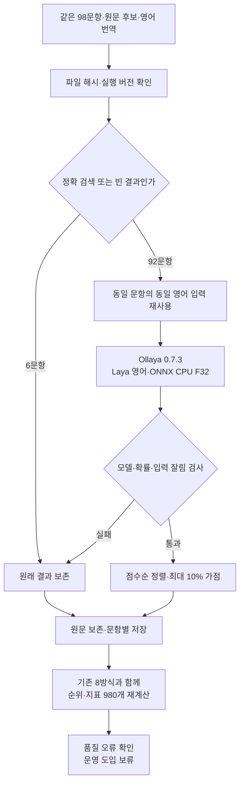

# Ollaya 검색 판단 실험

2026년 9월 27일 기준. 같은 날 18:40~18:43 KST에 Apple M2 Max에서 완료했습니다.

**Ollaya의 Laya 영어 모델을 로컬에서 실행하고 98문항을 비교했습니다. 직접 정렬은 기존 정답을 놓쳐 운영 적용을 보류합니다. 작은 가점은 후속 검증 후보입니다.** Ollaya 실행 성공과 검색 품질 개선을 구별합니다.

## 목적과 적용 범위

Ollaya는 판단 모델을 내려받고 API로 실행하는 도구입니다. 이번에 확인한 공식 지원 목록에는 LEV·CLM이 없으므로, 지원되는 `laya:en`을 별도 실행했습니다. 기존 LEV·CLM 가중치를 변환하거나 학습한 실험이 아닙니다. 답변 생성과 임베딩 서버는 그대로 유지합니다. [공식 프로젝트](https://github.com/ollaya-dev/ollaya), [0.7.3 릴리스](https://github.com/ollaya-dev/ollaya/releases/tag/v0.7.3).

앞선 비교의 합성 98문항, 검색 후보, 영어 번역과 판단 지시를 그대로 사용했습니다. 알려진 번역 오류도 보존했으며 원문 기준으로 채점합니다. 기존 50문항 중 정확 검색 3개와 빈 결과 3개는 모델을 호출하지 않습니다. 나머지 기존 44문항과 조건 48문항의 976후보쌍을 평가했습니다. 조건 질문은 16개 상황을 한국어·영어·중국어로 표현한 것이므로 서로 독립된 48개 업무 상황이 아닙니다.

이 실험은 운영 DB를 열지 않고 저장된 후보만 읽습니다. 원문 후보에 없는 정답을 새로 찾을 수 없으며, 평가 정답에 맞춘 프롬프트·임계값 조정이나 자동 모델 채택은 하지 않았습니다.



## 검색 품질

기존 첫 결과·상위 3건은 정답 있는 44문항, 조건 첫 결과는 정답 있는 36문항을 셉니다. 기존 상위 5건 평균 적합성은 정답 없는 문항을 포함한 50문항 평균입니다. 시간 비교의 44문항은 실제 모델 호출 문항이므로 이 품질 분모와 구성이 다릅니다.

| 방식 | 기존 첫 결과 /44 | 기존 상위 3건 정답 포함 /44 | 기존 상위 5건 평균 적합성 | 조건 첫 결과 /36 |
| --- | ---: | ---: | ---: | ---: |
| 기존 검색 | 40 | 44 | 72.0% | 18 |
| 영어 GLiNER 직접 정렬 | 41 | 42 | 83.6% | 28 |
| LEV 직접 정렬 | 44 | 44 | 88.0% | 36 |
| CLM 관련성 정렬 | 41 | 41 | 81.2% | 31 |
| Ollaya/Laya 직접 정렬 | 37 | 37 | 74.0% | 23 |
| Ollaya/Laya 최대 10% 가점 | 41 | 44 | 72.4% | 21 |

직접 정렬은 기존 오답 2개를 개선했지만 정답 5개를 악화시켰습니다. 기존에 상위 3건에서 찾던 정답도 7문항에서 밖으로 밀렸습니다. 가점은 기존 첫 결과를 1개 개선하고 정답을 악화시키지 않았습니다. 가점 공식은 이전 비교와 같은 `(1 + 0.1 × 관련 확률) / (60 + 원래 순위)`이며 결과를 본 뒤 변경하지 않았습니다.

조건 첫 결과는 직접 정렬에서 한국어 8/12·영어 7/12·중국어 8/12, 가점에서 각각 7/12였습니다. 조건 후보는 문항당 2개뿐이라 상위 3·5건 지표로는 정렬 차이를 평가할 수 없습니다. 모든 언어의 모델 입력은 저장된 영어 번역입니다.

## 근거 부족과 조건 오류

`related` 확률이 모든 후보에서 0.5 미만인 경우를 근거 부족으로 진단했습니다. 이 값은 검사 목적이며 후보를 삭제하거나 답변을 차단하지 않습니다. API의 `confidence` 필드는 관련 확률과 의미가 달라 정렬에 사용하지 않습니다.

- 정답 없는 조건 질문 12개 중 **3개만 거절**했고 9개를 놓쳤습니다. 숫자 불일치 질문의 세 언어 표현은 거절했지만 다른 근거 부족 조건은 통과시켰습니다.
- 실제 모델을 호출한 기존 근거 부족 질문은 3개 중 1개를 거절했습니다. 빈 검색 3개는 모델 판단 분모에서 제외합니다.
- 정답이 있는 기존 모델 호출 질문 41개 중 2개를 근거 부족으로 잘못 판단했습니다. 조건의 정답 질문 36개에는 이런 오류가 없었습니다.
- 부적합 후보 중 0.5 이상으로 평가한 쌍은 기존 145/240개, 조건 52/60개였습니다. 문항 수와 후보쌍 수를 혼동하지 않습니다.

| 원문 질문과 후보 | 관련 확률 | 판단 |
| --- | ---: | --- |
| 정확히 11.8 L/min 요청 → 1.18 / 118 L/min | 0.211 / 0.340 | 둘 다 근거 부족으로 구분 |
| 누수 확정 요청 → 누수 의심 / 점검 예정 | 0.791 / 0.757 | 미확인 사례에 높은 점수 |
| 팬에서만 소음 → 실제 팬 소음 / 펌프 소음 | 0.831 / 0.910 | 소음 발생 부위를 반대로 선택 |
| 전원 차단 때만 Z축 하강 → 실제 하강 / 이송 중 진동 | 0.861 / 0.894 | 작동 조건이 다른 사례를 먼저 선택 |

위 숫자·누수·팬 예시는 한국어 질문의 저장 영어 입력, Z축 예시는 원래 영어 질문입니다. 배기·벤트 등의 저장 번역에는 알려진 의미 오류도 있습니다. 번역과 모델 판단의 영향을 완전히 분리한 실험은 아닙니다.

## 처리 시간과 실행 환경

모델을 메모리에 준비한 뒤 문항별 후보 판단 시간을 측정했습니다. HTTP 통신·응답 검사·정렬은 포함하고, 모델 다운로드·적재·새 질문 번역·DB 검색·답변 생성·결과 파일 저장은 제외합니다. 같은 문항의 동일 영어 입력만 재사용하며 문항 사이에서는 재사용하지 않습니다.

| 방식 | 기존 모델 호출 44문항 평균 / 95백분위 | 조건 48문항 평균 / 95백분위 |
| --- | ---: | ---: |
| Ollaya/Laya 관련성 판단 | **2.590초 / 5.883초** | **0.422초 / 0.488초** |
| 이전 CLM 관련성 판단 | 3.479초 / 8.220초 | 0.770초 / 0.832초 |
| 이전 LEV 관련성 판단 | 49.373초 / 111.722초 | 11.318초 / 11.909초 |

Ollaya 판단 시간 합계는 134.234초입니다. 976후보쌍을 실제 API 468회로 계산했고 동일 문항의 508개 입력 계산을 재사용했습니다. 예비 확인 6회는 이 횟수와 시간에서 제외합니다. 모든 원문 후보와 ID는 유지했습니다. 기존 LEV도 같은 문항 안의 동일 입력을 재사용했습니다. 모델 크기·실행 방식이 다르므로 이 차이를 같은 모델의 순수 가속 배율이나 전체 서비스의 응답 시간으로 해석하지 않습니다.

| 항목 | 확인한 값 |
| --- | --- |
| 장비 | Apple M2 Max, 통합 메모리 32GB |
| 실행 도구 | Ollaya 0.7.3, darwin-arm64 공식 바이너리 |
| 모델 | `laya:en`, 421M, `convaiinnovations/laya` |
| 모델 revision | `aa8c91ca088ec597df95a0d1c76b3063cb2ae5e8` |
| 실제 계산 | ONNX Runtime CPU, F32; `/api/ps`와 실행 인수 대조 |
| 모델 문맥 | 512토큰, 실제 API 보고 입력 최대 219토큰, 잘림 0건 |
| API | `http://127.0.0.1:11435/api/decide`, 명시적 영어 모델 |
| 모델 manifest SHA-256 | `c305a9276531a47000bf93559d2c94f1ed6cbb67055c9151084682dad7655e9d` |

이번 경로는 MPS·Core ML을 사용하지 않았습니다. 장치 간 수치 동등성이나 이전 Laya-CoreML과의 성능 차이도 검사하지 않았습니다. Ollaya 0.7.3의 공식 ONNX 최적화 경로를 사용했지만 이전 Ollaya 버전과의 같은 모델 비교는 하지 않았습니다. 공식 릴리스의 성능 주장을 이 Mac의 실측치로 사용하지 않습니다.

## 검사와 재현 방법

[실험 코드](../experiments/ollaya_rerank.py)는 기존 입력·번역·채점 함수를 재사용하며 Python 표준 라이브러리로 Ollaya에 요청합니다. 응답 모델, 입력 잘림, 선택지와 확률 합계를 검사합니다. API의 소수점 네 자리 반올림을 고려해 합계 오차 0.0005 이내만 정규화합니다. 요청 시간 제한은 60초이고 자동 반복 요청은 없습니다. 장애가 나면 해당 문항의 원래 순위를 저장합니다. 문항별 체크포인트와 입력·코드·모델 조건이 같은 경우만 이어서 처리합니다.

- 서버 없는 검사는 잘못된 모델·잘린 입력·잘못된 선택지와 확률·시간 초과에서 기존 순위와 원문이 보존되는지 확인했습니다.
- 실제 CPU API 평가는 **98문항 완료, 92문항·976후보쌍 판단, 6문항 보존, 실패·잘림·누락 0건**입니다.
- 저장된 원문 후보와 API 확률에서 순위·지표 **980개**를 다시 계산했습니다. 기존 8방식 결과, 같은 문항 내 재사용, 언어별 집계, 근거 부족 진단과 입력·소스 해시도 일치했습니다.
- 공식 배포 압축 파일의 SHA-256과 모델 manifest·파일 9개의 해시 및 크기를 확인했습니다. 모델 실행 전후의 버전·digest·장치도 대조했습니다.
- Windows 실기기·동시 질문·운영 DB 전체 재검색·답변 작성 품질·새 업무 자료는 검사하지 않았습니다. 운영 코드·설정·설치 의존성·Windows 배포본은 변경하지 않았습니다.

이번 Mac에 준비된 경로를 기준으로 저장소 루트에서 실행합니다. 평가 후 실험용 모델과 서버는 종료했으며 파일은 보존했습니다. 먼저 터미널 하나에서 별도 서버를 엽니다.

```sh
OLLAYA_HOST=127.0.0.1:11435 \
OLLAYA_MODELS="$PWD/outputs/ollaya-20260927/models" \
OLLAYA_DEVICE=cpu OLLAYA_KEEP_ALIVE=10m \
outputs/ollaya-20260927/runtime/bin/ollaya serve
```

다른 터미널에서 검사·평가를 실행합니다. 완료 결과가 있으면 재계산하지 않으며, 입력이나 코드가 달라졌다면 새 `--output` 폴더를 지정해야 합니다.

```sh
.venv/bin/python -m tests.test_ollaya_rerank
.venv/bin/python -u -m experiments.ollaya_rerank \
  --base-url http://127.0.0.1:11435 --model laya:en \
  --output outputs/ollaya-20260927/laya-en

# 고정 자료와 함께 보관한 로컬 결과 검증기
PYTHONPATH=. .venv/bin/python outputs/ollaya-20260927/verify_results.py
```

API 규격은 [공식 API 문서](https://github.com/ollaya-dev/ollaya/blob/main/docs/api.md)를 기준으로 확인했습니다. 모델 다운로드·원문 후보·영어 번역·요청 및 응답·바이너리는 Git에 넣지 않습니다. 새 PC에는 저장소 복제만으로 재현 자료나 모델이 생기지 않습니다. 코드의 기본 입력 경로에는 이전 GLiNER·LEV·CLM 비교 자료가 필요합니다.

이번 로컬 근거는 `outputs/ollaya-20260927/` 아래의 `model-verification.json`, `server.log`, `laya-en/protocol.json`, `laya-en/results.json`, `laya-en/verification.json`, `laya-en/pair-diagnostics.json`, `laya-en/run.log`입니다. 결과 파일 SHA-256은 `5968af97ec7044c03d8e05f258e5ae4a21eb6d706b42c6b5609a0d7bc9501412`입니다.

다음 적용 판단은 새로운 업무 질문에서 기존 검색과 작은 가점을 비교해 내려야 합니다. 이미 반복 사용한 98문항으로 학습하거나 점수 기준을 맞춘 뒤 같은 문항의 향상을 독립 검증으로 보고하지 않습니다.
