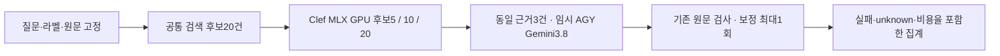

# AGY 임시 모델 · 질문 유형 확대 평가

기준 2026-10-14 KST. [전체 결과](report.md)의 완료·실패·미실행 분모를 먼저 확인하세요.

신규 TEST 200문항(10유형×20), DEV 40문항, 이전 회귀 24문항을 분리했습니다. TEST는 하드웨어·생성 규칙 20군이며 독립 현장 사건 200개가 아닙니다. 전부 창작 합성 원문·실버 라벨이고 사람 평가를 수행하지 않았습니다.



- [질문·실버 라벨](dataset-public.json) · [후보 ID 목록](candidate-pools.json) · [창작 원문 부분집합](synthetic-source-subset.json)
- [유형별 순위](ranking-by-type.csv) · [답변 시도](answers.csv) · [질문별 변화](changes.csv) · [짝지은 차이](paired-deltas.json)
- [TEST 답변 유형별 과제·실패·unknown](answers-by-type.csv)
- [순위 결과](ranking-outcomes.json) · [답변 진단](answer-outcomes.json) · [후속 대상 해석](scope-outcomes.json)
- [고정 선택 규칙의 개선·악화·유지 사례](cases.md)
- [실행 비용](cost.json) · [코호트 외 연결 시험 비용](preflight-costs.json) · [고정 조건](protocol-public.json) · [파일 해시](manifest.json)

저장소 루트에서 표준 라이브러리만으로 저장 수치·분모·후보 불변·파일 해시를 다시 계산합니다.

```sh
python docs/experiments/agy-breadth-20261014/verify_results.py
```

이는 모델 추론이나 라벨의 현장 타당성을 다시 검증하는 명령이 아닙니다. 전체 corpus는 `experiments.agy_cases.build`로 생성하며 공개 원문 파일은 후보·기대 근거에 해당하는 부분집합입니다. 모델 실행기는 Mac 절대 경로·이미 설치된 모델·AGY 계정에 의존합니다. 이식 가능한 Windows 재현 패키지로 제시하지 않습니다.

Clef는 별도 MLX 8bit 상주 프로토타입입니다. 운영의 매 요청 적재·교대 지연과 다릅니다. AGY의 실제 모델 ID와 high effort를 확인했지만 temperature·최대 출력·문맥 길이는 CLI로 강제하지 못합니다. 로컬 GPT-OSS와 동등한 배포 조건의 성능 비교가 아닙니다. 후속 질문은 창작한 고정 대화를 사용했습니다.

RAG의 역할별 메시지를 CLI 프롬프트의 JSON으로 감쌌으며 제공자의 native 역할 API와 다릅니다. `finish_reason=stop`은 CLI 성공·구조화 결과에 따른 어댑터 계약으로, 원래 제공자의 종료 신호가 아닙니다. CLI 내부 모델 호출 횟수도 직접 통제하지 못합니다. CLI 실행 수와 제공자 사용량·시간을 구분하며 원시 API 한 번의 성능으로 발표하지 않습니다.

합성 원문에는 2026-10-14 이후의 가상 날짜와 어색한 상태 표현이 있습니다. 상태의 예정 문구에 과거형 동사가 함께 있는 경우도 있어 해당 실버 라벨을 독립적인 의미 정답으로 보지 않습니다. 물리적으로 검증한 고장·측정 자료나 시점 검증 자료가 아닙니다. 실행 중 자료를 고쳐 유리한 결과를 만들지 않았습니다.

원시 LLM 요청·응답·추론·대화 ID·개인 설정·운영 DB·실제 CS·인증 정보·가중치·가상환경은 포함하지 않습니다. 답변 진단은 원문 주소와 제한적 문자 일치이며 의역은 unknown입니다. 검사 통과를 의미 정답률로 바꾸지 않습니다. 현장 효과·Windows/120B·사람 공수 절감·Clef 고유 우위는 이번 평가로 확인할 수 없습니다.

모든 답변 구성은 `claim_guard_mode=off`이며 규칙 기반 원문·인용·수치 검사를 사용합니다. 선택적 의미 검증 모델을 실행한 결과가 아닙니다.

연결 시험의 알려진 제공자 시간·GPU 적재/계산 비용을 별도 표에 남겼습니다. 초기 단독 CLI 시험 일부는 정확한 wall 측정값이 저장되지 않아 `null`이며, 전체 비용을 빠짐없이 실측했다거나 이를 0초로 간주하지 않습니다.
