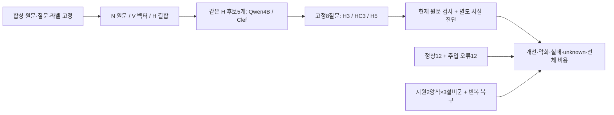

# CS RAG 구조 v3 — 공개 실험 결과

기준: 2026-10-14 KST · 평가 코드 `04060878b5933fa4d9bca899ed7a9bad7b9b347b` · 창작 합성/실버 라벨 · 사람 참여 없음

사용자가 결과 게시를 요청해 별도로 구성한 공개용 묶음입니다. 평가 당시의 원시 자료는 로컬에 보존했고, 운영 코드·DB·설정·기본 모델을 바꾸거나 운영에 채택하지 않았습니다.

## 핵심 결과

|비교|관측|해석|
|---|---|---|
|조건24 첫 직접 적합|N10·V12·H17·Qwen4B23·Clef23 /24|선택 단계의 기여이며 Clef 고유 우위는 미확인|
|대조쌍 동시 정답|H6·Qwen4B11·Clef11 /12쌍|같은 생성군6에서 파생된 질문을 독립 표본으로 세지 않음|
|답변 제공|H3 7/8·HC3 7/8·H5 6/8|최종 의미 정확도가 아니라 제공 상태|
|자동 사실 진단 / unknown|H3 2/8·5개, HC3 3/8·4개, H5 3/8·3개|판정 못한 의역을 정답·오답으로 바꾸지 않음|
|전체 중앙시간|H3 82.801초·HC3 157.690초·H5 117.402초|n=8씩, 적재·교대·검사·보정·정리 포함|
|원문 검사|정상12/12유지·주입 오류9/12차단|상태 의미 오류3건은 통과|
|지원 양식 재사용|등록·실제 검색·원문/자료형 보존6/6|지원2양식×3설비군의 합성 시나리오|

N은 원문 검색, V는 벡터 진단, H는 결합 검색, G는 Qwen4B, HC는 같은 H 후보의 Clef 재정렬입니다. H3/HC3는 근거3개, H5는 근거5개입니다. 실제 답변은 기본24회+보정7회=31호출입니다. H5의 실제 출력 한도는2583~2666, H3/HC3는3949~4024라 실패 차이를 근거 수만의 효과로 분리할 수 없습니다. Qwen은 MPS 상주 묶음, Clef는 MLX 요청별 적재 구성이라 점수 계산 속도를 동일한 서비스 응답 속도로 비교하지 않습니다.



## 보고서와 발표 파일

- [전체 보고서](report.md), [주장 가능 범위와 한계](claims_matrix.md), [기존 결과 재계산](existing_evidence.md)
- [본문10장 PPTX](CS-RAG-구조검증-본문10장-20261014-142527.pptx) · [PDF](CS-RAG-구조검증-본문10장-20261014-142527.pdf)
- [별첨8장 PPTX](CS-RAG-구조검증-별첨8장-20261014-142527.pptx) · [PDF](CS-RAG-구조검증-별첨8장-20261014-142527.pdf)
- [9분 배정 원고](발표원고-9분배정-20261014-142527.md). 낭독 실측은 아닙니다.

PPTX는 기존 검증본과 바이트 단위로 같은 파일이며 편집 가능합니다. PDF는 최종 슬라이드 이미지 기반입니다. 원래 발표자 메모의 로컬 근거 경로는 남아 있으나 해당 원시 로그는 공개하지 않습니다. 최종18장 개별 렌더링 검토와 구조·글꼴·페이지 확인의 범위는 [파일 검증 요약](artifact-checks.json)에 기록했습니다.

## 공개 자료와 재집계

- [공개 프로토콜](protocol-public.json): 평가 HEAD·모델·환경·선정 조건·원래 동결 파일 해시
- [창작 원문38건·질문36개·실버 라벨](synthetic-data.json), [순위 결과192기록](ranking-results.json)
- [순위 집계](summary.csv), [대조쌍](paired_conditions.csv), [개선·악화·동률](selection_changes.csv), [순서 민감도](order_sensitivity.csv)
- [답변 진단24흐름](answer-outcomes.json), [답변 집계](answer_summary.csv). 답변 원문·요청·추론 내용은 제외했습니다.
- [주입 대조 결과](validator-outcomes.json), [유형별 집계](B_summary.csv), [양식별 결과](schema-outcomes.json), [반복 복구](C-repeat-result.json)
- [시간·토큰 비용](cost-summary.json), [메모리 범위](memory_cost.json), [실제 장치 기록](device-execution-proof.json)
- [공개 파일 해시](manifest.json)

저장소 루트에서 Python 표준 라이브러리만으로 실행합니다. 모델 호출·설치·네트워크 접속은 없습니다.

```sh
python docs/experiments/architecture-v3-20261014/verify_results.py
```

이는 공개 순위·라벨·판정 결과로 표의 수치를 다시 계산하는 도구입니다. 원문 검사·사실 진단·모델 추론을 재실행하거나 라벨의 현장 타당성을 독립 검증하는 도구는 아닙니다. 기존의 비공개 실행기에 의존하는 GPU 실험 전체의 이식 가능한 재현 패키지도 아닙니다.

## 공개하지 않는 자료와 미확인 범위

실제 Excel/CS·운영 DB·개인 설정·인증 정보·가중치·가상환경·LLM 요청/응답/추론 로그는 제외했습니다. `report.md`의 원시 JSONL·GPU traces·실행 로그·`case_packets.md` 이름은 로컬 비공개 증거를 가리킵니다. 원시 자료와 이전200문항 계획의886개 부분 기록은 삭제하지 않았고 신규36의 분모에 합치지 않았습니다.

Mac M2 Max32GiB·GPTOSS20B의 합성 기술 진단입니다. Windows/DRM·GPTOSS120B·PowerPoint 실기기·사람 업무시간·사용성·금액 절감·현장 조치 효과는 미검증입니다. Clef의 보편적 우위·필수성·보정된 정답 확률·환각0을 주장하지 않습니다.
