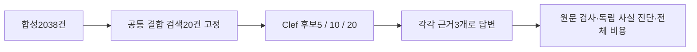

# 검색·재정렬 후보 5·10·20건 비교

기준 2026-10-14 KST · 별도 합성 2,038건 · 운영 코드/DB/설정 변경 없음

후반 실행 오류가 포함되어 18시도 중 실제 답변 모델 진입은 13시도입니다. 5시도는 답변 호출 전에 실패했고, 모델에 도달한 시도 중 1시도는 정리에 실패했습니다. 세 구성 공통 실행 질문은 4개뿐이므로 최종 답변 품질 우위는 판정하지 않습니다. 원래 실패 기록은 보존했고 실험 전용 모델의 사후 해제를 확인했습니다.

같은 검색 목록 20개에서 앞 5·10·20개만 Clef로 재정렬하고, 실제 답변의 근거 수는 모두 3개로 고정했습니다. 새 질문 12개와 이전 v3 회귀 12개를 분리했습니다. 고정한 새 질문 6개×3구성의 18답변 시도에서 보정/재요청은 최대 1회입니다.



- [결과·개선/악화·비용·한계 보고서](report.md)
- [순위 집계](ranking-summary.csv) · [질문별 변화](changes.csv) · [답변 시도 집계](answer-summary.csv) · [공통 실행 질문 진단](matched-answer-summary.csv)
- [모든 질문의 합성 사례](cases.md) · [공개 프로토콜](protocol-public.json)
- [질문·라벨](dataset-public.json) · [공통 후보 목록](candidate-pools.json) · [합성 원문 부분집합](synthetic-source-subset.json)
- [순위 결과](ranking-results.json) · [답변 진단 결과](answer-outcomes.json) · [비용 요약](cost-summary.json)
- [로컬 무결성 대조 기록](audit.json) · [파일 해시](manifest.json) · [이전 v3 결과](../architecture-v3-20261014/README.md)

공개 원문은 후보와 기대 근거에 해당하는 부분집합입니다. 전체 2,038건을 공개한 것으로 표시하지 않습니다. 원래 배경 2,000건은 저장소의 experiments/relation_quality.py 생성기, 나머지 38건은 이전 v3 합성 자료에서 가져왔습니다. 모델 지시문·버전은 고정했고 새 설치·다운로드는 하지 않았습니다.

저장소 루트에서 Python 표준 라이브러리만으로 공개 수치를 다시 집계할 수 있습니다.

```sh
python docs/experiments/candidate-budget-20261014/verify_results.py
```

Clef는 기존 직렬화·지시문·응답 검사를 유지하고, 전송만 격리 MLX GPU 자식 실행으로 연결했습니다. 임베딩·답변은 실제 로컬 LM Studio HTTP 호출입니다. 측정 시간은 브라우저 통신·웹 대기열을 포함한 운영 사용자 지연이 아닙니다.

이는 저장 결과·분모·시간·후보 불변과 해시의 재집계입니다. 모델 추론·원문 검사·의미 판정이나 라벨의 현장 타당성을 다시 검증하지 않습니다. 원래 격리 GPU 실행기는 로컬에 있고 이 공개 묶음은 전체 GPU 실험의 이식 가능한 재현 패키지가 아닙니다.

원시 LLM 요청·응답·추론 로그, 실제 Excel/CS·운영DB·개인 설정·인증 정보·가중치·가상환경은 업로드하지 않았습니다. 결과 보고서에서 언급하는 원시 로그는 로컬 비공개 증거입니다. 새 발표 파일을 만들거나 기존 v3 발표 수치를 이 실험으로 바꾸지 않았습니다.

이 결과는 Mac M2 Max 32GiB의 규칙적인 합성 기술 진단입니다. 이전 질문은 회귀이며 새 질문도 기존 합성 배경과 유형을 공유합니다. Windows/DRM·120B·10만 건·사람 업무 효과·근거 없는 질문의 거절 능력·범용 재정렬 대비 우위는 미검증입니다. 운영 기본값과 모델은 자동 채택하지 않았습니다.
