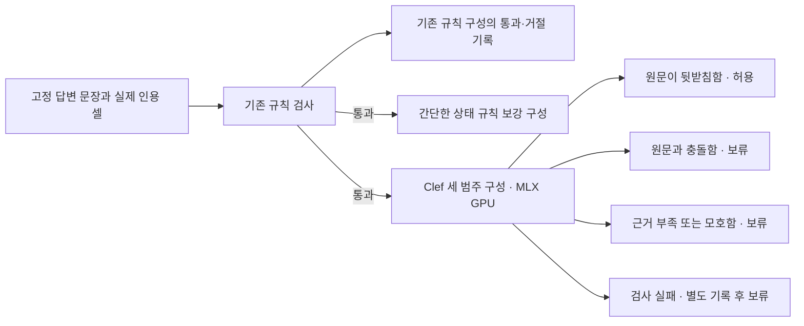

# Clef 답변 상태 의미 검사 · 소규모 진단

2026-10-15 KST · 운영 미연결 · 합성/실버 라벨

기존 운영 코드·설정·발표 파일은 변경하지 않았다. 답변 문장과 그 문장이 실제 인용한 원문 셀만 입력했다. 다른 검색 후보·질문·영어 번역·외부 지식으로 답변을 정당화하지 않았고, 답변 재생성·자동 수정·운영 채택은0회다.

## 입력 지원과 사전 고정

이미 설치된 Clef-flash MLX8bit 로더의 해시를 확인했다. 현재 로더의 native type은noul/choice/score이며, classification이라는 새 type을 흉내 내지 않고 choice의 세 범주를 사용했다. 비채점3입력에서 세 범주 구조·MLX GPU·잘림 없음·출력 토큰0을 확인했다. 이3개를 평가 정확도 표본으로 더하지 않았다. 모델 설치·다운로드는 없었다.

고정 프로토콜 SHA256 `2df6fb732bc2b2b5eb661551f6316d5d94aa71910bf17fc461c3a6bf9e86152b`, 자료 SHA256 `e7149c7853b2eb11cbdf270b39d064799eb2f5215f472b40e9286db3b4a98c1b`. DEV4원문묶음/12문장과 TEST12원문묶음/36문장을 분리하고 모든 사실·라벨·지시문·규칙·argmax·처리 기준을 평가 전에 고정했다. DEV 이후 지시문·임계값·규칙을 고치지 않았다. 저자가 만든 실버 라벨이며 독립 담당자 판정이 아니다. 같은 원문에서 파생한3문장을 독립 현장 사건3개로 세지 않는다.

원문이 직접 뒷받침하면supported, 명시적 반대 사실이면contradicted, 정보 부족·모호함이면insufficient이다. 계획만으로 시행/미시행을 단정하지 않고, 결과 미기재를 성공/실패로 바꾸지 않는다. 확률은 세 선택지 안의 상대값이며 보정된 진실 확률이 아니다.

## 비교군과 TEST 결과

기존 규칙은 현재 validate_claims를 수정 없이 호출하되, 비교 공정성을 위해 실제 인용 셀만 전달했다. 운영의 전체 후보 묶음 입력을 재현한 것은 아니다. 규칙 통과에는 의미 삼분류가 없으므로semantic=null을supported로 바꾸지 않았다. 상태 규칙 보강은 제한된 상태 단어 패턴으로 명시적 충돌/부족을 보류하고 나머지는 기존 통과를 유지한다. 기존 규칙+Clef는 기존 통과 건에만 모델을 호출하고supported만 허용한다. 검사 실패는 별도 보류이며 오류 탐지 성공으로 세지 않는다.

|구성|충돌 차단/12|기존 누락 중 추가 충돌 탐지|정상 오차단/12|근거 부족의 잘못된 통과/12|검사 실패/36|
|---|---:|---:|---:|---:|---:|
|기존 규칙|0|0/12|0|10|0|
|상태 규칙 보강|5|5/12|0|6|0|
|기존 규칙 + Clef|11|11/12|0|0|0|

정상 오차단과 충돌 차단은 검사 실패를 제외한 실버 라벨 대조다. 정상 보류에 검사 실패까지 포함한 수와 삼분류 혼동 행렬은metrics.json에 있다. 규칙의 미판정은 의미상 근거 부족 판정과 다르다. 유형별 표현과 실제 모델 판단·gate 결과는decisions.csv와cases-public.json에서 함께 확인할 수 있다.

기존 규칙을 통과했던 근거 부족10건 중 상태 규칙은4건, Clef는10건을 추가 보류했다. 이를 명시적 충돌 탐지와 합쳐 동일 의미 판정으로 발표하지 않는다.

## 삼분류와 통과/보류의 차이

위11건은충돌 라벨 문장을 비허용한 수이며, 모두를정확히contradicted로 분류했다는 뜻이 아니다. 기존 규칙이근거 부족2건을 먼저 차단해 TEST모델 호출은34회다. 모델이 실제로 내린 세 범주를 분리하면 다음과 같다.

|실버 라벨|supported 판정|contradicted 판정|insufficient 판정|모델 미호출|검사 실패|
|---|---:|---:|---:|---:|---:|
|supported|12|0|0|0|0|
|contradicted|1|10|1|0|0|
|insufficient|0|2|8|2|0|

충돌을근거 부족으로판정한1건과근거 부족을충돌로판정한2건도오분류다. 부족근거 오통과0건을 삼분류가모두맞았다는결과로 바꾸지 않는다. 정상 오차단0/12도 일반적 무오류 보장이 아니다.

## 고정 선택 규칙의 설명 사례

각 조건에 해당하는 TEST 문장 중 case_id 사전순 첫 사례다. 없는 사례는 만들지 않는다. 선택은 사후 설명용이며 새로운 성능 표본이 아니다.

- Clef 추가 충돌 보류 `TEST-source-01-1`: 답변 「도어 실링을 교체했다.」 / 실제 인용 셀 「도어 실링 교체는 자재를 기다리는 중이며 아직 수행하지 않았다.」 / 라벨 contradicted / 판정 contradicted.
- Clef 충돌 미탐지·오통과 `TEST-source-00-1`: 답변 「노즐 청소 안건은 상정되지 않았다.」 / 실제 인용 셀 「노즐 청소는 다음 정기정비 때 시행할 안건으로 올렸다. 현재 시행 여부는 적혀 있지 않다.」 / 라벨 contradicted / 판정 supported.
- Clef 근거 부족을 충돌로 오분류 `TEST-source-00-2`: 답변 「노즐 청소를 완료했다.」 / 실제 인용 셀 「노즐 청소는 다음 정기정비 때 시행할 안건으로 올렸다. 현재 시행 여부는 적혀 있지 않다.」 / 라벨 insufficient / 판정 contradicted.
- Clef 정상 오차단: 해당 사례 없음.
- Clef 근거 부족 오통과: 해당 사례 없음.
- 상태 규칙 정상 오차단: 해당 사례 없음.

## DEV와 기존3건 회귀 · 주 결과와 분리

- DEV / rules: n=12, 충돌 차단0/4, 정상 오차단0/4, 근거 부족 오통과4/4, 검사 실패0.
- DEV / state_rules: n=12, 충돌 차단3/4, 정상 오차단0/4, 근거 부족 오통과3/4, 검사 실패0.
- DEV / clef: n=12, 충돌 차단4/4, 정상 오차단0/4, 근거 부족 오통과0/4, 검사 실패0.
- REGRESSION / rules: n=3, 충돌 차단0/1, 정상 오차단정상 표본 없음, 근거 부족 오통과2/2, 검사 실패0.
- REGRESSION / state_rules: n=3, 충돌 차단1/1, 정상 오차단정상 표본 없음, 근거 부족 오통과1/2, 검사 실패0.
- REGRESSION / clef: n=3, 충돌 차단1/1, 정상 오차단정상 표본 없음, 근거 부족 오통과0/2, 검사 실패0.

기존 B09·B10·B11은 이전 실험이 주입한 상태 오류이며 실제 모델이 자연 발생시킨 오류3건이 아니다. 원래 답변 문장과 실제 인용 셀을 보존하고 다른 상세/열은 제외했다. 계획→시행과 미기재→정상은insufficient, 명시적 미실시→실시는contradicted로 사전 구분했다. 신규 TEST 분모나 개선 증거에 합치지 않았다.

## 순수 추론과 적재·교대 비용

상주 프로토타입에서 실제 모델 호출49회. 기존 규칙이 거절한 건은 모델을 호출하지 않았다. 적재22.504초, 계산 합50.271초, 자식 시작부터 종료까지wall 73.973초다. 적재·계산은wall에 포함되며 다시 합산하지 않는다.

- DEV: 실제 분류12회, 순수 계산 중앙1.003초, p95 1.021초. 적은 표본의 p95를 안정된 서비스 지연으로 해석하지 않는다.
- TEST: 실제 분류34회, 순수 계산 중앙1.006초, p95 1.087초. 적은 표본의 p95를 안정된 서비스 지연으로 해석하지 않는다.
- REGRESSION: 실제 분류3회, 순수 계산 중앙0.915초, p95 0.915초. 적은 표본의 p95를 안정된 서비스 지연으로 해석하지 않는다.

다음은 고정한DEV의 동일3입력을 사용한 별도 비용 측정이다. 소유한 진단 전용 GPT-OSS20B 별칭만16K·parallel1로 적재/해제했다. 실제 답변 생성은 없었다. 기존 사용자 모델을 중지하거나 서비스 설정을 바꾸지 않았다. cold는Clef별도 프로세스의 시작·적재·분류·종료 전체다. 추가 교대 비용은답변 모델 해제+cold+답변 모델 재적재이며, 최초 답변 모델 적재와 최종 별칭 해제는 준비/정리 비용으로 따로 보존했다.

- DEV-source-00-0: 최초 적재29.488초 / 해제1.473초 / cold 24.623초 / 재적재28.293초 / 최종 정리0.513초 / 검사 준비 완료까지26.096초 / 답변 모델 복원을 포함한 교대 합54.389초 / 오류None / 분류 실패False / 상주 판정과 동일True.
- DEV-source-00-1: 최초 적재2.489초 / 해제0.524초 / cold 24.625초 / 재적재28.155초 / 최종 정리1.554초 / 검사 준비 완료까지25.149초 / 답변 모델 복원을 포함한 교대 합53.304초 / 오류None / 분류 실패False / 상주 판정과 동일True.
- DEV-source-00-2: 최초 적재2.773초 / 해제0.496초 / cold 24.325초 / 재적재27.940초 / 최종 정리0.505초 / 검사 준비 완료까지24.822초 / 답변 모델 복원을 포함한 교대 합52.762초 / 오류None / 분류 실패False / 상주 판정과 동일True.

실행기 전체wall 271.833초(분류+비용 실험+상태 확인 포함). worker wall 합147.546초, LM Studio 제어 합124.198초. 이 부분합들을 전체wall에 또 더하지 않는다. 비채점 API 탐침 비용29.752초는 별도다. 초기 읽기 전용CLI 환경 탐색의 연결 지연은 정밀 계측하지 않았으며 모델 추론 비용이나0초로 간주하지 않는다.

추론 구간의 MLX GPU allocated 피크10463190300bytes, 분류 자식RSS 피크4627709952bytes. 적재 도중의 GPU 메모리 피크는 별도 계측하지 않았다. unified memory를 중복 합산하지 않는다. 답변 모델은 적재/해제만 측정했으며 답변 생성 지연·GPU피크·실제 브라우저 전체 응답 시간은 미측정이다. 현재 서비스에 연결한 운영 실측이 아닌 격리된 교대 진단이다.

## 해석 범위

이 진단은 현재 로컬 Clef가 인용 셀에 근거한 상태 삼분류를 실제로 수행할 수 있는지와, 규칙 대비 추가 탐지·오차단·부족 근거 통과·비용을 관찰한다. 작은 균형 합성자료·실버 라벨이며 현장 정확도나 자동 채택 근거가 아니다. 미탐지·오차단·실패를 모두 보존하고, 이 TEST를 고쳐 새로운 독립 성과로 발표하지 않는다. 종료 뒤 보고서의 혼동 행렬과 설명 사례만 정리했으며 모델 입력·규칙·라벨·처리 기준은 바꾸지 않았다.

모델 원시 요청/응답·추론 로그·실제 CS·DB·설정·가중치·가상환경은 공개하지 않는다. 공개 cases는창작 자료이며decisions는판정 집계용 파생 결과다. 운영 코드나 발표 파일은 수정하지 않았다.

추가 교대 합은 계측한 구성요소의 합으로 제어 전 상태 조회는 포함하지 않는다. 답변 모델 복원까지 기다려야 검사 결과를 화면에 제공할 수 있는지는 운영에 연결하지 않아 확인하지 않았다. 검사 준비 완료까지의 해제+cold 비용과 완전 교대 비용을 구분한다. 전체 실행기wall을 따로 보존했다. CSV의rule_seconds는규칙 시간이고compute_seconds는추가 GPU 계산 시간이며 둘을 전체 사용자 지연으로 해석하지 않는다. LM Studio의 답변 모델 배치는 자동 설정이며, 이를 별도 검증한 전층 GPU 추론 성능으로 설명하지 않는다.

[문장별 판정153행](decisions.csv) · [집계](metrics.csv) · [삼분류 혼동](metrics.json) · [고정 창작 원문과 라벨](cases-public.json) · [사전 프로토콜](protocol-public.json) · [비용](cost.json) · [검증 범위](audit.md) · [종료 후 환경 관측](inventory.json)
