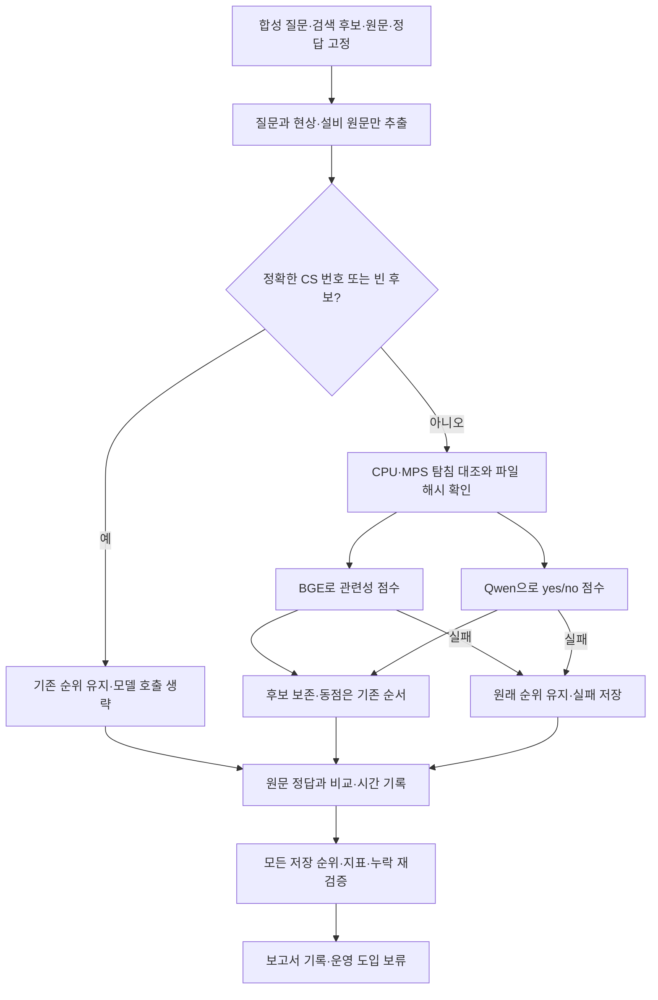

# BGE·Qwen 검색 후보 재정렬 비교

기준일: 2026-10-01 · Apple M2 Max·32GB·Mac MPS 실계산 · 운영 적용 보류

## 결과와 판단

**Qwen3-Reranker-0.6B를 후속 검증 후보로 권장합니다.** 같은 원문 후보에서 기존 질문의 첫 정답은 40/44→44/44, 조건 질문은 18/36→33/36으로 늘었습니다. 상위 5개 정답 포함 44/44도 유지했습니다. BGE는 빠르지만 정답 2건을 상위 5개 밖으로 밀었습니다. 두 모델 모두 근거 부족이나 정확한 숫자 조건을 믿을 만하게 거절하지 못하므로 답변 검사 모델로 대체하지 않습니다.

두 실행 모두 `complete=true`, 처리 98·오류 0·누락 0·모델 호출 생략 6문항입니다. 각 모델이 실제 976개 질문·후보 쌍을 계산했습니다. 학습·임계값 조정·운영 설정 변경·자동 모델 채택은 하지 않았습니다.

## 비교 범위

- 기존 50문항: 제목·유사 표현·현상 구분·새 표현·CS 번호·근거 부족. 정답 있는 44문항과 없는 6문항입니다. 10만 건 합성 DB에서 과거에 저장한 최대 20개 후보를 재사용합니다. DB를 열거나 현재 키워드·벡터 검색을 다시 실행하지 않았습니다.
- 조건 48문항: 16개 조건을 한국어·영어·중국어로 질문합니다. 후보는 한국어 원문 2개씩이고, 36문항은 정답이 있으며 12문항은 모두 조건에 맞지 않습니다. 언어별 문항은 서로 연관되어 독립 표본이 아닙니다.
- 정확한 CS 번호 3문항과 빈 후보 3문항은 기존 순위를 유지합니다. 재정렬 대상은 기존 44문항·조건 48문항입니다.
- 모델 입력은 원문 질문과 기존 `case_text`의 현상·제목·설비 관련 9개 열입니다. 채점 정답·검색 점수·상세 ID·CS 번호·작업자·조치는 입력에 넣지 않습니다. 모델 입력에 쓰는 문장과 인용 원문을 변경하지 않았습니다.

이미 여러 실험에 사용한 합성 자료입니다. 새 홀드아웃·사람이 판정한 현장 질문·10만 건 전체의 답변 품질 평가가 아닙니다. 후보 밖의 정답은 순서 조정으로 복구할 수 없습니다.

## 실행 방식

| 항목 | BGE | Qwen |
|---|---|---|
| 공개 모델 | [BAAI/bge-reranker-v2-m3](https://huggingface.co/BAAI/bge-reranker-v2-m3) | [Qwen/Qwen3-Reranker-0.6B](https://huggingface.co/Qwen/Qwen3-Reranker-0.6B) |
| 고정 revision | `953dc6f6f85a1b2dbfca4c34a2796e7dde08d41e` | `e61197ed45024b0ed8a2d74b80b4d909f1255473` |
| 점수 방식 | 질문·사례 쌍의 분류 logit | 공식 형식으로 입력 후 마지막 위치의 `yes − no` logit |
| 입력 | 원문 질문·원문 사례 | 동일 원문과 유지보수 조건 비교용 고정 영어 지시 |
| 실제 최대 입력 토큰 | 161 | 292 |

두 모델 모두 Apache-2.0 라이선스이며 설치된 Transformers로 실행했습니다. 공개 저장소의 고정 파일을 내려받아 가중치 SHA256과 전체 파일 해시를 기록했습니다. 표준 모델 로더·Safetensors만 사용하고 `trust_remote_code=False`, 오프라인 로딩, 자동 CPU fallback 금지로 실행합니다. 모델 파일·가상환경·실행 결과는 Git에 올리지 않습니다.

Float32·SDPA·배치 4·CPU 스레드 4로 실행하고, 두 모델을 동시에 GPU에 올리지 않았습니다. 동일한 8,192토큰 입력 제한을 적용해 길이를 초과하면 자르지 않고 실패로 기록합니다. Qwen은 [공식 Transformers 예제](https://huggingface.co/Qwen/Qwen3-Reranker-0.6B#using-transformers)의 입력 틀과 yes/no 점수를 사용하며 답변이나 사고 과정을 생성하지 않습니다. 모델과 입력 틀이 함께 다르므로 모델 구조 하나만의 효과를 분리한 실험은 아닙니다. 이번 자료는 짧아 긴 입력 성능을 검증하지 않았습니다.

점수는 확률로 반올림하기 전 logit으로 정렬합니다. 동점은 기존 순서를 유지하고, 후보를 삭제하지 않습니다. 잘못된 점수·누락·계산 오류에는 원래 순위를 보존하며 실패가 남으면 완료로 표시하지 않습니다. 질문마다 결과를 저장하므로 동일한 조건으로 중단 지점부터 재개할 수 있습니다.

## 실제 CPU·GPU 대조

평가 정답과 무관한 기존 6개 영어 탐침으로 장치를 비교했습니다. 모든 파라미터의 CPU/MPS 위치와 실제 추론을 확인하고, 사전에 고정한 logit 차이 0.02·판정 부호·후보쌍 순서 조건을 모두 통과했습니다. 허용 범위를 결과에 맞추어 늘리지 않았습니다.

| 항목 | BGE | Qwen |
|---|---:|---:|
| CPU·MPS 최대 logit 차이 | 0.0000225 | 0.0000277 |
| 탐침 판정·후보쌍 순서 일치 | 모두 일치 | 모두 일치 |
| 탐침 6쌍 CPU 계산 시간 | 0.176초 | 1.296초 |
| 탐침 6쌍 MPS 계산 시간 | 0.811초 | 0.755초 |
| 모델 CPU 적재 시간 | 1.980초 | 2.795초 |

GPU라고 모든 짧은 입력이 빨라지는 것은 아닙니다. BGE의 짧은 탐침은 CPU가 더 빨랐습니다. 다음 전체 평가는 MPS에서 수행했으며, 실제 현장 CPU·CUDA·Windows 지연은 측정하지 않았습니다. 다른 프로젝트의 CPU 작업도 실행 중이었으므로 이 시간을 독점 자원의 안정적인 벤치마크로 해석하지 않습니다.

## 품질과 처리 시간

| 원문 기준 지표 | 기존 순위 | BGE | Qwen |
|---|---:|---:|---:|
| 기존 정답 질문: 첫 정답 | 40/44 | 42/44 | 44/44 |
| 기존 정답 질문: 상위 3개 정답 포함 | 44/44 | 42/44 | 44/44 |
| 기존 정답 질문: 상위 5개 정답 포함 | 44/44 | 42/44 | 44/44 |
| 기존 50문항: 상위 5개 평균 적합 비율 | 72.0% | 84.0% | 87.2% |
| 조건 정답 질문: 첫 정답 | 18/36 | 29/36 | 33/36 |
| 조건 한국어·영어·중국어 첫 정답 | 각 6/12 | 10/12 · 9/12 · 10/12 | 10/12 · 12/12 · 11/12 |
| 기존 재정렬 44문항: 평균 / p95 | 추가 정렬 없음 | 0.330 / 0.386초 | 1.121 / 1.273초 |
| 조건 재정렬 48문항: 평균 / p95 | 추가 정렬 없음 | 0.026 / 0.053초 | 0.088 / 0.099초 |

첫 정답·정답 포함 지표는 정답 없는 문항을 제외합니다. 상위 5개 평균 적합 비율은 기존 50문항 각각의 `관련 후보 수 / 실제 상위 후보 수`를 평균하며, 빈 후보는 0, 후보가 5개 미만이면 반환 수를 분모로 사용합니다. 정확한 CS 조회 3문항은 모델 호출을 생략하지만 지표에는 포함합니다. 조건 질문은 후보 2개를 모두 유지하므로 정답 포함 지표로 순위 개선을 판별할 수 없어 첫 결과를 비교합니다.

추가 시간은 토큰화·점수 계산·정렬 단계입니다. 모델 적재·탐침·체크포인트 저장·원래 검색·번역·LLM 답변 생성은 제외합니다. 두 모델의 질문별 시간 합계는 BGE 15.766초, Qwen 53.526초입니다. 모델별로 한 차례의 고정 평가를 측정했으며 결과를 보고 재측정하거나 최적화하지 않았습니다.

## 남은 오류

| 확인한 사례 | 결과와 의미 |
|---|---|
| 진공 배기는 정상이며 대기압 복귀만 늦음 | BGE가 `contrast-03`, `new-03`의 정답을 상위 5개 밖으로 밀었습니다. Qwen은 첫 결과에 정답을 놓았습니다. |
| 팬은 정상이고 펌프에서만 소음 발생 | 한국어 `pump-ko`에서 두 모델 모두 팬 소음 사례를 먼저 놓았습니다. 영어·중국어 표현의 성공이 한국어 성능을 보증하지 않습니다. |
| 온도 초과가 아니라 승온이 늦음 | Qwen이 한국어 `slowheat-ko`에서 온도 초과 사례를 먼저 놓았습니다. |
| 펌프는 조용하고 팬만 소음 발생 | Qwen이 중국어 `fan-zh`에서 펌프 소음 사례를 먼저 놓았습니다. |
| 정확히 11.8 L/min인데 후보는 1.18·118 L/min | Qwen은 세 언어 모두 잘못된 후보에 양의 관련성 점수를 줬습니다. 높은 점수가 정확한 수치 일치를 뜻하지 않습니다. |
| 누수 확정만 찾는데 후보는 의심·점검 예정 | Qwen은 한국어·중국어에서 근거 부족을 구분하지 못했습니다. |

logit 0 미만(yes/no 변환 시 0.5 미만)을 근거 부족으로 보는 **진단용** 고정 조건도 기록했습니다. 조건 질문의 근거 없는 12문항에서 BGE는 8문항, Qwen은 1문항만 낮은 점수를 줬습니다. 정답 있는 조건 질문을 근거 부족으로 오인한 경우는 BGE 3/36, Qwen 0/36입니다. 기존 질문에서는 실제 점수를 계산한 정답 문항 41개 중 BGE 15개·Qwen 5개가 이 기준 아래였습니다. 따라서 이 임계값으로 후보를 자동 제거하거나 답변을 허용하지 않습니다.

기존 영어 번역을 쓰던 LEV·CLM과는 입력 언어·실행 방식이 다릅니다. 과거 LEV·CLM 결과를 이번 동일 조건의 직접 우열 비교에 섞지 않습니다. 원문 기반 재정렬과 답변 근거 확인은 역할이 다르며, 기존 규칙과 선택적 영어 mDeBERTa 검사는 유지합니다.

## 흐름도



## 재현과 검증

실험 입력은 기존 로컬 `outputs/gliner-decide-20260926`, `outputs/gliner-followup-20260926`입니다. Git 소스만 새로 받은 PC에는 이 고정 후보가 없으므로 같은 평가를 바로 재현할 수 없습니다. 이 명령은 Mac MPS용이며 Windows 배포 프로그램의 새 실행 버튼은 아닙니다.

```sh
# 모델 준비: 공개 고정 revision만 내려받아 SHA256 확인
.venv/bin/python -m experiments.search_rerank --model bge --prepare
.venv/bin/python -m experiments.search_rerank --model qwen --prepare

# 동시에 두 모델을 실행하지 않고 하나씩 완료
PYTORCH_ENABLE_MPS_FALLBACK=0 HF_HUB_OFFLINE=1 TOKENIZERS_PARALLELISM=false TORCH_FORCE_WEIGHTS_ONLY_LOAD=1 .venv/bin/python -u -m experiments.search_rerank --model bge
PYTORCH_ENABLE_MPS_FALLBACK=0 HF_HUB_OFFLINE=1 TOKENIZERS_PARALLELISM=false TORCH_FORCE_WEIGHTS_ONLY_LOAD=1 .venv/bin/python -u -m experiments.search_rerank --model qwen

# 모델을 재호출하지 않고 원문 후보·저장 점수로 결과 대조
.venv/bin/python -m experiments.search_rerank --model bge --verify
.venv/bin/python -m experiments.search_rerank --model qwen --verify
.venv/bin/python -m tests.test_search_rerank
```

검사 명령과 두 실제 평가·검증 모두 종료 코드 0입니다. 누락·비정상 점수·동점·원문 불변·정확한 CS/빈 후보 생략·입력 초과·저장 순위 손상을 모의 검사로 확인했습니다. 각 평가의 원문 순위·지표 대조에 더해 로컬 `outputs/search-rerank-20261001/verify_results.py`에서 채점 함수와 별도로 핵심 지표 1,960개를 직접 산출해 일치와 두 기준 순위의 동일성을 확인했습니다. 실제 장치 비교는 수치 일관성 검증이며 검색 정확도 인증이 아닙니다.

실행 Python 3.14.6·torch 2.14.1·Transformers 4.57.6입니다. 상세 패키지·모델 파일·입력·스크립트 해시는 각 `protocol.json`에 있습니다. 실행 조건이나 코드가 바뀌면 기존 결과를 덮어쓰지 않고 새 `--root`를 사용합니다. 완료 재개는 검증만 수행하고 모델을 적재하지 않습니다. 운영 파일에 변경이 없고 새 실험은 Windows 패키지 대상이 아니므로 이번에 Windows 배포본을 다시 만들지 않았습니다.

| 로컬 산출물 | SHA256 |
|---|---|
| BGE `results.json` | `abe2b2129d7695af32cd47da16766992807c64ac91fa79a5f79bf3da1fcc3845` |
| Qwen `results.json` | `0ae79a696d9018f9fe4a23d4770bdbdcb6a4aaa0f0062ff83d8d16739745019d` |
| 고정 검색 후보 `candidates.json` | `b2880b5b6027b06a10b3f76459460f8e0f13c10d93c670b12877ece88cd862c8` |
| 독립 검증 `independent-verification.json` | `d39d81d249df4c3bcc256427528e986c394306dec9541e1e9ee54125c6749032` |

다음 도입 판단에는 사람이 확인한 새 업무 질문에서 정답 누락·숫자·부정 오류와 실제 Windows 처리 시간을 확인해야 합니다. 이번 점수로 프롬프트·임계값을 조정해 같은 자료를 다시 성공시킨 뒤 품질 향상으로 보고하지 않습니다.
