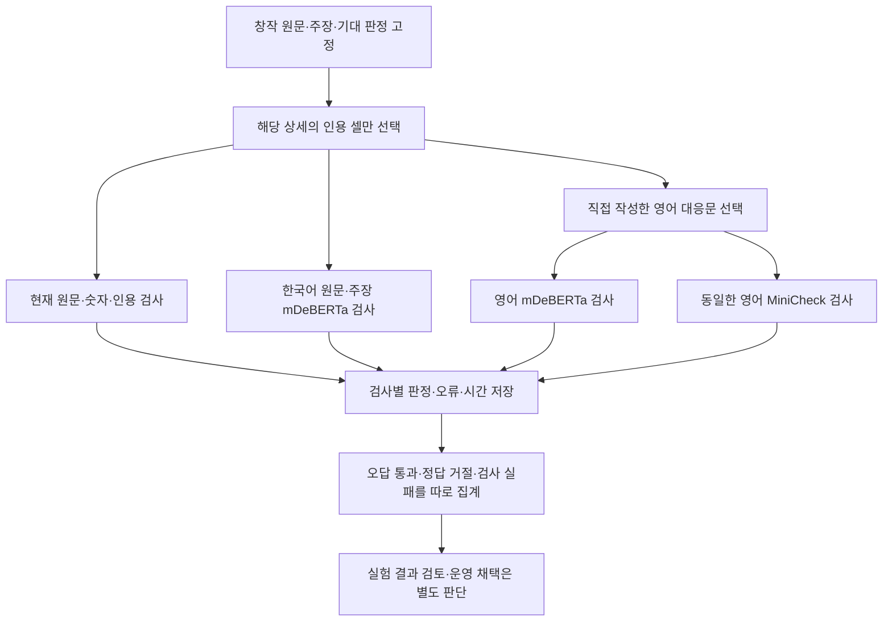

# 공개 모델로 답변 근거를 검사하는 비교

2026년 10월 1일 기준. Grok이 별도 실험 코드를 구현하고 Codex가 통합·검증합니다. 운영 답변, DB, 문장 다듬기와 번역 설정을 바꾸는 작업은 아닙니다.

## 목적과 비교 범위

원문의 숫자가 같아도 ‘교체 예정’을 ‘교체 완료’로 설명하거나, 다른 부품의 조치를 가져오면 답변의 뜻이 달라집니다. 기존 규칙 검사를 유지하면서 공개 모델이 이런 오류를 추가로 찾는지 확인합니다. 검색 후보 재정렬을 평가했던 LEV·CLM 실험과 구별합니다.

- 기준: 현재 `ragkit.llm.validate_claims`의 원문·인용·숫자 검사.
- 한국어 비교: mDeBERTa NLI가 원문과 주장 사이의 지지·중립·모순 확률을 계산합니다. 일부 원문에는 중국어가 섞여 있습니다.
- 영어 비교: mDeBERTa와 MiniCheck에 동일한 영어 근거·주장 쌍을 넣습니다. 같은 mDeBERTa의 두 언어 차이와 같은 영어에서의 모델 차이를 나눠 확인합니다. 영어는 직접 작성한 대응문이며 자동 번역의 정확도를 평가하는 실험이 아닙니다.
- 모델에 전달하는 자료는 해당 주장이 실제로 인용한 상세의 셀입니다. 다른 상세의 셀, 기대 정답과 오류 유형은 모델의 근거에 넣지 않습니다.

창작 사례로만 실행합니다. 운영 DB·실제 Excel·개인 설정·외부 판정 API를 사용하지 않습니다. 공개 모델 파일을 내려받은 뒤 추론은 로컬에서 진행합니다. 이 비교에 GPT-OSS 답변 생성이나 모델 학습은 필요하지 않습니다.

## 흐름



## 고정 모델과 판정 방식

| 비교 모델 | 고정 버전 | 입력·출력 |
|---|---|---|
| `MoritzLaurer/mDeBERTa-v3-base-xnli-multilingual-nli-2mil7` | `b5113eb38ab63efdd7f280f8c144ea8b13f978ce` | 원문·한국어 주장 또는 영어 대응 근거·주장 쌍, 지지·중립·모순 3개 확률, 최대 512토큰 |
| `lytang/MiniCheck-Flan-T5-Large` | `96eafd01cee2d16cf81aaa2fb226b14f422a37b3` | 영어 근거·주장 쌍, 공식 첫 decoder 위치의 두 label 확률, 공식 구현의 2048토큰 한도 |

MiniCheck는 일반적인 답변 생성 프롬프트로 호출하지 않습니다. 공식 구현의 입력 형식과 label token ID 3·209를 사용합니다. 일부 토크나이저 메타데이터에는 512가 표시되지만, 공식 MiniCheck 추론 코드는 2048을 사용합니다. 입력을 몰래 잘라 통과시키지 않으며, 한도 초과·비정상 확률·모델 오류는 판정 실패로 기록합니다.

지원 확률의 진단 기준은 실행 전에 **0.8**로 고정합니다. 확률은 실제 업무에서 보정된 정답 확률을 뜻하지 않습니다. 결과를 본 뒤 기준을 바꾸어 같은 자료의 성능을 높이는 작업은 하지 않습니다. NLI의 세 분류와 이진 통과 기준도 따로 기록합니다. 영어 결과가 한국어 원문 검사 실패를 덮어쓰지 않습니다.

`--language en`은 mDeBERTa의 모델 입력만 영어 대응문으로 바꿉니다. 모든 경로의 기존 규칙 검사는 한국어 주장과 원래 언어의 원문 셀을 사용합니다. 언어도 실행 조건에 고정하고, 다른 언어의 결과 폴더 재사용은 모델 적재나 결과 기록 전에 거절합니다. 기본값은 기존과 같이 mDeBERTa 한국어·MiniCheck 영어이며, mDeBERTa 영어의 기본 결과 폴더는 따로 둡니다. `baseline/en`, `minicheck/ko` 조합은 지원하지 않습니다.

두 모델 카드의 라이선스 표기는 MIT입니다. mDeBERTa 카드에는 한국어·중국어·영어를 포함한 NLI 학습 자료가 설명돼 있습니다. MiniCheck-Flan-T5-Large는 영어 문서와 주장 사이의 지원 여부를 검사합니다. 카드에 있는 다른 자료의 정확도·비용 수치를 우리 시스템의 성능으로 가져오지 않습니다.

## 재현과 결과 확인

실험 코드는 `experiments/claim_guard.py`, 창작 입력은 `experiments/claim_guard_cases.json`, 서버 없는 검사는 `tests/test_claim_guard.py`에 보관합니다. 무거운 모델 의존성은 별도 환경에 설치하며 기본 프로그램 설치에 추가하지 않습니다.

```sh
uv venv --python 3.12 outputs/claim-guard-20261001/.venv
uv pip install --python outputs/claim-guard-20261001/.venv/bin/python -r experiments/requirements-claim-guard.txt

# 공개 모델의 고정 버전을 한 번 준비합니다. 운영 DB는 사용하지 않습니다.
outputs/claim-guard-20261001/.venv/bin/python - <<'PY'
from huggingface_hub import snapshot_download
from experiments.claim_guard import MDEBERTA_ID, MDEBERTA_REV, MINICHECK_ID, MINICHECK_REV
snapshot_download(MDEBERTA_ID, revision=MDEBERTA_REV,
                  allow_patterns=['*.json', '*.model', '*.safetensors'])
snapshot_download(MINICHECK_ID, revision=MINICHECK_REV,
                  allow_patterns=['*.json', '*.model', 'pytorch_model.bin'])
PY

.venv/bin/python -m unittest tests.test_claim_guard
outputs/claim-guard-20261001/.venv/bin/python -m experiments.claim_guard --backend baseline --output outputs/claim-guard-english-20261001/baseline
HF_HUB_OFFLINE=1 TOKENIZERS_PARALLELISM=false TORCH_FORCE_WEIGHTS_ONLY_LOAD=1 outputs/claim-guard-20261001/.venv/bin/python -m experiments.claim_guard --backend mdeberta --language ko --device cpu --threshold 0.8 --local-files-only --output outputs/claim-guard-english-20261001/mdeberta-ko
HF_HUB_OFFLINE=1 TOKENIZERS_PARALLELISM=false TORCH_FORCE_WEIGHTS_ONLY_LOAD=1 outputs/claim-guard-20261001/.venv/bin/python -m experiments.claim_guard --backend mdeberta --language en --device cpu --threshold 0.8 --local-files-only --output outputs/claim-guard-english-20261001/mdeberta-en
HF_HUB_OFFLINE=1 TOKENIZERS_PARALLELISM=false TORCH_FORCE_WEIGHTS_ONLY_LOAD=1 outputs/claim-guard-20261001/.venv/bin/python -m experiments.claim_guard --backend minicheck --language en --device cpu --threshold 0.8 --local-files-only --output outputs/claim-guard-english-20261001/minicheck-en
```

처음에는 빈 결과 폴더를 사용합니다. 모델 준비만 인터넷을 사용하고 위 모델 비교 명령은 로컬 캐시만 읽습니다. 같은 결과 폴더를 재사용할 때는 옵션과 환경도 같아야 합니다. 이번 영문 추가 비교는 네 경로 모두 같은 Python 3.12.14 환경에서 실행했습니다. 모델 라이브러리는 PyTorch 2.14.1·Transformers 4.57.6·SentencePiece 0.2.2·openpyxl 3.1.5입니다. 네 경로의 규칙 판정은 문항별로 동일했습니다.

실측 창작 자료의 SHA-256은 `c388a9b9a3e847fb332e6b012e7e707c482f9a8e95d3ea5064e78bacc7b332de`입니다. 코드나 환경이 바뀌면 새 결과 폴더에서 비교하고 이전 결과를 덮어쓰지 않습니다.

같은 조건으로 다시 실행하면 완료된 문항을 재사용합니다. 자료·코드·모델 버전·언어·진단 기준·실행 환경이 바뀌면 새 출력 폴더를 사용합니다. 자료·실행 코드와 실제 규칙 검사 의존 파일의 SHA-256, 모델 개정·언어·장치·확률 기준·자료형·스레드·라이브러리 버전을 `protocol.json`에 먼저 고정합니다. 각 문항은 체크포인트로 저장하고, 마지막 입력 검증 후에만 `results.json`의 `complete`를 켭니다. 검사기 예외와 길이 초과는 오답 차단으로 세지 않습니다. 실행 실패는 종료 코드 1로 알리며 진행 상태도 남깁니다. 종료 코드나 실행 완료만으로 의미 검사 성능을 인정하지 않습니다. 초기 코드의 결과 폴더는 새 코드에서 재개하지 않고 보존합니다.

## 검증 결과와 한계

36건을 고정해 기존 규칙, 한국어 mDeBERTa, 영어 mDeBERTa, 영어 MiniCheck의 네 경로를 완료했습니다. 올바른 주장 17건, 인용 근거로 뒷받침되지 않는 주장 19건입니다. 예정·완료, 장기 재발 미확인, 실패 조치, 조치와 결과 연결, 숫자·부호·단위, 같은 CS의 다른 부품, 근거 누락, 목록 번호·의역, 질문에만 있는 조건과 중국어 혼합 원문을 포함합니다. 원문·대응문·기대 판정·모델 버전·확률 기준은 초기 비교 그대로 유지했습니다.

| 검사 경로 | 근거 없는 주장 통과 / 19건 | 올바른 주장 거절 / 17건 | 실행 오류 |
|---|---:|---:|---:|
| 기존 규칙 | 9 | 1 | 0 |
| mDeBERTa 한국어 경로 | 4 | 1 | 0 |
| 기존 규칙 + mDeBERTa 한국어 | 0 | 2 | 0 |
| mDeBERTa 영어 경로 | 3 | 0 | 0 |
| 기존 규칙 + mDeBERTa 영어 | 0 | 1 | 0 |
| MiniCheck 영어 경로 | 0 | 3 | 0 |
| 기존 규칙 + MiniCheck 영어 | 0 | 4 | 0 |

표의 결합 경로는 기존 원문 규칙과 해당 모델 검사 모두 통과한 경우입니다. 한국어·영어 모델을 서로 AND 또는 OR로 합친 운영 기능은 아닙니다. 각 모델 경로의 36건에는 빈 인용 1건을 모델 호출 전에 차단한 결과도 들어 있습니다. 성능 비교의 실제 모델 계산은 경로마다 **35쌍**, 합계 **105쌍**입니다. 두 영어 모델의 인용 셀·주장은 문항별로 동일합니다. 같은 모델의 언어별 차이는 직접 작성한 대응문에서의 결과이며 자동 번역의 개선 효과를 뜻하지 않습니다.

M2 Max·32GB Mac에서 CPU 4스레드·float32로 모델을 하나씩 실행했습니다. 실제 계산 35쌍의 평균은 한국어 mDeBERTa **0.046초**, 영어 mDeBERTa **0.042초**, 영어 MiniCheck **0.246초**였습니다. 인용 셀의 토큰화와 판정 단계 시간이며 모델 적재·검색·번역·답변 생성·전체 UI 처리 시간은 제외합니다. 다른 작업이 실행 중인 Mac에서 한 번 측정한 시간으로, Mac GPU나 Windows 성능 또는 보장된 속도 향상을 나타내지 않습니다.

### 두 언어의 판정이 달랐던 사례

mDeBERTa의 통과 여부는 36건 중 **2건**에서 달랐습니다. 나머지 34건은 빈 근거의 사전 차단 1건을 포함해 같았습니다. 두 언어 결과는 각각 기록하며 한쪽 점수로 다른 쪽 실패를 덮어쓰지 않습니다.

| 사례 | 원문 기준 의미 | 한국어 지지 점수 | 영어 지지 점수 | 원문 규칙과 결합한 결과 |
|---|---|---:|---:|---|
| `CG-PLAN-04` | ‘필터 청소 예정’만으로 현재 미완료를 확정할 수 없음 | 0.9849 · 통과 | 0.0263 · 거절 | 두 언어 모두 원문 규칙에서 거절 |
| `CG-MISS-01` | 펌프 누수를 뜻이 같은 문장으로 설명 | 0.7452 · 거절 | 0.8290 · 통과 | 한국어는 거절, 영어는 통과 |

영어에서 올바른 설명 한 건을 더 유지했지만 표본이 작고, 영어 표현을 손으로 작성했습니다. `CG-MISS-01`의 영어 근거와 주장은 마침표를 제외하면 같으므로 실제 자동 번역이나 다양한 의역에서도 개선되는지는 별도 확인이 필요합니다. 이 차이만으로 한국어보다 영어가 항상 정확하다고 판단하지 않습니다.

### 원문 대조에서 확인한 오류

- mDeBERTa는 ‘센서 교체 후에도 증상 지속, 배선 수정 후 정상화’에서 ‘센서 교체 후 정상화’를 지원 확률 **0.9865**로 통과시켰습니다. `-0.2 MPa`를 `0.2 MPa`로 바꾼 주장도 **0.9376**으로 통과했습니다. 기존 조치 연결·부호 검사는 둘 다 거절했습니다. 모델 단독으로 기존 검사를 대체할 수 없습니다.
- mDeBERTa는 올바른 ‘펌프에서 누수가 발생했습니다’를 **0.7452**로 평가했습니다. NLI 분류는 지지였지만 고정 기준 0.8 때문에 거절했습니다. 점수는 보정된 정답 확률이 아닙니다.
- MiniCheck는 올바른 압력 설명과 두 사실을 함께 설명한 답변 항목 일부를 거절했습니다. 특히 ‘센서 교체 후 증상 지속, 배선 수정 후 정상화’를 원문과 같은 영어로 적어도 지원 확률은 **0.2693**이었습니다. 이 실험은 한두 문장의 답변 항목을 하나의 짧은 쌍으로 넣으며, 공식 MiniCheck의 문장 단위 사용·긴 문서 처리 전체를 재현한 평가는 아닙니다.
- 영어 mDeBERTa도 ‘센서 교체 후 정상화’, ‘렌즈 청소 후 정상화’, 음수 부호를 지운 압력 주장 3건을 통과시켰습니다. 지지 점수는 각각 **0.9965**, **0.9969**, **0.9830**이었습니다. 기존 원문 규칙은 세 건 모두 거절했습니다. 영어로 바꿔도 조치와 효과의 잘못된 연결이나 부호 오류가 해결되지는 않았습니다.
- 세 결합 경로는 원문 `2小时`의 한국어 대응 `2시간`도 거절했습니다. 모든 모델 경로는 같은 지속 시간으로 지지했지만 기존의 단위 표기 보존 규칙이 거절한 것입니다. 영어 mDeBERTa 결합의 정답 거절 1건도 이 사례입니다. 의미 오류와 표기 규칙 실패를 따로 보여야 한다는 개선 지점을 확인했으며 이번 실험에서 운영 규칙을 바꾸지는 않았습니다.

### 실행과 결과 검증

네 실행은 각각 `complete=true`, 처리 36건, 누락·실행 오류 0건입니다. 원문 연결·확률·판정·체크포인트 **144건**을 다시 대조하고 지표를 집계 함수와 독립적으로 재계산했습니다. 원문·질문·정답의 분리를 확인했고, 네 실행의 규칙 판정도 모두 같았습니다. 초기의 기존 규칙·한국어 mDeBERTa·MiniCheck 결과는 재현됐으며 두 모델의 확률 차이는 10⁻⁶ 이내였습니다. 초기 자료 117파일의 해시가 바뀌지 않은 것도 확인했습니다.

공식 계산식으로 미리 구한 별도 3쌍씩과 구현을 대조했습니다. 확률 차이는 mDeBERTa **0**, MiniCheck 최대 **4.84×10⁻⁸**로 허용치 10⁻⁶ 이내였고 두 실제 토크나이저의 과도한 입력도 자르지 않고 거절했습니다. 이 6쌍은 연결·계산식 검증이며 위 36건의 성능 표본에는 포함하지 않습니다.

이번 영문 경로의 실제 입력 3쌍을 별도 Hugging Face 호출로 다시 계산했으며 저장된 확률과의 차이는 **0**이었습니다. 이 재계산은 입력 연결·계산식 검증이며 별도의 성능 표본이나 속도 측정에 더하지 않습니다.

서버 없는 실험 검사 16개와 기존 원문·답변 검사 9개, 합계 **25개**를 통과했습니다. 언어별 입력 전달·원문 검사 유지·다른 언어의 결과 폴더 사용 거절을 확인합니다. 완료된 네 경로를 재개할 때 모델 적재 0회, 재사용 각 36건, 체크포인트 해시 불변도 확인했습니다. 초기 구현에서 통과한 전체 오프라인·배포 검사와 모델 의존성 누락 시 종료 코드 1의 확인은 이전 검증 기록으로 보존합니다. 이번 수정은 운영·배포 코드와 의존성을 변경하지 않았으며, 같은 조건의 전체·배포 검사를 다시 실행하지 않았습니다.

초기 로컬 실행 자료는 `outputs/claim-guard-20261001/`에 보존합니다. 영문 추가 비교는 `outputs/claim-guard-english-20261001/`의 `pre-inference-audit.json`, 각 경로의 `protocol.json`·`results.json`·`checkpoints/`, `summary-verified.json`·`resume-verification.json`·`english-score-verification.json`에 있습니다. `verify_comparison.py`는 네 결과를 집계 함수와 독립적으로 다시 대조합니다. 모델 파일·가상환경·원문 요청 로그와 이 로컬 실행 폴더는 Git에 포함하지 않습니다. 공개하는 자료는 창작 입력·코드·검사와 이 보고서입니다.

### 현재 판단

**운영 도입은 보류합니다.** 이 창작 표본에서는 영어 mDeBERTa와 기존 원문 검사 결합이 오답 통과 0건·정답 거절 1건으로 세 모델 결합 중 정답을 가장 적게 거절했습니다. 후속 검토 후보로 볼 수 있지만, 영어 모델만으로 기존 검사를 대체할 수 없습니다. 실제 업무의 정확도를 대표하거나 Jev의 모든 기능을 대체한 결과도 아닙니다.

현장 고유명사·긴 셀·자동 번역을 거친 주장과 실제 Windows 실행은 미확인입니다. 다음 판단에는 현장 담당자가 원문을 확인한 새 자료를 먼저 고정하고, 개별 사실로 분리한 주장과 뜻이 같은 단위 번역을 포함해 비교해야 합니다. 검토 표시부터 평가하는 것이 합리적이며 모델 점수만으로 자료를 자동 채택하거나 재시도를 늘리는 방식은 이번 결과로 정당화하지 않습니다.

## 참고 자료

- [mDeBERTa 모델 카드](https://huggingface.co/MoritzLaurer/mDeBERTa-v3-base-xnli-multilingual-nli-2mil7): 한국어·중국어·영어를 포함한 학습 자료와 한계.
- [MiniCheck 논문](https://arxiv.org/abs/2404.10774), [모델 카드](https://huggingface.co/lytang/MiniCheck-Flan-T5-Large), [공식 추론 코드](https://github.com/Liyan06/MiniCheck/blob/main/minicheck/inference.py): 문서와 주장의 지원 관계를 검사하는 방법.
- [Jev 공식 설명](https://docs.typesafe.ai/introduction): 원문 상태에 대한 구조화된 판정과 일반 답변 생성의 구분.
