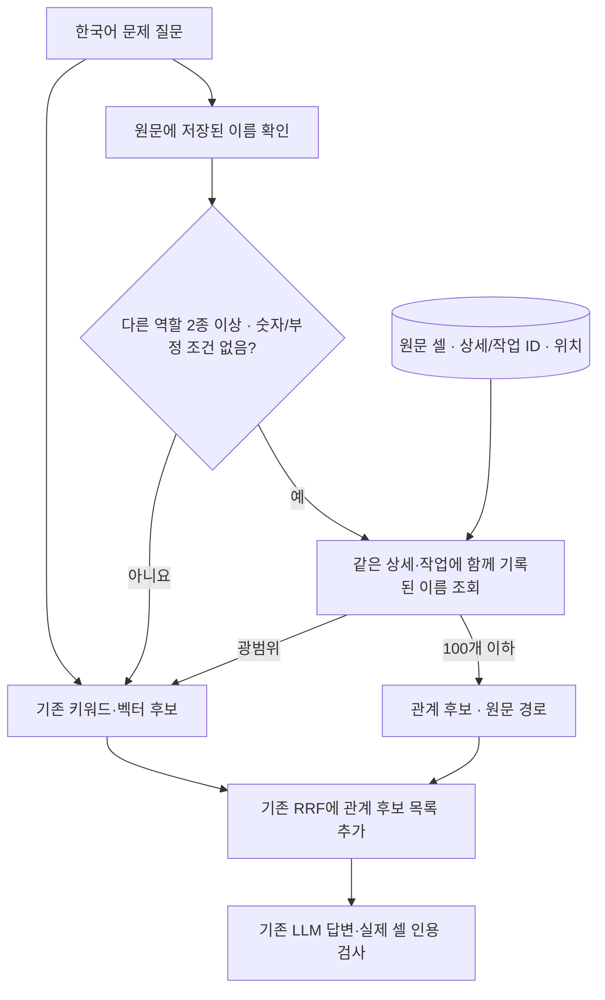

# 원문 관계 보완 검색 비교

기준: 2026-10-07 · 한국어 CS RAG · 운영과 분리한 합성 개발 실험

## 적용 범위

기존 SQLite에 상세·작업 ID, 열 이름, 설비·모듈·부품 역할, 원문 이름과 셀 위치를 담는 `rag_relations`를 선택적으로 만듭니다. 새로운 그래프 서버나 관계 추출용 LLM은 사용하지 않습니다. 이 기능은 전체 문서의 주제를 묶는 Microsoft GraphRAG나 자동 인과관계 추출 구현이 아닙니다.

질문 화면에서 **키워드 + 벡터 + 관계 보완 (실험)**을 선택합니다. 첫 요청에서 원문 셀을 한 번 읽고, 이후 새 자료 등록·원문·검토에 따른 검색 갱신과 함께 관계를 원자적으로 갱신합니다. 기본 검색·임베딩 설정을 자동 변경하지 않습니다. **검색 비교**에서는 답변 LLM을 호출하지 않습니다.



## 안전한 제한

- 두 이름은 서로 다른 역할이어야 합니다. ‘설비 + 부품’ 또는 ‘모듈 + 부품’처럼 같은 상세·작업에 함께 기록돼 있어야 합니다. 같은 CS의 다른 상세를 합치지 않습니다.
- 원문의 짧은 단일 이름만 사용하며 줄바꿈·쉼표·슬래시 등으로 나눈 복수 이름과 긴 설명은 추정해서 분리하지 않습니다. 원문 셀과 검토 결과는 그대로 보존합니다.
- 정확한 CS·코드·날짜와 고정 상세의 후속 질문은 기존 조회를 사용합니다. 숫자·알려진 부정·정상·계획·불확실 조건은 관계 확장을 건너뜁니다. 숫자 포함 설비 코드의 관계 확장도 이번 범위에 포함하지 않습니다.
- ‘펌프’, ‘팬’ 같은 범용 이름만 있는 질문, 이름·역할이 모호한 질문, 같은 작업 경로가 100개를 넘는 질문은 기존 결합 검색을 유지합니다. 읽기 전용 구형 DB에 관계 테이블이 없어도 기존 검색을 사용할 수 있습니다.
- 명시적 누수·소음·진동 조건은 그 상세의 원문 현상과 대조합니다. 다른 현상 전체의 의미 일치나 조치 성공을 보증하지 않습니다. 관계 경로는 후보 선정을 설명할 뿐 답변의 인용 근거를 대체하지 않습니다.

## 실제 임베딩으로 수행한 비교

10개 가상 설비, 20개 부품, 10회 이력으로 **2,000상세**를 만들었습니다. 한 CS에 두 부품의 상세가 있을 수 있고 성공·재발·예정·결과 미확인 상태를 원문에 남겼습니다. 부품과 현상의 조합이 규칙적인 합성 자료이므로 실제 현장 사례의 분포를 대표하지 않습니다.

정답과 한국어 질문 **41개**를 모델 호출 전에 고정했습니다. 현재 Mac의 LM Studio **EmbeddingGemma 2·768차원·최소 유사도 0.3**으로 고유 본문 1,000개를 생성하고 2,000상세를 색인했습니다. 번역·답변 LLM·mDeBERTa는 호출하지 않았습니다. 두 방식에 같은 질문·원문·벡터를 사용했으며 실행 순서를 문항마다 교대했습니다. 순위·기준을 평가 결과로 맞추지 않았습니다.

| 정답 있는 질문 유형 | 문항 | 기존 첫 정답 | 관계 보완 첫 정답 |
|---|---:|---:|---:|
| 설비 + 부품 + 현상 | 20 | 18 | 20 |
| 모듈 + 부품, 다른 설비 사례 | 6 | 6 | 6 |
| 현상만 질문 | 5 | 5 | 5 |
| 정확한 CS 번호 | 3 | 3 | 3 |
| 합계 | **34** | **32** | **34** |

상위 3개에 정답 포함도 32/34 → 34/34였고, 반환한 상위 3개 중 정답 비율의 문항 평균은 76.47% → 80.39%였습니다. 정답은 조치가 성공했다는 뜻이 아니라 질문한 설비·부품·현상에 맞는 기록이라는 뜻입니다. 예정·재발 상태도 검색 대상에 유지합니다.

‘도포장비의 회전베어링 소음’, ‘도포장비의 분사밸브 소음’ 두 질문에서 기존 검색이 놓친 상세를 상위 결과로 찾았습니다. 이 외 정답 있는 질문의 첫 결과가 오답으로 바뀐 경우는 없었습니다. 관계 후보를 사용한 질문은 26개입니다.

**근거 부족의 거절은 해결되지 않았습니다.** 정답 없는 별도 질문 3개 중 없는 CS 번호 1개만 두 방식 모두 빈 결과였고, 없는 설비·부품 질문 2개에는 유사 후보를 반환했습니다. 숫자·부정·정상·예정 조건 4문항은 두 방식의 후보가 같은지 확인한 검증이며, 조건을 정확히 이해했다는 정답률 평가가 아닙니다.

관계 자료 6,000개 준비는 Mac에서 약 0.081초였습니다. 전체 41문항의 검색 평균은 기존 0.024초·관계 보완 0.023초였으나 캐시·호출 순서의 영향을 받는 한 번의 소규모 측정이므로 속도 우위로 판단하지 않습니다. 준비 시간·답변 생성·Windows 성능은 검색 평균에 포함하지 않습니다.

## 검증과 보존

82개 검색 결과의 첫 정답·상위 3개 포함 여부를 저장 ID와 고정 정답으로 다시 계산했습니다. 모든 관계 경로의 이름·열·위치를 해당 원문 행과 대조했고 SQLite `integrity_check=ok`를 확인했습니다. 상세별 원문·검토 해시는 전후 같았습니다. CSList의 `문제현상` 열 누락과 일부 부정 표현을 보완한 뒤 같은 고정 질문·저장 벡터로 다시 검색해 32/34·34/34를 확인했습니다. 초기 실행의 코드 스냅샷과 고정 프로토콜도 보존합니다.

- 질문·정답 고정 SHA-256: `594f5494797b29008fedd69b4add77cacd46a956569e61f107dcea094a3aa5c2`
- 별도 실험의 원문·검토 SHA-256: `aab4d2342efebf378cf43cc0d8d667ee631566475a2d3f54aff9eec9c4706a99`
- 완료 `true` · 41/41문항 · 오류 0 · 누락 0 · 벡터 생성 실패 0
- 관계 검사: 같은 CS의 다른 상세 분리, 작업 경계, 원문 위치, CSList `문제현상`, 범용명·숫자·부정 조건 우회, 증분·전체 갱신, 실패 롤백, 100개 초과 우회, 웹 검색 비교 경로, 키워드·벡터에 없는 후보의 관계 단독 보완.
- 첫 사용 때 만든 자료는 연결을 닫고 다시 열어도 유지됐습니다. 별도 2,000상세 DB를 실제 웹 질문 처리 경로에서 준비·검색해 관계 자료 6,000개·후보 3개를 확인했습니다. 답변 모델 호출은 차단했고 원문은 보존됐습니다. 바깥 SAVEPOINT 해제가 커밋하는 현재 흐름을 확인했으므로 불필요한 추가 커밋이나 빈 테이블 전체 재구축은 넣지 않았습니다.
- 전체 오프라인 회귀와 JavaScript 구문 검사를 통과했습니다. Windows 배포 파일의 독립 압축 해제 검사는 Mac에서 수행하며 Windows 실기기 검증과 구분합니다.

운영 DB는 이번 실험에서 열지 않았고 모델 설정 파일은 읽기만 했습니다. 관계 검색이 기본 모드가 되거나 답변 검사 통과 기준이 낮아지는 변경은 없습니다.

## 재현과 다음 판단

저장소 루트의 Mac 개발 환경에서 다음과 같이 실행합니다. 기존 출력 폴더를 덮어쓰지 않습니다. 결과·질문·프로토콜·별도 DB는 지정한 출력 폴더에 저장하며 운영 자료는 Git에 포함하지 않습니다.

```sh
.venv/bin/python -c 'from pathlib import Path; from tests.test_relations import main; main(Path("windows-demo"))'
.venv/bin/python -m experiments.relation_quality --output outputs/relations-new-pilot --config mac_config.json
.venv/bin/python windows-demo/test_demo.py
.venv/bin/python package_windows.py
```

Mac 로컬 최종 실험 자료: `outputs/relations-pilot-20261007-final/{dataset,protocol,results,verification,ui-verification}.json`. 실제 업무의 설비·부품 이름 표기, 같은 CS의 복수 상세, 숫자·부정 조건과 근거 없는 질문을 담당자가 정답으로 판정한 뒤 같은 두 방식을 비교해야 합니다. 인과관계 추출·주제 요약·자동 원인/성공 판정과 운영 기본 채택은 추가 검증 후 별도로 판단합니다.
