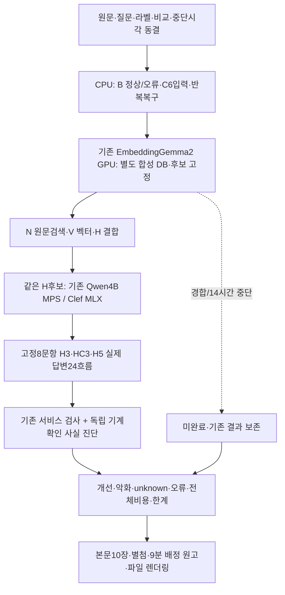

# 24시간 구조 검증 v3

기준: 2026-10-14 KST · 사용자 전환 승인 · 사람 참여 없음 · 운영 변경/배포 없음

평가 시에는 커밋·푸시를 하지 않았습니다. 이후 사용자가 실험 결과 게시를 승인해 [공개용 결과 묶음](experiments/architecture-v3-20261014/README.md)을 GitHub에 올립니다. 로컬 원시 로그·DB·설정은 게시하지 않습니다.

많은 모델의 우열보다 **상세·작업·셀 보존 → 후보 검색 → 조건 선택 → 답변 → 원문 검사 → 반복 운영**으로 나눈 구조가 이 업무에서 무엇을 확인해 주는지 검증합니다. Clef가 이겨야 한다는 목표를 두지 않습니다.

## 완료 결과

2026-10-14, 계획한 선택192기록과 답변24흐름을 완료했습니다. 답변 호출은 보정7회를 포함한31회입니다. 완료는 모든 답변이 옳거나 제공됐다는 뜻이 아닙니다.

|항목|실제 결과|해석|
|---|---|---|
|조건24 첫 직접적합|N10·V12·H17·Qwen4B23·Clef23 /24|Clef 고유 우위·보편적 동등성은 미확인|
|대조쌍 동시정답|H6·Qwen4B11·Clef11 /12쌍|같은 생성군6의 파생 질문은 독립 표본이 아님|
|실제 답변 제공|H3 7/8·HC3 7/8·H5 6/8|의미 정확도가 아니라 최종 제공 상태|
|기계 확인 사실충족 / unknown|H3 2/8·5개, HC3 3/8·4개, H5 3/8·3개|인식 못한 의역을 오답/정답으로 바꾸지 않음|
|전체 중앙시간|H3 82.801초·HC3 157.690초·H5 117.402초|적재·교대·보정·정리 포함, n=8씩|
|주입 대조|정상12/12유지·오류9/12차단|상태 의미 변형3개 통과|
|지원 양식 재사용|등록·실제 검색·원문/자료형 보존6/6|2양식×3설비군, 실제 타팀 성과 아님|
|반복 운영|동일DB20→22→23상세·중단복구·근거 사본 유지|실시간 LLM 비용 절감·exactly-once 미입증|

H5의 실제 출력 한도는2583~2666, H3/HC3는3949~4024였습니다. 같은 설정 상한4096이라도 기존 문맥 보호가 줄였으므로 실패 차이를 근거 수나 재정렬 효과만으로 분리할 수 없습니다. 실제 답변4흐름의 실패와 자동 진단12개의 `unknown`을 보존했습니다. 운영 채택은 하지 않았습니다.

최종 [본문10장·별첨8장·PDF·원고 목록](experiments/architecture-v3-20261014/README.md), [전체 보고서](experiments/architecture-v3-20261014/report.md), [공개 합성 원문·질문](experiments/architecture-v3-20261014/synthetic-data.json), [공개 재집계 명령](experiments/architecture-v3-20261014/README.md)을 공개용 묶음으로 제공합니다. 원래 실험 원시 기록은 로컬에 보관합니다. 최종18장 개별 렌더링과 구조·글꼴·페이지 수 검증을 완료했습니다. PDF는 최종PNG기반, PPTX는 편집 가능하며 낭독 실측·Windows PowerPoint는 미검증입니다.

## 실제 고정 범위

|구간|범위|해석|
|---|---|---|
|E0|기존50·Clef8·관계 비교의 저장 원시 기록 재계산|신규 현장 결과와 합산하지 않음|
|A 순위|새 창작36질문: 조건12쌍24 + 근거없음6 + 정확조회6|N/V/H·기존 범용Qwen4B·동일H후보 Clef 비교|
|A 순서|사전에 고정한6질문·추가 순환2개|18개의 독립 질문으로 계산하지 않음|
|A 답변|고정4대조쌍8질문 × H3/HC3/H5 =24흐름|보정 포함 답변 HTTP 최대48회|
|B|정상12·단일 주입 오류12|실제 모델 오류율이나 환각0의 증거 아님|
|C|지원28열/128열 × 냉각·진공·반송 =6합성 입력|각20상세/작업, 원문·자료형·검색 확인|
|C 반복|같은 일관된 DB 사본 재등록·추가·변경·소유 프로세스 복구|무중단/정확히1회 처리·사람 생산성은 미검증|

현재 고정 질문·라벨·원문은 모두 창작 합성 자료입니다. 일부 넓은 의미 유형은 기존 진단에도 등장했으며 독립 현장 홀드아웃으로 부르지 않습니다. N은 원문 전용 BM25·명시적 필드/정확 조회이며 학습 모델·번역·생성 사전을 사용하지 않습니다. 공식/수동 용어집이 제공되지 않아 사전 보강 비AI 대안은 미평가입니다.

## 시간과 보호

시작 시각을 다시 세지 않고, 최초 평가 폴더가 실제 생성된 시각을 보수적인 `t0` 근거로 고정했습니다. 최초14시간에 새 모델 실험을 멈추고,24시간에는 산출물을 정리합니다. [동결 프로토콜 공개 요약](experiments/architecture-v3-20261014/protocol-public.json)에 원래 프로토콜의 해시를 기록했으며, 정확한 `t0_source`, `model_stop_at`, `delivery_deadline` 원본은 로컬에 보존합니다. 새 모델·런타임을 설치하지 않고 이미 준비된 환경과 가중치를 재사용합니다. GPU는 실행기 하나가 순차 사용하며 모델 지연 측정 중 별도 대규모 CPU 검사·슬라이드 렌더링을 실행하지 않습니다.

이전 대규모 실험은 사용자 v3 전환으로 종료했고 **완료 요청886건**과 실패·자원 대기·미완료를 보존했습니다. 이전 N 번호 파서 오류·수정, 전이 대기 경로 사전점검 이력도 보관합니다. 이전 결과를 신규36의 성과나 새 독립 검증으로 합치지 않습니다.

운영 원문·검토·벡터·DB·개인 설정·서비스 기본값을 바꾸지 않습니다. 다른 서비스·모델은 종료하지 않으며 실제 업무 자료를 외부로 보내지 않습니다. Windows/DRM·GPTOSS120B는 이번 Mac GPTOSS20B 결과로 대체하지 않습니다.

## 확인할 산출물

- [실행 상태](experiments/architecture-v3-20261014/report.md)
- [동결 프로토콜 공개 요약](experiments/architecture-v3-20261014/protocol-public.json)
- [공개 실험 결과](experiments/architecture-v3-20261014/README.md)
- 완료 후 `report.md`, `summary.csv`, `case_packets.md`, `claims_matrix.md`, `not_run_and_failures.md`, `verification.md`, `run_commands.md`에 원시 행과 해석을 연결합니다.

기계가 확인할 수 없는 답변 의역은 `unknown`으로 남깁니다. 서비스 인용 검사가 통과했다는 사실을 답변 정확도 점수로 재사용하지 않습니다. 실제 담당자의 시간·비용 절감·사용성·타팀 채택·물리적 고장 해결은 미측정입니다.
