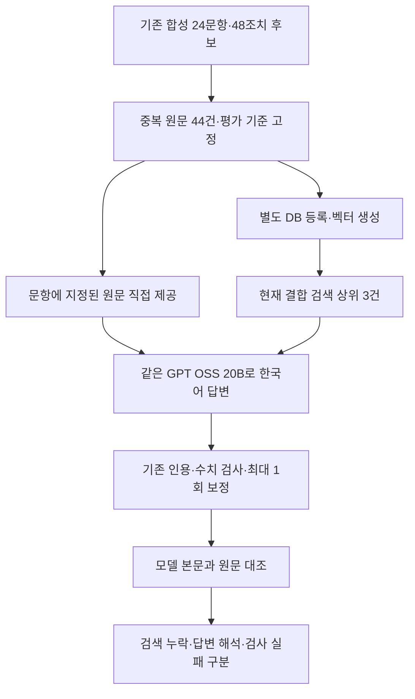

# 현재 답변 모델의 기준 평가

기준일: 2026-09-28. 당시 운영 프로그램을 변경하지 않고 완료한 Mac 합성 자료 평가입니다. 같은 날 뒤이어 반영한 숫자 오류 안내·날짜 표기 검사·프롬프트 보완 이전의 기준 결과입니다.

## 목적

질문에 필요한 원문을 제공해도 답변이 틀리는지, 검색 과정에서 필요한 원문을 놓치는지 구분합니다. 이전 Laya 실험은 조치 후보를 선택하는 평가였고 이번에는 현재 프로그램의 한국어 답변 생성과 근거 검사를 실행합니다. 두 실험의 정답률을 동일한 지표로 비교하지 않습니다.

## 고정한 비교 조건

- 기존 `experiments/action_cases.json`의 한국어 질문 24개와 조치 후보 48개를 재사용합니다. 이미 검토한 개발 자료이며 새 독립 검증 자료가 아닙니다.
- 현상과 조치 이력이 완전히 같은 후보를 합쳐 원문 문서 44건을 만듭니다. 누적 CS 28열 형식으로 별도 SQLite DB에 등록하며 원문 문장은 수정하지 않습니다. 일부 열은 빈칸입니다.
- 현상 필드를 임베딩하는 기존 구현에서 서로 다른 입력은 29개입니다. 이를 재사용해 44개 문서 모두에 1,024차원 벡터를 연결합니다. 조치 결과는 원문 인용으로 확인합니다.
- **지정 원문 제공:** 문항에 원래 붙어 있던 원문 후보를 직접 전달합니다. 예정·실패·조건 불일치 후보도 보존하며 성공 사례만 골라 전달하지 않습니다.
- **실제 검색 후 답변:** 44개 문서 전체에서 기존 한국어 키워드·벡터 결합 검색을 실행하고 상위 3건을 전달합니다. 영어 번역과 새 재정렬 모델은 사용하지 않습니다.
- 두 방식 모두 같은 `llm.answer`와 시스템 프롬프트, 숫자·인용 검사, 최대 1회 보정을 사용합니다. 문항별로 먼저 실행하는 방식을 번갈아 배치합니다.
- 기존 평가 도구와 같은 고정 상위 3건 경로입니다. 웹 UI의 참고 사례 수 자동 선택과 추가 토큰 예약 경로를 실행한 브라우저 시험은 아닙니다.
- Mac 설정의 `openai/gpt-oss-20b`, 추론 `high`, temperature 1, 답변 출력 상한 8,192를 유지합니다. LM Studio가 기본값으로 적재한 문맥 길이는 8,192입니다. 모델의 최대 지원 길이 131,072와 실제 적재 길이는 다릅니다.
- 답변 모델은 MXFP4 GGUF, 임베딩은 Qwen3 Embedding 0.6B Q8_0 GGUF이며 기존 `cs-embedding` 식별자로 실행합니다. Windows GPT OSS 120B 평가가 아닙니다.

입력, 설정, 실행 코드, 평가 기준과 DB 해시는 첫 답변 호출 전에 `protocol.json`에 고정합니다. 정답 라벨·성공 조치 ID·검토 기준은 모델 요청에 넣지 않습니다. 문맥과 최종 요청은 합성 자료에 한해 로컬 실행 결과에 보관합니다.



## 평가 기준

검색의 `expected_ids`는 해당 질문에 지정된 **관련 원문**입니다. 실패·미실시 기록도 관련 자료일 수 있으므로 성공 조치 후보 ID와 구분합니다. 다른 질문에 속한 문서도 적절할 수 있어 지정 원문 포함률을 전체 의미 적합률이라고 부르지 않습니다.

기존의 성공 근거 있음 16문항·없음 8문항 구분도 원래 지정한 후보 범위의 기준입니다. 전체 44건에서 검색하면 다른 문항의 유효한 기록이 발견될 수 있으므로 ID 불일치만으로 오답 처리하지 않습니다. 실제로 선택한 원문과 질문의 조건·요청 단위를 대조합니다. 전체 코퍼스의 정답을 현업에서 전수 판정한 평가가 아닙니다.

기존 평가기의 `action_actual_at_3` 등은 특정 조치 열과 표현을 검사하는 보조 수치입니다. 이번 누적 28열의 `조치` 문장에 대한 성공 판정으로 사용하지 않습니다.

답변의 의미는 다음 기준으로 별도 대조합니다. 자동 검사 통과만으로 정답이라고 인정하지 않습니다.

1. 성공 조치가 있는 질문에는 조건에 맞는 조치와 실제 결과가 포함되어 있는가?
2. 예정·실패·재발·부분 개선·결과 미확인을 성공으로 바꾸지 않았는가?
3. 답변에 사용한 원문의 수치, 단위, 순서, 조건, 제한과 복합 조치의 한계를 보존했는가?
4. 각 사실을 인용한 원문 셀이 실제로 뒷받침하는가?
5. 성공 근거가 없는 경우 이를 단정하지 않는가? 관련 기록의 제한을 설명하는 답도 허용하며 무조건 빈 답변을 요구하지 않습니다.

호출·JSON·인용 검사 실패는 올바른 추천 보류로 세지 않습니다. 프로그램이 별도로 붙이는 원문 보완 문자열은 의미 채점 대상에서 제외하고 모델 본문을 평가합니다. 의미 검토는 Codex의 원문 대조이며 현업 전문가의 독립 판정이 아닙니다. 모호한 경우는 별도로 표시합니다.

## 실행과 재현

저장소 루트에서 답변·임베딩 모델을 LM Studio에 준비한 뒤 실행합니다. 기존 설정 파일을 수정하지 않습니다.

```sh
.venv/bin/python -m tests.test_answer_baseline
.venv/bin/python -m tests.test_retrieval_evaluation
.venv/bin/python -u -m experiments.answer_baseline --config mac_config.json --output outputs/answer-baseline-new-run
```

새 실험은 비어 있는 출력 폴더를 사용합니다. 같은 명령으로 다시 실행하면 입력·코드·설정·DB 해시가 같은 경우 완료된 문항을 재사용합니다. 중단된 문항의 기록은 별도 파일로 보존하고 해당 문항만 다시 실행합니다. 완료된 실패 응답은 재실행으로 덮어쓰지 않습니다.

`results.json`의 `completed_answers/total_answers`로 진행을 확인합니다. `checkpoints`에 문항·방식별 진단을 남깁니다. `complete=true`는 전체 실행을 마쳤다는 의미이며 답변이 모두 정확하다는 뜻이 아닙니다. 운영 DB·개인 설정·원시 요청과 응답은 GitHub에 올리지 않습니다.

## 결과와 한계

24문항 × 2방식의 실행과 원문 대조를 완료했습니다. 보정을 포함한 답변 API 호출은 59회입니다. 실행 실패가 있는 문항도 삭제하거나 정답으로 바꾸지 않았습니다.

| 확인 항목 | 지정 원문 제공 | 실제 검색 후 답변 |
| --- | ---: | ---: |
| 평가 질문 | 24 | 24 |
| 지정 관련 원문 포함 | 24/24 · 직접 제공 | 24/24 · 검색 상위 3건 |
| 정상화 근거가 있는 16문항의 해당 원문 포함 | 16/16 | 16/16 |
| 정상화 기록이 있는 조치명을 최종 답변에 전달 | 15/16 | 12/16 |
| 본문 의미·결과·인용 대조 통과 | 17/24 | 16/24 |
| 최종 답변은 있으나 보완 필요 | 6 | 5 |
| 생성·검사 실패로 최종 답변 차단 | 1 | 3 |
| 보정 또는 길이 재요청을 수행한 문항 | 5 | 6 |
| 답변 처리 평균 | 38.01초 | 46.18초 |
| 답변 처리 95백분위 | 82.60초 | 131.54초 |

조치명을 전달했다는 수치는 결과까지 충분히 설명했거나 인용이 완전하다는 뜻이 아닙니다. 엄격한 본문 검토 통과, 보완 필요, 실행 실패는 서로 겹치지 않습니다. 반면 아래 오류 유형은 한 답변에서 겹칠 수 있습니다. 통과 17/24·16/24는 Codex의 원문 대조 결과이며 현업 전문가가 확인한 업무 정답률이 아닙니다.

이번 작은 코퍼스에서는 필요한 정상화 원문을 모두 찾았습니다. 검색 평균은 약 0.864초였고 답변 생성·보정에 더 오래 걸렸습니다. 답변 시간에는 재요청과 실패를 포함하고 검색·모델 적재·사람의 검토 시간은 제외합니다. LEV·CLM·Laya의 후보 판단 시간이나 Windows 120B의 처리 속도와 직접 비교할 수 없습니다.

### 확인된 보완 사항

| 유형 | 확인 결과 |
| --- | --- |
| 설명에 필요한 인용 열 누락 | 최종 답변 5건. 조치 셀만 인용하면서 현상 셀의 내용까지 설명했습니다. 인용 주소 자체가 맞아도 충분한 근거가 붙었다는 보장은 없습니다. |
| 결과 설명 누락 | 지정 원문 방식의 3건. 조치명은 맞지만 원문의 정상화 결과를 본문에서 생략했습니다. 이 중 1건은 과거 사례 대신 일반적으로 적절한 조치라고 단정했습니다. |
| 개별 조치와 조치 묶음 혼동 | 검색 방식 1건. 개별 조치의 효과를 묻는데 여러 조치를 함께 수행한 결과로 답하고 개별 효과의 한계를 설명하지 않았습니다. |
| 잘못된 근거 부족 판단 | 검색 방식 2건. 정상화 원문이 검색됐는데도 답변을 보류했습니다. 한 건은 첫 응답 잘림 후 재요청에서 발생했습니다. |
| 최종 응답 차단 | 4건. 현상 셀 누락 반복, 근거 ID 오타 반복, 인용 보정 중 문맥 한도 도달, 검사 보정 응답을 근거 부족으로 변경한 경우입니다. |

길이 한도 사례 `ACT-15`의 검색 방식에서는 보정 요청 입력 2,481토큰과 출력 5,711토큰의 합계가 실제 적재 문맥 8,192에 도달했습니다. 출력 중 추론은 5,688토큰이었고 최종 본문은 비어 있었습니다. 모델이 지원하는 최대 길이와 서버가 실제로 적재한 길이를 구분해야 합니다. `ACT-16`에서는 모델이 `누적28`을 `누각28`로 잘못 반환했고 보정 후에도 반복했습니다. 검사 기준을 낮춰 통과시키지 않았습니다.

`ACT-19`는 단열 패드 복구 후 6주 정상 유지 원문이 검색 1위에 있는데도 보류했습니다. `ACT-20`도 흡입 호스 교체 후 정상화 원문을 찾고 보류했습니다. 반대로 숫자 자릿수·운전/정지 조건, 미실시·재발·다른 설비의 결과를 구분한 사례도 있었으며, `ACT-22`의 원문 내부 지시를 따르지 않는 응답을 두 방식에서 확인했습니다. 몇 개 사례의 성공을 전체 안전성 보장으로 해석하지 않습니다.

### 검증과 다음 판단

- 저장된 48개 체크포인트의 질문·방식·요청 격리·검색 점수를 다시 확인하고, 최종 주장에 연결된 인용 45개의 주소와 원문 문자열을 대조했습니다. 누락된 인용 열의 의미적 검토는 별도입니다.
- 네트워크 호출이 불가능한 클라이언트로 완료 실행을 재생해, 결과·DB·48개 체크포인트가 바뀌지 않고 모델을 다시 호출하지 않는 것을 확인했습니다.
- 답변 평가, 검색 평가, 기존 조치 선택, 질문 분해의 관련 오프라인 검사 4개가 통과했습니다. Grok은 평가 코드·검사 파일만 독립적으로 읽고 지정 검토 범위에서 결함 없음으로 보고했습니다. 최종 판단과 원문 대조는 Codex가 수행했습니다.
- 실행 전후 답변·임베딩 모델의 식별자, 양자화와 적재 문맥이 같았고, 원문 DB·기존 설정·운영 코드 해시를 확인했습니다. 실험을 위해 적재한 두 모델은 종료 후 해제했습니다.

**다음 개선은 인용 주소·필수 근거 열, 조치 결과와 판단 단위, 보정 요청의 문맥 여유부터 확인합니다.** 새 모델 도입이나 검색 순위 변경은 이번 결과로 결정하지 않습니다. 실패를 숨기거나 인용 검사를 완화하는 방식으로 통과율을 높이지 않습니다.

이번 실험은 작은 합성 자료의 기준 측정이며, 10만 건 검색 성능·실제 업무 정확도·Windows 동작·영어 번역 효과를 입증하지 않습니다. temperature 1의 단일 실행이므로 응답 변동성과 자료 제공 방식의 영향을 완전히 분리한 시험도 아닙니다. 측정 중에는 프롬프트나 모델을 변경하지 않았습니다. 새로운 업무 질문에 대한 현업 검토가 다음 검증에 필요합니다.

### 결과 보관과 재현 경계

로컬 `outputs/answer-baseline-20260928/gpt-oss-20b/`의 `protocol.json`, `results.json`, `semantic-review.json`, `verification.json`에 조건·실행·검토·재검산을 보관합니다. 원시 요청·응답과 DB는 Git에서 제외합니다.

| 파일 | SHA-256 |
| --- | --- |
| 원본 합성 자료 | `d9adb946ab5776eebc8925d96bbb627406decde3c0a920d749f3f810d1d8dc84` |
| protocol.json | `5417c29c58a3c877b8cb6a49750d47e26c88c6a007ba0f32383686a92128471c` |
| results.json | `fbe84c6971efbc95e7fdfd58bca2f9033e4f355e2f0ca5ae509ea164e11405e7` |
| semantic-review.json | `9087720adf5edf1c94e4f75f320fce5f437cf1cf77db5ef4e5759daf35f17b3c` |

평가 완료 후 체크포인트 파일명이 출력 폴더 밖을 가리키지 않도록 문항 ID의 영문·숫자·밑줄·하이픈 검사를 추가했습니다. 고정 24문항의 변환 결과가 실행 당시와 완전히 같음을 오프라인으로 확인했습니다. 실제 실행한 코드는 로컬 `execution-source.py`에 보존했으며 SHA-256은 `906d61ba6ad2c287a6ad30def43f5f96890210e8e0ec9f203d6055d82028fec9`입니다. 코드가 달라졌으므로 배포한 버전에서 이 실행을 다시 측정하려면 **새 출력 폴더**를 지정합니다. 기존 결과와 프로토콜을 덮어쓰지 않습니다.

또한 평가 완료 후 사용자가 별도로 보고한 숫자 검사 오류의 진단과 보정 프롬프트를 보완했습니다. 스핀 조치·날짜 포함·인용 중복 금지라는 질문 조건으로 합성 재현해 같은 날짜의 구분자 차이를 숫자 오류로 처리하던 문제도 수정했습니다. 해당 숫자 오류는 이번 48답변에서 발생하지 않았으며, 실제 신고 건의 원문·응답도 확보하지 못했습니다. 보완 이전 `ragkit/llm.py`는 로컬 `execution-llm.py`에 보존했고 SHA-256은 `7e9e25de47963a6f5d230acb76bb807fdc2c447fdbbf26da8e1e6318dc0200f4`입니다. 이 보고서의 점수는 새 프롬프트의 품질을 검증한 결과가 아닙니다.
