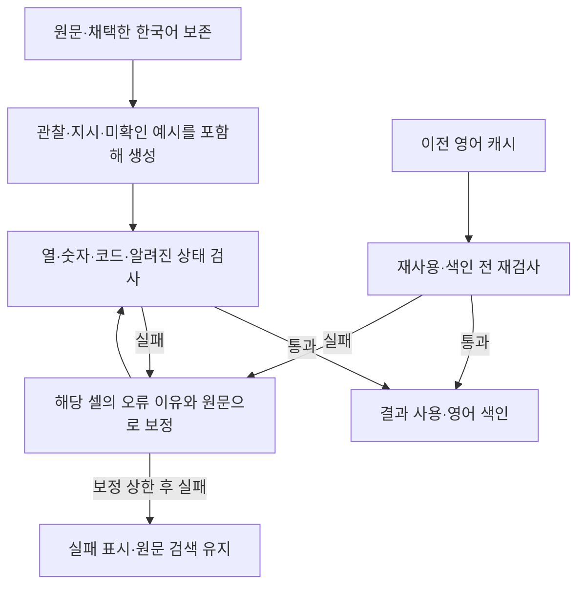

# 번역 의미 보존 개선

기준일: 2026-09-30 · 창작한 유지보수 기록 · Mac GPT-OSS 20B·추론 low · 운영 원문 변경 없음

## 문제와 해결 범위

이전 100행 비교에서 숫자·코드 검사를 통과해도 기록의 뜻이 바뀌는 사례가 있었습니다. 기존 결과를 현재 코드로 다시 검사하여 재현한 뒤, 같은 검사·보완 경로를 보강했습니다. 모델 학습이나 새로운 의존성은 추가하지 않았습니다.

| 원문 | 거절할 결과 | 보존할 뜻의 예 |
|---|---|---|
| 배선 접촉 불량 확인 | Check for poor wiring contact | Poor wiring contact was confirmed. |
| 배선 재체결. +0.5 V 측정. | Re-tighten wiring. Measure +0.5 V. | Wiring re-tightened. +0.5 V measured. |
| 재발 미확인 | No recurrence confirmed / 재발 없음 | Whether the fault recurred has not been confirmed. |
| 원인 미확인. 재발 미확인 | Cause unknown. Recurrence confirmed. | Cause unknown. Recurrence unconfirmed. |
| 압력 -0.1 MPa. 흡착 부족 | 영어 칸의 같은 한국어 복사 | Pressure -0.1 MPa. Insufficient suction. |

관찰·수행 이력과 명시적인 필요·계획·지시는 구별합니다. 질문은 사용자의 요청이므로 기록 검사에서 제외합니다. 원문이 `확인 필요`이면 `Check ...`처럼 요청을 표현할 수 있습니다. 숫자·코드 보호와 의미 검사는 별개입니다. 영어의 한국어·중국어 잔존을 검사하되 숫자와 함께 보호한 `10분`, `2小时` 같은 단위는 그대로 허용합니다.

## 처리 흐름



한국어 다듬기에서 미확인을 확정으로 바꾸면 기존 1회 보정으로 요청합니다. 의미 오류는 숫자 오류 전용 원문 복귀로 성공 처리하지 않습니다. 영어는 실패 셀만 최대 3회 보완하며, 성공한 셀을 다시 보내지 않습니다. 통합 생성에서는 한국어가 보정된 셀의 이전 영어 후보를 사용하지 않습니다. 전체 실패 여부·야간 다음 시도는 기존 정책을 따릅니다.

번역 지시문 변경은 새 번역 프로필로 구별합니다. 원문·검토·이전 비교 결과는 보존하고 영어 캐시는 새 프로필로 갱신합니다. 현재 검사에 실패한 영어를 색인·캐시에 정상 자료로 재사용하지 않습니다. 운영 DB는 이번 합성 실험에서 읽거나 수정하지 않았습니다.

## 검증

모의 검사에서 관찰/지시 변경, 재발 미확인의 대상 변경, 한국어·중국어 잔존, 단위 예외, 질문 예외와 실패 셀만 재요청하는 흐름을 확인했습니다. 한국어 보정과 잘못된 현재 프로필 캐시의 색인 제외·재생성도 실제 함수·임시 SQLite로 확인합니다. 모의 모델의 응답은 의미 정확도를 평가하는 자료가 아닙니다.

실제 모델 비교를 완료했습니다. 이전과 동일한 16가지 유형의 창작 100행·Mac LM Studio GPT-OSS 20B MXFP4·추론 low·출력 상한 8,192·문맥 설정 16,384·temperature 0.1·top_p 0.95를 사용했습니다. 분리·통합 순서를 행마다 교대하고 한 요청씩 실행했습니다. 이전 결과와 새 결과 폴더를 분리하고 코드·입력·설정을 고정했습니다. 문서의 검토 예시는 창작 자료이며 실제 업무 원문이 아닙니다.

### 알려진 오류 표현 대조

| 확인한 표현, 해당 셀 수 | 개선 전 분리 | 개선 후 분리 | 개선 전 통합 | 개선 후 통합 |
|---|---:|---:|---:|---:|
| 보호한 숫자 단위를 제외한 한국어·중국어 잔존 | 18 | 0 | 4 | 0 |
| 접촉 불량 확인 결과를 Check for poor wiring/cable contact로 표현 | 6 | 0 | 3 | 0 |
| 원문 재발 미확인을 No recurrence confirmed로 표현 | 3 | 0 | 6 | 0 |
| 최종 실패 행 | 0 | 0 | 0 | 0 |

영어 잔존의 개선 전 셀들은 분리 13행·통합 4행에 해당합니다. 표는 사전에 정한 오류 표현 대조이며 전체 의미 오류 건수가 아닙니다. 예를 들어 개선 전 분리 `PAIR-063`의 `No recurrence was observed`는 마지막 표현 집계에 포함되지 않습니다. 이 문장도 원문의 `재발 미확인`을 관찰한 부재로 바꾸므로 원문 대조가 필요합니다. 검사 강화 후에는 미확인의 대상과 상태를 유지한 영어를 요구합니다.

실제로 확인한 개선 후 `PAIR-016/원인`은 `Poor wiring contact confirmed`, `PAIR-031/조치`는 `Wiring re-tightened. Measured +0.5 V. Whether the fault recurred has not been confirmed.`입니다. `PAIR-052`의 영어 복사 문제도 재요청 후 번역됐습니다. 원문을 복사해 실패를 숨긴 숫자 복귀는 두 방식 모두 0행이었습니다.

### 처리 비용과 검증 한계

| 항목, 동일 100행 | 개선 전 분리 | 개선 후 분리 | 개선 전 통합 | 개선 후 통합 |
|---|---:|---:|---:|---:|
| 요청, 보정 포함 | 240 | 259 | 170 | 175 |
| 처리 시간 합계 | 772.6초 | 835.9초 | 648.0초 | 675.2초 |
| 서버 보고 전체 토큰, 추론 포함 | 208,571 | 248,006 | 136,794 | 162,706 |
| 고정 영어 표현 검사에서 검토 후보로 표시된 행 | 17 | 7 | 19 | 5 |

지시문과 보정을 강화해 처리 시간은 분리 8.2%·통합 4.2%, 전체 토큰은 두 방식 모두 약 18.9% 늘었습니다. 이 측정은 프롬프트와 검사를 함께 바꾼 구현 전체의 비교입니다. 특정 규칙만의 효과나 금전 비용으로 환산하지 않습니다. Excel 읽기·운영 DB 등록·검색·모델 로딩·체크포인트 저장 시간은 포함하지 않습니다.

형식·숫자·식별자·현재의 알려진 상태 검사를 두 방식 모두 100행에서 통과했습니다. `complete=true`, 200개 체크포인트·원문/설정/코드 해시를 대조하고 결과를 독립적으로 재검사했으며 요청·시간·토큰 합계를 다시 계산했습니다. 실제 모델 요청 434회는 모두 정상 종료였습니다. 검토 후보 7·5행은 실제 오류 수가 아닙니다. `Estimated cause ...`, `Cause Unidentified`, `Location is unclear`처럼 뜻을 유지한 표현도 고정 정규식에 없는 단어를 쓰면 표시됩니다. 전체 의미 정확도를 산출하지 않았습니다.

증거는 로컬 `outputs/bilingual-normalize-20260930/meaning-guard-low/{protocol,results,verification}.json`과 `meaning-verification-plan.json`, `verify_meaning.py`에 보관합니다. 이전 `final-low` 결과는 보존했습니다. 개별 요청·응답 및 결과 파일은 Git에 올리지 않습니다. 한국어 보정·캐시 재생성 모의 검사와 전체 회귀·독립 압축 해제 배포 검사는 실제 모델 비교와 별도로 수행합니다.

## 적용과 재현

Windows에서는 새 배포본으로 `start.bat`을 다시 실행한 뒤 **개별 실행 → 영어 검색 자료 → 남은 자료 전체 → 영어 변환 / 이어서 실행**을 사용합니다. 새 프로필에서 생성에 실패한 건은 **영어 실패 건 재시도** 또는 기존 야간 자동 실행으로 이어갈 수 있습니다. 이미 채택한 원문·검토를 지우거나 Excel을 다시 등록할 필요는 없습니다.

```sh
.venv/bin/python -m tests.test_english
.venv/bin/python windows-demo/test_demo.py
.venv/bin/python -m experiments.bilingual_normalize --config mac_config.json --output outputs/meaning-preservation-100
.venv/bin/python package_windows.py
```

## 제한과 판단

규칙은 알려진 한국어 표현과 제한된 명령·재발 미확인 구절을 다룹니다. 한국어·중국어 고유명사가 남으면 영어 잔존으로 재검토될 수 있습니다. 명시적인 필요·계획·지시가 함께 있거나 복잡한 대명사·조치 순서를 사용하는 문장은 자동 의미 검사만으로 판정하지 않습니다. 원문의 중국어·영어 상태 표현 전부, 모든 부정·추정·조건·인과관계와 번역의 완전성을 검증하는 기능이 아닙니다.

영어 번역의 기준은 현재 채택한 한국어 또는 원문입니다. 이전에 채택한 편집이 새 검사에 실패하면 기존 검토 값을 지우지 않고 재검토 대상으로 표시하는 기존 절차를 사용합니다. 이미 생성된 검색 자료를 갱신하고 복잡한 기존 편집을 원문과 대조해야 하며, 과거의 모든 검토 오류를 자동으로 고쳤다는 뜻은 아닙니다.

실제 DRM Excel·현장 업무 자료·Windows GPT-OSS 120B의 처리 시간과 의미 정확도는 미확인입니다. 답변의 사실 근거는 원래 언어의 원문이며 번역은 검색 보조 자료입니다. 통합 생성은 실험 기능으로 유지합니다. 이전 비교는 [통합 생성 보고서](한국어-영어-통합생성-비교-20260930.md), 운영 흐름은 [전체 흐름도](전체-프로그램-플로우.md)를 참고하세요.
