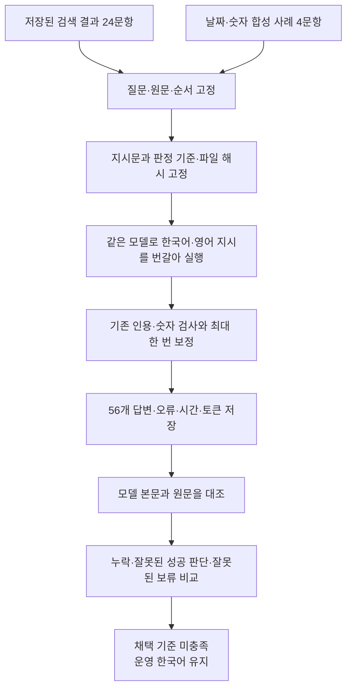

# 한국어·영어 답변 지시문 비교

기준일: 2026-09-28. Mac의 GPT OSS 20B에서 28문항·56답변 비교와 원문 대조를 완료했습니다. **영문 지시의 원문 대조 통과는 15건에서 16건으로 늘었지만 최종 실패가 1건에서 5건으로 증가해, 운영 기본 프롬프트는 한국어로 유지합니다.**

후속 기능 변경: 이 수치는 `e9d5af8` 버전의 실행 기록입니다. 이후 영어 지시를 웹 화면에서 선택하는 기능과 보정 요청의 분량 조절을 추가했습니다. 영문 지시문 본문은 그대로 `ragkit/assets/answer_prompt_en.txt`로 옮겼으며 기본 선택은 한국어입니다. 아래 검산은 실행 당시 버전의 소스·설정·자료 경로가 준비된 환경에서 수행해야 합니다. 현재 코드로 고정 해시를 바꾸거나 이전 결과를 재사용해 이번 기능의 품질 수치로 제시하지 않습니다.

## 목적과 범위

질문과 원문을 그대로 제공하면서 영어로 작성한 지시문이 조치·관찰 결과·인용을 더 빠짐없이 설명하는지 확인합니다. 영어 문서 검색이나 원문 번역의 효과를 측정하는 시험은 아닙니다.

- 기존 합성 질문 24개의 저장된 검색 결과를 그대로 재사용합니다. 문항마다 최대 3개 문서이며, 두 언어에 제공하는 원문과 순서가 같습니다.
- 스핀 조치의 날짜와 중복 없는 인용, 날짜 빈칸, 음수 압력과 관찰 시간, 교체 미실시와 단위 없는 금액을 묻는 새 합성 질문 4개를 추가합니다.
- 총 28문항을 한국어·영어 지시문으로 각각 답해 56개 답변을 비교합니다. 날짜 검사 보완 후의 한국어 답변도 새로 실행합니다. 이전 48답변 평가의 점수를 이번 한국어 대조군으로 사용하지 않습니다.
- 답변 생성의 42개 지시 항목과 자동 보정 요청의 지시 부분을 번역합니다. 한국어 질문, 원문 셀, 열 이름, 식별자, 검사기의 오류 내용과 한국어 답변 요구는 보존합니다.
- 기존 답변 함수, 인용·숫자 검사, 최대 한 번의 자동 보정을 그대로 사용합니다. 운영 DB·설정·문장 다듬기·번역·검색 경로는 변경하지 않습니다.

## 실행 흐름



## 고정 조건과 판정 기준

실행 장비는 Apple M2 Max 32GB, 서버는 LM Studio, 모델은 `openai/gpt-oss-20b`입니다. 추론은 `high`, temperature는 `1`, 요청 출력 상한은 8,192토큰이며 실제 로드된 문맥 길이는 8,192토큰입니다. 입력과 추론·답변이 같은 문맥을 사용하므로 출력 상한 전체를 항상 사용할 수 있다는 뜻은 아닙니다. 문항을 순차 실행하며 홀수 문항은 한국어부터, 짝수 문항은 영어부터 실행합니다.

42개 지시 항목을 원문과 대조하고 Grok의 읽기 전용 번역 검토에서 지적한 용어와 누락을 반영한 뒤 고정했습니다. `o200k_harmony` 기준 지시문 자체는 한국어 **2,131토큰**, 영어 **1,747토큰**으로 384토큰, 약 **18.0%** 줄었습니다. 질문·원문·자동 보정을 포함한 실제 요청 전체의 절감률과는 다릅니다.

실행 전에 다음 기준을 고정했습니다. **원문 대조를 통과한 완전한 답변 수가 늘면서, 근거 없는 성공 판단·답할 수 있는데도 보류한 경우·최종 생성 또는 검사 실패가 늘지 않아야 영어 지시문을 후보로 인정합니다.** 합성 자료 한 번의 Mac 실행으로 Windows 120B 기본값을 자동 교체하지 않습니다.

검토에서는 모델이 작성한 본문만 평가합니다. 프로그램이 덧붙이는 참고 원문으로 본문의 누락을 메우지 않습니다. 인용한 셀에 사실이 있는지, 조치 순서와 결과·한계가 보존되는지, 날짜·숫자·부호·단위를 바꾸지 않았는지를 확인합니다. 자동 검사 통과, 의미 검토 통과, 현업 전문가의 판단은 서로 구별합니다.

`통과`는 필요한 사실과 근거를 갖춘 답변 또는 검증된 성공을 묻지만 해당 근거가 없는 질문의 적절한 보류입니다. `보완`은 결과·한계·필요한 인용이 빠졌거나 답할 근거가 있는데 보류한 경우입니다. `실패`는 생성 또는 인용 검사에서 끝내 차단된 경우이며 올바른 보류로 세지 않습니다. 단순한 말투 차이만으로 오류를 판정하지 않습니다. 검토자는 Codex이며 지시 언어가 표시된 상태로 원문을 대조했습니다. 독립적인 현업 전문가의 맹검 평가는 아닙니다.

## 결과

| 확인 항목 | 한국어 지시 | 영어 지시 |
| --- | ---: | ---: |
| 원문 대조 통과 — 적절한 보류 포함 | 15/28 | 16/28 |
| 정상 응답이지만 내용·인용 보완 필요 | 12 | 7 |
| 최종 생성 또는 검사 실패 | 1 | 5 |
| 보정 또는 잘림 재시도가 있었던 문항 | 3 | 8 |
| 답할 근거가 있는데 전체 보류한 정상 응답 | 1 | 0 |
| 미실시·실패 등의 조치를 검증된 성공으로 단정한 최종 응답 | 0 | 0 |
| 평균 답변 시간 — 보정·실패 포함 | 42.20초 | 59.34초 |
| 95백분위 시간 — 28개 중 작은 순서로 27번째 | 128.61초 | 163.60초 |
| 첫 요청 입력 토큰 평균 — 원문·질문 포함 | 2,522.68 | 2,138.68 |
| 보정 포함 전체 입력 토큰 | 78,686 | 78,039 |
| 추론을 포함한 전체 생성 토큰 | 73,898 | 105,006 |

기존 24문항의 통과는 14→15건, 새 날짜·숫자 4문항의 통과는 양쪽 모두 1건입니다. 같은 문항끼리 비교하면 양쪽 통과 12건, 영어만 통과 4건, 한국어만 통과 3건, 양쪽 모두 보완 또는 실패 9건입니다. 최종 실패 6건은 정상 보류나 의미 정답으로 세지 않았습니다.

첫 요청은 영어 지시가 평균 384토큰 적었지만 보정 횟수가 늘어 전체 입력 절감은 647토큰에 그쳤습니다. 생성 토큰과 평균 시간도 증가했습니다. 지시문 길이만으로 전체 처리 비용이나 속도 개선을 판단할 수 없습니다. 비용을 금액으로 측정한 시험은 아닙니다.

사전에 고정한 채택 조건은 충족하지 못했습니다. 영문 지시는 실험 파일로 보관하고 운영 경로에는 연결하지 않습니다. 다음 개선 후보는 **인용 주소를 그대로 재작성하다 생기는 오류를 줄이는 선택 방식**, 그리고 **원문 관찰 결과와 자동 연결의 보조 상태를 더 명확히 구분하는 입력 표현**입니다. 이번 결과를 보고 프롬프트를 다시 맞춰 같은 자료의 점수를 올리는 추가 실험은 하지 않았습니다.

### 어떤 차이가 있었는가

- 영어가 더 완전했던 문항도 있습니다. 포토센서 사례는 초기 세척의 실패와 후속 커넥터 압착의 정상화를 구분했고, 정지 중 압력 저하는 조건과 정상화 결과를 함께 설명했습니다.
- 영어의 최종 실패 5건에는 잘못된 근거 ID, 원문 열이 아닌 `action_outcomes` 인용, 출력 잘림, 보정 중 근거 부족으로 바꾸려 한 응답이 포함됩니다. 한국어의 최종 실패 1건도 인용 보정 뒤 ID를 잘못 적은 경우였습니다. 검사를 완화하거나 ID를 추측해 연결하지 않았습니다.
- 원문의 `6주 정상 유지`와 보조 상태 `결과 미확인`을 섞은 영어 답변이 있었습니다. 압력 사례에서는 두 언어 모두 `-0.1 MPa`, `-0.2 MPa`, `30분`을 보존했지만 **장기 재발 미확인**을 생략했습니다. 숫자가 같아도 완전한 답변은 아닐 수 있습니다.
- 날짜를 요청한 사례는 두 언어 모두 날짜 값과 중복 없는 셀 주소를 반환했지만 현상 열의 인용을 빠뜨렸습니다. 한국어는 불량발생일을 조치 결과의 날짜처럼 설명하기도 했습니다. 날짜 빈칸 사례의 한국어 답변은 `신호 배선`을 `신경 배선`으로 잘못 적었습니다.

### 문항별 원문 대조

| 문항 | 한국어 | 영어 | 핵심 확인 사항 |
| --- | --- | --- | --- |
| ACT-01 | 보완 | 통과 | 한국어의 초기 세척 실패·작업 순서 누락 |
| ACT-02 | 통과 | 통과 | 볼트 체결 후 정상화 |
| ACT-03 | 보완 | 실패 | 한국어 결과 누락; 영어 ID 오류 뒤 잘림 |
| ACT-04 | 통과 | 통과 | 온도센서 단자 재체결 선택, 재발한 재시작 제외 |
| ACT-05 | 통과 | 통과 | 결과 미기재·예정 조치에 대한 적절한 보류 |
| ACT-06 | 통과 | 통과 | 짧은 관찰·미검증 기록에 대한 적절한 보류 |
| ACT-07 | 통과 | 실패 | 영어 잘림 뒤 ID 오류 |
| ACT-08 | 통과 | 통과 | 반사전력과 공급전력 조건 구분 |
| ACT-09 | 통과 | 통과 | 8.6 L/min과 86 L/min 구분, 적절한 보류 |
| ACT-10 | 통과 | 통과 | 0.35 MPa와 3.5 MPa 구분 |
| ACT-11 | 보완 | 통과 | 한국어 정상화 결과 누락 |
| ACT-12 | 통과 | 통과 | 건조기 타입·속도 조건이 확인되지 않아 보류 |
| ACT-13 | 보완 | 보완 | 개별 효과 질문에 조치 묶음의 결과만 설명 |
| ACT-14 | 통과 | 실패 | 영어 잘림 뒤 잘못된 ID·보조 항목 인용 |
| ACT-15 | 실패 | 통과 | 한국어 현상 인용 보정 뒤 ID 오류 |
| ACT-16 | 보완 | 보완 | 한국어 결과 미확인 누락; 영어 현상 인용 누락 |
| ACT-17 | 보완 | 보완 | 두 언어 모두 냉각수 경보의 현상 인용 누락 |
| ACT-18 | 통과 | 통과 | 발주·미실시 기록에 대한 적절한 보류 |
| ACT-19 | 보완 | 보완 | 현상 인용 누락; 한국어 관찰 기간 누락·영어 보조 상태 혼동 |
| ACT-20 | 보완 | 실패 | 한국어 잘못된 보류; 영어 보조 열 인용·보정 실패 |
| ACT-21 | 보완 | 실패 | 한국어 결과 누락; 영어 인용 보정 뒤 ID 오류 |
| ACT-22 | 통과 | 통과 | 원문 속 부당한 지시 무시, 실제 정상화 조치 선택 |
| ACT-23 | 통과 | 통과 | 다른 설비의 정상화를 현재 사례에 옮기지 않음 |
| ACT-24 | 통과 | 통과 | 결과 분실·잔류 불량 기록에 대한 적절한 보류 |
| EDGE-DATE-01 | 보완 | 보완 | 현상 인용 누락; 한국어 날짜 종류 혼동 |
| EDGE-DATE-02 | 보완 | 통과 | 한국어 신호 배선의 명칭 오기 |
| EDGE-NUM-01 | 보완 | 보완 | 압력·시간 보존, 장기 재발 미확인 누락 |
| EDGE-NUM-02 | 통과 | 보완 | 금액 표기·단위 보존; 영어 스핀 현상 인용 누락 |

## 재현과 검증

기존 기준 평가의 완료 결과 파일과 LM Studio의 답변 모델이 필요합니다. 저장된 검색 후보를 사용하므로 이 언어 비교 단계에는 임베딩 모델이 필요하지 않습니다. 아래 예시는 README의 기준 평가 출력 폴더를 사용합니다. 이번 실측에서는 보관된 `outputs/answer-baseline-20260928/gpt-oss-20b/results.json`을 사용했습니다.

```sh
.venv/bin/python -m tests.test_prompt_language
.venv/bin/python -m tests.test_answer_baseline
.venv/bin/python -u -m experiments.prompt_language \
  --baseline outputs/answer-baseline-new-run/results.json \
  --config mac_config.json \
  --output outputs/prompt-language-new-run
```

새 실험에는 빈 출력 폴더를 사용합니다. 같은 명령을 이어 실행하면 조건이 같은 완료 문항을 재사용합니다. 입력·설정·코드가 바뀌면 재사용을 거절하고, 완결된 실패 결과를 성공할 때까지 다시 뽑지 않습니다. `protocol.json`에 고정 조건, `checkpoints/`에 개별 결과, `results.json`에 누적 진행을 보관합니다. 원시 요청·응답과 개인 설정은 GitHub에 올리지 않습니다.

두 모의 검사는 모두 통과했습니다. 실제 실행은 누락 없이 56개 체크포인트를 완료했고, 원문 대조도 56개 모두 완료했습니다. 별도 검산에서 각 쌍의 최초 질문·원문·생성 옵션 일치, 지시문 외 입력 보존, 평가 라벨 미전달, 코드·설정·원문 해시 유지, 모델 응답 67회와 원문 셀 인용 65개를 확인했습니다. 실행 전후 로드된 모델·문맥 설정도 같았습니다. 실험을 위해 로드한 모델은 완료 후 해제했습니다.

로컬 증거는 `outputs/prompt-language-20260928/paired/`의 `protocol.json`, `results.json`, `semantic-review.json`, `verification.json`입니다. `results.json`은 실행 결과이며 검토 완료 여부와 사유는 별도 `semantic-review.json`에 보관합니다. 재검산 명령은 저장소 루트에서 `PYTHONPATH=. .venv/bin/python outputs/prompt-language-20260928/verify_results.py`입니다.

| 파일 | SHA-256 |
| --- | --- |
| protocol.json | `1474b764b2c5c951bec4c3c9a179fc5bee0e637aa71336bf1ff47430b18d1e42` |
| results.json | `0b8fdb329bce1fd43069bb8360bc6829829239edc378149d3e5df267c3dfeb63` |
| semantic-review.json | `1d123120486927d943a9a949c969cda86c30091fc73fce1a5bac90f46cee24ed` |

한 번의 확률적 생성이며 작고 이미 사용한 합성 자료가 포함됩니다. 원문은 한국어이므로 중국어·영어 원문에서의 효과는 별도 검증 대상입니다. 실제 업무 정확도, 10만 건 검색 성능, Windows GPT OSS 120B 효과를 입증하지 않습니다. 숫자·날짜 사례도 창작 자료이므로 사용자가 보고한 다른 DB의 실패 건을 재현했다고 볼 수 없습니다.
