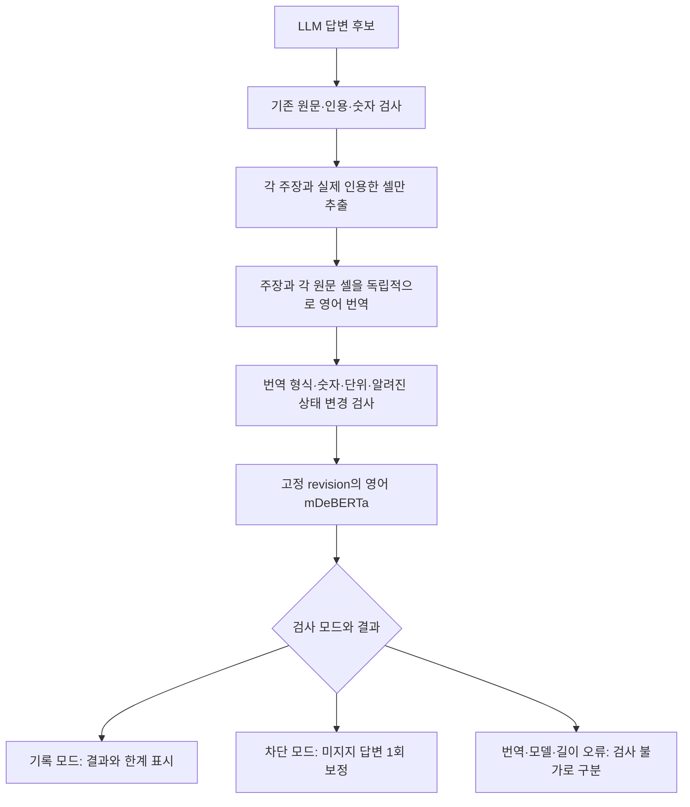

# 영어 답변 근거 검사 운영화

기준일: 2026-10-01. 선택적 근거 검사 연결, Mac 실측, Windows CI와 배포 검증을 완료했습니다. 자동 차단은 운영 기본으로 채택하지 않습니다. 현장 자료·Windows GPT-OSS 120B·DRM Excel 실기기 검증은 남아 있습니다.

## 목적과 범위

기존 답변의 원문·상세 ID·인용·수치 검사를 유지하면서, 영어 mDeBERTa로 각 주장이 실제 인용한 원문에서 뒷받침되는지 추가 검사합니다. 한국어와 영어 mDeBERTa를 모두 필수로 통과시키는 조건은 도입하지 않습니다. LEV·CLM·GLiNER·Laya의 후보 정렬 실험은 이번 운영 연결 범위에 포함하지 않습니다.

원문·검토·운영 DB와 기존 모델 설정을 보존합니다. 기본 설치에는 대형 모델 의존성을 추가하지 않고 별도 선택 설치를 제공합니다. 기존 설정에 검사 모드가 없으면 기존 규칙 검사를 유지하며, UI에서 검사 끔·결과 기록·답변 차단을 선택할 수 있도록 합니다.

## 처리 계약



- 사실 근거는 원래 언어의 원문 셀입니다. 검색용 영어 번역·채택문·미인용 셀·질문·추가 참고 원문을 NLI 전제에 넣지 않습니다.
- 서로 다른 상세 또는 주장들을 하나의 NLI 판단으로 합치지 않습니다. 번역이 주장을 근거에 맞춰 고치지 않도록 입력을 분리합니다.
- 고정 모델 `MoritzLaurer/mDeBERTa-v3-base-xnli-multilingual-nli-2mil7`, revision `b5113eb38ab63efdd7f280f8c144ea8b13f978ce`, CPU float32, 지지 점수 기준 0.8을 사용합니다. 이 점수는 업무 정확도나 보정된 신뢰도가 아닙니다.
- 질문 중 모델을 다운로드하지 않습니다. 명시적인 준비 단계에서 다운로드하고, 준비 후 같은 프로세스에서 모델을 재사용합니다.
- 실제 토큰 수로 입력 한도를 확인합니다. 긴 근거를 조용히 잘라서 통과시키지 않습니다. 번역·입력 한도·모델 오류를 근거 없는 주장 거절과 구별합니다.
- 번역·검사에는 시간 예산을 두고 원문을 수정하지 않습니다. 기본 120초이며 설정 파일의 `claim_guard_timeout_seconds`로 5~600초를 지정합니다. 번역 요청에는 남은 SDK 대기 시간을 전달합니다. 모델 적재·추론은 재사용하는 로컬 자식 프로세스에서 수행하며 한도를 넘으면 그 프로세스만 종료합니다. 프로세스 정리에 최대 약 2초를 추가 허용합니다. 차단 모드에서 검사를 못 마치면 미검증 답변을 통과시키지 않습니다.
- 독립 번역용 지시문을 사용합니다. 알려진 예정·미실시·일시 상태의 누락과 추가, 명시적인 완료의 변경을 검사하지만 문장 전체의 번역 충실성을 보증하는 검사는 아닙니다. 다른 대상의 상태로 바뀌는 복잡한 문장은 원문 대조가 필요합니다.

## 완료에 필요한 근거

| 항목 | 확인할 근거 | 현재 상태 |
|---|---|---|
| 원문 검사 뒤 영어 NLI 연결 | 실제 answer 호출·주장별 결과·보정·검사 불가 경로 | Mac LM Studio 20B high → 실제 HTTP 답변·독립 번역·CPU 검사 통과 · 원문 불변 |
| 번역의 독립성과 사실 보존 | 숫자·상태 변경, 다른 상세 혼입, 미인용 셀 배제 검사 | 관련 36개 검사 통과 · 임의 문장의 의미 보증은 아님 |
| 모델 운영 | 선택 설치·고정 revision·캐시·CPU 실추론·오프라인 재사용 | Mac CPU 실추론 확인 · 적재/추론 정지·후속 재개 검사 통과 |
| UI와 설정 | 모드 저장·준비 상태·검사 결과·오류 표시의 HTTP/UI 확인 | 실제 HTTP 및 Chromium 데스크톱·모바일 표시 통과 · 모델은 모의 |
| 품질과 지연 | 기존 고정 36건의 자동 번역 비교 및 실제 LLM 답변 경로 | 수정 후 36건 완료 · 누락·검사 불가 0건 · 오거절 3건 · 실제 HTTP 1건 통과 |
| 회귀와 배포 | 전체 검사·압축 해제 검사·Windows 관련 검증 | Mac 전체·기본 의존성만 설치한 독립 배포·Windows CI 회귀/압축 해제/CPU 실계산 통과 |
| 문서와 게시 | README·전체 흐름·임원 보고서·Ponytail 검토·커밋·푸시 | 코드·설치·흐름을 GitHub에 게시 · 최종 실측과 배포 근거를 이 문서에 정리 |

합성 자료와 모의 검사, 실제 Mac 모델 실행, Windows 실기기 또는 CI 검증은 각각 보고합니다. 합성 탐침의 성공을 실제 업무 정확도로 확대 해석하지 않습니다.

## 최종 Mac 실측과 판단

`automatic-en-v6`에서 같은 창작 사례 36건(올바른 설명 17건, 잘못되거나 근거가 부족한 설명 19건)을 모두 처리했습니다. `processed=36`, `missing=0`, `errors=[]`, `complete=true`이며 실제 LLM은 Mac LM Studio의 GPT-OSS 20B·추론 high입니다. 기존 개발 탐침으로 규칙·번역을 보완한 뒤 재검증한 결과로, 독립적인 새 업무 자료의 검증 결과가 아닙니다.

| 비교 경로 | 잘못된 설명 통과 | 올바른 설명 거절 | 검사 불가 |
|---|---:|---:|---:|
| 원문 규칙만 | 9 | 1 | 0 |
| 원문 규칙 + 사전 작성 영어 mDeBERTa 대조 | 0 | 1 | 0 |
| 원문 규칙 + 실제 독립 자동 번역 + mDeBERTa | 0 | 3 | 0 |

ID·라벨·원문 규칙·체크포인트·지표를 다시 계산해 대조했고 고정 조건의 코드·자료·설정 해시도 일치했습니다. 사전 작성 영어 35쌍의 확률은 기존 완료 결과와 차이 0으로 일치했습니다. 인용 없는 주장 한 건은 원문 규칙에서 먼저 거절하여 빈 NLI 전제로 처리하지 않았습니다.

추가 검사 25건의 평균은 15.957초, 최대 50.8982초였습니다. 번역·검사 시간이며 모델을 먼저 적재한 합성 평가 조건입니다. 전체 질문 시간·콜드 시작·동시 사용자 처리량·Windows 120B 속도는 이 수치로 판단하지 않습니다. 별도 합성 DB의 실제 HTTP 질문 한 건은 답변 생성부터 전체 36.2초, 추가 검사 24.8초로 통과했고 원문이 보존됐습니다.

남은 오거절은 세 유형입니다. `CG-REC-03`은 설비 기록의 장기 상태가 신체 기관(organ)으로 잘못 번역된 사례입니다. `CG-MISS-01`은 영어 원문·주장이 동일한 `A leak occurred in the pump.`인데도 지지 점수가 약 0.592여서 기준 0.8을 넘지 못했습니다. `CG-ZH-02`는 기존 원문 규칙에서 중국어 `2小时`를 한국어 `2시간`으로 바꾼 표기를 거절한 경우로 NLI 실행 전입니다. 모델 점수 완화로 이 결과를 감추지 않았습니다.

**현재 권장은 추가 검사 기본 끔을 유지하고, 먼저 결과 기록으로 시범 운영하는 것입니다.** 차단 모드는 검사 불가를 통과로 바꾸지 않지만 정상 답변도 막을 수 있습니다. 검색 재정렬은 구현하지 않았으며, 질문과 사례의 관련성 평가는 원문이 답변을 지지하는지와 다른 문제이므로 별도 고정 비교가 필요합니다.

## 실행·설치 방법

기존 설정·원문·검토·결과 폴더를 보존하고 코드를 업데이트한 뒤 서버를 재시작합니다. Windows에서는 `setup.bat guard`, Mac에서는 README의 선택 설치 명령을 실행합니다. 웹 설정에서 모드를 저장하며, 파일에는 `claim_guard_mode: off|observe|enforce`를 지정합니다. 웹 모드는 로컬 `cslist_settings.json`의 저장값을 우선합니다. 기존 설정에 새 키가 없어도 기본은 꺼짐입니다.

`python -m ragkit.claim_verification --status`는 모델을 적재하지 않고 상태만 봅니다. `--prepare`는 고정 파일을 다운로드하고, `--check`는 인터넷 없이 두 예시를 실제 계산합니다. 같은 영어 문장 `The pump was replaced.`의 지지 점수는 Mac Python 3.14·3.12에서 모두 약 0.502로, 운영 통과 기준 0.8보다 낮았습니다. 설치 점검은 이 예시의 argmax 라벨과 예정→완료 미지지 계산을 확인하며 낮은 점수를 그대로 출력합니다. 설치 성공을 업무 품질 인증으로 사용하지 않습니다.

고정 합성 36건의 자동 번역 평가는 다음과 같습니다. 새 조건에는 새 출력 폴더를 사용합니다. 오류·누락이 있으면 완료하지 않으며 기존 영어 대응문 대조와 실제 자동 번역을 구별합니다.

첫 자동 번역 평가(`automatic-en-v4`)는 36건을 모두 처리했으나 검사 불가 3건으로 `complete=false`입니다. 잘못된 설명 통과는 기존 규칙 9건에서 결합 검사 0건으로 줄었으나, 올바른 설명 거절은 1건에서 4건으로 늘었습니다. 별도 검사 불가 3건을 오거절 수에 섞지 않았습니다. 추가 검사 25건의 평균은 22.0초, 최대 89.9초이며 전체 질문 응답 시간이 아닙니다. 잘못 번역된 용어와 중립 판정, 조사·확인 대기의 규칙 문제가 확인되어 차단 모드의 운영 채택 근거로 사용하지 않습니다.

HTTP 400 한 건은 같은 합성 문장을 독립적으로 다시 번역했을 때 재현되지 않았으며 원인을 확정하지 못했습니다. 이전 실행·체크포인트는 보존합니다. 조사가 붙은 교체 미실시와 확인 대기를 바로잡은 코드는 새 평가 폴더에서 비교하며, 고정 모델·점수 기준을 완화하지 않습니다.

실제 웹 경로에서 FAISS와 PyTorch가 함께 적재된 자식 프로세스의 OpenMP 충돌·종료 코드 -11을 재현했습니다. FAISS를 실제 벡터 색인을 읽을 때만 불러오도록 변경한 뒤, 웹을 가져온 스레드에서 CPU 모델 적재·계산이 통과했습니다. 별도 합성 DB의 HTTP 질문에서도 예정·미실시 답변의 생성·번역·검사 통과와 DB 원문 불변을 확인했습니다. 원문 검사와 추가 모델 검사를 실제로 호출한 결과이며 Windows 실기기의 재현·검증은 아닙니다.

Windows CI에서 확인한 환경 문제 세 가지를 수정했습니다. 한국어 콘솔 출력을 위해 `PYTHONUTF8=1`을 적용했고, 개인 설정이 없는 새 체크아웃에는 인증 정보 없는 예제 설정을 복사합니다. Git의 자동 줄바꿈 변환으로 해시로 검증하는 토크나이저 파일의 바이트가 달라지는 문제는 해당 파일을 그대로 보존하는 `.gitattributes` 규칙으로 해결했습니다. Windows 줄바꿈 설정을 적용한 임시 체크아웃에서도 기존 SHA-256과 일치했습니다. 해시 검사와 토큰 수 검사는 유지합니다. 회귀·압축 해제·모델 준비·실계산은 각각 별도 단계로 실행합니다.

수정한 코드 `654d397`의 [Windows CI 36841046731](https://github.com/pmh10401/cs-excel-rag/actions/runs/36841046731)은 `completed/success`입니다. Python 3.14.7에서 기본·선택 의존성 설치, 전체 오프라인 회귀, 독립 압축 해제 검사, 고정 모델 준비와 실제 CPU 두 예시 계산을 모두 통과했습니다. 같은 영어 문장의 지지 점수 약 0.502와 예정→완료 변경의 지지 점수 약 0.00031을 출력했으며, 운영 기준 0.8을 낮추지 않았습니다. 이 CI는 실제 Windows OS에서 프로그램과 CPU 모델을 실행한 검증이지만, LLM 답변 회귀에는 모의를 사용합니다. 현장 GPT-OSS 120B·DRM Excel·실제 업무 정확도·동시 사용 성능의 검증은 아닙니다.

```sh
.venv/bin/python -m experiments.claim_guard_operating --self-check
.venv/bin/python -m experiments.claim_guard_operating --config mac_config.json --output outputs/claim-guard-operating-20261001/automatic-en-v6
```

## 배포 파일

한국 시간 2026-10-01 17:58:11에 생성한 `RAG-Windows-CS128-20261001-175811.TXT`는 ZIP 형식이며, 확장자를 `.zip`으로 바꾼 뒤 압축을 풉니다. 포함된 80개 파일은 현재 배포 대상 소스와 일치하며, 기본 의존성만 설치한 독립 가상환경에서 압축 해제·오프라인 검사를 통과했습니다. 실제 DB·개인 설정·모델 파일·LLM 로그는 포함하지 않습니다. SHA-256은 `a5fa309f567804ecce718fd2c8780ce95a19d2df75f9d5b008eb68225954f8c2`입니다. Windows에서는 `setup.bat`으로 기본 설치, `setup.bat guard`로 추가 검사 모델 준비, `start.bat`으로 웹을 실행합니다. 기존 DB·검토·설정은 보존하고 코드를 교체합니다.

## 웹 표시 검증

Browser 스킬이 없어 기존 번들 Playwright·Chromium을 사용했습니다. 임시 합성 DB와 모의 LLM·NLI를 사용한 실제 HTTP 화면입니다. 1440×1000과 390×844에서 설정 저장·재접속 복원, 준비 완료 표시, 기록 모드의 경고·영어 대응문, 차단 모드 실패를 확인했습니다. 페이지 제목·내용·스크린샷과 상호작용을 확인했고 관련 콘솔 오류·경고와 프레임워크 오류 화면은 없었습니다. 이 검증은 실제 모델 정확도와 Windows 브라우저 검증을 대신하지 않습니다.
