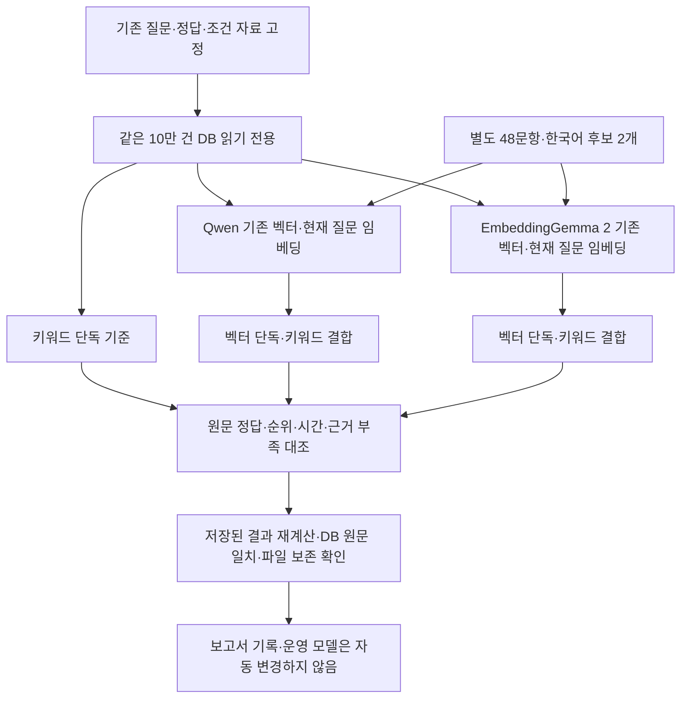

# Qwen·EmbeddingGemma 2 검색 품질 비교

기준일: 2026-10-07 · Mac LM Studio 실모델 · 합성 자료 · 운영 설정 변경 없음

## 판단

**현재 질문과 검색 방식에서는 기존 Qwen이 우세합니다. EmbeddingGemma 2 교체가 품질을 높였다는 근거는 확인하지 못했습니다.** 키워드·벡터 결합 검색에서 첫 정답은 39/44에서 35/44로 줄었고, 상위 5개 정답 포함도 43/44에서 41/44로 줄었습니다. 별도의 짧은 다국어 조건 시험에서는 새 모델이 29/36→31/36으로 나았습니다. 두 결과는 서로 다른 범위를 평가하므로 합쳐서 하나의 정확도로 표현하지 않습니다.

이번에는 평가만 진행했습니다. 새 모델을 사용하는 개인 설정, 기존 Qwen 벡터, 원문 DB, 검토 결과를 유지했습니다. 품질을 우선하는 운영 모델 선정은 새 현장 질문으로 확인한 뒤 결정해야 합니다.

## 비교 범위와 조건

- 10만 건의 **합성 검색 자료**에서 기존 고정 질문 50개를 새로 검색했습니다. 정답 있는 44개는 현상 질문 41개와 정확한 CS 조회 3개입니다. 정답 없는 6개는 없는 CS 번호 3개와 자료에 없는 분야 3개입니다. 10만 개 질문이나 실제 업무 기록 전체를 채점한 실험은 아닙니다.
- 별도 조건 질문 48개는 기존 16개 상황의 한국어·영어·중국어 표현입니다. 각 질문은 **한국어 원문 후보 2개**에서 비교합니다. 정답 있는 36개, 없는 12개이며 언어별 질문은 서로 연관됩니다. 이 후보들은 10만 건 검색에 추가하지 않았습니다.
- 여러 과거 실험에서 사용한 개발 질문입니다. 독립 홀드아웃이나 사람이 판정한 현장 질문이 아닙니다. 모델에 정답·평가 점수를 보내지 않았습니다.
- 같은 SQLite 원문, 문서 본문, 14,542개 고유 문서 내용, 100,000개 접수 연결과 FAISS FlatIP를 사용했습니다. Qwen은 1,024차원, EmbeddingGemma 2는 768차원입니다. 모델별 기존 저장 벡터를 읽었으며 새 운영 벡터를 만들지 않았습니다.
- 두 모델 모두 Q8_0이며 같은 LM Studio 서버의 8,192토큰 적재 설정으로 실행했습니다. Qwen은 기존 유지보수 현상용 질문 지시, 새 모델은 모델용 문서·질문 접두사를 사용합니다. **각 모델과 접두사를 함께 비교한 결과**이며 가중치만의 효과를 분리한 실험은 아닙니다.
- 최소 유사도 0.3, 결합 후보는 키워드 최대 20개·벡터 최대 20개, 평가 반환 수는 5개로 고정했습니다. 결과를 보고 문턱값·프롬프트·정답을 수정하지 않았습니다. 서로 다른 모델의 유사도 숫자는 같은 확률이나 신뢰도를 뜻하지 않습니다.
- 번역·답변 LLM·mDeBERTa·추가 재정렬은 호출하지 않았습니다. 이번 수치는 **검색 품질**이며 최종 답변의 정확도나 인용 검사 성공률이 아닙니다.

## 실제 결합 검색

| 확인 항목 | 키워드 단독 | Qwen 결합 | EmbeddingGemma 2 결합 |
|---|---:|---:|---:|
| 첫 결과가 정답인 질문 | 28/44 | **39/44 (88.6%)** | 35/44 (79.5%) |
| 상위 3개에 정답 포함 | 28/44 | **43/44** | 41/44 |
| 상위 5개에 정답 포함 | 28/44 | **43/44** | 41/44 |
| 현상 질문만의 첫 정답 | 25/41 | **36/41** | 32/41 |
| 50문항의 상위 5개 평균 적합 비율 | 56.0% | **70.8%** | 66.0% |
| 정답 없는 질문에 후보를 반환하지 않음 | 4/6 | 3/6 | 3/6 |

첫 정답과 정답 포함 지표는 정답 없는 질문을 분모에서 제외합니다. 평균 적합 비율은 각 질문의 `정답 후보 수 / 실제 반환 후보 수`를 평균하고 빈 결과는 0으로 계산합니다. 같은 상황 유형에 해당하는 서로 다른 접수도 정답 후보로 계산합니다. 전체 관련 접수 수를 판정하지 않았으므로 이 표는 전체 DB의 재현율을 뜻하지 않습니다.

정확한 CS 조회에서는 결합 검색이 임베딩을 호출하지 않고 기존 정확 검색을 사용합니다. 기존 CS 번호 3개는 두 설정 모두 정확히 찾았고, 없는 번호 3개는 모두 빈 결과였습니다. 임베딩 차이를 보려면 41개 현상 질문의 지표를 확인해야 합니다.

벡터 **단독** 검색의 현상 질문 첫 정답은 Qwen 36/41, 새 모델 32/41이었습니다. 이 자료에서는 같은 유형의 유사 접수가 앞쪽 후보를 많이 차지해 상위 3개·5개 정답 포함 수도 각각 같은 수였습니다. 벡터 단독은 자료에 없는 분야 3개에도 후보를 반환했습니다. 진단용 벡터 단독 호출은 정확한 CS 조회를 우회하므로 CS 번호 질문의 성적을 임베딩 의미 이해 성적으로 섞지 않습니다.

## 좋아진 질문과 나빠진 질문

새 모델 결합 검색은 기존 모델보다 첫 정답이 좋아진 질문 1개, 나빠진 질문 5개였습니다. 나머지는 첫 정답 여부가 같았습니다.

| 질문의 핵심 조건 | Qwen 첫 사례 | 새 모델 첫 사례 | 변화 |
|---|---|---|---|
| 약액 가열 출력을 높여도 승온이 늦음 | 히터 승온 지연 | 드레인 밸브 누유 | 후퇴 |
| 검사 테이블의 가로 이동 시 위치 오류 | XY 위치 오차 | 일반 검사 멈춤 | 후퇴 |
| 이동은 정상이며 전원을 끌 때만 로봇 팔이 내려감 | 전원 차단 시 Z축 낙하 | 로봇 원점 오류 | 후퇴 |
| 냉각수 유량은 정상이며 환수 온도만 높음 | 척 쿨링 고온 | 냉각수 저유량 | 후퇴 |
| 진공 배기는 정상이며 벤트할 때만 압력 회복이 늦음 | 벤트 밸브 지연 | 진공 도달 불량 | 후퇴 |
| 사용 중 압력 저하가 아니라 차단 후 압력 상승 | 스크러버 차압 | 가스 박스 압력 상승 | 개선 |

새 모델에서 정답을 상위 5개에 놓지 못한 `paraphrase-28`, `new-01`, `new-04`는 키워드 20개·벡터 20개의 전체 후보군에도 해당 정답 유형이 없었습니다. **이 세 질문은 같은 후보의 순서만 다시 매기는 방법으로 복구할 수 없습니다.** 후보 검색과 후보 다양성을 먼저 보완할 근거입니다. 같은 증상 벡터를 공유하는 접수라도 조치·원문이 다를 수 있으므로 원본 상세를 삭제하거나 합치는 방식은 피해야 합니다.

## 다국어 조건 시험의 뜻과 결과

**같은 문제를 한국어·영어·중국어로 질문해, 조건에 맞는 과거 사례를 고르는지 확인하는 시험**입니다. 후보 사례는 한국어로 두었습니다. 예를 들어 ‘진공 배기는 정상이고 공기를 넣어 대기압으로 돌아올 때만 늦음’이라는 질문에서 ‘벤트 지연’을 골라야 하며, ‘진공 배기 불량’을 고르면 실패합니다. 수치 차이, 정상인 장치와 고장 난 장치, 발생 시점, 확인된 사실과 의심을 포함한 16개 상황을 세 언어로 물어 48문항을 만들었습니다.

| 확인 항목 | Qwen | EmbeddingGemma 2 |
|---|---:|---:|
| 정답 있는 조건 질문의 첫 정답 | 29/36 | **31/36** |
| 한국어 / 영어 / 중국어 첫 정답 | 9/12 · 10/12 · 10/12 | **10/12 · 10/12 · 11/12** |
| 근거 없는 조건 질문을 최소 유사도로 거절 | 0/12 | 0/12 |
| 정답 있는 조건 질문을 잘못 거절 | 0/36 | 0/36 |

새 모델은 팬 소음의 한국어·영어와 전원 차단 조건의 영어·중국어에서 개선됐습니다. 반대로 벤트 조건의 영어, 온도 초과 조건의 영어는 후퇴했습니다. 남은 첫 결과 오류는 `vent-ko`, `vent-en`, `overshoot-ko`, `overshoot-en`, `overshoot-zh`입니다.

두 모델 모두 **11.8 L/min을 찾는데 후보는 1.18·118 L/min인 경우**, 누수 확정만 찾는데 후보는 의심·점검 예정인 경우를 유사도 0.3으로 거절하지 못했습니다. 이 작은 시험에서 새 모델의 후보 점수는 모두 0.696 이상이었습니다. 점수가 높아도 수치·부정·확정 여부가 맞는다는 뜻은 아닙니다. 기존 원문·숫자·상태 검사와 선택적 답변 근거 검사는 계속 필요합니다.

## 시간과 검증

| 단일 실행에서 측정한 항목 | Qwen | EmbeddingGemma 2 |
|---|---:|---:|
| 10만 건 FAISS 최초 적재 | 2.019초 | 1.909초 |
| 벡터 단독 검색 평균 / p95 | 0.265 / 0.520초 | 0.225 / 0.296초 |
| 결합 검색 평균 / p95 | 0.551 / 1.489초 | 0.501 / 1.626초 |
| 별도 후보 32개·질문 48개의 배치 임베딩 | 3.317초 | 2.462초 |

검색 시간은 서버 연결·색인 적재·임베딩 준비 호출을 완료한 뒤 한 번 측정했습니다. 결합 검색에는 정확한 CS 조회 6문항도 포함됩니다. 체크포인트 저장, 번역·답변 작성, 모델 적재와 최초 FAISS 적재는 제외합니다. 두 모델을 순서대로 평가했으며 다른 CPU 작업과 자원을 독점하지 않았습니다. 평균은 새 모델이 짧았지만 결합 검색 p95는 길었습니다. 반복 부하 시험·Windows 속도 개선을 입증한 결과는 아닙니다.

실행은 `complete=true`, 250개 검색 결과와 96개 조건 결과를 저장했고 오류·누락은 없었습니다. 평가 코드의 첫 실행은 처리 시간 항목을 잘못 읽어 첫 질문에서 중단됐으며, 오류 기록을 보존하고 평가 코드만 수정해 전체를 다시 실행했습니다. 질문·모델 설정·채점 기준은 바꾸지 않았습니다.

저장 원문과 정답으로 모든 지표를 다시 계산했습니다. 별도의 계산으로 주요 건수·점수 236개를 대조하고, 반환된 고유 상세 556개의 내용·근거가 실제 DB와 일치하는지 확인했습니다. 조건 점수를 float64로 다시 합산했을 때 순위·문턱 판정의 차이는 없었습니다. 실제 모델로 정답과 무관하게 고른 문서 3개씩을 다시 임베딩해 저장 벡터와 비교했으며 두 모델 모두 최대 차이는 0이었습니다. 표본 점검으로 고유 벡터 14,542개 전체를 재생성한 검사는 아닙니다.

DB 전체 파일과 개인 설정의 SHA256이 평가 전후 일치했습니다. DB 체크섬은 `7d8328031f7974e80ffb80d5cc0984a327a459b756e6320316cae89e078a6a97`입니다. 질문·정답 고정 해시는 `d1412d05c6823bf4f69b051a10ea1fb00ce43493ba67d9556df1e128c0b2bd56`이며 조건 자료 해시는 `d2b72b78a2692445f3564837aff6264a8dcd8e951a04a304739af2191b006abf`입니다.

## 다음 판단

1. 현재 합성 업무 질문의 검색 품질을 우선하면 Qwen이 더 적합합니다. 새 모델은 별도 후보로 두고, 비교 결과만으로 운영 설정을 자동으로 되돌리거나 문턱값을 올리지 않습니다.
2. 정답이 후보군에 없는 세 질문은 현상·설비 조건과 유사 접수의 후보 점유를 먼저 점검합니다. 정답이 후보군에 들어온 뒤 재정렬 효과를 평가합니다.
3. 실제 현장 질문을 별도로 고정하고 담당자가 정답 상세를 판정해야 합니다. 개발 질문으로 기준을 정한 뒤 사용하지 않은 질문에서 누락·잘못된 조치·응답 시간을 확인합니다.

## 평가 흐름과 재현



실행 코드: [experiments/embedding_quality.py](../experiments/embedding_quality.py). 원문 DB·개인 설정·평가 결과·고정 질문 사본은 로컬 `outputs/embedding-quality-20261007`에만 보관하며 GitHub에 올리지 않습니다. `evaluated-script.py`에는 이번 실행 당시의 코드와 해시를 보존했습니다. 실행 후 코드 검토에서 중복 파일 해시 함수만 기존 도우미 호출로 정리했고 저장 결과 검증과 모의 검사를 다시 통과했습니다. 새로 저장소를 받은 PC에는 해당 DB와 고정 질문 사본이 없으므로 같은 실험을 바로 실행할 수 없습니다. 새 실행은 기존 결과를 덮어쓰지 않는 다른 출력 폴더를 지정해야 합니다.

```sh
cd "/Users/mac/Documents/ChatGPT/RAG 구성"
# 로컬에 준비된 같은 DB·고정 질문·모델 설정 사용
.venv/bin/python -u -m experiments.embedding_quality --output outputs/embedding-quality-repeat
# 모델 재호출 없이 저장 결과 검증
.venv/bin/python -m experiments.embedding_quality --verify --output outputs/embedding-quality-20261007
# 모의 점수·근거 없음 분모 검사; 실제 모델 품질 수치가 아님
.venv/bin/python -m tests.test_embedding_quality
```
