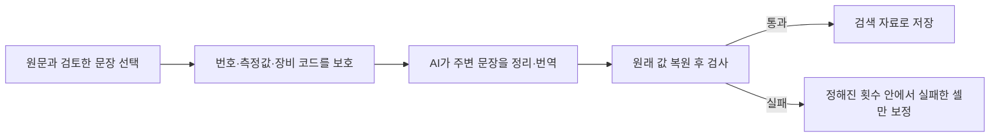
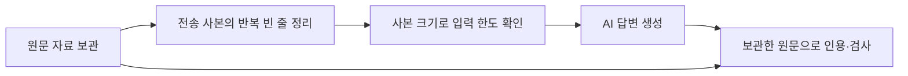
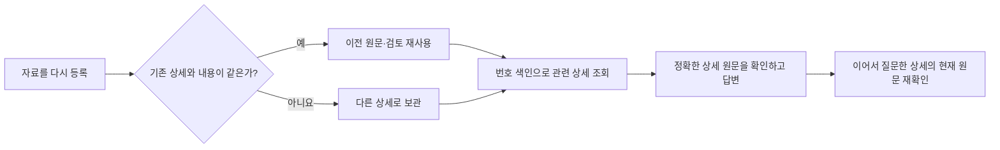
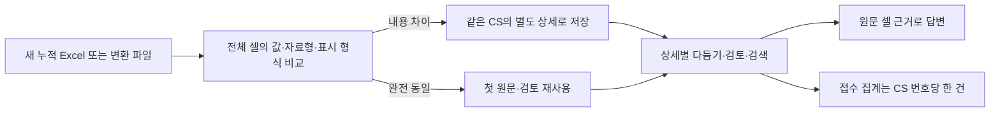
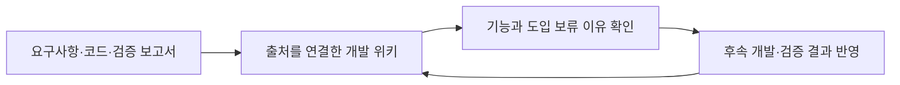
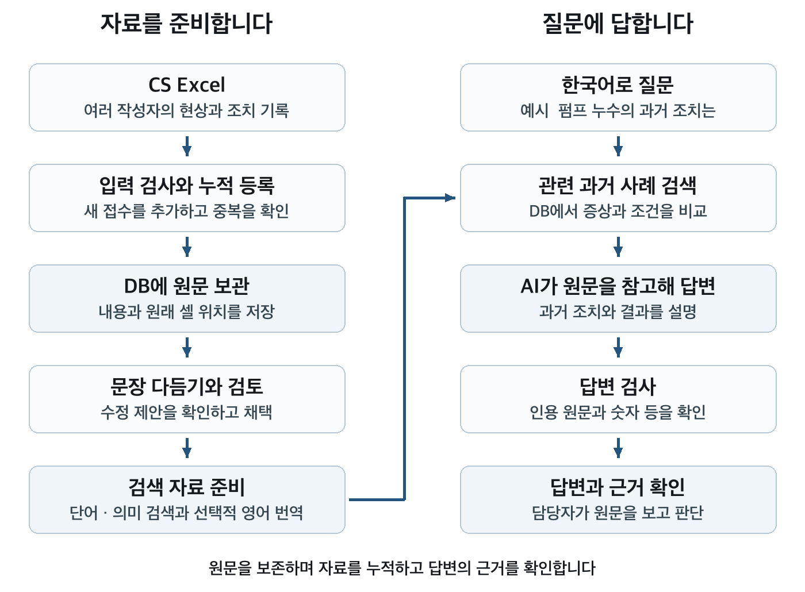
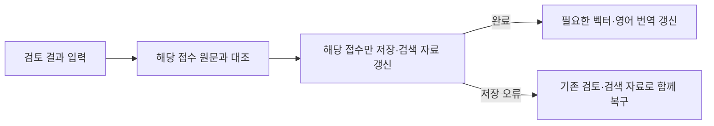
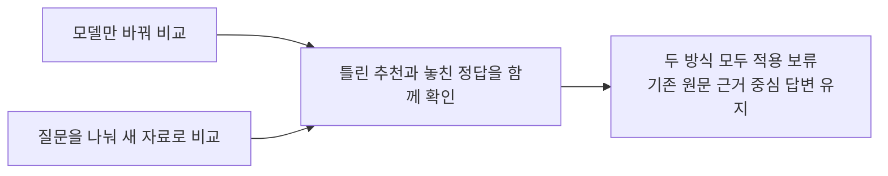

# CS 이력 검색 시스템 개발 현황 보고

2026년 9월 30일 문서 기준 · 경영진 보고용 · 운영 기능은 9월 30일 DB·상세 근거·반복 빈 줄 전송·첫 요청 숫자 보호까지 반영 · 모델 평가는 각 실험 날짜 기준

## 1 보고 요지

여러 사람이 작성한 Excel의 고장·조치 이력을 모아, 문제 현상을 질문하면 관련 과거 사례와 원문 근거를 확인하는 시스템을 구현했습니다. 기존 128열 자료에 누적 28열 자료를 추가하고, 중국어·영어 설명을 한국어로 번역해 검색에 활용하도록 확장했습니다. DB 등록 후에는 Excel 파일 없이도 작업할 수 있습니다.

현재는 기능 검증을 마친 시험 운영 단계입니다. 실제 Windows 환경과 업무 자료로 제한된 시범 운영을 진행하고, 검색에 걸리는 시간과 답변의 근거 적합성을 측정한 뒤 적용 범위를 넓히는 것을 제안합니다. 현장의 최종 조치 판단은 담당자가 수행합니다.

### 문장을 다듬을 때 목록 번호와 장비 코드 보존 (2026년 9월 30일)

문장 앞의 `1.`만 빠져도 숫자 오류로 표시되던 사례를 확인했습니다. 이제 문장 다듬기와 검색용 영어 번역에서 첫 요청부터 목록 번호, 측정값·단위, 숫자가 있는 장비 코드를 고정 표시자로 전달합니다. AI는 주변 문장을 정리하고 프로그램이 원래 값을 복원해 검사합니다. 표시자가 빠지거나 순서가 바뀌면 보정을 요청하며, 목록 번호 누락은 측정값 변경과 구분하여 안내합니다.

문장 다듬기는 한 번 보정 후 숫자 보존 오류만 남으면 해당 셀의 원문을 유지하고 검토 사유를 남깁니다. 영어 번역은 최대 세 번 보완하며 끝내 실패한 번역을 성공으로 저장하지 않습니다. 기존 원문·검토·성공 결과를 유지하고 추가 모델이나 설정은 필요하지 않습니다.

제시된 짧은 예시와 모의 AI 응답으로 `1.`과 `ifep2`가 첫 응답에서 복원되는 것을 확인했습니다. 실패한 셀만 재요청하는 처리와 소수 측정값·부호·단위 검사도 확인했습니다. 실제 업무 파일 전체나 Windows GPT-OSS 120B를 평가한 결과는 아니므로 오류 감소율은 아직 제시하지 않습니다. 현장에서는 같은 실패 사례의 전후 결과와 재요청 횟수를 비교해야 합니다.

관련 검사와 전체 오프라인 검사, Mac에서 Windows 배포 파일을 별도 폴더에 풀어 수행한 검사·실행 확인을 모두 통과했습니다(종료 코드 0). 원문·검토를 보존하며 운영 DB를 직접 변경한 것은 아닙니다.

### 답변에 보내는 반복 빈 줄 정리 (2026년 9월 30일)

Excel 셀에 불필요한 빈 줄이 여러 번 들어간 경우, 답변 AI에 보낼 사본에서만 줄입니다. 문단·항목을 구분하는 줄바꿈과 숫자·측정 단위·작업 순서는 유지합니다. 원본 자료와 검토 결과는 그대로 보관하고, 답변의 인용과 사실 검사는 원본 자료로 수행합니다. 담당자가 설정을 바꿀 필요 없이 CS 답변 요청에 적용됩니다.

가상 셀에서 동봉된 GPT-OSS 토크나이저로 확인한 결과, 줄바꿈 30개가 반복된 두 구간을 정리하면 자료 부분은 107→51토큰, 전체 메시지 본문은 2,399→2,343토큰으로 줄었습니다. 실제 업무 자료의 절감 비율이나 답변 품질 향상을 입증한 수치는 아닙니다. 모의 응답 검사는 원문 인용 보존, Windows 줄바꿈, 숫자·단위·작업 순서와 입력 한도를 확인합니다.

관련 검사와 전체 오프라인 검사, Mac에서 Windows 배포 파일을 별도 폴더에 풀어 수행한 검사·실행 확인을 모두 통과했습니다(종료 코드 0). 실제 모델의 업무 답변 품질 평가는 포함하지 않습니다.

### 자료 보존과 조회 안정성 보완 (2026년 9월 30일)

같은 파일을 다른 형식으로 다시 등록하거나 구형 변환 파일을 나중에 등록해도 같은 내용이면 이전 자료를 재사용하도록 수정했습니다. 같은 CS 번호라도 내용이 다르면 새 상세로 보관합니다. 기존 원문, 검토 결과와 출처를 유지하며 이미 저장된 중복 자료를 자동 삭제하지 않습니다.

숫자로만 된 접수번호에서도 원본 상세를 모두 조회하고, 검색과 건수 집계의 대소문자 처리도 통일했습니다. 번호를 찾는 보조 색인을 추가해 매번 전체 원문을 읽던 작업을 줄였습니다. 새 버전으로 검색 자료를 확인할 때 기존 DB의 필요한 색인만 자동 보완합니다.

누적 자료의 조치가 답변에서 빠지던 경로도 보완했습니다. 같은 접수의 펌프와 밸브를 각각 설명하도록 검사하고, 다른 상세의 조치를 인용 없이 가져온 답변에는 보정을 요청합니다. “두 번째 사례의 조치는?”처럼 이어서 질문할 때는 앞선 답변의 해당 상세를 확인해 현재 DB 원문을 다시 읽습니다. 원문이 없어졌다면 다른 부품의 조치로 대신 답하지 않습니다.

년월 표기가 `2026-09`에서 `2026년 9월`로 바뀌어도 같은 값이면 허용합니다. 년월만 있는 자료로 특정 일자나 시각을 만들어 답하는 것은 허용하지 않으며, 측정값의 부호·단위 검사도 유지합니다.

창작 자료와 임시 DB로 등록 순서, 상세 보존, 검색·집계 일치와 기존 DB의 색인 보완을 확인했습니다. 모의 AI 응답으로 상세별 인용·년월·후속 질문 기능도 검사했습니다. 이는 자료 처리 기능의 검사이며 실제 업무 정확도나 전체 답변 속도 개선을 입증한 결과는 아닙니다. 자동 인용 검사가 의역의 의미 전체를 보증하지는 않습니다. Windows DRM 파일과 실제 답변 모델의 검증은 별도로 필요합니다.

9월 30일 기준으로 새 회귀 검사 9개를 포함한 전체 오프라인 검사와, Mac에서 Windows 배포 파일을 별도 폴더에 풀어 수행한 검사·실행 확인을 모두 통과했습니다(종료 코드 0). 운영 DB를 직접 변환하거나 실제 업무 자료를 다시 평가한 것은 아닙니다.

### 한 접수의 여러 부품 문제 보존 (2026년 9월 29일)

같은 CS 번호에 펌프와 밸브 문제가 함께 기록되면 두 상세를 모두 저장합니다. 같은 부품이라도 현상이나 조치가 다르면 별도로 남깁니다. 완전히 같은 행을 여러 번 등록하는 경우만 재사용합니다. 접수 1건 안에 상세 3건이 있을 수 있으며, 업무 접수 건수를 부풀리지 않습니다.

새 시트는 `19~26년 누적_260925`, 변경 열은 `SITE`와 `불량발생년월`입니다. 기존 `19~26년 누적_2600831`의 `Site`·`불량발생월`도 지원하며 원래 열 이름을 보존합니다. 새 입력과 내용이 같은 구형 DB 기록은 이전 ID·원문·검토를 그대로 재사용합니다. 기존 변환 파일도 읽을 수 있고, 새 파일을 변환하면 상세 기록 구분 정보를 함께 저장합니다.

합성 12행에서 완전 중복 1행만 제외하고 11상세·접수 1건을 보관하는 검사와, 행·열 순서 변경, 구형 DB의 검토·출처 보존, 상세별 인용 검사를 통과했습니다. 전체 오프라인 회귀·UI DOM 검사, Mac의 독립 압축 해제 후 Windows 배포 검사도 통과했습니다. 실제 업무 Excel은 제공받지 않았으므로 Windows DRM 실기기와 실제 답변 품질은 미확인입니다. 모델을 새로 평가하거나 운영 DB를 변환한 것은 아닙니다.

### 개발 지식 정리 (2026년 9월 29일)

지금까지의 요구사항, 프로그램 사용법, 설계 이유와 실험 결과를 [개발 지식 위키](../llm-wiki/index.md)로 연결했습니다. 담당자가 “현재 가능한 기능은 무엇인가”, “왜 이 모델은 도입하지 않았는가”, “어디까지 검증했는가”를 관련 출처와 함께 찾을 수 있도록 구성했습니다. 구성·입력·검색·질문·실험·운영·향후 판단의 7개 주제로 나누었습니다.

이번 작업은 문서 정리입니다. 실제 CS 자료와 인증 정보를 옮기지 않았고, 운영 DB·모델·답변 방식도 바꾸지 않았습니다. 문서 링크·출처 버전·기존 보고서 수치를 대조하는 범위이며 새로운 정확도·비용 절감 효과를 측정한 것은 아닙니다. 설비·증상별 업무 지식 요약을 검색에 활용하는 방안은 별도 비교를 거친 뒤 판단할 제안으로 남겼습니다.

### 이번 질문 기능 개선 (2026년 9월 28일)

답변을 고치는 과정에서 실패한 답변 전체를 덧붙여 요청 분량이 커지는 문제를 수정했습니다. 이제 필요한 경우 실패 답변을 제외하고 같은 원문으로 다시 작성합니다. 자료를 임의로 잘라 맞추거나 숫자·인용 검사를 생략하지 않습니다. 최초 자료 자체가 너무 크면 참고 사례 수를 조정해야 합니다.

사용자는 답변을 받은 뒤 **최근 답변에 이어서 질문**을 눌러 “그 사례의 관찰 기간은?”처럼 물을 수 있습니다. 이전 문답은 대상을 파악하는 데 사용하고, 답변 근거는 DB에서 다시 찾습니다. 시스템이 이해한 검색 질문도 펼쳐 볼 수 있으며 대상을 특정하기 어려우면 확인을 요청합니다. 최근 대화는 사용자 세션별로 잠시 보관하며 **새 대화**로 초기화합니다.

**영어 지시 · 한국어 답변** 선택도 추가했습니다. AI에 보내는 작업 지시만 영어로 바꾸며 원문과 한국어 답변은 유지합니다. 영어가 더 우수하다고 판단해 기본값을 교체한 것은 아닙니다. 기존 합성 비교에서 실패가 늘어난 결과를 고려해 한국어를 기본으로 두고 사용자가 선택하도록 했습니다.

이번 검증은 창작 자료와 모의 AI 응답을 이용한 기능·회귀 검사, 실제 HTTP 사용자 분리 검사, Mac 웹 화면 조작입니다. Windows GPT-OSS 120B의 실제 답변 품질이나 업무 정확도 향상을 측정한 결과는 아닙니다. 후속 질문에는 대상 확인용 AI 호출이 한 번 추가됩니다. 시범 운영에서는 해석된 질문이 사용자 의도와 맞는지, 보정 후 실제 원문에 부합하는지, 처리 시간이 허용 범위인지 확인해야 합니다.

### 해결하려는 업무 문제

작성자마다 표현이 다른 Excel에서는 같은 증상을 다른 말로 기록하기 쉽습니다. 과거 조치를 찾더라도 실제로 해결됐는지, 재발했는지, 아직 시행하지 않은 조치인지 원문을 다시 확인해야 합니다. 이 시스템은 기록을 찾고 비교하는 일을 돕고, 답변에서 해당 원문까지 바로 확인하도록 구성했습니다.

| 현재 가능한 기능 | 업무에서 달라지는 점 |
| --- | --- |
| 여러 Excel을 순차 누적 등록 | 파일을 한 번에 대기시키고 오류 파일을 제외해 계속 처리합니다. |
| 다국어 번역과 검토 결과 저장 | 중국어·영어 설명도 한국어로 정리하고 원문과 비교합니다. |
| 단어 검색과 의미 검색을 결합 | 표현이 달라도 관련 증상의 과거 사례를 찾을 수 있도록 돕습니다. |
| 한국어 답변과 원문 근거 제공 | 조치 내용과 결과를 원문에서 확인하고 판단합니다. |
| 야간 자동 처리와 실패분 재시도 | 성공할 때까지 재시도하며 단계·남은 대기 시간을 표시합니다. |

기대 효과는 자료 탐색과 정리에 드는 수작업을 줄이는 것입니다. 시간 절감률, 비용 절감액, 실제 업무 질문의 정답률은 아직 측정하지 않았습니다.

## 2 시스템이 동작하는 과정

RAG는 **질문과 관련된 기록을 먼저 찾고, 찾은 기록을 근거로 AI가 답하는 방식**입니다. 현재 시스템은 회사 자료로 AI 모델을 새로 학습시키지 않습니다.

자료를 처음 등록할 때 원문 셀의 내용과 자료형, 파일명, 시트명, 셀 주소를 보관합니다. 문장 다듬기는 별도의 수정 제안을 만들며, 검토해 채택한 내용이 검색에 반영됩니다. 원문 자체를 AI 문장으로 덮어쓰지 않습니다. 원문 등록만으로 단어 검색을 시작할 수도 있습니다.

의미 검색은 문장을 의미 비교용 숫자 목록인 ‘벡터’로 바꾸어 비슷한 사례를 찾습니다. 누적 자료는 채택한 한국어 번역도 벡터에 반영합니다. 영어 번역은 선택적인 검색·질문 이해 보조 자료이며, 영어 번역문을 별도로 벡터화하지는 않습니다. 인용 근거는 번역 전 원문입니다.

질문할 때에는 DB에 저장된 사례를 검색하고, AI가 관련 원문을 참고해 답변합니다. 인용과 숫자 등을 검사한 뒤 답변과 근거를 구분해 보여 줍니다. 근거가 부족하면 그 상태를 알리며, 단순 건수 질문은 지원하는 조건에 한해 DB에서 직접 계산합니다.

## 3 자료를 누적하고 보호하는 방식

최대 100파일을 한 번에 대기시켜 순서대로 등록합니다. 오류가 생기면 해당 파일 전체를 제외하고 다음 파일을 계속 처리합니다. 앞선 성공분은 보존하며, 문제를 수정한 뒤 실패 파일만 재시도할 수 있습니다. 브라우저를 닫아도 계속되지만 프로그램 재시작 시 대기 목록은 초기화됩니다. Excel 수식은 계산 완료 값을 읽으며, 입력 오류는 파일과 셀 위치·수정 방법을 알려줍니다.

새 접수번호는 추가하고, 번호와 원문이 같으면 기존 처리 결과를 재사용합니다. 번호가 다르면 내용이 같아도 별도 사례입니다. 두 양식의 같은 CS 번호는 원문을 각각 보관하고 함께 조회하며 접수 건수에서는 한 건으로 셉니다. 누적 자료의 다른 내용은 새 상세로 추가합니다. CSList는 같은 파일의 수정분을 갱신하고, 다른 파일에서 같은 번호의 내용이 다르면 해당 파일 등록을 중단합니다.

등록이 완료되면 문장 다듬기, 검토, 번역, 벡터 생성과 질문은 저장된 DB를 사용합니다. Excel을 수정해도 다시 등록하기 전에는 DB에 반영되지 않습니다. 원본 파일을 삭제하려면 등록 건수와 원문을 먼저 확인하고, 프로그램을 종료한 상태에서 설정 파일과 출력 폴더 전체를 백업해야 합니다.

야간 실행은 검사 통과 제안을 자동 채택하고 벡터·영어 자료를 준비합니다. 모든 단계의 실패를 성공 또는 사용자 중지까지 재시도하며 성공분은 재사용합니다. 화면에서 6단계와 재시도 대기를 확인합니다. 인증·설정 등 외부 원인이 남으면 완료되지 않을 수 있습니다.

## 4 현재까지 확인한 결과

다음 표는 2026년 9월 22일의 Mac 환경 검증입니다. 자동 검사에서 AI 응답을 모의로 제공한 구간은 저장·검사·재시도 동작을 확인한 것이며, 실제 모델의 답변 품질 평가와 구별합니다.

| 검증 항목 | 확인한 결과 | 결과의 범위 |
| --- | --- | --- |
| 자동 회귀 검사 | 대기열·다국어 자료 검사를 포함해 39개 PASS 항목을 확인했습니다. | 모의 응답으로 저장·검색·검토·번역·벡터 동작을 검사했습니다. |
| 대기열과 야간 실행 화면 | 여러 파일 등록, 야간 실패 반복·중지·재개·질문 이동을 확인했습니다. | 시험용 DB를 사용했으며 원본 삭제 후 처리도 앞선 검사에서 확인했습니다. |
| 두 양식의 연결과 원문 보존 | 같은 번호의 두 원문, 번역 채택 후 검색, 중국어 원문 인용을 확인했습니다. | 새 파일의 실제 원문은 아직 제공받지 않았습니다. |
| Windows 배포 | 71개 파일을 별도 폴더에 풀어 오프라인 검사와 실행 명령을 확인했습니다. | Mac에서 검사했으며 Windows 실기기 검증과 구별합니다. |

### 9월 26일 구조 개선: 검토 저장 시 불필요한 전체 재처리 제거

과거에는 한 접수의 검토를 저장해도 전체 접수의 검색 자료를 다시 만들었습니다. 이를 검토한 접수만 갱신하도록 개선했습니다. 개별 검토·일괄 채택·야간 실행이 같은 저장 절차를 사용하며, 원문을 두 번 읽는 작업과 중복된 설치 목록도 정리했습니다. 사용자가 새 설정을 입력하거나 자료를 다시 등록할 필요는 없습니다.

원문·셀 위치·기존 검토 결과는 보존합니다. 오래된 검색 자료는 필요한 경우에만 한 번 이관하며, 깨진 제안이 있으면 실패를 알리고 정상 제안의 일괄 처리를 계속합니다. 이 변경은 저장·검색 자료 준비 과정의 개선이며 모델의 판단 품질을 높였다는 뜻은 아닙니다.

Mac에서 가상 2,000건을 같은 조건으로 세 번씩 실행한 결과입니다. 한 건을 저장할 때는 해당 접수만 갱신하고, 모든 접수를 일괄 채택할 때는 기존 전체 갱신을 사용해 대량 처리 성능도 유지했습니다.

| 처리 구간 | 변경 전 중앙값 | 변경 후 중앙값 |
| --- | ---: | ---: |
| 2,000건 원문 DB 등록·검색 자료 생성 | 1.827초 | 1.584초 |
| 접수 한 건의 검토 저장 | 3.104초 | 0.006초 |
| 전체 미검토 제안 일괄 채택 | 11.184초 | 10.187초 |

공개 가상 샘플 8건을 접수번호를 달리해 2,000건으로 만들었으며, 메모리 SQLite와 모의 번역·임베딩을 사용했습니다. 원문 등록 시간에는 Excel 읽기를 포함하지 않고, 검토 저장 시간에는 후속 모델 호출을 포함하지 않습니다. 변경 전후에 11개 질문을 세 가지 검색 방식으로, 검토 전·개별 검토 후·일괄 채택 후에 비교했습니다. 이를 세 번 반복한 **297개 비교에서 검색 순위와 원문 근거가 같았고**, 원문·제안·검토 값·검색 자료·벡터의 논리적 저장 내용도 같았습니다. 검토 시각과 색인 내부 저장 구조는 동일성 비교에서 제외했습니다.

이는 Mac의 제한된 자동 시험 결과입니다. 실제 Windows의 디스크 DB·DRM Excel 처리 시간, 10만 건의 처리 성능과 실제 AI 답변 품질은 이번 구조 개선 시험의 검증 범위에 포함하지 않았습니다.

전체 오프라인 검사 39개 PASS 항목과 새 Windows 배포본 71개 파일의 독립 압축 해제·오프라인 실행 검사를 통과했습니다. 저장 실패 시 원문·검토·검색·벡터 자료의 동시 복구, 구형 색인 이관의 롤백, 전체 보고서의 접수 누락 방지를 포함합니다. 재확인 명령은 프로젝트 루트의 `.venv/bin/python windows-demo/test_demo.py`와 `.venv/bin/python package_windows.py`입니다. 배포본 실행 검사는 Mac에서 수행했으며 Windows 실기기 시험과 구별합니다.

### 9월 26일 추가 검토: 증상 자동 분류로 검색을 개선할 수 있는가

작은 다국어 분류 모델인 GLiNER로 질문과 과거 사례의 증상을 분류하고, 같은 분류의 사례를 조금 더 앞에 표시하는 방법을 시험했습니다. 기존 합성 질문 50개와 고정된 검색 후보를 사용해 실제 로컬 모델로 비교했습니다.

상위 5건의 평균 적합성은 72.0%에서 72.4%로 소폭 높아졌지만, 정답이 있는 44개 질문에서 첫 번째 사례가 맞는 경우는 40개에서 38개로 줄었습니다. 추가 시간은 평균 약 1초였습니다. 전기 이상·압력 이상처럼 넓은 분류가 같더라도 실제 고장 조건이 다른 사례를 앞에 놓은 문제가 있었습니다.

**이 방식은 운영에 적용하지 않습니다.** 기존 검색, DB와 사용자 화면은 유지합니다. 실제 업무 자료의 개선을 입증한 결과도 아닙니다. 다음 비교에서는 별도로 정답을 확인한 현업 질문과 발생 조건을 구분하는 검색 모델이 필요합니다. [상세 실험 보고서](GLiNER-실험-20260926.md)에 결과와 재현 절차를 기록했습니다.

추가로 가점을 줄이는 방법과 질문·사례의 관련성을 직접 판단하는 방법을 비교했습니다. 직접 정렬은 관련 사례의 평균 비율을 높였지만, 기존에 상위 3건에서 정답을 찾던 44개 질문 중 5개에서 정답을 놓쳤습니다. 새 합성 조건을 한국어·영어·중국어로 표현한 48문항에서는 숫자 자릿수와 부정 조건을 잘못 판단하는 경우도 확인했습니다. 따라서 운영 미적용을 유지하며, 평균 지표 하나만으로 개선을 판단하지 않습니다. [추가 실험과 흐름도](GLiNER-추가실험-20260926.md)에 자세한 결과를 기록했습니다.

질문과 사례를 영어로 번역한 뒤 비교하는 검사도 완료했습니다. 기존 검색 순위를 조금만 조정하는 방식은 정답이 있는 44개 질문에서 첫 결과 적중을 40개에서 41개로 높였고, 상위 3건에 정답을 포함하는 44개 결과는 유지했습니다. 반면 순위를 전부 바꾸면 정답 2개를 상위 3건에서 놓쳤습니다. 별도 다국어 조건에서는 한국어 질문의 결과가 좋아졌지만 전체 언어의 개선은 일관되지 않았습니다.

**영어 번역이 모든 문제를 해결하지는 않습니다.** 숫자가 다른 사례를 같은 현상으로 보는 오류와 배기·벤트를 혼동한 번역이 남았습니다. 따라서 운영 검색은 유지하고, 용어 번역을 안정화한 뒤 새 업무 질문에서 작은 순위 조정 방식을 검증하는 것이 다음 판단입니다. 이번에는 번역 준비에 약 7.3분의 배치 처리 시간이 들었고, 저장된 번역으로 최대 20개 후보를 분류하는 단계는 평균 약 1.45초였습니다. 실제 사용자 응답 시간이나 현업 정확도 수치는 아닙니다. [영어 번역 비교 보고서](GLiNER-영어번역-실험-20260926.md)에 결과·한계·흐름도를 함께 기록했습니다.

### 9월 26일 추가 검토: Mac GPU에서 새로운 검색 판단 모델 실행

LEV라는 작은 언어 모델로 질문과 과거 사례의 조건이 맞는지를 판단하는 방법도 별도 비교했습니다. 앞선 실험의 영어 번역과 검색 후보를 재사용해 번역 변경 효과와 모델 변경 효과를 구분했습니다. 같은 입력은 한 번만 계산하고 각 문항의 결과를 저장하도록 구성했습니다.

M2 Max의 GPU에서 실제로 실행되는 것을 확인했습니다. 짧은 6개 예비 입력에서 기존 CPU 실행은 평균 약 45.4초, GPU는 약 1.84초였으며 선택한 분류는 모두 같았습니다. 이는 같은 모델의 제한된 장치 비교이며, 업무 검색 전체가 24배 빨라진다는 뜻은 아닙니다. 후보를 묶어 처리하는 추가 시도는 판단 확률 차이가 커서 제외했습니다. [LEV·GPU 보고서](LEV-M2-GPU-실험-20260926.md)에 전체 비교와 근거를 기록합니다.

전체 98문항 검사를 완료했습니다. 정답이 있는 기존 질문 44개에서 첫 결과가 맞는 경우는 기존 검색 40개에서 LEV 44개로 늘었고, 별도 조건 질문 36개도 모두 첫 결과에 정답을 표시했습니다. 정답 없는 별도 질문 12개도 근거 부족으로 구분했습니다. 다만 여러 번 확인한 합성 자료와 같은 조건의 언어별 질문이므로 실제 업무 정확도 100%를 뜻하지 않습니다.

**운영 도입은 보류합니다.** 현재 Mac에서 기존 질문의 후보를 판단하는 데 평균 약 49초가 추가됩니다. 첫 결과가 맞더라도 다른 부적합 후보에 높은 점수를 준 사례가 있었고, 기존 질문 4개는 관련 사례가 있는데도 점수만 보면 근거가 부족하다고 잘못 판단했습니다. 속도를 개선하고 새 현업 질문으로 다시 비교한 뒤 도입 여부를 결정해야 합니다. 실제 계산 결과·오류·한계를 보고서에 함께 남겼으며 운영 검색은 유지했습니다.

### 9월 27일 추가 검토: CLM 비교 완료와 판단

CLM은 질문과 과거 사례를 비교해 후보 순서를 정하는 별도의 판단 모델입니다. 모델을 GPU에 올리는 순서를 개선해 앞서 중단됐던 비교를 완료했습니다. CPU와 GPU의 판단 확률 차이는 최대 0.220%p로, 처음 정한 허용 범위 2%p를 통과했습니다. 같은 합성 질문 98개를 처리했고 실행 실패·누락은 없었습니다. 저장 결과 784개를 원문 기준으로 다시 계산해 일치를 확인했습니다.

**빨라졌지만, 바로 도입할 만큼 정확하지는 않았습니다.** 아래는 같은 후보를 관련성 점수로 정렬한 결과입니다. 기존 질문 중 정답이 있는 44개와 별도 조건 질문 중 정답이 있는 36개를 셉니다. 시간은 후보 판단 단계만 측정했습니다.

| 확인 항목 | LEV | CLM 관련성 정렬 |
| --- | ---: | ---: |
| 기존 질문에서 첫 결과가 맞은 수 | 44/44 | 41/44 |
| 별도 조건 질문에서 첫 결과가 맞은 수 | 36/36 | 31/36 |
| 기존 모델 호출 질문의 평균 판단 시간 | 49.37초 | 3.48초 |
| 근거가 없는 별도 질문을 올바르게 거절한 수 | 12/12 | 0/12 |

CLM은 11.8 L/min을 찾을 때 1.18·118 L/min 기록에도 높은 점수를 줬고, 누수 확정과 단순 의심도 충분히 구분하지 못했습니다. 후보를 직접 비교하는 다른 CLM 방식은 첫 결과가 35/44·20/36으로 더 낮았습니다. 기존 검색에 작은 가점만 주는 방식은 이번 품질 지표를 개선하지 못했습니다. **운영에는 기존 검색을 유지합니다.** 다음 판단은 새로운 업무 질문의 품질 검증과 LEV의 긴 대기 시간 개선을 중심으로 진행하는 것이 합리적입니다.

이 수치는 반복 사용한 합성 질문과 저장된 영어 번역을 사용한 비교입니다. 일부 번역 오류도 그대로 포함하며 실제 업무 정확도나 전체 답변 속도를 뜻하지 않습니다. 다른 프로젝트의 선행 LEV 4,406건과 금융 CLM 평가는 섞지 않았습니다. 9월 26일 CPU·GPU 대조 실패, 적재 정체와 Mac 재시작 기록도 보존했습니다. 이번 성공으로 이전 재시작 원인이 확정된 것은 아닙니다. [CLM 보고서와 흐름도](CLM-비교실험-20260926.md)에 실행 개선, 품질 한계와 재현 조건을 정리했습니다.

### 9월 27일 추가 검토: Ollaya로 가벼운 판단 모델 실행

Ollaya는 모델을 내려받아 로컬에서 실행하는 도구입니다. 이번에는 Laya라는 영어 판단 모델을 Mac의 CPU에서 실행하고, 앞선 LEV·CLM과 같은 질문·번역·후보를 비교했습니다. 98문항 처리를 완료했고 실행 실패·누락은 없었습니다. 저장 결과 980개를 원문 기준으로 다시 계산해 일치를 확인했습니다.

| 확인 항목 | 기존 검색 | Ollaya/Laya 직접 정렬 | 기존 순위에 작은 가점 |
| --- | ---: | ---: | ---: |
| 기존 질문에서 첫 결과가 맞은 수 | 40/44 | 37/44 | 41/44 |
| 기존 질문의 상위 3건에 정답이 있는 수 | 44/44 | 37/44 | 44/44 |
| 별도 조건 질문에서 첫 결과가 맞은 수 | 18/36 | 23/36 | 21/36 |

기존 모델 호출 질문의 평균 판단 시간은 2.59초로, 앞선 LEV 49.37초와 CLM 관련성 판단 3.48초보다 짧았습니다. 다만 모델 자체가 다르고 새 질문 번역·검색·답변 작성 시간을 제외하므로 전체 서비스의 속도 개선 수치는 아닙니다. 같은 문항의 동일 입력을 재사용해 976개 후보쌍을 468번 계산했으며 원문 후보는 모두 보존했습니다.

**이번 설정은 운영에 도입하지 않습니다.** 순위를 전부 바꾸면 기존 정답 일부가 뒤로 밀렸고, 작은 가점도 정답 없는 조건 질문 12개 중 9개를 거절하지 못했습니다. 숫자 자릿수가 다른 질문 3개는 구분했지만 누수 의심을 확정 근거로 높게 평가하는 오류가 남았습니다. 합성 자료에서 얻은 결과이므로 새로운 업무 질문에서 작은 가점의 효과와 오류를 검증해야 합니다. 학습이나 기존 AI 모델의 자동 교체는 하지 않았습니다. [Ollaya 보고서와 흐름도](Ollaya-비교실험-20260927.md)에 근거를 기록했습니다.

### 9월 27일 추가 검토: 어떤 조치를 해야 하는지 묻는 질문

유사 기록을 찾는 데서 나아가, 과거에 효과가 확인된 조치를 고를 수 있는지 시험했습니다. 새 가상 질문 24개에 조치 후보를 두 개씩 준비했습니다. 16개 질문에는 적절한 후보가 있고, 나머지 8개는 근거가 부족해 추천을 보류해야 합니다. 정답과 평가 기준을 먼저 고정하고 Ollaya/Laya에 조건 일치와 조치 결과를 따로 판단하게 했습니다.

**자동 추천에는 도입하지 않습니다.** 올바른 후보가 있는 16개 질문에서는 13개를 골랐지만, 보류해야 하는 8개 질문에서는 3개만 보류했습니다. 총 8개 질문에서 잘못된 조치를 골랐습니다. 예를 들어 일부 개선에 그친 필터 세척을 정상화 조치로 선택하거나, 아직 수행하지 않은 통신 모듈 교체를 선택했습니다. 여러 작업을 함께 한 뒤 좋아진 기록에서도 개별 작업만의 효과를 구분하지 못했습니다.

| 확인 항목 | 실제 결과 |
| --- | ---: |
| 적절한 조치가 있는 질문에서 올바른 선택 | 13/16 |
| 근거 부족 질문에서 올바른 추천 보류 | 3/8 |
| 전체 선택·보류 판단 일치 | 16/24 |
| 질문당 후보 두 개의 평균 판단 시간 | 1.27초 |
| 실행 실패·누락 | 0건 |

실행 성공과 추천의 타당성은 다릅니다. 기존 원문 분석 규칙만으로 고른 참고 결과는 17/24였지만, 이는 운영 중인 전체 답변 AI와 비교한 수치가 아닙니다. 새 자료는 한국어 기록과 대응 영어 문장을 함께 만든 가상 사례로, 현업 담당자가 확정한 실제 정답 자료도 아닙니다. 원문 근거를 붙여도 모델의 조치 해석이 틀릴 수 있음을 확인했습니다.

현재 답변 흐름을 유지하고, 다음 판단은 기존 답변 AI가 같은 기록에서 실패·예정·재발을 빠뜨리지 않는지 확인한 뒤 내려야 합니다. 이 24문항으로 기준을 맞춘 뒤 같은 자료의 점수 상승을 새 검증으로 보고하지 않습니다. [조치 추천 평가 보고서](조치추천-평가-20260927.md)에 결과, 오류 사례, 흐름도와 재현 절차를 기록했습니다.

### 같은 날 후속 비교: 판단 모델과 질문 방식을 바꾸면 좋아지는가

공식 문서를 참고해 두 가지를 나누어 시험했습니다. 먼저 질문과 자료를 그대로 두고 같은 계열의 다른 Laya 판단 모델로 변경했습니다. 다음에는 조치의 실행·정상화·재발 등을 여섯 질문으로 나누고, 확실하지 않으면 추천을 보류하도록 했습니다. 두 번째 시험은 기존 자료를 개발용으로 취급하고, 미리 고정한 새로운 가상 질문 24개로 별도 확인했습니다.

| 비교 | 확인한 결과 | 서비스 관점의 판단 |
| --- | --- | --- |
| 기존 24문항에서 모델만 변경 | 맞은 판단 16개 → 13개, 잘못된 추천 8개 → 11개 | 모델 교체의 이점이 확인되지 않았습니다. |
| 새 24문항에서 기존 질문 방식 사용 | 정답 있는 12개 중 6개 선택, 보류할 12개도 모두 추천 | 근거가 부족한 사례를 걸러내지 못했습니다. |
| 새 24문항에서 질문 분해와 엄격한 기준 사용 | 24개 모두 보류, 정답 있는 12개도 모두 놓침 | 잘못된 추천은 없지만 유용한 답도 제공하지 못했습니다. |

추가 네 번의 CPU 실행에서 오류·입력 잘림·누락은 없었고, 192개 선택 결과와 192개 원문 근거 연결을 재확인했습니다. 실행이 정상이어도 서비스에 도움이 되는 것은 아니라는 점을 확인했습니다. 모델 학습이나 운영 프로그램 변경은 하지 않았습니다. 질문과 보류 기준을 동시에 바꿨으므로 어느 한쪽만의 효과를 분리한 시험도 아닙니다.

새 자료 역시 가상 사례이며 현업 검토를 받은 정답 자료가 아닙니다. 모든 질문을 보류하면 틀린 추천은 줄지만 과거 조치를 찾는 업무 목적을 달성하지 못합니다. 다음 도입 판단에는 실제 답변 AI와 현업 검토 자료를 이용해 **틀린 추천을 줄이면서 필요한 조치는 찾아주는지** 확인해야 합니다. [상세 비교와 재현 방법](조치추천-평가-20260927.md#공식-문서에-따른-추가-비교)에 결과를 기록했습니다.

### 9월 28일 추가 검토: 현재 답변 AI의 오류 위치 확인

과거 조치를 찾을 때 생기는 오류를 검색과 답변 작성으로 나누어 확인하는 평가를 추가했습니다. 같은 가상 질문 24개에 대해 담당자가 지정한 원문을 바로 제공하는 방식과, 현재 검색 기능으로 자료를 찾은 뒤 제공하는 방식을 비교합니다. 두 방식 모두 현재 GPT OSS 20B가 한국어 답변을 작성하고 기존 인용 검사를 거칩니다.

같은 문서가 조치 후보 수만큼 중복 집계되지 않도록 정리한 44개 원문을 별도 실험 DB에 보관합니다. 실패·예정·결과 미확인 기록도 삭제하지 않습니다. 관련 기록을 찾았는지와 그 조치가 실제로 성공했는지는 구분해서 판단합니다. 인용 검사 통과 여부에 더해 원문과 답변의 의미를 대조하고, 현업 전문가가 검토한 결과와 구별해 보고합니다. [평가 방법과 결과](답변모델-기준평가-20260928.md)에 세부 근거를 기록합니다.

| 확인 결과 | 지정 원문 제공 | 실제 검색 후 답변 |
| --- | ---: | ---: |
| 관련 원문을 제공한 질문 | 24/24 | 24/24 |
| 본문·조치 결과·인용 대조 통과 | 17/24 | 16/24 |
| 답변이 있으나 보완 필요 | 6 | 5 |
| 생성 또는 검사 실패 | 1 | 3 |
| 답변 평균 처리 시간 | 38.01초 | 46.18초 |

이번 작은 시험에서는 자료를 찾은 뒤 설명하는 단계에 보완점이 남았습니다. 조치 셀만 인용하면서 다른 열의 현상을 설명하거나, 조치는 적고 결과를 생략하거나, 답할 근거가 있는데도 보류한 경우가 있었습니다. 다음에는 필요한 인용 열과 조치 결과를 빠뜨리지 않도록 개선하고 검증해야 합니다. 모델 교체는 이번 결과만으로 결정하지 않습니다. 이는 Mac의 가상 자료와 Codex 검토 결과이며 실제 업무 정확도·Windows 120B 성능을 뜻하지 않습니다.

### 9월 28일 보완: 숫자 검사 안내와 날짜 오판 수정

사용자가 숫자·부호 검사 실패를 보고해, 어느 답변의 어떤 숫자가 어느 인용 열과 맞지 않는지 표시하도록 보완했습니다. 동일한 비교 정보를 AI의 자동 수정 요청에도 보냅니다. 예를 들어 원문은 30분인데 답변이 90분이면 두 값을 나란히 안내합니다. 숫자가 다른 열에 있다면 그 열을 인용해야 하며, 원문에 없는 값은 통과시키지 않습니다. 숫자의 쉼표·소수 표기를 유지하고 목록 번호를 추가하지 않도록 요청도 명확히 했습니다.

사용자가 알려 준 질문은 스핀 문제의 조치, 참고 날짜, 중복 없는 인용을 함께 요구했습니다. 같은 조건의 가상 사례에서 날짜가 `2026-09-01`에서 `2026.09.01`로 표현되면 잘못 거절하는 문제를 재현해 수정했습니다. 같은 년월일의 표기 차이는 허용하되 다른 날짜는 계속 차단합니다. 인용 중복을 줄이면서 날짜 근거까지 빠뜨리지 않도록 요청도 보완했습니다.

위 48답변 평가는 이 보완 이전 결과입니다. 사용자가 보고한 다른 PC의 실패 응답·원문은 확보하지 못해 해당 건의 해결 여부와 실제 재보정 성공률은 확인되지 않았습니다. 모의 응답과 HTTP 검사에서는 잘못된 숫자의 차단, 근거 열 보완 후 통과, 상세 오류 전달을 확인했습니다.

보완 후 Mac의 GPT OSS 20B에 가상 스핀 사례 2건과 날짜·중복 인용 조건을 실제 요청했습니다. 두 사례의 조치와 날짜, 원문 인용을 확인했고 중복 셀 주소는 없었습니다. 한 질문의 동작 확인이며 업무 정확도 개선률을 뜻하지 않습니다. Windows 배포 파일은 Mac에서 압축 해제·오프라인 전체 검사를 통과했으며 실제 Windows·120B·업무 DB는 미검증입니다.

### 9월 28일 추가 비교: AI에 주는 지시의 언어

AI에 주는 작성 지시를 영어로 바꾸면 누락이나 잘못된 해석이 줄어드는지 확인하는 비교를 추가했습니다. 사용자의 질문, 업무 원문과 최종 답변은 계속 한국어로 유지합니다. 저장된 검색 자료가 같은 24개 질문에 날짜·숫자 경계 질문 4개를 더해, 한국어 지시와 영어 지시로 각각 답하게 합니다. 검색 결과가 달라져 생기는 효과와 구분하기 위한 구성입니다.

총 56개 답변의 실행과 원문 대조를 마쳤습니다. 같은 내용을 지시하는 42개 항목은 영어로 작성했을 때 분량이 약 18% 줄었지만, 추가 보정이 늘어 전체 입력 절감은 작았습니다.

| 비교 결과 | 한국어 지시 | 영어 지시 |
| --- | ---: | ---: |
| 필요한 내용·인용 대조 통과 — 적절한 보류 포함 | 15/28 | 16/28 |
| 답변이 있었으나 보완 필요 | 12 | 7 |
| 최종 답변 생성·검사 실패 | 1 | 5 |
| 평균 처리 시간 | 42.20초 | 59.34초 |

영어 지시가 더 완전한 설명을 만든 사례도 있었지만 최종 실패가 늘어 사전에 정한 채택 조건을 충족하지 못했습니다. **운영 기본값은 한국어로 유지합니다.** 후속 개선은 인용 주소의 오기와 원문 결과·보조 상태의 혼동을 줄이는 데 집중할 필요가 있습니다. 이번 결과는 Mac의 작은 가상 자료를 Codex가 대조한 것이며, 실제 업무 정확도와 Windows 120B 효과는 별도 확인 대상입니다. [비교 보고서와 흐름도](영문-프롬프트-비교-20260928.md)에 문항별 결과와 재현 방법을 기록했습니다.

## 5 시범 운영에서 확인할 사항

LM Studio의 GPT OSS 20B에서 중국어 셀의 한국어 번역을 확인했습니다. 추가 2행 시험은 번역·보정과 벡터 생성을 지났지만 답변이 잘려 전체 흐름은 완료하지 못했습니다. 이는 작은 시험이며 전체 자료의 번역 품질 평가가 아닙니다.

현재 검증으로 Windows의 실제 DRM 연동, GPT OSS 120B의 업무 답변 품질, 동시 사용자 수에 따른 처리 성능까지 확인됐다고 볼 수는 없습니다. 자동 숫자·인용 검사는 원문 대비 일부 오류를 차단하지만 문장 의미와 인과관계 전체를 보증하지 않습니다.

실제 과거 사례와 현업 질문을 정해 기존 Excel 탐색 방식과 비교하는 것이 다음 단계입니다. 아래 항목의 목표치는 시범 운영 전에 담당 부서와 합의하고, 같은 질문으로 비교해야 합니다.

| 측정 항목 | 측정 방법 |
| --- | --- |
| 필요한 사례를 찾는 시간 | 같은 질문으로 기존 방식과 시스템 사용 시간을 비교합니다. |
| 검색 사례의 적합성 | 상위 3개 사례가 질문의 증상·장비·조건에 맞는지 현업 담당자가 판단합니다. |
| 답변 근거의 정확성 | 조치·결과·미실시·재발 등의 설명이 인용 원문과 일치하는지 확인합니다. |
| 운영 안정성 | 실패 건수, 재시도 후 미완료 건수, 응답 대기 시간, 백업 복원 여부를 기록합니다. |

실제 Windows에서 DRM 등록부터 원본 삭제 후 질문까지 확인하고, 업무 자료의 검색·답변 오류를 평가해야 합니다. 확대 적용 전에는 로그인·권한 관리와 정기 백업·복구 절차를 마련해야 합니다. 현재 UI에는 사용자 인증·역할별 권한이 없어 신뢰할 수 있는 내부 사용자 범위로 운영합니다.

원문과 질문의 일부는 설정한 답변·임베딩 서버로 전달됩니다. 사내 자료를 사용할 때는 해당 서버의 위치와 접근 가능 범위를 확인해야 합니다. 여러 브라우저의 질문은 대기열로 순차 처리하며, 동시 접속이 모두 동시 답변을 뜻하지는 않습니다.

## 6 변경 이력과 보고 문서 관리

2026년 9월 27일 비공개 GitHub 저장소 [pmh10401/cs-excel-rag](https://github.com/pmh10401/cs-excel-rag)를 만들었습니다. 코드와 설명 문서, 흐름도를 `main` 브랜치에서 함께 관리하며, 저장소 접근 권한이 있는 사용자만 열람할 수 있습니다.

기능 변경 시 코드·사용 설명·흐름도·이 보고서를 함께 갱신하고 검증한 버전을 GitHub에 반영합니다. 배포 파일명은 한국 시간으로 구분합니다. 실제 Excel·운영 DB·인증 정보·요청 로그는 올리지 않습니다. 보고서는 구현 사실과 기대 효과를 구분하며, 미검증 환경을 표시하고 실측하지 않은 정확도·비용 절감 수치를 제시하지 않습니다.

근거 자료: [전체 프로그램 흐름도](전체-프로그램-플로우.md), [검증 기록](검증기록-20260922.md), [GLiNER 실험](GLiNER-실험-20260926.md), [LEV·GPU 실험](LEV-M2-GPU-실험-20260926.md), [CLM 비교](CLM-비교실험-20260926.md), [Ollaya 비교](Ollaya-비교실험-20260927.md), [조치 추천 평가](조치추천-평가-20260927.md), [답변 모델 기준 평가](답변모델-기준평가-20260928.md), [사용 및 개발 안내](../README.md). 기존 [9월 22일 Word 보고서](CS-RAG-임원보고서-20260922.docx)에는 9월 26~28일 추가 실험 내용이 포함되어 있지 않습니다. 최신 결과는 이 Markdown 보고서를 기준으로 확인하세요.
