# 전체 프로그램 플로우

운영 흐름 기준: 2026-09-26. 검토 저장 구조 정리와 별도 GLiNER·LEV 실험, CLM 장치 검사 실패를 반영했습니다. 웹 UI를 중심으로 그렸으며, CLI도 같은 입력·다듬기·검토·검색 함수를 사용합니다. 화살표는 처리 순서 또는 데이터 전달을 뜻하고, 점선은 선택 기능이나 보조 경로입니다. 모델을 학습시키는 단계는 없습니다. 비개발자용 설명은 [임원 보고서](임원보고서.md)에서 확인할 수 있습니다.

## 1. 전체 흐름

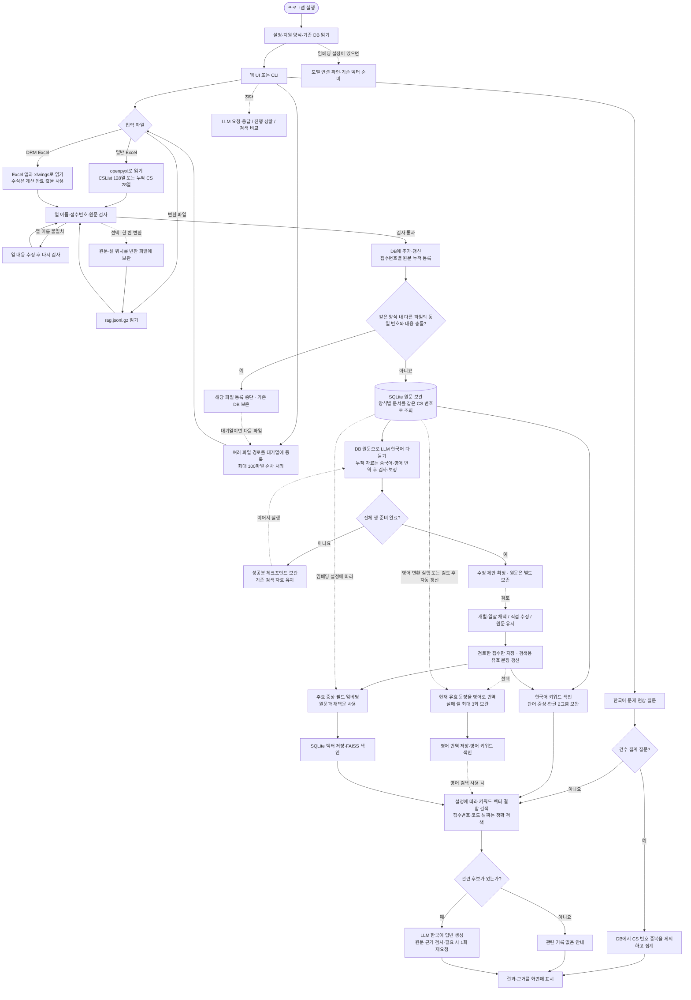

**입력 검사·파일 변환과 DB 등록은 다른 단계입니다.** DB 등록 완료 후에는 Excel 없이 다듬기·검토·번역·벡터·질문을 처리합니다. 원문 등록만으로 단어 검색이 가능하고, 임베딩 자동 갱신이 켜져 있으면 원문 기반 벡터도 준비합니다. 같은 내용은 재사용하며, 같은 원본에서 변경된 접수만 갱신하고 이번 파일에 없는 기존 접수는 유지합니다.

일반 다듬기에서는 제안을 바로 채택하지 않습니다. 검토에서 채택·직접 편집한 값이 있으면 그 값을 사용하고, 없으면 원문을 사용합니다. 미채택 제안은 영어 번역과 벡터 입력에 넣지 않습니다. 야간 자동 처리에서는 검사 통과 미검토 제안을 자동 채택합니다.

새 누적 양식은 `19~26년 누적_2600831` 시트의 28열을 그대로 보관합니다. `CS NO`와 기존 `CS 접수번호`는 같은 업무 번호이며, 서로 다른 양식의 문서는 덮어쓰지 않고 함께 조회합니다. 자료 목록은 원문 문서 수, 전체 접수 집계는 중복을 제외한 CS 번호 수입니다.

누적 자료의 한국어 번역은 문장 다듬기의 수정 제안으로 생성합니다. 검토 채택 후 단어 검색과 벡터에 반영되며, 인용에는 원래 언어의 원문과 셀 위치를 사용합니다. 식별자·날짜·빈칸을 보존하고 `2小时`처럼 숫자에 붙은 단위는 원문 표기를 유지합니다.

영어 번역 결과는 영어 **키워드 검색**에 사용합니다. 현재 영어 번역문을 별도로 임베딩하는 경로는 없습니다. 기존 벡터 입력 필드는 제목·문제현상·현상·제품군·UNIT명·알람코드이며, 누적 자료는 Defect 유형·상세, 설비·설비군 간소화, 기인 모듈·부품도 포함합니다. 신규 파생 검색 규칙은 기존 DB의 첫 색인 확인 때 한 번 갱신하며 원문과 검토를 보존합니다.

### 입력 오류와 수식 처리

Excel 연결 방식은 계산 완료 상태를 확인하고 수식의 결과값을 읽습니다. 계산 중·대기는 F9 계산 후 재실행하도록 안내하며 실제 오류 값은 셀 주소와 함께 거절합니다. 수식 자체를 실행하거나 원본 파일을 변경하지 않습니다. 일반 파일 읽기는 수식을 계산하지 않고 Excel 연결 방식을 안내합니다.

열 검사에서는 제목과 값이 모두 빈 뒤쪽 열만 제외합니다. 중간 빈 제목·중복·예약 이름·이름 없는 데이터 열은 파일·시트·셀 위치와 수정 방법을 표시합니다. 뒤쪽 행에서 무제목 열의 값이 발견돼도 전체 입력을 실패 처리하고 기존 DB·변환 파일을 보존합니다. UI는 오류가 난 입력 영역을 펼치고 알림으로 이동합니다.

### 여러 파일 등록 대기열

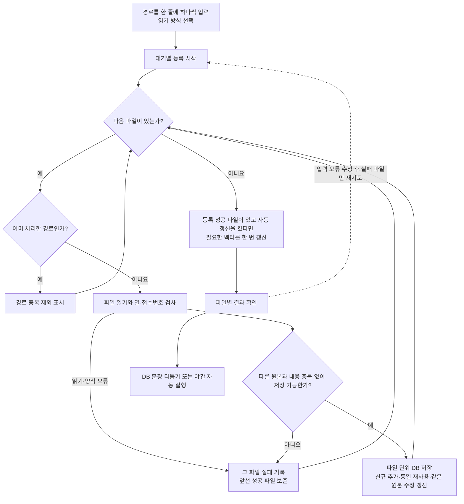

브라우저는 목록을 서버에 한 번 전달하고 진행 상황을 조회합니다. 파일을 하나씩 읽고 저장하므로 여러 Excel 전체를 동시에 메모리에 올리지 않습니다. 작업 중 새 목록을 시작하지 못하게 기존 공유 작업 잠금을 사용합니다. 브라우저 새로고침·종료와 관계없이 서버는 계속 처리하지만, 서버 재시작 후 대기 목록 복구는 지원하지 않습니다. 재등록 시 저장된 동일 원문은 재사용합니다.

## 2. 문장 다듬기와 검토

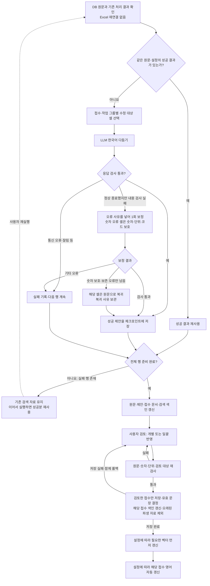

- 문장 다듬기와 영어 번역의 동시 처리 설정은 기본 200, 최대 1,000입니다. 서버에서 실제로 동시에 계산하는 수와는 다릅니다.
- 문장 다듬기는 완료한 성공분을 체크포인트에 저장합니다. 실패가 남으면 새 검색 자료 전체를 확정하지 않습니다.
- 검토 저장은 원문 등록에서 쓰던 변경분 색인 갱신을 재사용합니다. 최신 색인에서는 검토한 접수만 읽고 다시 만들며, 모든 접수를 검토할 때는 기존 전체 갱신 방식을 사용합니다. 구형 색인은 한 번 전체 이관하며 이관이 저장 트랜잭션을 먼저 확정하지 않습니다. 빈 검토는 생략하고, 전체 HTML 보고서 조회는 저장과 분리합니다.
- 일괄 채택은 원문·제안을 순서대로 읽어 검사하며, 제안 JSON이 손상된 접수도 실패 목록으로 남깁니다. 정상 제안과 기존 검토는 보존합니다. 같은 원문의 중복 읽기와 원문 등록에 불필요한 LLM 다듬기 지문 계산은 제거했습니다.
- 다듬기 직후에는 벡터를 생성하지 않습니다. 검토 저장 후 벡터를 먼저 갱신하고 영어 번역을 실행하며, 어느 쪽이 실패해도 검토 저장을 취소하지 않습니다. 시작 시 준비·파일 변환 후 준비·수동 벡터 생성은 유지합니다.

## 3. 영어 번역과 자동 보완 3회

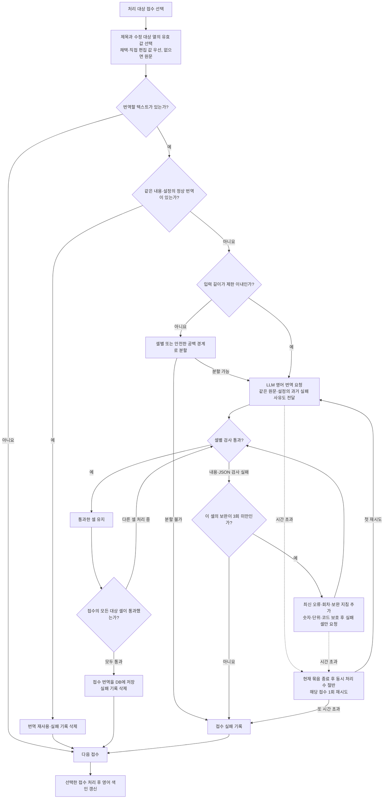

실패한 셀을 보완하는 동안 이미 통과한 셀은 다시 번역하지 않습니다. 세 번 모두 실패하면 다른 접수 처리는 계속하되, 해당 접수의 일부 번역을 전체 성공으로 저장하지 않습니다. 시간 초과 재시도는 내용 검사 보완 횟수와 별도입니다. 인증·설정 등 보완할 수 없는 오류는 실패로 표시합니다.

영어 대상 열은 제목, 재발방지대책, 문제현상, 발생원인, 현상, 원인(1), 조치내용(1), 원인(2), 조치내용(2)입니다. 빈 셀과 숫자만 있는 셀은 제외합니다.

## 4. 질문부터 답변까지

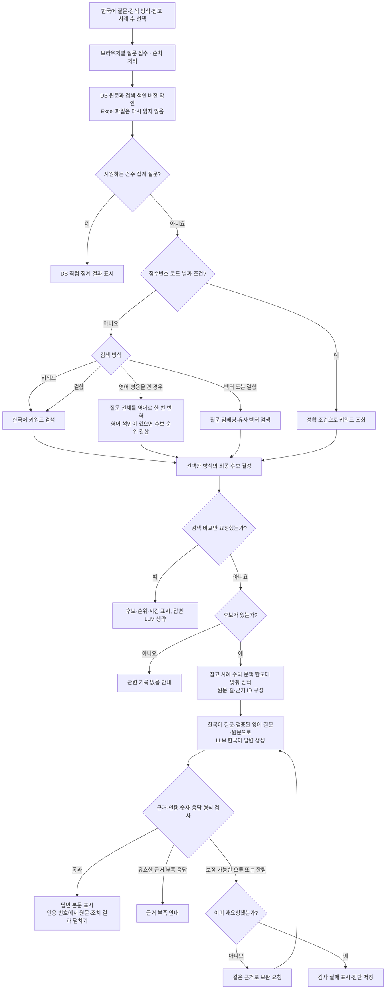

- 결합 검색은 키워드와 벡터 후보의 순위를 합칩니다. 참고 사례 수는 기본 3건이며 UI에서 1~100건 또는 자동을 선택합니다. 자동은 설정된 문맥과 서버에서 확인할 수 있는 한도, 입력 예약량을 고려합니다. 명시적인 접수번호·코드·날짜는 정확 조회를 우선합니다.
- 질문 번역은 검색과 답변에 재사용하며 원문 질문이 우선입니다. 영어 질문이 검사에 실패하면 한국어만 사용합니다. 벡터 질의에는 원문 질문을 사용하며, 영어 문서가 없어도 검증된 질문 번역은 답변 이해를 도울 수 있습니다.
- 결합 검색에서 벡터를 사용할 수 없으면 키워드 검색으로 돌아가지만, 벡터 전용 모드에서는 오류로 안내합니다. 검색 비교만 요청하면 답변 LLM을 호출하지 않습니다.
- 답변과 인용의 사실 근거는 원문입니다. 채택문과 영어 번역은 검색을 돕는 자료입니다.
- 기본 CS 답변 경로는 최초 요청과 재요청을 합쳐 최대 2회입니다. 통신·입력 오류 등은 별도로 안내합니다.

## 5. 저장·설정·진단

| 구분 | 저장/사용 내용 |
|---|---|
| 변환 파일 | `.rag.jsonl.gz`: 반복 실험에 사용하는 원문·셀 위치. Excel을 매번 열지 않아도 읽을 수 있음 |
| 원문·수정 제안 | `normalized_records`, 중간 성공분 `normalization_checkpoints` |
| 검토·원문 복귀 | `cell_reviews`, `normalization_fallbacks` |
| 접수 문서·한국어 검색 | `rag_documents`, `rag_original_documents`: 접수 한 건/문서 하나, 내부 근거는 접수·작업1·작업2 구분 |
| 영어 검색 | `english_translations`, `english_failures`, `rag_english_documents` |
| 벡터 검색 | SQLite에 벡터 저장, 실행 중 FAISS 색인 사용. 변경되지 않은 벡터 재사용 |
| 요청·응답 | UI 호출의 `llm_messages.jsonl`; 보완 프롬프트와 모델 응답 확인 가능. 인증 값은 마스킹 |
| 답변 진단 | `answer_diagnostics.jsonl`; 검색 후보·검사 오류·응답 시간 등 |
| 평가 | 검색 비교는 답변 생성 없이 수행 가능. 별도 평가 CLI는 준비한 질문·기대 접수로 검색 결과를 검증 |

Windows의 생성·문맥 상한 설정은 131,072이며, 요청마다 입력의 보수적 예약량과 여유 공간을 제외합니다. 실제 서버의 로드 문맥과 맞춰야 합니다. 추론은 high이며 문장 다듬기·번역·답변에 같은 생성 설정을 사용합니다. 임베딩은 별도 모델과 배치 설정을 사용합니다.

## 운영과 분리된 GLiNER 실험 (2026-09-26)

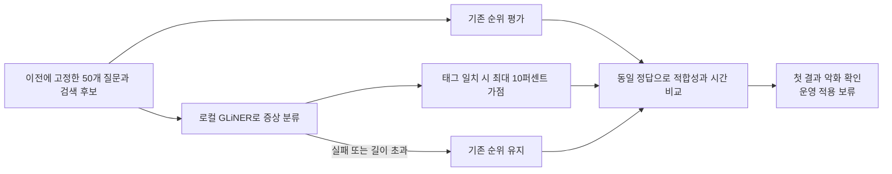

이 경로는 위 운영 UI의 질문 흐름에 연결되지 않습니다. DB를 열지 않고 후보 스냅샷만 사용했으며, 분류 태그는 답변 근거가 아닙니다. [실험 보고서](GLiNER-실험-20260926.md)에 결과와 재현 명령을 기록했습니다.

같은 날 추가 검사에서는 기존 태그 가점을 2%로 줄이고, 질문–사례 관련성 점수의 가점·직접 정렬을 비교했습니다. 별도로 16조건의 한국어·영어·중국어 48문항을 고정해 숫자·부정·발생 조건을 검사했습니다. 다음 경로 역시 운영에 연결하지 않습니다.

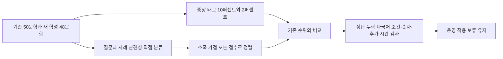

기존 문항에서 평균 적합성이 높아져도 정답 누락은 늘었고, 새 조건에서는 숫자와 부정을 잘못 판별했습니다. [추가 실험 보고서](GLiNER-추가실험-20260926.md)에서 표본의 한계와 검증 범위를 확인할 수 있습니다.

같은 고정 자료로 질문만 영어 번역하거나 질문과 사례를 모두 영어로 번역하는 비교를 추가했습니다. 이 번역 경로도 운영 UI·DB와 분리되어 있습니다.

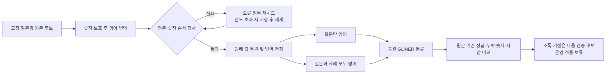

양쪽 번역 후 소폭 가점은 기존 50문항의 첫 결과를 40/44에서 41/44로 개선하면서 상위 3건 정답 포함 44/44를 유지했습니다. 다만 다국어 조건 전체의 개선은 일관되지 않았고, 숫자·부정 오류와 의미가 바뀐 번역이 남았습니다. 숫자를 보존한 번역도 의미가 정확하다는 보장은 없습니다. [번역 실험 보고서](GLiNER-영어번역-실험-20260926.md)에 실패 보완과 전체 검증 범위를 기록했습니다.

## 운영과 분리된 LEV·M2 GPU 실험 (2026-09-26)

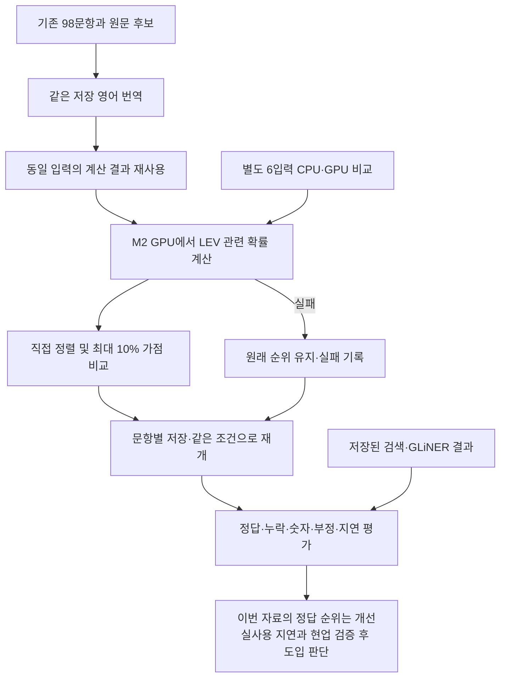

원문 근거와 후보는 그대로 유지합니다. GPU 사용 가능 여부뿐 아니라 실제 모델 실행을 확인했고, 계산 방식을 바꾼 추가 최적화는 확률 차이가 커서 제외했습니다. 이 실험은 운영 질문 경로와 연결하지 않았습니다. [상세 보고서](LEV-M2-GPU-실험-20260926.md)에서 결과와 한계를 확인할 수 있습니다.

98문항 전체에서 실행 실패는 없었습니다. 직접 정렬의 첫 결과는 기존 정답 질문 44/44, 별도 조건 36/36에서 맞았지만, 기존 질문의 평균 추가 지연은 약 49초였습니다. 일부 부적합 후보에 높은 점수를 주는 오류도 남아 점수를 자동 제외·채택 기준으로 쓰지 않습니다.

## 운영과 분리된 CLM 장치 검사 (2026-09-26)

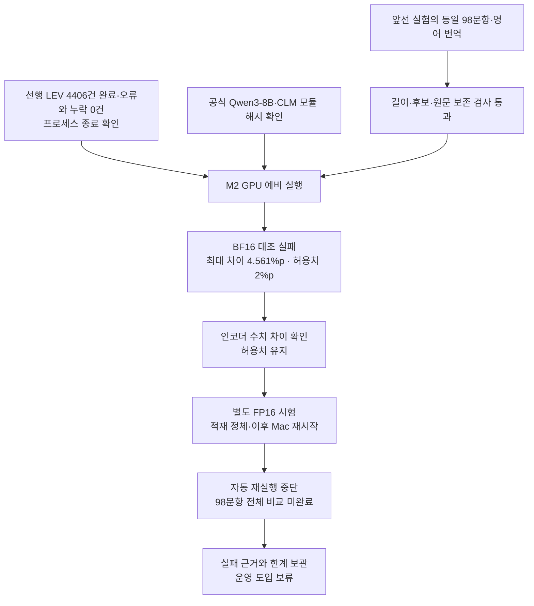

**CLM의 실제 품질·속도 비교는 미완료입니다.** BF16의 CPU·GPU 분류 이름은 같았지만 확률 차이가 사전 허용치를 초과했습니다. FP16은 장치 검사 결과도 생성하지 못했습니다. 재시작 기록에는 `watchdogd` 90초 무응답이 있으나 CLM과의 직접 인과관계는 확인되지 않았습니다. 입력 검증이나 예비 입력의 짧은 GPU 시간을 검색 성능 개선으로 해석하지 않습니다. [실험 기록](CLM-비교실험-20260926.md)에 확인한 범위와 재실행 중단 사유를 적었습니다.

## 확인한 코드

- 입력·변환·작업·검토·질문: [web.py](../ragkit/web.py)
- 중간 저장·검토 확정: [storage.py](../ragkit/storage.py)
- 문서·근거·한국어 색인: [cslist.py](../ragkit/cslist.py)
- 다듬기·토큰 예약·답변 검사: [llm.py](../ragkit/llm.py)
- 영어 번역·3회 보완·영어 검색: [english.py](../ragkit/english.py)
- 임베딩·벡터·결합 검색: [semantic.py](../ragkit/semantic.py)
- 변환 파일: [source_cache.py](../ragkit/source_cache.py)
- 야간 실행: [overnight.py](../ragkit/overnight.py)
- 누적 등록·원본 파일 삭제 후 검사: [test_incremental.py](../tests/test_incremental.py)

## 야간 자동 실행

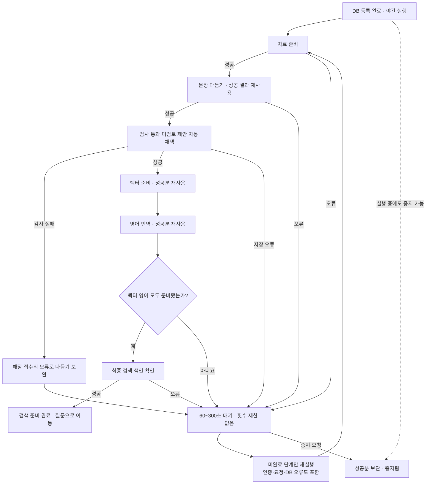

재실행 화살표는 처리 흐름으로의 복귀를 뜻합니다. 이미 끝난 단계는 건너뛰며, 채택 검사 실패 접수만 다듬기 캐시를 사용하지 않고 보완 요청합니다. 벡터가 실패해도 영어는 처리하고, 둘 다 준비될 때까지 미완료 부분을 반복합니다. 임베딩 모델 미설정 시 벡터를 생략하고 키워드 검색 준비라고 표시합니다. 검사를 완화하거나 실패 제안을 정상 결과로 처리하지 않습니다.

자료 화면은 원문·벡터·영어 건수, 접을 수 있는 등록 영역, 6단계 야간 카드, 개별 실행 영역 순서입니다. 완료 단계 수, 시도 횟수, 재시도 남은 시간과 상세 오류를 표시합니다. 중지 요청은 진행 중인 행·묶음을 저장한 뒤 적용하며 서버 응답 제한까지 지연될 수 있습니다.

실행 전 입력·설정 검증은 유지합니다. 실행 중 인증·요청·DB·색인 오류는 자동 재시도하며, 상태 보고 파일 저장 오류는 경고로 남기고 DB 작업을 계속합니다. 인증·설정·권한 등 외부 원인을 해결하지 않으면 반복해도 완료되지 않을 수 있습니다. 브라우저를 닫아도 프로그램이 켜져 있으면 진행되지만, 프로그램 재시작 후에는 자동 실행 버튼을 다시 누릅니다.

기존 API에서 입력 경로를 명시한 야간 요청은 원문을 DB에 누적 등록한 뒤 DB 전체를 처리합니다. 현재 UI는 등록된 DB를 사용해 파일을 읽지 않습니다. 실제 동작과 검증 범위는 [검증 기록](검증기록-20260922.md)에 구분했습니다.
