# 전체 프로그램 플로우

2026-10-13 기준 구조를 설명하는 [SEMES Tech Fair 발표 자료](presentations/tech-fair-20261013/README.md)를 제공합니다. 본문 4장에 자료 등록부터 한국어 답변까지의 편집 가능한 흐름도를 넣었고, 아래의 상세 흐름과 같은 원문 보존·선택적 모델 적용 원칙을 사용합니다. 발표 자료 추가로 프로그램 동작을 변경하지 않았습니다.

## 제품화 목표 흐름 (2026-10-13 · 일부 구현)

[제품화 설계안](제품화-설계-20261013.md)은 작업 복구와 원문 기준 검색을 중심으로 구조를 재정리합니다. 아래는 최종 목표이며, 현재 구현한 범위는 여러 파일 등록·야간 자동 실행의 재시작 복구와 자료 준비 중 질문입니다.

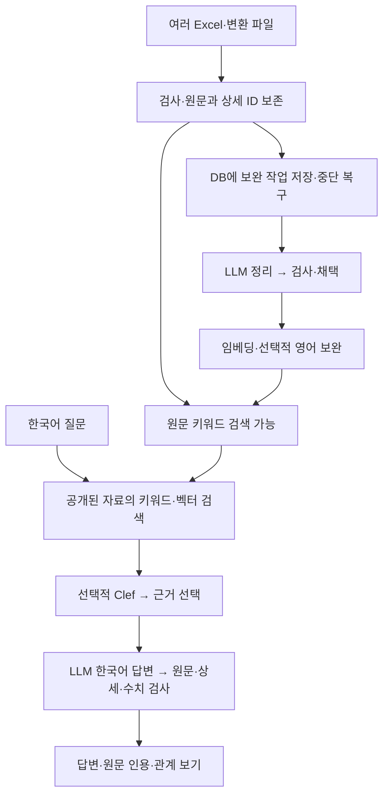

영어 실패와 전체 검색 불가를 구분하고 준비된 근거 버전으로 질문을 처리하는 것이 목표입니다. 현재의 정확 조회·집계·고정 상세 보호와 선택적 mDeBERTa 정책도 보존합니다. 갱신 중 질문은 아래의 짧은 읽기 스냅샷으로 처리합니다. 질문·대화의 영속화와 API 교체는 아직 구현하지 않았습니다.

## 현재 동시 질문 흐름 (2026-10-13)

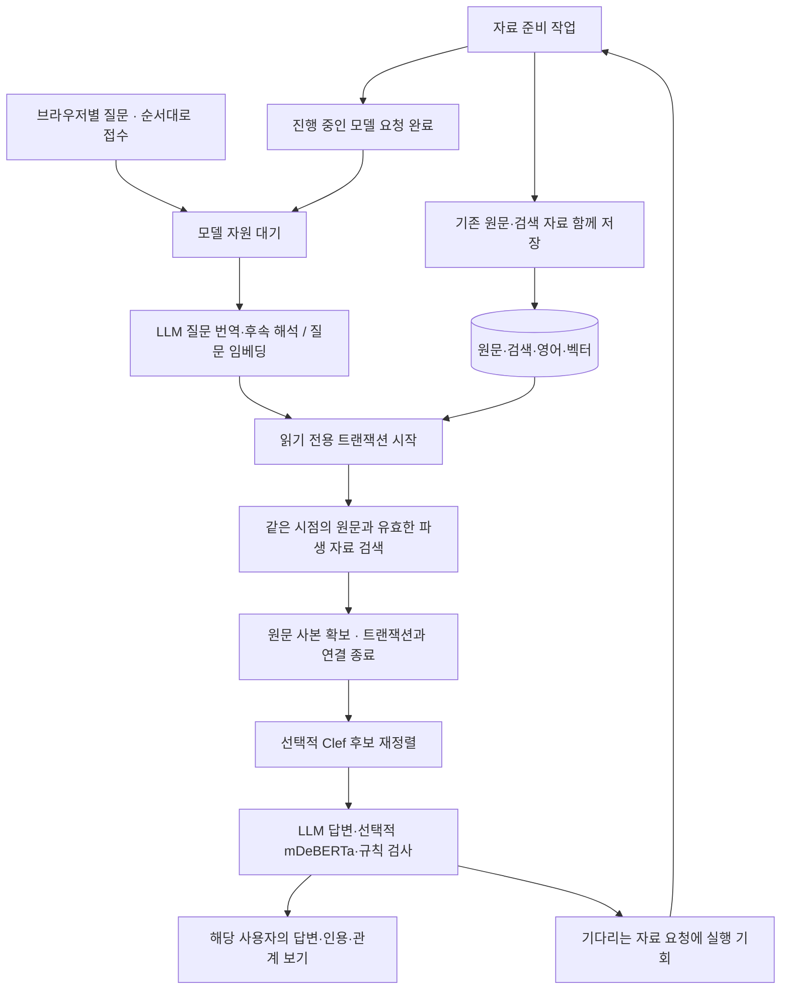

`web.App`은 준비 작업을 `self.job`, 질문을 세션별 작업에 유지합니다. `/api/job`의 `maintenance`는 준비 작업, `preparation`은 복구 가능한 파일 등록·야간 작업의 현재 또는 마지막 결과입니다. 모델 호출 로그와 진행 문구는 호출 당시 작업에 고정하여 병렬 정리의 응답을 다른 사용자의 질문으로 기록하지 않습니다.

질문은 모델 자원을 사용하는 동안 자료 모델 호출과 겹치지 않습니다. 기존 자료 요청이 모두 끝난 뒤 질문이 진행하고, 다음 질문 사이에는 기다리는 자료 요청 하나가 진행할 수 있습니다. 자료 정리의 병렬 개수 설정은 유지합니다. Clef의 로컬 모델 교대 설정에서는 개별 자료 요청도 모델 적재·해제 범위를 보호합니다. 외부 프로그램의 모델 사용을 통제하는 기능은 아닙니다.

검색은 DB 전체를 복사하지 않습니다. 짧은 읽기 트랜잭션에서 FTS·영어·벡터 해시·FAISS revision과 반환 원문을 확인하고 닫습니다. 장시간 모델 호출·문맥 검사·답변 보정에는 원문 사본을 사용합니다. 읽은 원문의 확인 시각과 지문을 응답/진단에 남기며, 과거 DB를 복원하는 버전 저장소는 아닙니다. 기존 rollback/WAL 모드를 유지하므로 긴 쓰기 트랜잭션의 대기는 남아 있습니다.

검증: Mac 실제 SQLite·스레드/모의 모델의 새 동시성 검사 7건과 전체 오프라인 회귀 통과. Chromium 1440×1024·390×844에서 준비 중 질문, 대기·답변, 두 상태 표시와 야간 중지를 확인했습니다. Windows 실기기·실제 모델 부하 성능은 미검증입니다.

구형 검색 자료의 재구성은 쓰기 실행 잠금이 비어 있을 때만 수행합니다. 준비 중 아직 관계 색인이 없으면 관계 후보 보완 없이 기존 결합 검색을 사용하며 원문 관계 보기 기능은 유지합니다. 설정·개별 검토 저장은 기존 잠금을 유지하고, 단일 서버 프로세스를 전제로 합니다.

## 현재 자료 준비 복구 흐름 (2026-10-13)

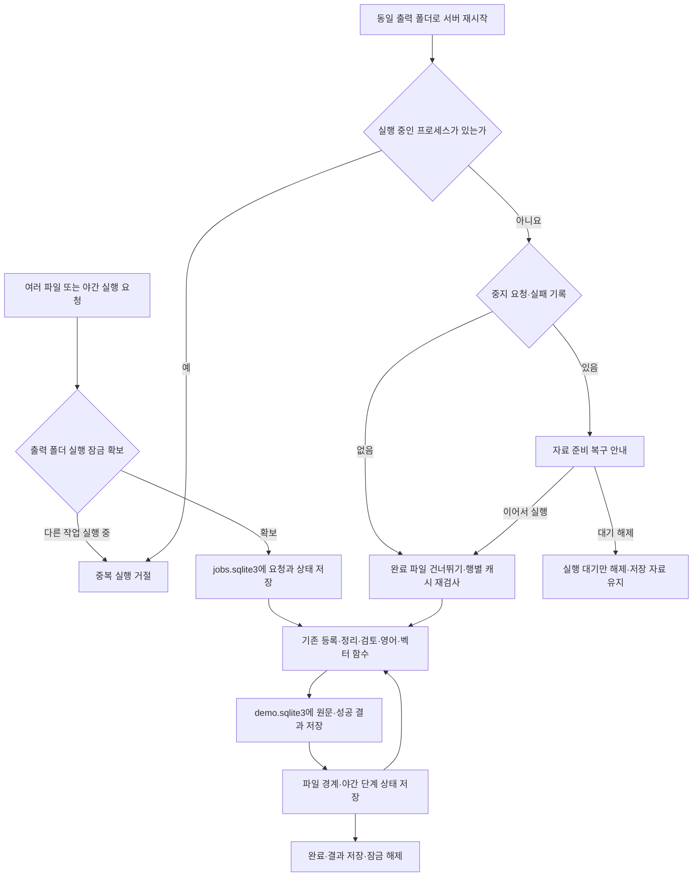

작업 저널은 장시간 원문 쓰기와 별도 연결을 사용합니다. 작업 기록 저장에 실패하면 오류를 표시하며 자동 복구 가능 상태라고 숨기지 않습니다. OS 잠금은 프로세스 종료 시 풀리며 Windows는 `msvcrt`, Mac은 `fcntl`을 사용합니다. 정상 완료 기록은 최근 20건, 미완료 기록은 계속 보존합니다. 마지막 완료 결과는 재시작 후 복원하며 자동 임베딩 실행 중에도 별도로 표시합니다. 다른 실행기의 작업을 기다리는 화면은 상태를 다시 조회해 완료 후 잠금을 해제합니다. SQLite 저장 중 종료 시 남은 트랜잭션 저널은 실행 잠금을 확보한 뒤 SQLite의 자동 롤백으로 복구합니다. `jobs.sqlite3`에는 질문·대화·인증 설정을 넣지 않습니다.

복구는 원문 데이터의 기존 중복 검사와 행별 캐시를 재사용합니다. DB 저장과 작업 저널 저장 사이에 종료되면 해당 파일 또는 모델 요청을 다시 수행할 수 있으므로 정확히 한 번 실행을 보장하지 않습니다. 실패한 파일도 완료된 시도로 표시하고 다음 파일을 처리하며, 파일별 오류는 별도 재시도합니다. 개별 변환·다듬기·영어·벡터 버튼은 이번 자동 복구 대상이 아닙니다. 질문은 기존 세션 메모리 대기열을 유지하지만 자료 준비와 함께 진행할 수 있습니다. 원문 쓰기 작업끼리의 상호 배제는 유지합니다.

## 현재 운영 흐름의 기준

운영 흐름 갱신: 2026-10-08 · 본 시스템 Clef GPU 후보 재정렬과 관계 원문 보기 추가. 별도 모델 실험은 각 절의 날짜 기준. 기본 임베딩은 EmbeddingGemma 2입니다. 문장 다듬기의 첫 요청을 원문 전송 방식으로 롤백한 정책과 누적 시트·열 변경, 동일 CS의 상세 행 보존, 검색 비교와 답변 검사는 유지합니다. 웹 UI를 중심으로 그렸으며, CLI도 같은 입력·다듬기·검토·검색 함수를 사용합니다. 화살표는 처리 순서 또는 데이터 전달을 뜻하고, 점선은 선택 기능이나 보조 경로입니다. 모델을 학습시키는 단계는 없습니다. 비개발자용 설명은 [임원 보고서](임원보고서.md)에서 확인할 수 있습니다.

문서 보관 기준: 2026-10-08. 9월 30일의 신구 입력 동일 상세 재사용, CS 번호 인덱스와 답변 전송본의 반복 빈 줄 축소는 유지합니다. 아래 과거 모델 비교 수치는 당시 결과이며 현재 처리 속도를 뜻하지 않습니다. 소스와 이 흐름도의 버전은 비공개 저장소 [pmh10401/cs-excel-rag](https://github.com/pmh10401/cs-excel-rag)의 `main`에서 함께 관리합니다. 설치 방법은 [README](../README.md)를 따릅니다.

## 본 시스템 Clef 흐름 (2026-10-08)

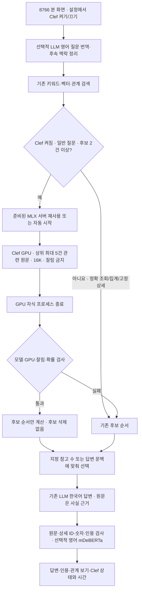

`clef_enabled`는 공유 서버 설정이며 진행 중에는 변경할 수 없습니다. 각 브라우저의 질문·참고 수와 대화 기록은 기존 세션 규칙을 유지합니다. 개인 설정의 `runtime_python`·`model_path`를 사용해 준비된 GPU 서버만 자동 시작하며 설치·다운로드는 하지 않습니다. 이 Mac은 `manage_lm_studio: true`로 설정된 답변 모델만 영어 번역·후속 정리·답변 때 16K·동시 예측 1로 적재하고 사용 후 해제합니다. Clef와 답변 모델을 순서대로 사용하고, 다른 모델이나 사용 중인 모델을 강제 해제하지 않습니다. Clef를 끄면 이 모델 관리도 생략합니다. 원문·검토·영어 자료·벡터 프로필은 변경하지 않습니다. Clef 오류는 기존 순서로 대체하며 답변 모델 자체의 연결·적재 오류는 별도로 보고합니다. Windows 기본 설정은 Clef를 켜지 않습니다.

관리 모드에서는 Clef HTTP 요청이 끝나거나 시간 초과돼도 GPU 서버의 작업 종료를 확인한 뒤 답변 모델을 적재합니다. 종료 상태를 확인하지 못하면 적재를 거절합니다. 실제 본 화면에서 영어 질문 번역·키워드 후보 5건 판단·참고 3건의 답변과 인용·수치 검사를 확인했습니다. 자동 참고 9건에서는 잘못된 근거 ID와 보정 답변 잘림을 거절했습니다. 문맥 자동 선택은 답변 성공·의미 일치를 보증하지 않습니다. 자세한 조건과 시간은 [Clef 연결 검증](Clef-테스트-RAG-20261008.md)을 따릅니다.

## 초기 별도 Clef 테스트 흐름 (2026-10-08, 격리 화면 보존)

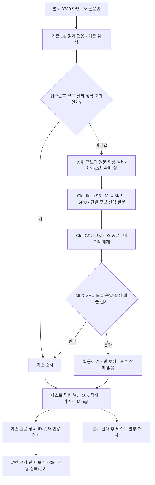

초기 시험은 이 프로세스에만 `clef` 설정을 적용했습니다. 전용 MLX 로더가 GPU를 실제 사용하고, CPU로 전환하지 않습니다. 입력 길이는 16,384토큰으로 제한하며 초과 원문을 잘라 채택하지 않습니다. Ollaya CLI의 0.12.0 업데이트와 Clef GPU 로더는 별도 구성입니다. SQLite `mode=ro`와 HTTP 변경 경로 거절로 원문을 보호하고, 참고 수는 별도 결과 폴더에만 저장합니다. Clef 점수는 후보 간 상대 선택 확률이며 성공 조치나 참인 주장의 확률이 아닙니다. 정확 조회는 재정렬하지 않으며 고정 상세의 후속 질문은 시험 화면에서 받지 않습니다. 당시 8766 화면과 DB·모델 설정 파일은 유지했으며, 본 화면 연결은 위 흐름으로 추가했습니다. 별도 임베딩·모델 학습·인덱스 재생성 없이 기존 검색과 답변 검사를 재사용합니다. [실행·모델 revision·실측·한계](Clef-테스트-RAG-20261008.md)를 참조하세요.

## 관계 검색의 화면 흐름 (2026-10-08)

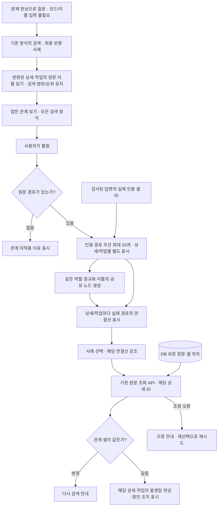

화면의 연결은 이번에 반환된 상세·작업에 기록된 원문 이름만 뜻합니다. 키워드·벡터·결합·정확 조회·고정 상세의 후속 질문 모두 같은 표시를 사용하며, 최종 답변의 참고 분량이 줄면 그 안의 사례만 표시합니다. 질문에 관계 이름 두 종류가 없어도 동작하며, 원문에 이름 한 종류만 있어도 표시합니다. 다른 CS 상세·다른 작업의 조치를 합치지 않고 미채택·번역·추정 이름은 넣지 않습니다. 답변에 직접 인용된 경로와 검색 후보를 구분하며, 실패한 답변은 인용됨으로 표시하지 않습니다. 새 LLM 호출·관계 테이블·DB 변경 없이 반환된 근거 셀을 재사용합니다. 빠른 연속 선택이나 새 결과로 교체된 뒤의 오래된 응답은 버립니다.

같은 설비·모듈·부품이 여러 사례에 등장해도 역할·서버의 정규화 이름으로 하나의 화면 노드를 재사용합니다. 역할이 다르면 같은 이름을 합치지 않습니다. 상세·작업의 원문 셀 경로는 각각 유지하고, SVG로 실제 연결만 그립니다. 펼침과 화면 크기 변경 시 연결선을 다시 계산합니다. `relation_sample.xlsx`의 가상 4행으로 같은 CS의 다른 부품이 별도로 표시되는 것을 확인할 수 있습니다. 실제 목록과 노드 수는 반환된 결과에 따르며 예제 자료를 자동 등록하지 않습니다.

코드 없는 확인 질문은 `냉각수 저유량 알람이 발생했을 때 과거 조치와 결과는?`입니다. 2026-10-08 가상 10만 건의 키워드 상위 3개에서 원문 경로 6개를 읽기 전용으로 확인했습니다. 화면은 최대 10개 경로를 표시합니다. 별도 후보 보완의 코드 보호 범위는 아래와 같으며, 그래프가 표시된다는 사실로 질문의 숫자·부정 조건 충족을 판정하지 않습니다. 기존 원문·검토·벡터 재생성 없이 프로그램을 재시작하면 적용됩니다.

Mac Chromium의 모의 응답으로 데스크톱·390px·키보드·상세 및 작업 분리·인용·조회 실패·원문 변경·응답 경합·HTML 문자 보호를 검사하고 전체 오프라인 회귀 검사를 수행했습니다. 실제 Windows와 업무 사용성·정확도 향상은 미검증입니다.

## 선택적 설비·부품 관계 보완 (2026-10-08 갱신)

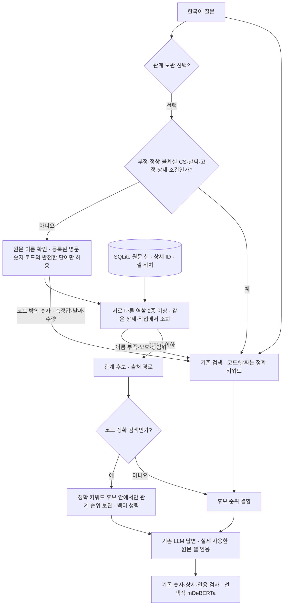

관계 추출·질문 이름 확인·경로 조회·순위 결합은 프로그램이 수행합니다. 별도 LLM으로 관계를 추정하지 않습니다. 관계는 원문에 함께 기록된 이름이며 원인·성공의 증거가 아닙니다. 처음 선택할 때만 원문 기반 관계 테이블을 만들고, 이후 기존 전체·증분 검색 갱신과 함께 원자적으로 갱신합니다. 같은 CS의 상세와 CSList 작업 경계를 유지합니다. 기본 방식은 바뀌지 않습니다. 등록된 `SIM-ETCH-001`, `IFEP2` 같은 완전한 영문·숫자 코드만 허용하며 `11.8bar`, 년월, 수량 등 코드 밖의 숫자는 계속 건너뜁니다. 코드 정확 검색에서는 기존 키워드 후보 범위 밖의 상세·경로를 추가하지 않고, 임베딩 호출 없이 기존 순위 결합 함수를 재사용합니다. 명시적인 CS 번호·ISO 날짜·고정 상세의 정확 조회는 관계 함수를 호출하지 않습니다.

Mac 실제 임베딩으로 별도 가상 2,000상세·41문항을 처리하고 82개 결과를 재계산했습니다. 정답 있는 34문항의 첫 정답은 기존 결합 32/34·관계 보완 34/34였습니다. 근거 부족의 거절은 둘 다 1/3이며 관계 연결로 이를 보증하지 않습니다. [결과·재현·한계](관계검색-비교-20261007.md)를 참조하세요.

## 임베딩 모델 전환 (2026-10-07)

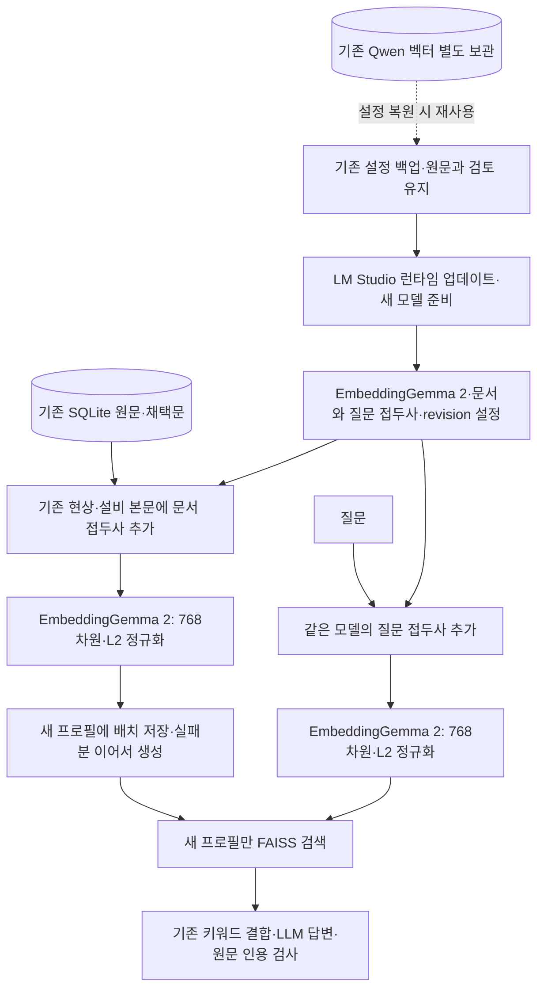

새 예제 설정은 `text-embedding-embeddinggemma-2`, 문서 접두사 `title: none | text: `, 질문 접두사 `task: search result | query: `를 사용합니다. 기존 설정을 그대로 보관한 PC는 자동으로 모델이 바뀌지 않습니다. 모델·서버·접두사·revision이 다른 벡터는 현재 검색에 사용하지 않으며 기존 Qwen 벡터도 삭제하지 않습니다. 답변 모델·문장 다듬기·영어 번역·mDeBERTa의 호출 위치는 유지합니다. 현재는 텍스트만 사용합니다. [설치·전환·복원 방법](../README.md#기존-qwen-설정에서-전환하기)과 [공식 모델 카드](https://huggingface.co/google/embeddinggemma-2)를 참고하세요.

Mac의 실제 모델로 10만 가상 기록 전체를 색인했습니다. 고유 벡터 14,542개·768차원·실패 0건이며 FAISS에 100,000개 접수 연결을 확인했습니다. 원문·제안·검토의 저장 내용 해시가 전후 일치하고 기존 Qwen 벡터도 보존됐습니다. 재시작한 웹 UI는 준비 완료·100,000건·추가 생성 0개를 보고했습니다. 다국어 8문항 시험과 전체 오프라인·독립 배포본 검사는 동작 확인이며 실제 업무 정확도나 Windows 실기기 검증을 대신하지 않습니다.

## 운영과 분리된 임베딩 품질 비교 (2026-10-07)

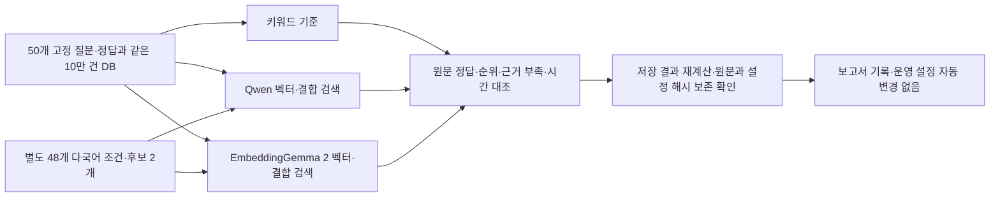

250개 검색 결과와 96개 조건 결과를 오류·누락 없이 검증했습니다. 정답 있는 44개 질문의 결합 검색 첫 정답은 Qwen 39/44·새 모델 35/44, 상위 5개 정답 포함은 43/44·41/44였습니다. 정확한 CS 번호 조회 3개는 둘 다 키워드로 정확히 처리하므로 현상 질문만의 첫 정답은 36/41·32/41입니다. 별도 조건 시험의 첫 정답은 29/36·31/36이지만 두 모델 모두 근거 없는 12개 조건을 최소 유사도 0.3으로 거절하지 못했습니다.

현재 질문에서는 새 모델의 품질 우위를 확인하지 못했습니다. 번역·답변 LLM·추가 재정렬·mDeBERTa를 호출하지 않은 검색 평가이며, 운영 DB와 개인 설정은 보존했습니다. 기존 합성 개발 자료의 결과를 실제 현장 정확도나 Windows 성능으로 해석하지 않습니다. [상세 결과·원문 오류·다음 판단](임베딩-품질비교-20261007.md)을 참조합니다.

## 운영과 분리된 검색 후보 재정렬 비교 (2026-10-01)

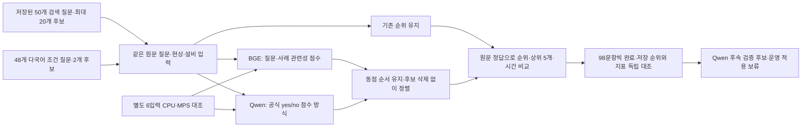

정확한 CS 번호·빈 후보 6문항은 원래 순위를 유지하고 모델을 호출하지 않습니다. 원문 셀·상세 ID·출처와 운영 DB는 보존합니다. Qwen은 기존 질문의 첫 정답 44/44·상위 5개 정답 포함 44/44, 다국어 조건 첫 정답 33/36이었으며 최대 20개 후보의 평균 추가 시간은 1.121초였습니다. BGE는 더 빨랐지만 정답 2건을 상위 5개 밖으로 밀었습니다. 두 모델의 저장 지표 1,960개를 직접 다시 계산해 대조했습니다.

이번 실험은 새 검색·영어 번역·LLM 답변 생성 없이 저장된 원문 후보만 정렬했습니다. 관련성 점수는 사실의 확률이 아니며 숫자·부정·근거 부족 오류가 남습니다. 반복 사용한 합성 자료로 실제 업무 품질이나 Windows 성능을 확정하지 않습니다. [결과·재현 조건](검색-재정렬-비교-20261001.md)을 참조합니다.

## 개발 지식의 기록 흐름 (2026-09-29)

[LLM Wiki](../llm-wiki/index.md)는 요구사항·설계 결정·실험 결과를 설명하는 문서입니다. 아래 흐름은 개발 지식을 갱신하는 절차이며, 운영 CS DB의 검색·답변 처리에는 아직 연결하지 않았습니다.

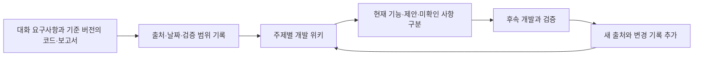

실제 업무 자료를 요약한 설비·증상별 Wiki를 검색에 추가하는 방안은 [별도 제안](../llm-wiki/결정과-다음검증.md)입니다. 이번 문서화로 모델 학습이나 자동 갱신 서비스를 시작하지 않았습니다.

## 모델이 사용되는 위치

기준일: 2026-10-07. 파란 상자는 LLM, 초록 상자는 임베딩 모델, 보라 상자는 mDeBERTa입니다. 나머지는 프로그램 또는 사용자가 처리합니다. 영어 답변 근거 검사의 기본 모드는 `off`이며, 설치·준비 후 `observe`(결과 기록)나 `enforce`(답변 차단)로 선택합니다.

검색 뒤 BGE·Qwen으로 후보 순서를 바꾸는 [별도 비교](검색-재정렬-비교-20261001.md)는 완료했습니다. 아래 운영 경로에는 연결하지 않았으며, mDeBERTa는 답변과 실제 인용 원문 사이의 지지 여부를 검사하는 기존 역할을 유지합니다.

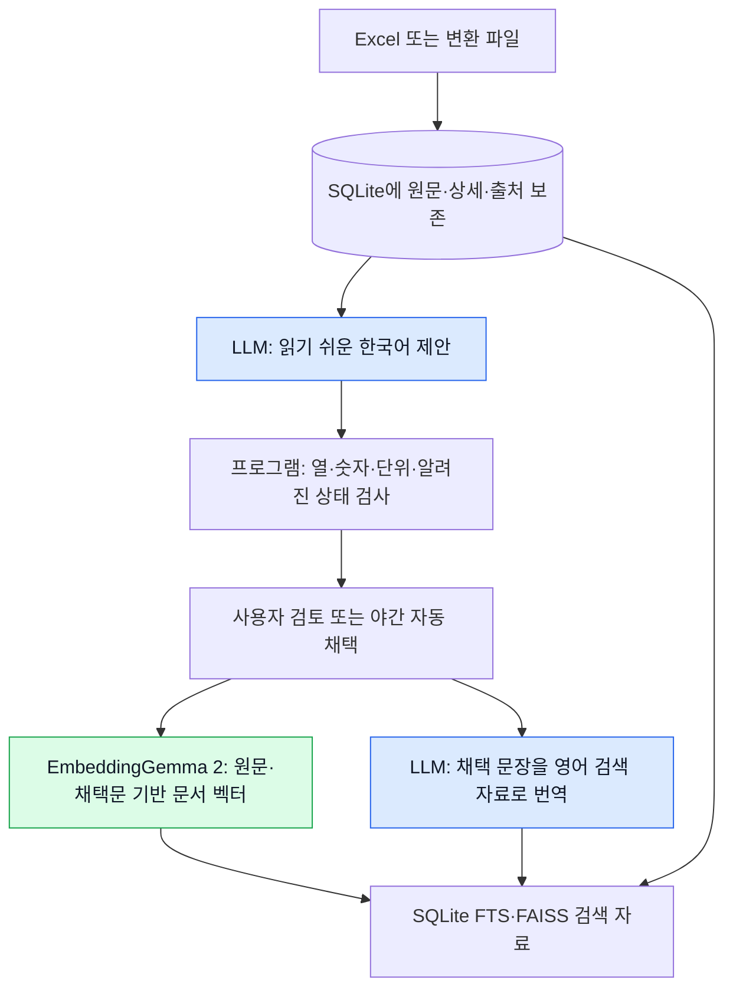

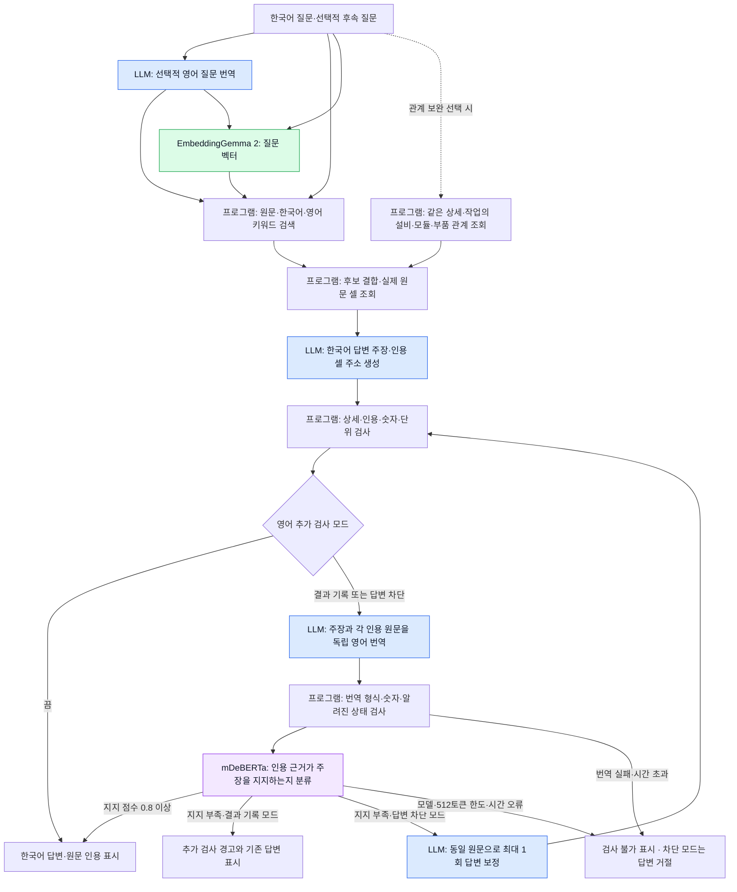

프로그램이 전체 DB 건수를 집계하거나 검색된 후보가 없음을 알릴 때는 답변 생성·추가 NLI를 실행하지 않습니다. 빈 원문 셀만 인용한 단순 미기재 안내도 프로그램이 직접 확인합니다. 후속 질문의 앞선 답변은 문맥 보조이며 새 답변의 사실 근거는 다시 조회한 원문입니다.

추가 검사의 전제에는 **그 주장이 실제로 인용한 셀 전체만** 사용합니다. 검색용 영어 번역, 미인용 셀, 다른 상세, 질문과 추가 참고 원문은 포함하지 않습니다. 원문·답변 주장을 함께 번역시키지 않으며, 번역으로 잘못된 주장을 근거에 맞춰 수정하는 것을 막기 위해 별도 요청합니다. 점수는 모델 판단이며 업무 정확도나 사실의 확률을 보증하지 않습니다.

LEV·CLM·GLiNER·Laya·한국어 mDeBERTa·MiniCheck는 아래 날짜별 **독립 실험**에서만 사용합니다. 영어 mDeBERTa의 선택적 운영 연결과 구분합니다. [검증 결과·운영 한계](영어-근거검사-운영화-20261001.md)

Mac 20B high의 자동 번역·CPU 추가 검사 36건은 누락·검사 불가 없이 완료했습니다. 잘못된 설명 통과는 기존 9건에서 0건으로 줄었으나 올바른 설명 거절은 1건에서 3건으로 늘어 결과 기록으로 시범 운영하도록 권장합니다. 원문·인용 검사를 통과한 25건의 추가 검사는 평균 16.0초였습니다. 합성 개발 탐침이며, 모든 업무 사례의 의미 정확도나 Windows 120B 성능을 보증하지 않습니다.

Windows CI에서도 전체 오프라인 회귀, 독립 압축 해제 검사, 고정 모델 준비와 CPU 실계산을 통과했습니다. 원문과 질문의 관련성을 평가하는 검색 재정렬은 현재 흐름에 추가하지 않았습니다. 답변 뒤의 근거 검사와 구분하며, 재정렬의 품질·지연은 같은 후보를 사용하는 별도 비교가 필요합니다.

## DB의 상세 구분과 인덱스 보완 (2026-09-30)

CS 번호는 사건 묶음, 상세 ID는 서로 다른 원본 행을 구별합니다. 기존 SQLite의 원문 JSON·ID·검토·출처를 유지하며, 신구 입력의 같은 내용은 먼저 저장한 상세로 연결합니다. 구형 캐시라도 같은 번호의 내용이 달라졌다면 기존 상세를 덮어쓰지 않고 새 상세를 추가합니다. 이미 저장된 중복 기록의 삭제·병합은 수행하지 않습니다.

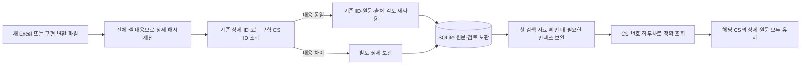

`records_case_number`는 기존 CS 번호 식 인덱스이며 `records_case_family`를 추가해 접두사 판별 때 원문 테이블 전체를 읽지 않습니다. 기존 FTS 색인이 최신이면 문서를 다시 만들지 않고 필요한 인덱스만 보완합니다. 숫자 CS 번호 조회는 상세 중복 제거를 생략하고, 접수 집계는 같은 대소문자 비교 규칙으로 업무 번호당 한 건을 셉니다.

재현 검사는 `.venv/bin/python -m tests.test_history_input`입니다. 실제 SQLite 쿼리 계획의 인덱스 사용, 기존 원문·검색 문서 보존, 신구 캐시 양방향 재사용과 구형 자료 내용 변경 시 별도 보관을 확인합니다. Mac의 별도 10만 가상 행·7회 반복 시험에서 접두사 판별 중앙값은 전체 조회 약 71.5ms, 인덱스 조회 0.006ms였습니다. Excel 읽기·FTS·벡터 검색·모델 답변·인덱스 생성 시간은 이 수치에 포함하지 않습니다.

## 1. 전체 흐름

### 기록 상태·미번역 검사와 자동 보완 (2026-09-30)

한국어 다듬기·영어 번역의 공통 검사에서 알려진 관찰/지시 변경과 `재발 미확인`의 대상·불확실성 변경을 확인합니다. 질문의 요청 문장은 기록의 실행 지시 오류로 검사하지 않습니다. 영어에는 보호한 숫자·단위를 제외한 한국어·중국어 문장이 남지 않아야 합니다. 의미 검사는 문장 전체를 판정하는 모델이 아니며, 명시적인 필요·계획·지시나 복잡한 구절은 원문 확인이 필요합니다.

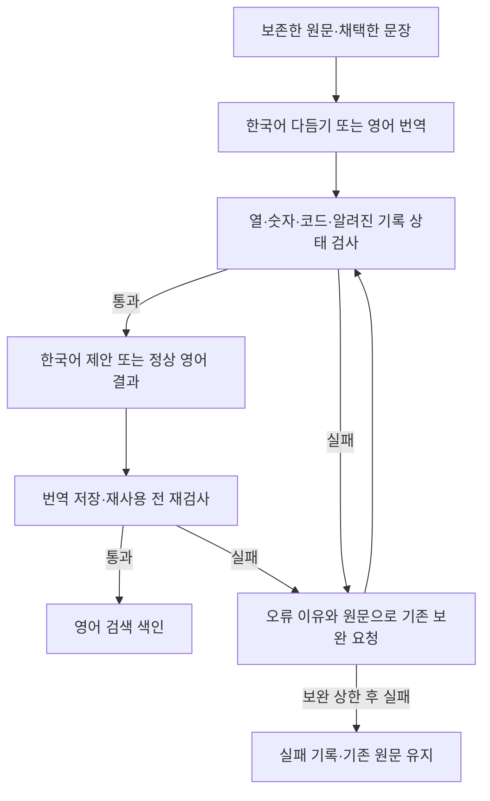

한국어 다듬기는 기존 1회 보정 정책을 유지하고, 영어는 실패 셀만 최대 3회 보완합니다. 야간 실행의 다음 시도 정책도 유지합니다. 잘못된 번역을 색인에서 제외해도 원문과 검토를 삭제하지 않습니다. [개선 범위·검증·한계](번역-의미보존-개선-20260930.md)를 참고하세요.

동일한 합성 100행의 Mac 20B·추론 low 재비교에서 분리·통합 모두 최종 실패가 없었습니다. 사전에 정한 영어 잔존·관찰/지시·미확인 모호화 표현은 개선 후 0건이었으며 전체 의미 정확도는 측정하지 않았습니다. 요청·시간·토큰 증가를 보고서에 함께 기록합니다. 통합은 실험 경로로 유지합니다.

### 한국어·영어 동시 생성의 별도 비교 실험 (2026-09-30)

Mac GPT-OSS 20B·추론 low에서 같은 100행의 양쪽 처리를 완료했습니다. 요청은 240→170회, 처리 시간 합계는 772.6→648.0초, 서버 보고 토큰은 208,571→136,794였습니다. 두 방식 모두 형식·수치 검사를 통과했지만 한국어 잔존·확인 결과의 지시문 변환 사례가 있어 실험 경로로 유지합니다. 숫자 검사 통과는 의미 전체의 정확성을 보장하지 않습니다. 운영 기본 처리 순서는 검토·채택 후 번역입니다.

현재 운영의 검토 후 번역 흐름을 유지하면서, 같은 창작 100행으로 통합 요청을 비교합니다. 실험 함수는 DB에 저장하지 않습니다. CSList 작업별 요청 경계와 누적 상세별 원문 구분은 유지합니다. 아래의 자동 채택 가정은 실험에만 적용합니다. 직접 수정·원문 유지로 결정하면 해당 영어 후보는 재사용할 수 없습니다.

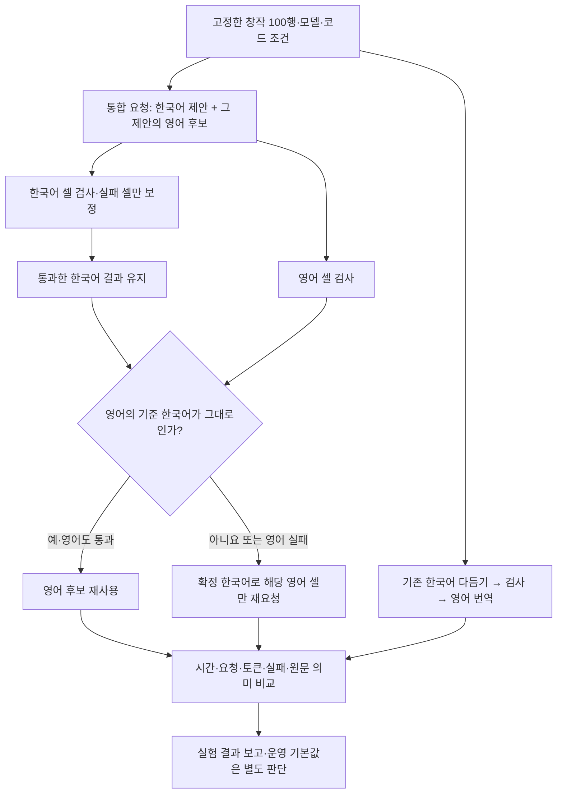

재현: `.venv/bin/python -m experiments.bilingual_normalize --config mac_config.json --output outputs/bilingual-100`. 실행 기록은 운영 DB와 분리하며, 해시가 바뀐 조건이나 서로 다른 모델의 표본을 합치지 않습니다. [측정 결과와 제한](한국어-영어-통합생성-비교-20260930.md)을 확인하세요.

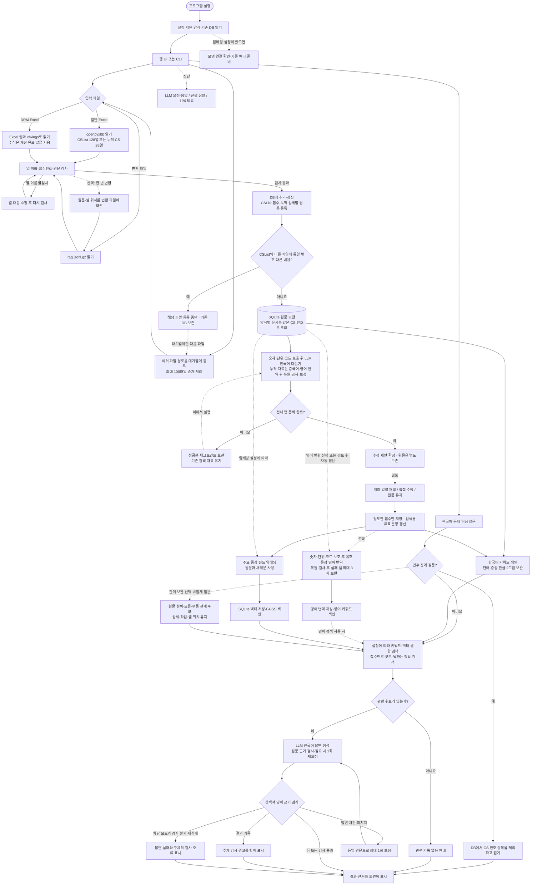

**입력 검사·파일 변환과 DB 등록은 다른 단계입니다.** DB 등록 완료 후에는 Excel 없이 다듬기·검토·번역·벡터·질문을 처리합니다. 원문 등록만으로 단어 검색이 가능하고, 임베딩 자동 갱신이 켜져 있으면 원문 기반 벡터도 준비합니다. 같은 내용은 재사용합니다. CSList는 같은 원본에서 변경된 접수를 갱신하며, 누적 28열은 다른 내용을 새 상세로 추가합니다. 이번 파일에 없는 기존 접수·상세는 유지합니다.

일반 다듬기에서는 제안을 바로 채택하지 않습니다. 검토에서 채택·직접 편집한 값이 있으면 그 값을 사용하고, 없으면 원문을 사용합니다. 미채택 제안은 영어 번역과 벡터 입력에 넣지 않습니다. 야간 자동 처리에서는 검사 통과 미검토 제안을 자동 채택합니다.

새 시트는 `19~26년 누적_260925`, 변경 열은 `SITE`와 `불량발생년월`입니다. 기존 `19~26년 누적_2600831`의 `Site`·`불량발생월`도 지원하며 원래 열 이름을 보존합니다. 새 입력과 내용이 같은 구형 DB 기록은 이전 ID·원문·검토를 그대로 재사용합니다. 기존 변환 파일도 읽을 수 있고, 새 파일을 변환하면 상세 기록 구분 정보를 함께 저장합니다.

누적 28열은 같은 CS NO여도 내용이 다른 행을 별도 상세 기록으로 추가합니다. 7개 부품 구분 항목이 같아도 현상·원인·조치 등 다른 열이 다르면 각각 보관합니다. 모든 셀의 값·자료형·표시 형식이 같은 반복 행만 한 번 처리하며, 먼저 등록한 원문 위치와 검토를 유지합니다. 파일명·행 순서·열 순서만 바뀌면 중복 추가하지 않습니다.

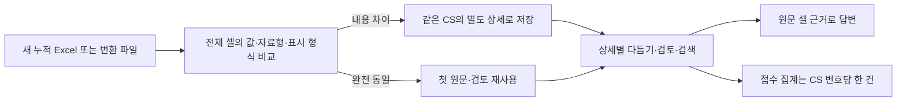

새 누적 양식의 28열을 그대로 보관합니다. `CS NO`와 기존 `CS 접수번호`는 같은 업무 번호이며, 서로 다른 양식의 문서는 덮어쓰지 않고 함께 조회합니다. 자료 목록은 원문 문서 수, 전체 접수 집계는 중복을 제외한 CS 번호 수입니다.

누적 자료의 한국어 번역은 문장 다듬기의 수정 제안으로 생성합니다. 검토 채택 후 단어 검색과 벡터에 반영되며, 인용에는 원래 언어의 원문과 셀 위치를 사용합니다. 식별자·날짜·빈칸을 보존하고 `2小时`처럼 숫자에 붙은 단위는 원문 표기를 유지합니다.

영어 번역 결과는 영어 **키워드 검색**에 사용합니다. 현재 영어 번역문을 별도로 임베딩하는 경로는 없습니다. 기존 벡터 입력 필드는 제목·문제현상·현상·제품군·UNIT명·알람코드이며, 누적 자료는 Defect 유형·상세, 설비·설비군 간소화, 기인 모듈·부품도 포함합니다. 신규 파생 검색 규칙은 기존 DB의 첫 색인 확인 때 한 번 갱신하며 원문과 검토를 보존합니다.

### 입력 오류와 수식 처리

Excel 연결 방식은 계산 완료 상태를 확인하고 수식의 결과값을 읽습니다. 계산 중·대기는 F9 계산 후 재실행하도록 안내하며 실제 오류 값은 셀 주소와 함께 거절합니다. 수식 자체를 실행하거나 원본 파일을 변경하지 않습니다. 일반 파일 읽기는 수식을 계산하지 않고 Excel 연결 방식을 안내합니다.

열 검사에서는 제목과 값이 모두 빈 뒤쪽 열만 제외합니다. 중간 빈 제목·중복·예약 이름·이름 없는 데이터 열은 파일·시트·셀 위치와 수정 방법을 표시합니다. 뒤쪽 행에서 무제목 열의 값이 발견돼도 전체 입력을 실패 처리하고 기존 DB·변환 파일을 보존합니다. UI는 오류가 난 입력 영역을 펼치고 알림으로 이동합니다.

### 여러 파일 등록 대기열

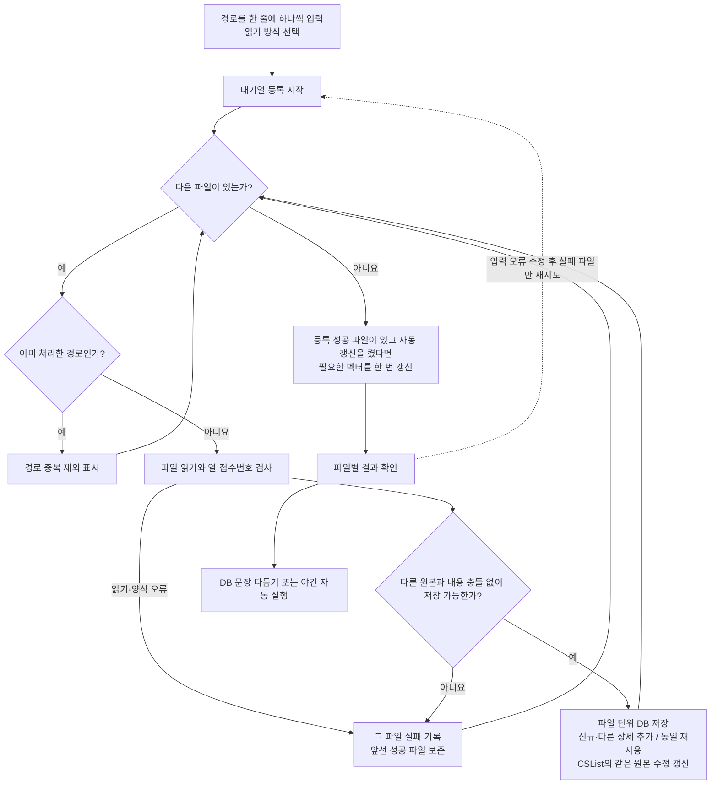

브라우저는 목록을 서버에 한 번 전달하고 진행 상황을 조회합니다. 파일을 하나씩 읽고 저장하므로 여러 Excel 전체를 동시에 메모리에 올리지 않습니다. 작업 중 새 목록을 시작하지 못하게 기존 공유 작업 잠금을 사용합니다. 브라우저 새로고침·종료와 관계없이 서버는 계속 처리하지만, 서버 재시작 후 완료 파일을 건너뛰고 대기 목록을 복구합니다. 중지·실패 기록은 복구 화면에서 재개합니다. 재등록 시 저장된 동일 원문은 재사용합니다.

## 2. 문장 다듬기와 검토

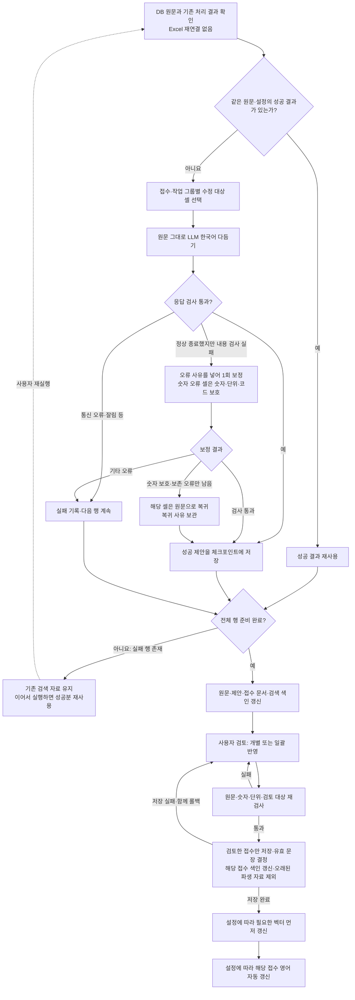

- 문장 다듬기와 영어 번역의 동시 처리 설정은 기본 200, 최대 1,000입니다. 서버에서 실제로 동시에 계산하는 수와는 다릅니다.
- 2026-10-01: `110039` Windows 배포본의 장시간 다듬기 문제 보고에 따라 첫 요청의 표시자 보호와 대응표를 제거하고 `095836` 배포본의 원문 전송·지시문을 복구했습니다. 숫자 오류 셀의 1회 표시자 보정, 목록 번호·식별자·의미 검사는 유지합니다. 같은 원문·설정의 정상 체크포인트를 재검사해 재사용하며 실패·미완료 건만 요청합니다. 실제 Windows 지연 원인과 처리 시간은 미확인입니다. 모의 검사: `.venv/bin/python -m tests.test_quality`와 `.venv/bin/python -m tests.test_resume`.
- 롤백 검증: 관련 검사, `windows-demo/test_demo.py` 전체 오프라인 검사와 `package_windows.py` 독립 압축 해제 검사가 종료 코드 0으로 완료됐습니다. 실제 Windows 모델의 속도를 평가한 결과는 아닙니다.
- 문장 다듬기는 완료한 성공분을 체크포인트에 저장합니다. 실패가 남으면 새 검색 자료 전체를 확정하지 않습니다.
- 검토 저장은 원문 등록에서 쓰던 변경분 색인 갱신을 재사용합니다. 최신 색인에서는 검토한 접수만 읽고 다시 만들며, 모든 접수를 검토할 때는 기존 전체 갱신 방식을 사용합니다. 구형 색인은 한 번 전체 이관하며 이관이 저장 트랜잭션을 먼저 확정하지 않습니다. 빈 검토는 생략하고, 전체 HTML 보고서 조회는 저장과 분리합니다.
- 일괄 채택은 원문·제안을 순서대로 읽어 검사하며, 제안 JSON이 손상된 접수도 실패 목록으로 남깁니다. 정상 제안과 기존 검토는 보존합니다. 같은 원문의 중복 읽기와 원문 등록에 불필요한 LLM 다듬기 지문 계산은 제거했습니다.
- 다듬기 직후에는 벡터를 생성하지 않습니다. 검토 저장 후 벡터를 먼저 갱신하고 영어 번역을 실행하며, 어느 쪽이 실패해도 검토 저장을 취소하지 않습니다. 시작 시 준비·파일 변환 후 준비·수동 벡터 생성은 유지합니다.

## 3. 영어 번역과 자동 보완 3회

```mermaid
flowchart TD
    A[처리 대상 접수 선택] --> B[제목과 수정 대상 열의 유효 값 선택<br/>채택·직접 편집 값 우선, 없으면 원문]
    B --> C{번역할 텍스트가 있는가?}
    C -->|아니요| NEXT[다음 접수]
    C -->|예| D{같은 내용·설정의 정상 번역이 있는가?}
    D -->|예| SAVE[번역 재사용·실패 기록 삭제]
    D -->|아니요| NUM[첫 요청부터 숫자·단위·코드 보호]
    NUM --> SIZE{원문·보호한 전송 셀 길이가 제한 이내인가?}
    SIZE -->|아니요| SPLIT[셀별 또는 안전한 공백 경계로 분할]
    SPLIT -->|분할 가능| CALL[LLM 영어 번역 요청<br/>같은 원문·설정의 과거 실패 사유도 전달]
    SPLIT -->|분할 불가| FAIL[접수 실패 기록]
    SIZE -->|예| CALL
    CALL --> RESTORE[셀별 보호 표시자 복원]
    RESTORE --> CHECK{셀별 검사 통과?}
    CHECK -->|예| HOLD[통과한 셀 유지]
    CHECK -->|내용·JSON 검사 실패| LIMIT{이 셀의 보완이 3회 미만인가?}
    LIMIT -->|예| REPAIR[최신 오류·회차·보완 지침 추가<br/>숫자·단위·코드 보호 후 실패 셀만 요청]
    REPAIR --> RESTORE
    LIMIT -->|아니요| FAIL
    HOLD --> ALL{접수의 모든 대상 셀이 통과했는가?}
    ALL -->|다른 셀 처리 중| CHECK
    ALL -->|모두 통과| WRITE[접수 번역을 DB에 저장<br/>실패 기록 삭제]
    SAVE --> NEXT
    WRITE --> NEXT
    FAIL --> NEXT
    NEXT --> FINISH[선택한 접수 처리 후 영어 색인 갱신]
    CALL -. 시간 초과 .-> TIMEOUT[현재 묶음 종료 후 동시 처리 수 절반<br/>해당 접수 1회 재시도]
    REPAIR -. 시간 초과 .-> TIMEOUT
    TIMEOUT -->|첫 재시도| CALL
    TIMEOUT -->|또 시간 초과| FAIL
```

실패한 셀을 보완하는 동안 이미 통과한 셀은 다시 번역하지 않습니다. 세 번 모두 실패하면 다른 접수 처리는 계속하되, 해당 접수의 일부 번역을 전체 성공으로 저장하지 않습니다. 시간 초과 재시도는 내용 검사 보완 횟수와 별도입니다. 인증·설정 등 보완할 수 없는 오류는 실패로 표시합니다.

2026-09-30: 숫자 보호와 복원은 첫 영어 번역 요청에도 적용합니다. 짧은 숫자가 표시자로 길어지는 경우도 기존 안전한 공백 분할을 사용하며 숫자·단위의 짝을 자르지 않습니다. 기존 정상 번역의 재사용은 유지합니다. 모의 모델·임시 SQLite 검사는 `.venv/bin/python -m tests.test_english`로 실행하며, 실제 모델의 번역 품질·오류 감소율을 측정한 결과는 아닙니다.

영어 대상 열은 제목, 재발방지대책, 문제현상, 발생원인, 현상, 원인(1), 조치내용(1), 원인(2), 조치내용(2)입니다. 빈 셀과 숫자만 있는 셀은 제외합니다.

## 4. 질문부터 답변까지

```mermaid
flowchart TD
    A[한국어 질문·검색 방식·참고 사례 수·지시 언어 선택] --> QUEUE[브라우저별 질문 접수 · 순차 처리]
    QUEUE --> FOLLOW{이어서 질문?}
    FOLLOW -->|예| RESOLVE[최근 최대 3문답으로 질문 대상 명확화<br/>한국어 또는 영어 지시]
    RESOLVE -->|모호함| CLARIFY[확인 질문 표시 · 기존 대화 유지]
    RESOLVE -->|명확함| B[DB 원문과 검색 색인 버전 확인<br/>Excel 파일은 다시 읽지 않음]
    FOLLOW -->|아니요| B
    B --> SUBJECT{검증된 이전 상세 ID가 있는가?}
    SUBJECT -->|예| SCOPED[선택한 상세의 현재 원문만 조회<br/>질문 번역·벡터 순위·전체 집계 생략]
    SCOPED --> RANK
    SUBJECT -->|아니요| C{지원하는 건수 집계 질문?}
    C -->|예| D[DB 직접 집계·결과 표시]
    C -->|아니요| E{접수번호·코드·날짜 조건?}
    E -->|예| EXACT[정확 조건으로 키워드 조회]
    E -->|아니요| MODE{검색 방식}
    MODE -->|키워드| KO[한국어 키워드 검색]
    MODE -->|결합| KO
    MODE -->|벡터 또는 결합| EMB[질문 임베딩·유사 벡터 검색]
    MODE -. 영어 병용을 켠 경우 .-> EN[질문 전체를 영어로 한 번 번역<br/>영어 색인이 있으면 후보 순위 결합]
    KO --> RANK[선택한 방식의 최종 후보 결정]
    EN --> RANK
    EMB --> RANK
    EXACT --> RANK
    RANK --> COMPARE{검색 비교만 요청했는가?}
    COMPARE -->|예| TABLE[후보·순위·시간 표시, 답변 LLM 생략]
    COMPARE -->|아니요| FOUND{후보가 있는가?}
    FOUND -->|아니요| NO[관련 기록 없음 안내]
    FOUND -->|예| CONTEXT[원문 셀·근거 ID 구성]
    CONTEXT --> COMPACT[전송본의 연속 줄바꿈 3개 이상을 2개로 축소<br/>DB 원문은 보존]
    COMPACT --> BUDGET[동일 전송본으로 참고 사례 수·문맥 한도 계산]
    BUDGET --> CALL[한국어 또는 영어 지시·질문·전송본으로<br/>LLM 한국어 답변 생성]
    CALL --> VALID{근거·인용·숫자·응답 형식 검사}
    CONTEXT -. 저장된 원문으로 인용·검사 .-> VALID
    VALID -->|통과| OK[답변 본문 표시<br/>인용 번호에서 원문·조치 결과 펼치기]
    VALID -->|유효한 근거 부족 응답| LACK[근거 부족 안내]
    VALID -->|보정 가능한 오류 또는 잘림| LIMIT{이미 재요청했는가?}
    LIMIT -->|아니요| RETRY[같은 원문으로 보완 요청<br/>한도 초과 시 실패 응답·보정 안내 순서로 제외]
    RETRY --> CALL
    LIMIT -->|예| ERROR[검사 실패 표시·진단 저장]
```

- 결합 검색은 키워드와 벡터 후보의 순위를 합칩니다. 참고 사례 수는 기본 3건이며 UI에서 1~100건 또는 자동을 선택합니다. 자동은 설정된 문맥과 서버에서 확인할 수 있는 한도, 입력 예약량을 고려합니다. 명시적인 접수번호·코드·날짜는 정확 조회를 우선합니다.
- 질문 번역은 검색과 답변에 재사용하며 원문 질문이 우선입니다. 영어 질문이 검사에 실패하면 한국어만 사용합니다. 벡터 질의에는 원문 질문을 사용하며, 영어 문서가 없어도 검증된 질문 번역은 답변 이해를 도울 수 있습니다.
- 결합 검색에서 벡터를 사용할 수 없으면 키워드 검색으로 돌아가지만, 벡터 전용 모드에서는 오류로 안내합니다. 검색 비교만 요청하면 답변 LLM을 호출하지 않습니다.
- 답변과 인용의 사실 근거는 원문입니다. 채택문과 영어 번역은 검색을 돕는 자료입니다.
- 2026-09-30: CS 답변 요청의 셀 값은 LF·Windows CRLF의 연속 개행 3개 이상만 2개로 축소합니다. 빈 줄의 공백·탭만 해당 구간에서 제거하고 항목 순서·들여쓰기·숫자·부호·단위·문자 그대로의 `\n`은 유지합니다. 원문 `hits`와 DB를 수정하지 않으며, 인용은 저장된 원문 전체를 붙입니다. 자동 참고 사례 선택·입력 제한·실제 요청·재요청이 `case_answer_messages`의 같은 전송본을 사용합니다. 별도 설정·모델 호출은 추가하지 않습니다. `.venv/bin/python -m tests.test_rag`로 전송본과 원문 인용의 분리, Windows 개행과 재요청 한도를 검사합니다.
- 2026-09-30: 같은 접수의 여러 누적 상세 또는 서로 다른 접수의 사실을 한 주장에 합치지 못합니다. 선택된 다른 상세의 서술 문장을 직접 옮겼는데 인용이 없으면 보정을 요청합니다. 누적 양식의 `조치`도 원문 보충 자료에 포함하며, 각 상세의 현상·조치와 내부 근거 ID를 유지합니다. 짧은 표현·의역의 의미 전체는 이 검사로 증명하지 못합니다.
- 2026-09-30: `불량발생년월`·`불량발생월`·`반입년월` 열은 같은 년월의 표기 차이를 허용합니다. 이 열에 Excel 날짜·시각 값이 저장되었어도 월까지만 근거로 사용합니다. 일자 열을 년월 열 대신 쓰거나 없는 일자·시각을 추론하지 못하며, 측정값의 부호·단위 검사는 유지합니다.
- 2026-09-28: **최근 답변에 이어서 질문**은 서버가 보관한 해당 세션의 문답만 참고합니다. 질문을 독립적으로 정리하는 모델 호출 후 DB를 다시 검색하며, 이전 답변 전체를 답변 모델의 근거에 넣지 않습니다. 해석된 질문을 화면에 표시하고 모호하면 검색 전에 확인 질문으로 끝냅니다. 최근 5문답을 메모리에 보관하고 최대 3문답을 입력 한도 안에서 사용합니다. 실패 응답은 보관하지 않고 새 대화·세션 만료·서버 재시작으로 초기화됩니다.
- 2026-09-30: 후속 문맥에는 주장별 원문 ID와 원문 부품·날짜를 제한된 길이로 보관합니다. 특정 상세를 선택한 모델 응답의 `source_ids`는 실제 전달한 해당 세션의 근거 ID인지 검증합니다. 선택된 ID로 현재 DB 원문을 다시 읽으며 다른 상세로 대체하지 않습니다. 클라이언트가 보낸 대화·상세 ID를 신뢰하지 않습니다. 대상이 불명확하면 확인 질문을 반환합니다. `.venv/bin/python -m unittest tests.test_detail_claims`는 모의 모델로 이 경로와 사용자 간 분리를 검사합니다.
- 2026-09-30 검증: 새 회귀 검사 9개를 포함한 `.venv/bin/python windows-demo/test_demo.py`와 `.venv/bin/python package_windows.py`를 모두 통과했습니다(exit 0). 배포 검사는 독립 압축 해제 폴더에서 새 검사를 포함한 전체 오프라인 검사와 실행 명령을 확인했습니다. 실제 Windows DRM·업무 자료·실모델 답변 품질은 이 검사 범위에 포함하지 않습니다.
- 지시 언어는 브라우저에서 한국어 또는 영어로 선택합니다. 후속 질문 정리·답변·보정 지시에 적용하며 한국어 답변과 원문 검사는 동일합니다. 선택한 언어의 실제 프롬프트로 자동 참고 사례 분량을 계산합니다. 질문 영어 번역·문장 다듬기와는 별도입니다.
- 보정 요청이 길어지면 실패 응답부터 제외합니다. 안내까지 들어가지 않으면 원래 질문·동일 원문으로 재생성합니다. 설정된 문맥 한도에서는 최초 요청의 출력 여유도 보존합니다. `retry_context`에 전체 보정·실패 응답 제외·재생성을 구분해 진단 로그에 기록합니다. 최초 원문 자체가 제한을 넘는 경우의 안내와 최대 두 번의 답변 호출은 유지합니다.
- 기본 CS 답변 경로는 최초 요청과 재요청을 합쳐 최대 2회입니다. 통신·입력 오류 등은 별도로 안내합니다.
- 숫자 오류는 답변 순번, 불일치 표기와 인용 원문 숫자 각 최대 6개, 인용 위치 최대 3개를 표시합니다. 숫자가 있는 다른 열은 모델이 근거로 선택해야 하며 자동 추가하지 않습니다. 값·부호·단위 검사와 보정 횟수는 유지하고, 숫자 표기 보존과 목록 번호 생략을 요청합니다.
- 날짜는 년월일 전체를 비교해 같은 날짜의 하이픈·점·슬래시·한국어 표기를 허용합니다. 날짜가 틀리거나 날짜 열을 인용하지 않으면 불일치 날짜를 안내하고 보정을 요청합니다. 인용 중복을 줄이더라도 날짜·현상·조치 각각의 필수 근거를 유지하도록 명시했습니다.

## 5. 저장·설정·진단

| 구분 | 저장/사용 내용 |
|---|---|
| 변환 파일 | `.rag.jsonl.gz`: 반복 실험에 사용하는 원문·셀 위치. Excel을 매번 열지 않아도 읽을 수 있음 |
| 원문·수정 제안 | `normalized_records`, 중간 성공분 `normalization_checkpoints` |
| CS 번호 조회 | 원문 JSON을 바꾸지 않는 식 인덱스 `records_case_number`, `records_case_family` |
| 검토·원문 복귀 | `cell_reviews`, `normalization_fallbacks` |
| 접수 문서·한국어 검색 | `rag_documents`, `rag_original_documents`: 접수 한 건/문서 하나, 내부 근거는 접수·작업1·작업2 구분 |
| 영어 검색 | `english_translations`, `english_failures`, `rag_english_documents` |
| 벡터 검색 | SQLite에 벡터 저장, 실행 중 FAISS 색인 사용. 변경되지 않은 벡터 재사용 |
| 요청·응답 | UI 호출의 `llm_messages.jsonl`; 보완 프롬프트와 모델 응답 확인 가능. 인증 값은 마스킹 |
| 답변 진단 | `answer_diagnostics.jsonl`; 검색 후보·검사 오류·응답 시간 등 |
| 평가 | 검색 비교는 답변 생성 없이 수행 가능. 별도 평가 CLI는 준비한 질문·기대 접수로 검색 결과를 검증 |

Windows의 생성·문맥 상한 설정은 131,072이며, 요청마다 입력의 보수적 예약량과 여유 공간을 제외합니다. 실제 서버의 로드 문맥과 맞춰야 합니다. 추론은 high이며 문장 다듬기·번역·답변에 같은 생성 설정을 사용합니다. 임베딩은 별도 모델과 배치 설정을 사용합니다.

## 운영과 분리된 GLiNER 실험 (2026-09-26)

```mermaid
flowchart LR
    SNAP[이전에 고정한 50개 질문과 검색 후보] --> BASE[기존 순위 평가]
    SNAP --> CLS[로컬 GLiNER로 증상 분류]
    CLS --> BONUS[태그 일치 시 최대 10퍼센트 가점]
    CLS -->|실패 또는 길이 초과| KEEP[기존 순위 유지]
    BASE --> COMPARE[동일 정답으로 적합성과 시간 비교]
    BONUS --> COMPARE
    KEEP --> COMPARE
    COMPARE --> HOLD[첫 결과 악화 확인<br/>운영 적용 보류]
```

이 경로는 위 운영 UI의 질문 흐름에 연결되지 않습니다. DB를 열지 않고 후보 스냅샷만 사용했으며, 분류 태그는 답변 근거가 아닙니다. [실험 보고서](GLiNER-실험-20260926.md)에 결과와 재현 명령을 기록했습니다.

같은 날 추가 검사에서는 기존 태그 가점을 2%로 줄이고, 질문–사례 관련성 점수의 가점·직접 정렬을 비교했습니다. 별도로 16조건의 한국어·영어·중국어 48문항을 고정해 숫자·부정·발생 조건을 검사했습니다. 다음 경로 역시 운영에 연결하지 않습니다.

```mermaid
flowchart LR
    INPUT[기존 50문항과 새 합성 48문항] --> TAG[증상 태그 10퍼센트와 2퍼센트]
    INPUT --> PAIR[질문과 사례 관련성 직접 분류]
    PAIR --> RANK[소폭 가점 또는 점수로 정렬]
    TAG --> COMP[기존 순위와 비교]
    RANK --> COMP
    COMP --> VERIFY[정답 누락·다국어 조건·숫자·추가 시간 검사]
    VERIFY --> HOLD[운영 적용 보류 유지]
```

기존 문항에서 평균 적합성이 높아져도 정답 누락은 늘었고, 새 조건에서는 숫자와 부정을 잘못 판별했습니다. [추가 실험 보고서](GLiNER-추가실험-20260926.md)에서 표본의 한계와 검증 범위를 확인할 수 있습니다.

같은 고정 자료로 질문만 영어 번역하거나 질문과 사례를 모두 영어로 번역하는 비교를 추가했습니다. 이 번역 경로도 운영 UI·DB와 분리되어 있습니다.

```mermaid
flowchart LR
    SNAP[고정 질문과 원문 후보] --> TRANSLATE[숫자 보호 후 영어 번역]
    TRANSLATE --> CHECK{영문·숫자 순서 검사}
    CHECK -->|실패| RETRY[오류 첨부 재시도<br/>한도 초과 시 저장 후 재개]
    RETRY --> CHECK
    CHECK -->|통과| CACHE[원래 값 복원 및 번역 저장]
    CACHE --> QUERY[질문만 영어]
    CACHE --> BOTH[질문과 사례 모두 영어]
    QUERY --> GLINER[동일 GLiNER 분류]
    BOTH --> GLINER
    GLINER --> COMPARE[원문 기준 정답·누락·숫자·시간 비교]
    COMPARE --> HOLD[소폭 가점은 다음 검증 후보<br/>운영 적용 보류]
```

양쪽 번역 후 소폭 가점은 기존 50문항의 첫 결과를 40/44에서 41/44로 개선하면서 상위 3건 정답 포함 44/44를 유지했습니다. 다만 다국어 조건 전체의 개선은 일관되지 않았고, 숫자·부정 오류와 의미가 바뀐 번역이 남았습니다. 숫자를 보존한 번역도 의미가 정확하다는 보장은 없습니다. [번역 실험 보고서](GLiNER-영어번역-실험-20260926.md)에 실패 보완과 전체 검증 범위를 기록했습니다.

## 운영과 분리된 LEV·M2 GPU 실험 (2026-09-26)

```mermaid
flowchart TD
    SNAP[기존 98문항과 원문 후보] --> EN[같은 저장 영어 번역]
    EN --> DEDUP[동일 입력의 계산 결과 재사용]
    DEDUP --> LEV[M2 GPU에서 LEV 관련 확률 계산]
    PROBE[별도 6입력 CPU·GPU 비교] --> LEV
    LEV --> RANK[직접 정렬 및 최대 10% 가점 비교]
    LEV -->|실패| FALLBACK[원래 순위 유지·실패 기록]
    RANK --> SAVE[문항별 저장·같은 조건으로 재개]
    FALLBACK --> SAVE
    SAVE --> CHECK[정답·누락·숫자·부정·지연 평가]
    OLD[저장된 검색·GLiNER 결과] --> CHECK
    CHECK --> HOLD[이번 자료의 정답 순위는 개선<br/>실사용 지연과 현업 검증 후 도입 판단]
```

원문 근거와 후보는 그대로 유지합니다. GPU 사용 가능 여부뿐 아니라 실제 모델 실행을 확인했고, 계산 방식을 바꾼 추가 최적화는 확률 차이가 커서 제외했습니다. 이 실험은 운영 질문 경로와 연결하지 않았습니다. [상세 보고서](LEV-M2-GPU-실험-20260926.md)에서 결과와 한계를 확인할 수 있습니다.

98문항 전체에서 실행 실패는 없었습니다. 직접 정렬의 첫 결과는 기존 정답 질문 44/44, 별도 조건 36/36에서 맞았지만, 기존 질문의 평균 추가 지연은 약 49초였습니다. 일부 부적합 후보에 높은 점수를 주는 오류도 남아 점수를 자동 제외·채택 기준으로 쓰지 않습니다.

## 운영과 분리된 CLM 비교 완료 (2026-09-27)

```mermaid
flowchart TD
    SNAP[동일 98문항·원문 후보·영어 번역] --> INPUT[길이·후보·해시 확인]
    PRIOR[선행 LEV 4406건 완료<br/>GPU 프로세스 종료 확인] --> LOAD[CPU에서 FP16 변환<br/>같은 자료형으로 GPU 복사]
    INPUT --> LOAD
    LOAD --> PROBE{6입력 CPU·GPU 대조<br/>분류 일치·확률 차이 2%p 이내}
    PROBE -->|실패| STOP[중단·기록 보존]
    PROBE -->|실제 최대 0.220%p로 통과| RUN[92문항·976후보쌍 비교<br/>정확 검색·빈 결과 6문항 보존]
    RUN --> METHODS[후보 직접 비교·관련성 정렬·가점]
    METHODS --> SAVE[원문 후보 유지·문항별 저장]
    SAVE --> CHECK[98문항 × 8방식<br/>순위·지표 784개 재계산 일치]
    CHECK --> REPORT[LEV보다 짧은 대기 시간<br/>숫자·부정·근거 부족 오류 확인]
    REPORT --> HOLD[운영 도입 보류]
```

실행 실패·누락은 0건이지만 검색 품질 오류는 남았습니다. CLM 관련성 정렬의 첫 결과는 기존 정답 질문 41/44·조건 질문 31/36으로 LEV의 44/44·36/36보다 낮았습니다. 기존 모델 호출 질문의 평균 판단 시간은 CLM 3.479초·LEV 49.373초였으나, CLM은 정답 없는 조건 질문 12개를 모두 거절하지 못했습니다. 운영 검색은 유지합니다. 이전 BF16 대조 실패와 FP16 적재 정체·Mac 재시작 기록도 [실험 보고서](CLM-비교실험-20260926.md)에 보존했습니다. 합성 평가와 실제 업무 정확도, 후보 판단 시간과 전체 답변 시간을 구별합니다.

## 운영과 분리된 Ollaya 비교 (2026-09-27)

```mermaid
flowchart TD
    SNAP[동일 98문항·원문 후보·저장 영어 번역] --> HASH[입력·모델·버전 확인]
    HASH --> SKIP{정확 검색 또는 빈 결과인가}
    SKIP -->|6문항| KEEP[원래 결과 보존]
    SKIP -->|92문항| DEDUP[같은 문항의 동일 영어 입력 재사용]
    DEDUP --> API[로컬 Ollaya API<br/>Laya 영어 모델·ONNX CPU F32]
    API --> CHECK{입력 잘림·확률·모델 검사}
    CHECK -->|실패| KEEP
    CHECK -->|통과| RANK[직접 정렬·최대 10% 가점 비교]
    KEEP --> SAVE[원문 후보 유지·문항별 저장]
    RANK --> SAVE
    SAVE --> VERIFY[기존 8방식과 새 2방식<br/>순위·지표 980개 재계산]
    VERIFY --> HOLD[속도와 품질 함께 평가<br/>이번 운영 적용 보류]
```

976후보쌍을 같은 문항 내 468개 입력으로 계산하고 508개 계산을 재사용했습니다. 원문 후보를 삭제하거나 합치지는 않았습니다. 실행 오류·잘림·누락은 0건입니다. 기존 모델 호출 질문의 평균 판단은 2.590초였으나 직접 정렬은 기존 첫 결과 정답을 40/44에서 37/44로 낮췄습니다. 작은 가점은 41/44였지만 근거 부족 판정의 오류가 남아 운영 흐름에 연결하지 않았습니다. [Ollaya 보고서](Ollaya-비교실험-20260927.md)에 CPU 실행, 합성 평가의 한계와 실행 명령을 기록했습니다.

## 운영과 분리된 조치 추천 평가 (2026-09-27)

```mermaid
flowchart TD
    DATA[새 가상 질문 24개·조치 후보 48개] --> FIX[정답·후보 순서·프롬프트 고정]
    FIX --> SOURCE[한국어 원문의 기존 조치 분석 규칙<br/>참고 기준]
    FIX --> EN[정답 필드를 뺀 대응 영어 입력]
    EN --> LAYA[Ollaya/Laya CPU 판단<br/>현재 조건 일치·해당 조치의 결과]
    LAYA --> VALID{정상 응답이며 조건 일치·정상화를<br/>모두 만족하는 후보가 있는가}
    VALID -->|예| SELECT[해당 후보 선택·원문 근거 연결]
    VALID -->|아니요| HOLD[추천 보류<br/>실행 실패는 별도로 기록]
    SELECT --> EVAL[16개 정답 있는 질문·8개 보류 질문 채점]
    HOLD --> EVAL
    SOURCE --> EVAL
    EVAL --> RESULT[선택·보류 16/24<br/>잘못된 추천 8건]
    RESULT --> KEEP[운영 연결 보류·원문과 기존 답변 흐름 유지]
```

Laya는 조건 일치를 37/48개, 조치 결과를 26/48개 정확히 분류했습니다. 정상화가 아닌 조치 25개 중 22개를 정상화로 잘못 분류했으며, 최종 선택에서도 보류할 8문항 중 5개에 조치를 추천했습니다. 실행 오류·누락은 0건입니다. 후보 두 개의 평균 판단 시간은 1.269초였습니다. 검색과 답변 생성은 포함하지 않으며, 기존 규칙은 전체 답변 LLM을 대신한 비교가 아닙니다. [조치 추천 보고서](조치추천-평가-20260927.md)에 방법과 한계를 기록했습니다.

### 모델 변경과 질문 분해를 구분한 후속 비교

```mermaid
flowchart TD
    OLD[기존 24문항·48후보] --> SAME[동일한 두 질문·CPU F32 유지]
    SAME --> TAG[모델만 typed-decisions로 변경<br/>판단 일치 16/24에서 13/24]
    OLD --> DEV[기존 자료는 질문 분해의 개발용으로 취급]
    DEV --> FREEZE[6개 사실 질문·확률 기준·코드 고정]
    NEW[새 가상 24문항·48후보<br/>12개 정답 있음·12개 보류 필요] --> FREEZE
    FREEZE --> CHOICE[기존 두 질문<br/>정답 선택 6/12·정상 보류 0/12]
    FREEZE --> FACTS[여섯 사실 질문과 엄격한 보류 기준<br/>정답 선택 0/12·정상 보류 12/12]
    CHOICE --> CHECK[원시 응답·원문 근거·실패·지표 재검산]
    FACTS --> CHECK
    TAG --> CHECK
    CHECK --> KEEP[모델 변경은 오추천 증가<br/>질문 분해 방식은 모든 추천 포기<br/>두 방식 모두 운영 적용 보류]
```

여섯 질문은 조건 일치, 조치 실행, 정상화 기록, 재발, 제한적 결과, 복합 조치 여부입니다. 앞의 세 확률은 각각 0.8 이상, 뒤의 세 확률은 각각 0.2 이하여야 선택합니다. 기준은 호출 전에 고정했으며 업무 자료로 보정한 값이 아닙니다. 질문 수와 보류 기준을 함께 바꾼 실험이므로 질문 분해만의 효과로 해석하지 않습니다. 새 자료에서 전부 보류한 결과를 개선으로 채택하지 않았습니다. 운영 흐름·DB·설정은 유지합니다.

## 운영과 분리된 현재 답변 모델 평가 (2026-09-28)

```mermaid
flowchart LR
    FIXED[기존 합성 24문항<br/>원문·평가 기준 고정] --> PROVIDED[문항 지정 원문 직접 제공]
    FIXED --> CORPUS[별도 DB 원문 44건<br/>기존 결합 검색 상위 3건]
    PROVIDED --> LLM[같은 현재 답변 LLM<br/>총 48답변]
    CORPUS --> LLM
    LLM --> VALID[인용·숫자 검사<br/>최대 1회 보정]
    VALID --> AUDIT[모델 본문과 원문 대조<br/>검색 누락·해석·인용 오류 구분]
```

조치 후보 48개를 원문 기준으로 합쳤으며 실패·미실시 이력은 그대로 보존합니다. 지정 원문에는 해당 문항의 부적합 후보도 포함합니다. 검색 관련성의 기준과 성공 조치의 기준은 별개이며 정답 라벨을 LLM에 전달하지 않습니다. 자동 검사 통과만으로 의미 정답을 인정하지 않습니다. 실행 조건과 재현 방법은 [답변 모델 기준 평가](답변모델-기준평가-20260928.md)에 기록합니다. 운영 경로에 새 모델이나 평가 기준을 연결하지 않습니다.

48답변의 실행과 원문 대조를 완료했습니다. 지정 원문 방식은 17/24, 검색 방식은 16/24가 본문·결과·인용 검토를 통과했습니다. 원문은 모두 찾았지만 총 11답변은 보완이 필요했고 4답변은 생성·검사에 실패했습니다. 이 기준 측정은 같은 날 추가한 숫자·날짜 검사와 프롬프트 보완 이전 결과이며, 보완 후 품질 개선을 입증하는 수치는 아닙니다.

## 운영과 분리된 답변 지시문 언어 비교 (2026-09-28)

```mermaid
flowchart LR
    A[저장된 검색 후보 24문항<br/>날짜·숫자 합성 4문항] --> B[원문·질문·검사·모델 고정]
    B --> C[한국어·영어 지시 번갈아 실행<br/>각 28답변]
    C --> D[동일한 근거 검사<br/>최대 한 번 자동 보정]
    D --> E[원문과 모델 본문 대조<br/>시간·토큰·실패도 집계]
    E --> F[채택 기준 미충족<br/>운영 한국어 유지]
```

지시문과 보정 요청의 지시 부분만 번역합니다. 질문·원문 셀·식별자·열 이름·오류 진단은 유지하고 두 방식 모두 한국어로 답합니다. 자동으로 붙는 참고 원문으로 모델 본문의 누락을 가리지 않습니다. 이 비교는 새 검색이나 임베딩을 실행하지 않으며 운영 기본값을 바꾸지 않습니다. [실행 조건과 결과](영문-프롬프트-비교-20260928.md)를 확인하세요.

56답변을 모두 실행하고 원문과 대조했습니다. 한국어·영어 통과는 15/28·16/28이었지만 최종 실패는 1건·5건, 평균 시간은 42.20초·59.34초였습니다. 영어 지시는 사전에 고정한 채택 조건을 충족하지 못해 운영 기본값을 한국어로 유지합니다. 실제 업무와 Windows 120B의 결과는 별도 확인 대상입니다.

## 운영과 분리된 공개 모델 근거 검사 비교 (2026-10-01)

```mermaid
flowchart LR
    A[창작 원문·주장과 기대 판정 고정] --> B[실제 인용한 상세의 셀 선택]
    B --> C[기존 원문·숫자·인용 검사]
    B --> D[한국어·혼합 원문 mDeBERTa 검사]
    B --> E[직접 작성한 영어 대응문 선택]
    E --> H[영어 mDeBERTa 검사]
    E --> I[동일한 영어 MiniCheck 검사]
    C --> F[오답 통과·정답 거절·실행 오류 대조]
    D --> F
    H --> F
    I --> F
    F --> G[결과 기록·운영 적용은 별도 판단]
```

검색 후보의 순서를 비교했던 LEV·CLM과 달리, 답변의 한 주장과 그 주장이 인용한 원문 사이의 지지 관계를 비교합니다. 다른 상세의 셀과 기대 정답은 모델 입력에 넣지 않습니다. 긴 입력을 잘라 처리하지 않으며 오류·입력 한도 초과를 오답 차단의 성공으로 세지 않습니다. 영어 자료는 직접 작성한 대응문이므로 자동 번역의 성능으로 해석하지 않습니다. [실험 코드](../experiments/claim_guard.py)와 [결과·검증 범위](공개모델-근거검사-실험-20261001.md)를 확인하세요. 운영 답변 검사·DB·설정에는 연결하지 않습니다.

네 경로 36건씩을 완료하고 144건의 원문 연결·판정을 독립 대조했습니다. 기존 검사에서 통과한 근거 없는 주장 9건은 세 모델 경로 결합 시 각각 0건입니다. 올바른 주장 거절은 기존 1건, 한국어 mDeBERTa 결합 2건, 영어 mDeBERTa 결합 1건, 영어 MiniCheck 결합 4건입니다. 영어 mDeBERTa를 후속 검토 후보로 보고 운영 적용은 보류합니다. 각 모델 경로는 빈 인용 1건을 호출 전에 차단하고 실제 35쌍을 계산했습니다. 실행 오류·누락은 0건입니다. mDeBERTa의 언어별 판정이 다른 2건은 별도 기록하고 영어가 원문 검사를 덮어쓰지 않습니다. 언어도 고정 조건에 포함하며, 완료 재개는 체크포인트를 먼저 읽고 모델을 적재하지 않습니다. 마지막 자료·코드 검증 후에만 완료로 표시합니다.

## 확인한 코드

- 입력·변환·작업·검토·질문: [web.py](../ragkit/web.py)
- 중간 저장·검토 확정: [storage.py](../ragkit/storage.py)
- 문서·근거·한국어 색인: [cslist.py](../ragkit/cslist.py)
- 다듬기·토큰 예약·답변 검사: [llm.py](../ragkit/llm.py)
- 영어 번역·3회 보완·영어 검색: [english.py](../ragkit/english.py)
- 임베딩·벡터·결합 검색: [semantic.py](../ragkit/semantic.py)
- 변환 파일: [source_cache.py](../ragkit/source_cache.py)
- 야간 실행: [overnight.py](../ragkit/overnight.py)
- 누적 등록·원본 파일 삭제 후 검사: [test_incremental.py](../tests/test_incremental.py)


## 야간 자동 실행

```mermaid
flowchart TD
    A[DB 등록 완료 · 야간 실행] --> P[자료 준비]
    P -->|성공| B[문장 다듬기 · 성공 결과 재사용]
    B -->|성공| D[검사 통과 미검토 제안 자동 채택]
    D -->|검사 실패| REPAIR[해당 접수의 오류로 다듬기 보완]
    REPAIR --> WAIT[60~300초 대기 · 횟수 제한 없음]
    D -->|성공| E[벡터 준비 · 성공분 재사용]
    E --> F[영어 번역 · 성공분 재사용]
    F --> CHECK{벡터·영어 모두 준비됐는가?}
    CHECK -->|예| H[최종 검색 색인 확인]
    H -->|성공| READY[검색 준비 완료 · 질문으로 이동]
    P -->|오류| WAIT
    B -->|오류| WAIT
    D -->|저장 오류| WAIT
    CHECK -->|아니요| WAIT
    H -->|오류| WAIT
    WAIT --> AGAIN[미완료 단계만 재실행<br/>인증·요청·DB 오류도 포함]
    AGAIN --> P
    WAIT -->|중지 요청| STOP[성공분 보관 · 중지됨]
    A -. 실행 중에도 중지 가능 .-> STOP
```

재실행 화살표는 처리 흐름으로의 복귀를 뜻합니다. 이미 끝난 단계는 건너뛰며, 채택 검사 실패 접수만 다듬기 캐시를 사용하지 않고 보완 요청합니다. 벡터가 실패해도 영어는 처리하고, 둘 다 준비될 때까지 미완료 부분을 반복합니다. 임베딩 모델 미설정 시 벡터를 생략하고 키워드 검색 준비라고 표시합니다. 검사를 완화하거나 실패 제안을 정상 결과로 처리하지 않습니다.

자료 화면은 원문·벡터·영어 건수, 접을 수 있는 등록 영역, 6단계 야간 카드, 개별 실행 영역 순서입니다. 완료 단계 수, 시도 횟수, 재시도 남은 시간과 상세 오류를 표시합니다. 중지 요청은 진행 중인 행·묶음을 저장한 뒤 적용하며 서버 응답 제한까지 지연될 수 있습니다.

실행 전 입력·설정 검증은 유지합니다. 실행 중 인증·요청·DB·색인 오류는 자동 재시도하며, 상태 보고 파일 저장 오류는 경고로 남기고 DB 작업을 계속합니다. 인증·설정·권한 등 외부 원인을 해결하지 않으면 반복해도 완료되지 않을 수 있습니다. 브라우저를 닫아도 프로그램이 켜져 있으면 진행되지만, 프로그램 재시작 후 성공분을 재사용해 이어갑니다. 중지 요청·작업 실패 기록이 있으면 자료 준비 복구에서 재개합니다.

기존 API에서 입력 경로를 명시한 야간 요청은 원문을 DB에 누적 등록한 뒤 DB 전체를 처리합니다. 현재 UI는 등록된 DB를 사용해 파일을 읽지 않습니다. 실제 동작과 검증 범위는 [검증 기록](검증기록-20260922.md)에 구분했습니다.
