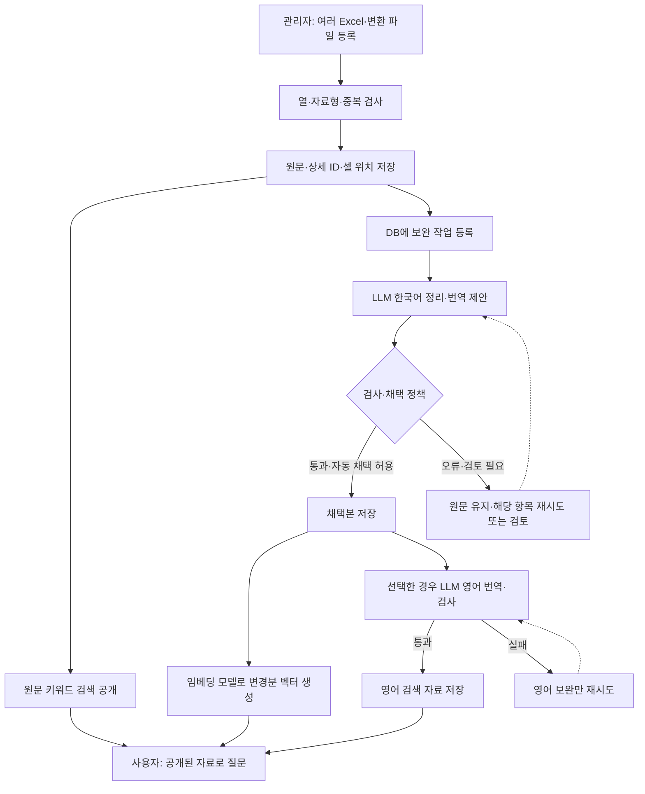
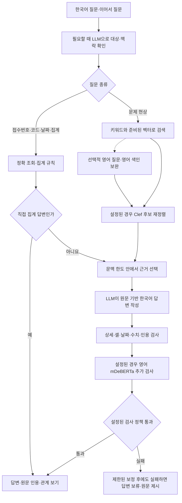
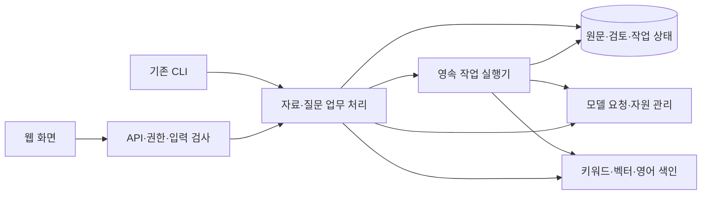

# CS RAG 제품화 설계안

기준: 2026-10-13 KST · 조사 코드: `01f3cd8` · 상태: **사용자 검토 전 제안**

아래의 작업 복구·권한 분리·새 API·검색 공개 방식은 아직 구현하지 않았습니다. 이번에는 운영 코드, DB, 검토 결과와 개인 설정을 변경하지 않았습니다.

## 1. 목표와 운영 전제

담당자가 문제 현상을 한국어로 입력하면, 과거의 유사 사례와 실제 수행한 조치·관찰 결과를 원문 근거로 확인하는 제품을 만듭니다. 자료 관리자는 여러 Excel을 등록하고 진행 상황과 검토가 필요한 항목을 확인합니다. 등록 이후에는 Excel 없이도 검색·검토·근거 확인이 가능해야 합니다.

확인된 요구는 Windows의 DRM Excel, CSList 128열과 누적 CS 28열, 같은 CS의 여러 상세 보존, 한국어 업무, 야간 자동 처리, 여러 브라우저의 질문, 원문 셀 인용입니다. 한국어·중국어·영어 원문을 모두 보존합니다.

**확인이 필요한 전제:** Windows 한 대에서 서버를 실행하고 사내 여러 사용자가 브라우저로 접속하며, Mac은 개발·검증용이라고 가정했습니다. 같은 자료를 공유하는 첫 제품이며 부서별 자료 접근 제어는 이번 제안에 포함하지 않습니다. 접속 인원과 시간 목표는 실기기 측정 전 확정하지 않습니다.

Windows의 기존 GPT-OSS 120B 호환 서버와 Mac의 현재 개발 모델을 재사용하되 모델 이름을 업무 로직에 고정하지 않습니다. 자료를 보내는 모델 서버는 관리자 설정으로 명확히 표시합니다.

## 2. 현재 구조와 개선 이유

| 확인한 현재 구조 | 사용자에게 미치는 영향 | 제품화 변경 |
|---|---|---|
| `web.py`의 App이 입력·작업·질문·설정·모델 수명을 함께 관리 | 한 기능 변경의 영향 범위를 확인하기 어려움 | HTTP, 업무 처리, 작업 실행의 책임 분리 |
| 질문·파일 대기열과 최근 5문답은 메모리 보관 | 서버 재시작으로 대기 상태와 대화가 사라짐 | 작업과 대화를 DB에 저장하고 소유자별 복구 |
| 자료 작업 중 질문 접수 거절 | 갱신이 길어지면 기존 자료에도 질문할 수 없음 | 준비된 자료 조회와 백그라운드 갱신 분리 |
| 야간 완료가 다듬기·검토·벡터·영어 완료에 연결 | 한 단계의 반복 실패로 전체가 미완료로 보임 | 기본 검색 가능, 보완 중, 전체 보완 완료를 구분 |
| 번역 검사는 숫자·단위·일부 상태만 확인 | 예정/완료, 미실시/실시, 없는 원인 추가를 놓칠 수 있음 | 상태 변화 회귀 사례와 검토 대상 표시 보강 |
| 답변 모델 적재 관리가 Clef 설정에 연결 | 재정렬 선택이 번역·답변 모델 수명에도 영향 | 모델 자원 관리를 처리 단계에서 독립 |
| 기본 동시 요청 200, Mac 관리 모드는 동시 예측 1 | 요청 수와 실제 처리 능력의 불일치 가능 | 처리 대상 수·전송 묶음·동시 요청 수 구분 |
| Host·Origin·세션 검사는 있지만 사용자 역할 분리는 없음 | LAN 접속자와 자료 관리자를 구분하지 않음 | 질문 사용자와 관리자 권한을 API에서 분리 |
| 시작 문서 앞부분에 과거 실험이 누적 | 현재 사용법과 실험 결과의 구분이 어려움 | 시작 안내·운영 안내·실험 기록의 읽는 경로 분리 |

근거: [웹 실행 흐름](../ragkit/web.py), [야간 처리](../ragkit/overnight.py), [번역 검사](../ragkit/english.py), [모델 관리](../ragkit/clef.py), [화면](../ragkit/assets/app.html). 파일 길이보다 실제 책임과 호출 관계를 기준으로 나눕니다.

2026-10-13 번역 점검에서 의도적으로 틀리게 만든 `센서 교체 예정 → Sensor replaced.`, `필터 교체 안함 → Filter replaced.`, `密封件已订购，尚未更换。 → Seal replaced.`가 현 검사에 통과했습니다. 이는 검사 허점의 재현이며 실제 모델 오류율이 아닙니다. 점검 당시 로컬 10만 건 DB에는 영어 번역·영어 색인 테이블이 없었습니다.

## 3. 구조 선택

| 방법 | 장점 | 비용·제약 | 판단 |
|---|---|---|---|
| **핵심 코드를 재사용하는 단일 제품으로 단계 전환** | 원문·검토·검색 규칙과 회귀 검사를 이어감 | 새 경계를 단계별로 검증해야 함 | **권장** |
| 별도 제품을 처음부터 전부 작성 | 구조를 자유롭게 설계 | DRM·수식·상세 ID·숫자·인용 예외를 다시 구현·검증 | 선택하지 않음 |
| PostgreSQL·별도 작업 서버·여러 서비스로 즉시 분리 | 다중 서버와 다수 쓰기 작업에 대응 | 설치·백업·배포·장애 지점 증가 | 실측 필요가 확인된 뒤 판단 |

Python 한 저장소, 하나의 시작 명령, 하나의 웹 화면을 유지합니다. 업무 처리를 분리한 뒤 HTTP 계층을 FastAPI 기반으로 전환하는 안입니다. OpenAPI와 요청 형식 선언을 재사용하되 기존 세션·출처·입력 검증은 유지합니다. 프레임워크 교체가 보안과 복구를 자동 해결하지는 않습니다. 현재 `http.server`는 Python 공식 문서에서 운영용으로 권장하지 않습니다. [Python 문서](https://docs.python.org/3.14/library/http.server.html), [FastAPI 기능](https://fastapi.tiangolo.com/features/)

SQLite·FTS5·FAISS는 우선 유지합니다. DB는 서버 로컬 디스크에 두고 브라우저는 API로만 접근합니다. WAL은 짧은 읽기/쓰기를 함께 처리하기 위한 후보이며 단일 쓰기 제약·체크포인트·백업을 검증한 뒤 적용합니다. DB 파일을 공유 폴더에서 여러 PC가 직접 열지 않습니다. 다중 서버 또는 쓰기 경합이 실제 병목이면 PostgreSQL 전환을 별도 결정합니다. [SQLite 용도](https://www.sqlite.org/whentouse.html), [WAL 제약](https://www.sqlite.org/wal.html)

## 4. 자료 등록과 검색 준비



- **기본 검색 가능:** 원문 저장과 키워드 색인이 완료된 상태.
- **보완 중:** 일부 문장·벡터·영어 자료가 준비되지 않은 상태. 사용 가능한 검색 범위를 표시.
- **전체 보완 완료:** 해당 실행에서 선택한 모든 단계가 완료된 상태.

실패를 성공으로 바꾸거나 원문을 영어 번역으로 위장하지 않습니다. 영어 실패는 준비된 원문 검색을 막지 않습니다. 한국어 중심 사용을 유지하고 영어는 선택적 보완으로 둡니다. 기존 사용자가 저장한 선택은 이관하며 다듬기와 영어 번역을 한 요청에 합친 실험을 운영 기본 경로로 되살리지 않습니다.

## 5. 질문과 AI의 역할



| 구성 요소 | 담당 역할과 한계 |
|---|---|
| LLM | 정리·번역·후속 질문 이해·답변. 없는 원인, 미실시 조치, 미확인 결과를 사실로 추가하지 않도록 검사·검토 |
| 임베딩 | 비슷한 현상 후보 검색. 숫자·설비 코드 정확 일치를 대신하지 않음 |
| Clef | 후보 순서 보완. 정확 조회·집계·고정 상세 보호, 오류 시 기존 순서와 실패 사유 반환 |
| 규칙 검사 | 원문 주소·숫자·단위·상세·작업 범위 확인. 통과가 전체 의미 보장은 아님 |
| mDeBERTa | 선택적 추가 판단. 자동으로 기본 차단 모드로 바꾸지 않음 |

상태 검사는 예정/완료, 미실시/실시, 발주/교체, 원인·재발 미확인과 중국어 부정의 올바른 사례와 잘못된 사례를 함께 검증합니다. 규칙으로 판정하기 어려운 의미는 검토 대상으로 남깁니다.

## 6. 코드와 데이터의 경계



현재 함수는 재사용하면서 `web.py` 안의 작업 실행, 모델 연결, 질문 처리부터 책임을 분리합니다. 폴더 개수나 파일 길이를 맞추기 위한 분할과 범용 플러그인 프레임워크는 만들지 않습니다. UI와 CLI는 같은 업무 함수를 호출합니다.

| 데이터 | 보관 규칙 |
|---|---|
| 원문 | 기존 ID·자료형·파일/시트/셀 주소 유지. 이미 답변 근거로 사용한 변경 전 원문은 버전으로 보존 |
| CS와 상세 | CS 번호는 사건 묶음, 상세 ID는 별도 기록. 같은 CS라도 내용·자료형이 다르면 병합하지 않음 |
| 검토 | 수동 채택·원문 유지·직접 편집 보존. 이전 원문 검토를 새 버전에 자동 적용하지 않음 |
| AI 생성물 | 원문/채택본 지문, 모델·프롬프트·검사 버전과 연결. 변경된 원문의 이전 결과를 재사용하지 않음 |
| 검색 자료 | 기존 FTS·벡터 저장 재사용. 변경 상세만 갱신하고 미완료 벡터 범위 표시 |
| 작업 | 종류·소유자·대상·상태·시도·다음 실행 시각·오류·취소 저장 |
| 질문·답변 | 질문 소유자와 사용 근거 버전 저장. 다른 사용자의 대화·요청 로그는 반환하지 않음 |

DB를 일괄 교체하지 않습니다. 첫 단계는 공통 연결·스키마 버전 관리와 `jobs`, `job_items` 도입입니다. 원문 버전과 질문 저장은 해당 기능을 전환할 때 추가합니다. 번역·벡터·검토 테이블을 만능 JSON 테이블로 합치지 않습니다. 이관은 DB 사본으로 검사하고 운영 교체 전 백업과 복원 경로를 남깁니다.

질문 시작 시 **공개된 근거 버전과 사용할 셀 사본**을 고정합니다. LLM을 기다리는 동안 DB 읽기 트랜잭션을 오래 유지하지 않습니다. 새 원문과 키워드 자료는 작은 단위로 함께 공개하고, 준비되지 않은 파생 자료를 검색에서 제외합니다. FAISS 캐시와 DB의 버전 일치도 확인해야 합니다.

## 7. 작업 복구와 모델 자원

1. 작업을 DB에 저장한 뒤 접수 완료를 반환합니다. 항목별로 짧은 트랜잭션에서 실행 소유권을 획득하고 결과·완료 상태를 함께 저장합니다.
2. 상태는 대기·실행·재시도 대기·확인 필요·완료·취소로 구분합니다. 재시작 시 만료된 실행 소유권을 확인하고 미완료 항목을 재개합니다. 같은 작업을 두 실행기가 동시에 확정하지 못하게 합니다.
3. 동일한 단계·원문 버전·모델/프롬프트 결과는 중복 저장하지 않습니다. 연결이 끊긴 원격 모델 요청은 성공 여부가 불명확할 수 있어 재호출 가능성까지 없다고 보장하지 않습니다.
4. 기존 ‘성공할 때까지 재시도’ 선택을 유지합니다. 실패 항목만 독립적으로 재시도하며 지연과 최근 오류를 표시합니다. 인증·Excel 편집·잘못된 입력은 확인 필요로 표시하고 조건을 재확인합니다. 같은 오류로 모델 요청을 쉬지 않고 반복하지 않습니다.
5. 다듬기 처리 대상 수, 임베딩 전송 묶음, 동시 LLM 요청을 별도 값으로 관리합니다. 기존 1~1000 선택을 없애지 않고 새 설치의 미확인 서버는 보수적으로 시작합니다. 기존 저장 설정은 알리지 않고 바꾸지 않습니다.
6. 대화 요청은 현재 모델 호출을 강제 중단하지 않고 다음 실행 경계에서 우선합니다. 배경 작업에도 실행 기회를 배정합니다. 같은 GPU의 큰 모델은 종료 확인 후 교대하며 외부 서버 모델은 임의 적재·해제하지 않습니다.
7. 일반 조회와 기존 답변 열람은 자료 준비 중에도 가능합니다. 새 질문은 모델 자원이 없으면 대기 위치를 표시합니다. 여러 브라우저의 접속과 모델 동시 추론은 구분합니다.

## 8. 화면·Windows·운영

사용자는 **질문** 화면에서 시작합니다. 관리자에게는 **자료**, **작업**, **관리** 화면을 제공합니다. 문장 검토는 자료 상세에서 원문·제안·채택 상태를 비교합니다. Apple 스타일의 절제된 화면을 유지하며 고급 설정과 요청·응답 로그는 관리 화면으로 모읍니다.

답변은 과거 조치, 확인된 결과와 미확인 사항, 발생일·CS 번호·상세별 인용 순서로 읽도록 구성합니다. 긴 원문은 인용을 펼쳐 확인하고 본문에 반복하지 않습니다. 관계 그래프는 반환된 사례의 설비·모듈·부품 연결을 보여주며 인과관계나 조치 성공률로 표시하지 않습니다.

DRM은 현재처럼 Windows Excel에서 인증해 연 통합문서를 `xlwings`로 읽습니다. 웹 서버를 서비스 계정으로 옮기면 열린 Excel과 연결 조건이 달라질 수 있으므로 첫 제품의 DRM 수집은 **Excel을 연 Windows 사용자 세션**에서 실행합니다. 첫 제품은 관리자가 서버 PC에 준비한 파일을 등록하며 원격 사용자의 PC 경로를 서버 경로로 간주하지 않습니다.

일반 사용자는 질문·자신의 대화·공개 근거를 보고, 관리자는 등록·검토·설정·작업 제어·진단을 수행합니다. 모든 API에서 권한을 검사합니다. 사내 접속의 인증·암호화 방식은 회사 환경과 함께 확정하고 기존 Host·Origin·CSRF 검사와 로그 인증 정보 가림을 유지합니다.

`start.bat`을 일상 진입점으로 유지하고 설치·복구 안내를 분리합니다. 배포에는 필요한 코드·설정 예제·매뉴얼만 포함합니다. 연구 결과·모델·원문·개인 설정을 포함하지 않습니다. 설치/DB 버전·모델 상태·백업/복원 결과를 관리 화면에 표시합니다. 실험 코드는 보존하고 운영 패키지에서 제외 가능한지 호출과 패키지 검사를 확인합니다.

## 9. 전환 순서와 완료 기준

| 단계 | 사용자에게 전달할 결과 | 완료를 인정할 검증 |
|---|---|---|
| 1. 작업·DB 경계 | 재시작 후 상태 확인·이어서 실행 | 저장 직전/직후 종료, 중복 접수, 취소/재개, 원문·검토 보존 |
| 2. 질문·자료 준비 분리 | 갱신 중 기존 자료에 질문 | 근거 버전 혼합 없음, 낡은 벡터 제외, 질문과 배경 작업 진행·복원 |
| 3. AI 처리 정리 | 번역·다듬기·자원·오류를 같은 기준으로 관리 | 숫자·단위·예정/완료·부정·중국어 상태, 보정 한도, 모델 종료·시간 초과 |
| 4. 제품 API·화면 | 질문 중심 화면, 역할별 관리, 명확한 준비 상태 | 권한·세션·출처·입력 검사, 후속 질문 범위, 키보드·실제 브라우저 |
| 5. 배포 검증 | Windows 배포본·매뉴얼·임원 보고서 | 설치·업데이트·복원, DRM 실기기, 사내 접속·동시 요청, 현장 평가 |

이 순서는 의존 관계입니다. 상세 파일별 구현 계획은 설계 확정 후 작성합니다. 작은 변경 단위로 회귀 검사·검토·커밋·푸시하고 새 경로를 DB 사본으로 확인하기 전 기존 실행 경로를 교체하지 않습니다.

출시 조건:

- 원문·상세 ID·수동 검토의 이관 전후 보존. 신구 입력 순서에 따른 중복 차이 없음.
- Excel 삭제 후 검색·검토·원문 확인 가능. 실패한 파일/상세/열과 재시도 조건 표시.
- 재시작·모델 장애·영어 실패 때 성공분 보존. 실제 검색 가능 범위 표시.
- 다른 상세의 조치 혼입, 부정·예정·수치·근거 없는 조치의 고정 회귀 검사 통과. 규칙 통과를 전체 의미 보장으로 표현하지 않음.
- 같은 고정 질문에서 기존/새 경로의 정답 누락·근거 오류·지연 비교. 조정에 쓰지 않은 업무 질문은 별도 평가하고 목표를 시범 운영 전에 확정.
- Windows 실제 DRM 입력·GPT-OSS 120B·다중 사용자 접속·대기·권한 분리·설치·복원 확인. Mac 모의 검사로 대체하지 않음.

## 10. 이번 확인 범위

현재 호출 흐름, 저장 테이블, 화면, 설치/패키징 경계를 확인했습니다. 아래 기존 검사는 Mac의 임시 데이터·모의 모델로 모두 통과했습니다.

```sh
.venv/bin/python -m tests.test_multiuser
.venv/bin/python -m tests.test_incremental
.venv/bin/python -m tests.test_overnight
```

이는 기존 기능의 기준선이며 새 구조의 검증이 아닙니다. 제품 코드·운영 DB 변경과 모델 적재는 하지 않았습니다. 제안한 영속 작업·API·권한 분리·동시 갱신은 미구현이며 Windows 실기기·현장 정확도·새 구조 부하 성능은 미검증입니다.
