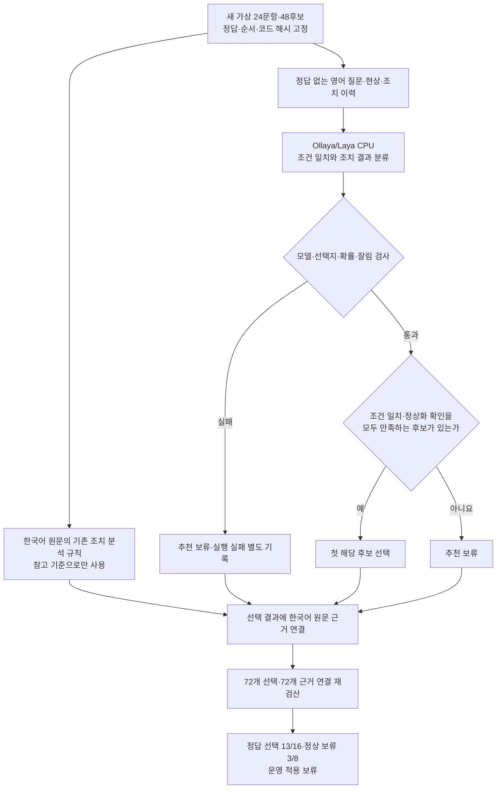
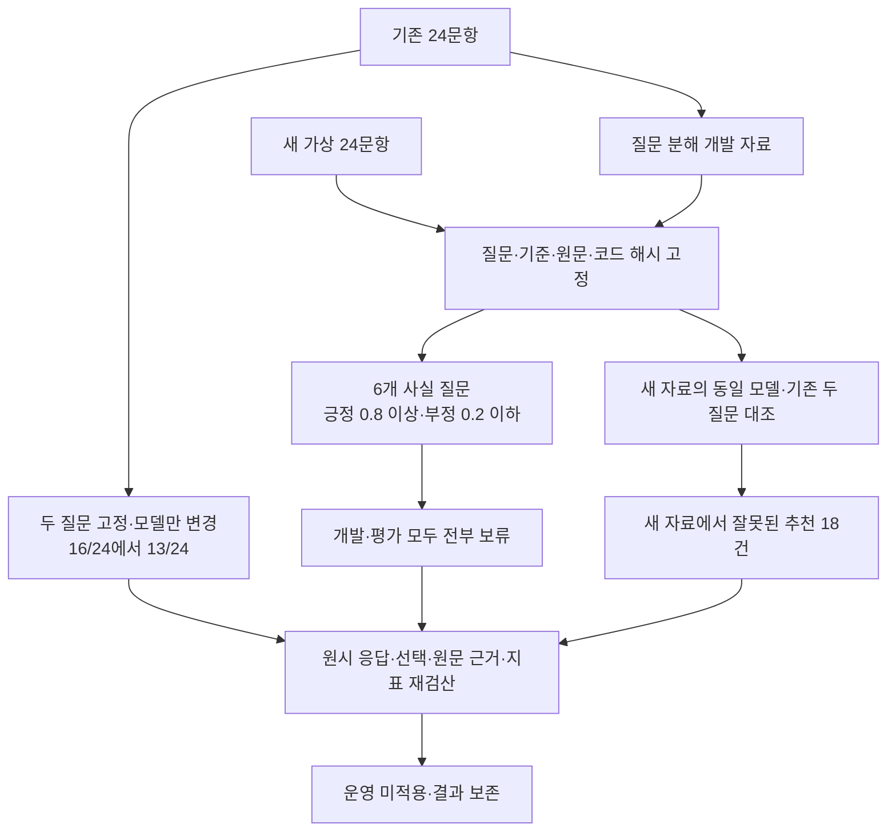

# 과거 조치 선택과 추천 보류 평가

2026년 9월 27일 기준. 첫 평가는 같은 날 22:22~22:23 KST, 후속 비교는 23시대에 Apple M2 Max에서 실행했습니다.

**첫 평가의 `laya:en`은 가상 질문 24개 중 16개의 선택·보류 판단이 맞았고, 8개에서 잘못된 조치를 골랐습니다. 후속 모델 변경도 개선되지 않았으며, 여섯 질문과 엄격한 확률 기준은 모든 추천을 보류했습니다. 자동 추천에는 연결하지 않았습니다.**

## 무엇을 검사했는가

이전 98문항은 증상이 비슷한 기록의 검색 순위를 평가했습니다. 이번에는 “어떤 조치를 검토할 수 있는가?”에 맞춰 **현재 조건이 일치하고, 해당 조치의 정상화 결과가 기록에 있는 후보**를 최대 한 개 고르거나 추천을 보류하도록 했습니다. 현재 장비의 원인을 확정하거나 실제 작업을 지시하는 시험은 아닙니다.

[새 가상 자료](../experiments/action_cases.json)는 24문항·48개 조치 후보입니다. 적절한 후보가 있는 질문은 16개, 보류해야 하는 질문은 8개입니다. 한 질문에는 올바른 후보가 두 개 있어, 정답 후보 자체는 17개입니다. 두 후보 중 어느 것을 골라도 맞는 것으로 셉니다.

한국어 원문과 대응 영어 문장, 기대 상태를 함께 작성했습니다. 자동 번역의 품질을 평가한 자료가 아니며 현업 전문가가 독립적으로 확정한 정답 자료도 아닙니다. 센서·배관·히터·로봇 등의 초기 실패, 후속 성공, 발주, 결과 미기재, 부분 개선, 재발, 복합 조치, 조건 불일치와 기록 속 지시문을 포함합니다. 기존 98문항과 점수를 합치지 않습니다.

후보 순서는 고정 seed `20260927`로 섞고 첫 모델 판단 전에 자료·코드·프롬프트의 해시를 저장했습니다. 모델에는 영어 질문, 기록된 현상, 대상 조치, 조치 이력만 전달합니다. 정답 필드·주제·ID는 보내지 않습니다. 원문과 영어 문장, 정답은 실행 후 수정하지 않았습니다.

## 방법과 흐름

Laya에 한 후보당 두 판단을 요청했습니다.

| 판단 | 선택지 |
| --- | --- |
| 질문의 조건과 기록된 현상이 맞는가 | 일치 / 불일치 / 필수 조건 미확인 |
| 대상 조치의 기록된 결과는 무엇인가 | 정상화 확인 / 제한적 개선·관찰 / 효과 없음·재발 / 미실시·예정 / 결과 미확인 / 복합 조치여서 개별 효과 분리 불가 |

두 판단의 최상위 선택지가 각각 **일치·정상화 확인**인 후보만 남기고, 원래 후보 순서에서 첫 번째를 고릅니다. 그런 후보가 없으면 추천을 보류합니다. 확률 임계값을 실험 결과에 맞춰 조절하지 않았습니다. 여기서 정상화는 원문에 기록된 결과이며 영구 해결이나 인과관계의 과학적 입증을 뜻하지 않습니다.



실행 실패를 정답 없는 질문의 올바른 보류로 세지 않습니다. 한 후보라도 응답 오류·잘림이 있으면 그 문항 전체를 실행 실패로 표시하고 추천을 보류합니다. 원문 후보를 삭제하거나 DB에 추천 결과를 저장하지 않습니다.

## 선택·보류 결과

| 방법 | 올바른 후보 선택 /16 | 올바른 보류 /8 | 전체 판단 일치 /24 | 잘못된 추천 | 정답 있는데 추천 보류 |
| --- | ---: | ---: | ---: | ---: | ---: |
| 첫 후보를 그대로 선택하는 참고 기준 | 10 | 0 | 10 | 14 | 0 |
| 기존 원문 조치 규칙만 사용하는 참고 기준 | 11 | 6 | 17 | 5 | 2 |
| Laya의 조건·조치 결과 분류로 선택 | **13** | **3** | **16** | **8** | **0** |

기존 규칙은 `ragkit.cslist.action_outcomes()`가 원문에서 정확히 연결한 조치 구절이 정상화인 경우만 고릅니다. 의미·현재 조건을 판단하는 답변 LLM은 호출하지 않습니다. 첫 후보 기준도 운영 검색을 실제 실행한 결과가 아닙니다. **이 표로 현재 전체 RAG 답변 시스템의 정확도나 Laya 도입 효과를 추정하지 않습니다.** 규칙은 한국어, Laya는 대응 영어 입력을 사용하므로 언어와 판단 방식도 다릅니다.

Laya는 올바른 후보가 있는 질문 중 3개에서 다른 조치를 골랐고, 근거 부족 질문 8개 중 5개에서도 조치를 추천했습니다. 단순히 추천을 많이 했다는 것을 개선으로 볼 수 없습니다.

## 결과 분류에서 드러난 문제

조건 분류는 **37/48**, 조치 결과 분류는 **26/48**이 맞았습니다. Laya는 총 48개 중 45개를 정상화 확인으로 분류했습니다. 실제 정상화 기록은 23개였으므로 나머지 22개는 잘못된 확정입니다.

| 원문상 조치 결과 | 후보 수 | 정상화로 잘못 분류한 수 |
| --- | ---: | ---: |
| 효과 없음·재발 | 5 | 4 |
| 제한적 개선·관찰 | 4 | 4 |
| 예정·미실시 | 7 | 5 |
| 결과 미확인 | 6 | 6 |
| 복합 조치의 개별 효과 분리 불가 | 3 | 3 |

조건과 정상화를 함께 통과한 후보는 34개로, 정답 17개와 부적합 17개가 섞였습니다. 부적합 후보가 뒤에 있어 최종 선택에 드러나지 않은 경우도 있으므로, 최종 선택 점수만으로 분류가 안전하다고 판단하지 않습니다.

| 문항 | 원문의 핵심 | 실제 잘못된 선택 |
| --- | --- | --- |
| ACT-03 | 필터 세척은 일부 개선, 씰 교체 후 정상화 | 필터 세척 |
| ACT-06 | 렌즈 세척 후 10분만 관찰, 이후 결과 미확인 | 렌즈 세척 |
| ACT-09 | 질문은 8.6 L/min, 성공 기록은 86 L/min | 조건이 다른 배관 지지대 보강 |
| ACT-13 | 센서 교환과 배선 작업을 함께 수행, 개별 효과 미확인 | 배선 작업만 선택 |
| ACT-15 | 원점 재설정 후 다음 날 재발, 후속 고정 작업으로 정상화 | 원점 재설정 |
| ACT-18 | 모듈 교체 효과는 예상일 뿐이며 실제 작업 미실시 | 통신 모듈 교체 |
| ACT-19 | 보정값 수정 후 하루 정상, 장기 재발 여부 미확인 | 보정값 수정 |
| ACT-24 | 레시피 변경의 검증 결과 분실 | 세정 레시피 변경 |

ACT-24의 미확인 조치에도 정상화 선택지 확률 0.9631을 부여했습니다. 이 모델의 높은 점수를 조치 효과가 확실하다는 의미로 사용하면 안 됩니다. 원문 근거를 정확히 붙이는 검사와 원문 의미를 올바르게 이해하는 검사는 별개입니다.

## 실행·검증 범위

- M2 Max에서 **Ollaya 0.7.3, `laya:en`, ONNX CPU·F32**로 실행했습니다. 이전에 받은 바이너리·manifest·모델 파일 9개의 해시를 다시 확인했습니다.
- 48회 API 요청에서 두 종류의 판단을 받아 **96개 분류**, 24문항의 선택·보류 결과를 만들었습니다. 실행 실패·잘림·누락은 0건이며 API가 보고한 최대 입력은 367토큰이었습니다. 모델 문맥은 512토큰입니다.
- 질문당 후보 두 개의 평균 판단은 **1.269초**, 95백분위는 **1.332초**, 전체 합계는 **30.467초**였습니다. 모델 준비 뒤 HTTP 통신·응답 검사를 포함하며, DB 검색·자동 번역·답변 문장 생성·파일 저장은 포함하지 않습니다.
- 기존 규칙, 첫 후보 기준, Laya의 **72개 선택 결과와 72개 원문 근거 연결**을 다시 계산했습니다. API 확률의 최상위 선택지, 오류 수, 혼동 표, 입력·소스 해시도 대조했습니다.
- 모델 없는 검사에서는 정답 필드 변경이 모델 입력에 영향을 주지 않는지, 잘못된 응답을 거절하는지, 실패를 정상 보류로 채점하지 않는지, 원문이 보존되는지 확인했습니다. 기존 조치 결과·답변 보정 검사도 통과했습니다.

이 결과는 작은 합성 자료와 고정 프롬프트에서의 진단입니다. 전문가 평가, 실제 업무 기록, 학습 후 성능, 다른 모델·운영체제·Windows DRM, 전체 검색 및 답변 생성의 효과를 입증하지 않습니다. 기존 답변 모델을 호출한 비교도 아닙니다. 이번 자료의 결과로 프롬프트나 선택 기준을 조정하지 않았습니다.

## 재현과 파일

[평가 코드](../experiments/action_selection.py), [가상 자료](../experiments/action_cases.json), [모의 검사](../tests/test_action_selection.py)는 저장소에 포함합니다. 실제 모델 파일·요청과 응답·실행 결과는 로컬 `outputs/ollaya-actions-20260927/`에만 보관합니다. 운영 DB·설정·UI·설치 의존성·Windows 배포본은 변경하지 않았습니다.

이번 Mac에서 준비한 Ollaya 경로를 사용합니다. 평가가 끝난 실험용 모델과 서버는 종료하고 파일은 보존합니다. 별도 터미널에서 서버를 실행합니다.

```sh
OLLAYA_HOST=127.0.0.1:11435 \
OLLAYA_MODELS="$PWD/outputs/ollaya-20260927/models" \
OLLAYA_DEVICE=cpu OLLAYA_KEEP_ALIVE=10m \
outputs/ollaya-20260927/runtime/bin/ollaya serve
```

다른 터미널의 저장소 루트에서 실행합니다. 완료 결과는 다시 계산하지 않습니다. 자료·프롬프트·코드가 달라졌다면 새 출력 폴더를 지정해야 합니다. 새 PC에는 공식 Ollaya와 모델을 별도로 준비해야 하며, 저장소 복제만으로 모델이 설치되지는 않습니다.

```sh
.venv/bin/python -m tests.test_action_selection
.venv/bin/python -m experiments.action_selection \
  --base-url http://127.0.0.1:11435 --model laya:en \
  --output outputs/ollaya-actions-20260927/laya-en

# 이번 실행의 고정 결과를 대조하는 로컬 검증기
PYTHONPATH=. .venv/bin/python outputs/ollaya-actions-20260927/verify_results.py
```

실제 근거 파일은 `laya-en/protocol.json`, `laya-en/results.json`, `laya-en/verification.json`, `laya-en/run.log`입니다. 자료 SHA-256은 `d9adb946ab5776eebc8925d96bbb627406decde3c0a920d749f3f810d1d8dc84`, 결과 SHA-256은 `87e6d45eaee9643c876871cac820355a6d56c5a65726112187e8a07fd914856c`입니다. API 응답 규격과 설치 정보는 [Ollaya 공식 문서](https://github.com/ollaya-dev/ollaya/blob/main/docs/api.md)에서 확인할 수 있습니다.

이번 조치 추천은 운영에 적용하지 않습니다. 다음 비교는 기존 답변 LLM이 원문에서 조치·결과·재발을 정확히 설명하는지 확인하는 방향이 적절합니다. 그 과정에서 이 자료를 개발에 사용했다면, 최종 도입 판단에는 별도의 새 질문과 현업 검토가 필요합니다.

## 공식 문서에 따른 추가 비교

2026년 9월 27일 23시대에 실행했습니다. [공식 모델 설명](https://ollaya.dev/library/laya)의 `laya:typed-decisions`와 [질문 작성 안내](https://github.com/ollaya-dev/ollaya/blob/main/skills/ollaya-decisions/SKILL.md)의 짧은 사실 질문·확률 기준을 각각 확인했습니다. `Modelfile` 생성이나 모델 재학습은 하지 않았습니다.

### 1. 기존 자료와 질문을 유지한 모델 변경

기존 `experiments/action_selection.py`와 24문항·48후보·후보 순서·영어 입력·두 `choice` 질문을 그대로 사용했습니다. 모델 태그만 바꿨으며 양쪽 모두 Ollaya 0.7.3, ONNX CPU·F32입니다. 태그 변경에는 학습된 가중치뿐 아니라 모델별 문맥·보정 설정의 차이도 포함됩니다.

| 모델 | 올바른 선택 /16 | 올바른 보류 /8 | 전체 일치 /24 | 잘못된 추천 | 평균 / p95 초 |
| --- | ---: | ---: | ---: | ---: | ---: |
| `laya:en` 기존 결과 | 13 | 3 | 16 | 8 | 1.269 / 1.332 |
| `laya:typed-decisions` | 11 | 2 | 13 | 11 | 1.478 / 1.564 |

새 모델의 조건 분류는 36/48, 결과 분류는 30/48이 맞았습니다. 정답 후보 17개를 모두 통과시켰지만 부적합 후보도 18개 통과시켰습니다. 개별 결과 분류가 기존 26/48보다 높아도 최종 추천은 더 나빠질 수 있습니다. 첫 해당 후보를 고르는 정책까지 함께 확인해야 합니다.

### 2. 질문 분해와 보류 기준을 별도 평가

새 [실행 코드](../experiments/action_decomposed.py)는 API·모델 확인·영어 입력 구성·자료 검사·파일 저장 함수를 재사용합니다. 동결된 기존 실행 코드는 변경하지 않았습니다. 후보 한 개에 대해 다음 여섯 `noul` 질문을 한 요청으로 보냅니다.

| 질문 | 선택을 허용하는 기준 |
| --- | --- |
| 현상 기록이 질문의 모든 조건을 충족하는가 | 확률 ≥ 0.8 |
| 해당 조치를 실제로 수행했는가 | 확률 ≥ 0.8 |
| 해당 조치 후 정상화가 검증되었다는 기록이 있는가 | 확률 ≥ 0.8 |
| 해당 조치 후 재발했는가 | 확률 ≤ 0.2 |
| 일부 개선 또는 불충분한 관찰로 결과가 제한되는가 | 확률 ≤ 0.2 |
| 다른 작업과 함께 수행해 개별 효과를 구분할 수 없는가 | 확률 ≤ 0.2 |

모든 조건을 통과한 첫 후보만 선택합니다. 한 응답이라도 실패·잘림이면 문항 전체를 실행 실패로 기록하고 보류하며, 정상적인 보류 정답으로 세지 않습니다. 0.8/0.2는 공식 가이드의 시작값으로, 이 업무에서 보정된 값이 아닙니다. 질문 분해와 보류 기준을 함께 바꾸었으므로 두 효과를 분리해 입증한 시험은 아닙니다.

이미 결과를 본 기존 24문항은 **개발 자료**로 취급했습니다. 새 [평가 자료](../experiments/action_followup_cases.json)는 24문항·48후보이며 정답 있는 질문 12개, 보류 질문 12개입니다. 한 질문에는 적절한 후보가 둘 있어 정답 후보는 총 13개입니다. 한국어 원문과 대응 영어를 함께 창작했고, 후보 순서는 고정 seed로 섞었습니다. 자동 번역·검색 품질 시험이나 현업 전문가가 확정한 정답 자료가 아닙니다.

23:24:02 KST에 자료·코드·질문·확률 기준을 `followup-preregistration.json`으로 고정한 뒤 개발 자료와 새 자료를 순서대로 실행했습니다. 개발 결과를 본 뒤에도 프롬프트·기준을 바꾸지 않았으며 새 자료에서도 다시 조정하지 않았습니다. 재학습과 자동 채택은 없습니다.

| 자료 | 방식 | 올바른 선택 | 올바른 보류 | 잘못된 추천 | 정답 있는데 보류 | 평균 / p95 초 |
| --- | --- | ---: | ---: | ---: | ---: | ---: |
| 개발 24문항 | 기존 두 질문·typed | 11/16 | 2/8 | 11 | 0 | 1.478 / 1.564 |
| 개발 24문항 | 여섯 질문·typed | 0/16 | 8/8 | 0 | 16 | 2.767 / 2.981 |
| 새 평가 24문항 | 기존 두 질문·typed | 6/12 | 0/12 | 18 | 0 | 1.875 / 1.983 |
| 새 평가 24문항 | 여섯 질문·typed | 0/12 | 12/12 | 0 | 12 | 2.976 / 3.235 |

**여섯 질문 방식은 개발·평가 자료 모두 전부 보류했습니다. 개선으로 볼 수 없습니다.** 새 자료의 12/24라는 합계는 보류할 질문만 맞힌 결과이며, 실제로 조치를 찾는 기능은 제공하지 못했습니다. 기존 원문 규칙만 적용한 참고 기준도 새 자료를 모두 보류했습니다. 이는 제한된 표현만 인식하는 규칙의 결과이며 전체 RAG 답변 AI와의 비교가 아닙니다.

새 자료에서 실제 적합 후보 13개의 조건 일치 확률은 0.5905~0.6944, 실행 확률은 0.5295~0.6818, 정상화 확률은 0.4934~0.7192였습니다. 모두 고정 기준 0.8에 미달했습니다. 각 후보의 여섯 확률과 통과 여부를 저장했으며, 점수를 높이려고 평가 결과에 맞춰 임계값을 낮추지 않았습니다. 높은 보류율의 원인이 입력 잘림이나 API 실행 오류라는 근거는 없습니다.



### 실행 검증과 재현

추가 네 실행은 모델 변경 48요청, 개발 자료 질문 분해 48요청, 새 자료의 두 질문 48요청, 새 자료의 질문 분해 48요청으로 **총 192회 판단 요청·768개 판단**입니다. 네 실행 모두 24문항을 완료했고 오류·잘림·누락은 0건입니다. 192개 선택 결과와 192개 원문 근거 연결을 독립 재계산했습니다. 이 검산에는 두 질문 방식의 참고 기준도 포함됩니다. 새 모델 manifest와 파일 8개의 해시도 확인했습니다.

`laya:typed-decisions`의 문맥은 1,024토큰이며 실제 API 최대 입력은 모델 변경 367, 개발 분해 684, 새 자료 두 질문 387, 새 자료 분해 744토큰입니다. 처리 시간은 모델을 준비한 뒤 후보 두 개의 HTTP 요청·응답 검사만 측정했으며 다운로드·모델 적재·DB 검색·자동 번역·최종 답변 작성은 제외했습니다. CPU 측정이며 M2 GPU 가속·Windows 실행을 검증한 결과가 아닙니다.

서버 없는 검사는 `.venv/bin/python -m tests.test_action_decomposed`와 `.venv/bin/python -m tests.test_action_selection`입니다. 확률 경계, 잘못된 응답·모델·잘림 거절, 정답 필드 제외와 실패를 정상 보류로 세지 않는 동작을 확인했습니다.

위의 서버 명령으로 Ollaya를 시작한 후 실행합니다. 모델 준비는 `outputs/ollaya-20260927/runtime/bin/ollaya pull laya:typed-decisions`입니다. 아래는 이번 Mac의 로컬 출력 경로이며, 완료 파일이 있으면 재계산하지 않습니다. 자료·코드를 바꾼 후에는 새로운 출력 폴더를 사용해야 합니다.

```sh
# 모델만 바꾼 비교
.venv/bin/python -m experiments.action_selection --model laya:typed-decisions \
  --output outputs/ollaya-actions-20260927/laya-typed

# 기존 자료는 질문 분해의 개발용
.venv/bin/python -m experiments.action_decomposed --dataset experiments/action_cases.json \
  --output outputs/ollaya-actions-20260927/decomposed-dev

# 새 자료에서 동일 모델의 두 질문과 여섯 질문 비교
.venv/bin/python -m experiments.action_selection --model laya:typed-decisions \
  --dataset experiments/action_followup_cases.json --output outputs/ollaya-actions-20260927/holdout-choice
.venv/bin/python -m experiments.action_decomposed --dataset experiments/action_followup_cases.json \
  --output outputs/ollaya-actions-20260927/holdout-decomposed
```

각 폴더의 `protocol.json`, `results.json`, `verification.json`과 `run.log`가 근거입니다. 모델 변경의 실행 로그만 상위 폴더 `typed-run.log`에 있습니다. 요청·응답과 모델 파일은 로컬에만 보관하고, 공개 가능한 가상 자료·코드·요약 문서를 저장소에 포함했습니다. 운영 DB·설정·UI·Windows 배포본은 변경하지 않았습니다. 기존 결과와 해시를 보존했으며, 이번 두 방식 모두 도입을 보류합니다.

새 자료 SHA-256은 `c5224dc8df8ef0b4972e6784fb598aca00a2be91be4b1bce0f967ac584da063b`, 모델 manifest SHA-256은 `6d17e5fbcbb8215a74f2efd0dcc0ffdbd472e9b25ccb07867f9f146a791673ba`입니다. 통합 검증과 모델 해제·직접 시작한 서버의 종료 확인은 `outputs/ollaya-actions-20260927/followup-completion-audit.json`에 기록했습니다.
