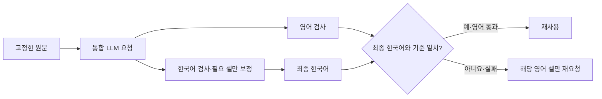

# 한국어 다듬기와 영어 번역의 통합 생성 비교

기준일: 2026-09-30 · 창작 사례를 이용한 Mac 시험 · 운영 DB 변경 없음

2026-10-01: 한국어 다듬기의 첫 요청 방식이 롤백됐습니다. 아래 수치는 롤백 전 코드의 고정 비교 결과이며 현재 구현의 성능을 뜻하지 않습니다. [현재 처리·복구 절차](../README.md#문장-다듬기-요청-방식-롤백-2026-10-01)를 참고하세요.

이 문서는 기록 상태·영어 잔존 검사 보강 전의 초기 비교입니다. 원래 결과를 보존하며, 후속 변경과 재검증은 [번역 의미 보존 개선](번역-의미보존-개선-20260930.md)에 별도로 기록합니다.

## 목적과 비교 범위

한 번의 AI 요청으로 한국어 정리문과 그 정리문을 번역한 영어 후보를 받으면, 기존 두 단계보다 요청과 처리 시간을 줄일 수 있는지 확인합니다. 원문은 항상 사실·인용의 기준이며, 번역은 검색을 돕는 자료입니다. 요청이 줄었다고 정확도가 높아졌다고 판단하지 않습니다.

16가지 유형으로 만든 창작 100행을 고정합니다. 목록 번호·장비 코드, 한국어·중국어·영어 혼합, 빈 셀, 숫자·부호·단위, 긴 경과, 부정·추정, 발주와 교체, 조치 순서·효과 구분을 포함합니다. 같은 유형이 반복되는 합성 표본이며 100개의 독립적인 현장 문제를 대표하지 않습니다.

두 방식은 동일한 행과 모델 설정을 사용합니다. 분리→통합과 통합→분리 순서를 행마다 교대로 적용하며 한 요청씩 실행합니다. 실험에서는 검사한 한국어 제안을 그대로 채택한다고 가정합니다. 프로토콜·코드 해시·접수별 체크포인트와 결과는 로컬 `outputs/bilingual-normalize-20260930`에 보관합니다. 중간 조건이나 모델이 다른 실행은 합산하지 않습니다.

## 통합 방식의 안전장치

- 한국어와 영어 셀의 열 구성, 빈 문자열, 숫자·부호·단위·식별자를 각각 검사합니다.
- 한국어가 실패하면 그 셀만 기존 보정 요청으로 다시 다듬습니다. 보정된 한국어의 영어 후보는 사용하지 않습니다.
- 영어가 누락되거나 실패해도 통과한 한국어 결과를 유지합니다. 실패한 영어 셀은 확정 문장을 기준으로 별도 번역합니다.
- CSList의 작업1과 작업2는 서로의 셀을 요청 문맥에 포함하지 않습니다. 누적 자료도 서로 다른 상세를 합치지 않습니다.
- 통합 입력이 커지면 기존 한국어 다듬기로 처리하고 영어를 별도로 요청합니다. 원문을 잘라 성공으로 처리하지 않습니다.
- 이 실험은 DB에 후보를 자동 저장·채택하지 않습니다. 운영의 검토 후 번역 흐름을 유지합니다.



## 측정과 판단

100행의 양쪽 처리를 완료했습니다. Apple M2 Max·메모리 32GiB, LM Studio의 GPT-OSS 20B MXFP4, 추론 `low`, 출력 상한 8,192, 설정 문맥 한도 16,384, temperature 0.1, top_p 0.95에서 한 요청씩 실행했습니다.

| 항목 | 기존 분리 요청 | 통합 요청 |
|---|---:|---:|
| 처리한 동일 합성 행 | 100 | 100 |
| 최종 형식·수치 검사 통과 | 100 | 100 |
| 모델 요청 수, 보정 포함 | 240 | 170 |
| 처리 시간 합계 | 772.6초 | 648.0초 |
| 행별 처리 시간 중앙값 | 7.35초 | 5.26초 |
| 서버 보고 입력 토큰 | 159,246 | 94,105 |
| 서버 보고 출력 토큰, 추론 포함 | 49,325 | 42,689 |
| 서버 보고 전체 토큰 | 208,571 | 136,794 |
| 사전 영어 표현 검사에서 원문 대조가 필요한 행 | 17 | 19 |

이번 구현에서는 요청이 **29.2%**, 처리 시간 합계가 **16.1%**, 서버 보고 전체 토큰이 **34.4%** 줄었습니다. 통합 방식의 66행은 요청 한 번으로 끝났고, 34행은 보정·영어 재요청을 포함해 2~7회 요청했습니다.

현재 분리 파이프라인과 새 통합 프롬프트를 사용하는 구현 전체를 비교했습니다. 통합 지시문은 영어로 간결하게 작성해 언어·길이도 달라졌습니다. 따라서 요청 합침만의 효과를 분리한 실험은 아닙니다. 처리 시간에는 모델 요청·보정·결과 검사를 포함하며 Excel 읽기, 운영 DB 등록·검색, 모델 로딩·예열, 체크포인트 저장은 포함하지 않습니다. 금전 비용이나 Windows 성능으로 환산하지 않습니다.

### 숫자 검사 통과와 의미 정확성은 다릅니다

- 영어 칸에 한국어 정리문이 그대로 남은 행은 설비 등 모든 번역 열을 포함하면 기존 13행, 통합 4행입니다. **현상·원인·조치만 보면 기존 3행, 통합 4행**입니다. 통합 `PAIR-052`의 조치에는 `호스 교체 후 -0.2 MPa. 10분 관찰 중 재발 없음. 장기 미확인`이 그대로 남았습니다. Latin 단위·코드가 영어 단어 검사에 잡혀도 문장 전체가 영어라는 뜻은 아닙니다.
- `배선 접촉 불량 확인`이 `Check for poor wiring contact`로 바뀐 사례가 두 방식에 있습니다. 기록된 확인 결과가 지시로 바뀌었지만 숫자 검사는 이를 판별하지 못합니다.
- `재발 미확인`이 `No recurrence confirmed`로 번역되어 불확실성이 모호해진 사례가 있습니다. 재발하지 않았다는 확인으로 오해할 수 있어 원문 대조가 필요합니다.
- 사전 표현 검사 17·19행은 오류 건수가 아닙니다. `Effect not stated`, `Estimated ...`, `resumed`처럼 의미가 유지된 표현도 고정 정규식에 없으면 후보로 표시됩니다.

한국어 복사 건수는 완료 결과에 추가한 원문 대조이며 사전 정규식 지표와 분리했습니다. 전체 의미 정확도를 산출하지 않았습니다. 두 방식 모두 수치·열 검사를 통과했지만 번역 품질까지 100%라고 볼 수 없습니다.

**현재 판단: 통합 방식은 실험 기능으로 제공하고 운영 기본값은 검토·채택 후 번역을 유지합니다.** 운영 적용 전에는 코드·단위 외의 한국어·중국어 잔존과 관찰/지시·추정/확정 상태를 검사하고, Windows 120B의 현재 추론 설정으로 동일한 비교를 수행해야 합니다.

### 예비 실행과 완료 검증

초기 GPT-OSS 20B `high` 예비 실행에서는 첫 비교가 4,096토큰에 걸려 잘렸으며, 8,192토큰의 통합 예비 요청도 잘렸습니다. 다른 모델의 예비 요청에서는 추론 값 오류와 시간 초과를 확인했습니다. 로그에서 중복된 JSON 출력 지시를 반복 검토하는 모습을 확인해 통합 프롬프트를 하나의 출력 계약으로 정리했습니다. 본 비교는 그 뒤 조건을 새로 고정한 `low` 실행입니다. 예비 결과와 합산하지 않으며, `high`보다 품질이 좋다고 판단하지 않습니다. 수정한 프롬프트의 `high` 성능은 검증하지 않았습니다.

완료 결과의 `complete=true`, 100행·200체크포인트·코드/프로토콜 해시를 확인했습니다. 모든 한국어·영어 결과를 원래 검사기로 다시 검사하고 요청·시간·토큰 합계를 별도로 재계산했습니다. 로컬 증거는 `outputs/bilingual-normalize-20260930/final-low/{protocol,results,verification}.json`입니다. 개별 실행 결과와 LLM 요청·응답 로그는 Git에 올리지 않습니다.

통합 생성·숫자 복원·영어 실패 격리·한국어 보정 셀의 영어 재사용 금지·작업1/2 문맥 분리 모의 검사, 전체 오프라인 회귀 검사와 독립 압축 해제 후 배포 검사는 모두 exit 0입니다. 실제 모델 100행 비교와 모의 검사는 서로 다른 검증입니다.

## 재현과 검증

```sh
.venv/bin/python -m tests.test_english
.venv/bin/python windows-demo/test_demo.py
.venv/bin/python -m experiments.bilingual_normalize --config mac_config.json --output outputs/bilingual-100 --prepare-only
.venv/bin/python -m experiments.bilingual_normalize --config mac_config.json --output outputs/bilingual-100
.venv/bin/python package_windows.py
```

Windows 배포 폴더에서는 `".venv\Scripts\python.exe" -m experiments.bilingual_normalize --config config.json --output outputs/bilingual-100`으로 실행합니다. 모델·출력 상한·추론 수준은 두 방식에 동일하게 적용되며 설정을 바꾸려면 새 출력 폴더를 사용합니다. 정상 처리한 접수의 체크포인트는 같은 명령으로 재사용합니다.

모의 검사와 Mac 실제 모델 비교, Windows 실기기 검증을 구별합니다. 실제 DRM Excel, 현장 자료의 의미 정확도, Windows 120B의 처리 시간과 품질은 이번 Mac 합성 시험으로 확인할 수 없습니다.
