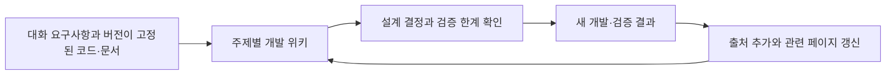

# CS Excel RAG · LLM Wiki

기준일: **2026-09-29**. 구현 확인 기준: `7c70bddb963aa3f1539a96d6353facb1de65b1a6`.

이 대화에서 정한 요구사항, 현재 프로그램의 동작, 실험에서 배운 점을 연결한 개발 지식 위키입니다. 실제 CS 기록은 제품 DB에서 관리합니다. 이번 정리는 문서 작업이며 새 모델 학습·실험·운영 DB 변경은 수행하지 않습니다.

## 읽는 순서

| 페이지 | 알 수 있는 내용 |
| --- | --- |
| [시스템 개요](시스템-개요.md) | 목적, 전체 처리 흐름, 모델별 역할, 현재 범위 |
| [입력과 데이터 보존](입력과-데이터보존.md) | 두 Excel 양식, DRM, 파일 변환, 중복·갱신·삭제 규칙 |
| [문장 정리와 검색](문장정리와-검색.md) | 한국어 정리, 검토, 영어 번역, 2그램, 벡터와 결합 검색 |
| [질문과 근거 검사](질문과-근거검사.md) | 답변·인용, 숫자·날짜, 토큰 예산, 후속 질문, 영문 지시 |
| [실험과 채택 판단](실험과-채택판단.md) | GLiNER·LEV·CLM·Laya·답변 모델 실험 결과와 한계 |
| [운영과 장애 대응](운영과-장애대응.md) | Windows 실행 파일 순서, Mac 실행, 야간 처리, 오류 확인 |
| [결정과 다음 검증](결정과-다음검증.md) | 채택한 설계, 미도입 제안, 다음 판단에 필요한 증거 |

## 출처와 갱신

- [대화의 요구사항 기록](raw/2026-09-29-대화-요구사항.md): 사용자의 요청을 주제별로 요약한 최초 기록. 구현 완료 목록과 구분합니다.
- [출처 목록](raw/2026-09-29-출처목록.md): 기준 커밋의 문서·코드 링크와 해시, Karpathy의 LLM Wiki 원출처.
- [변경 기록](log.md): 언제 어떤 자료를 반영했는지 기록합니다.
- [위키 작성 규칙](AGENTS.md): 새 자료 반영·상충 내용 확인·출처 유지 방법입니다.

**상태 읽는 법:** ‘현재 기능’은 기준 버전의 동작, ‘과거 검증’은 해당 날짜·장치·표본의 기록, ‘제안’은 아직 제품에 넣지 않은 방향입니다. 자동 검사를 통과했다는 사실과 실제 업무에서 정확한 답변을 한다는 판단은 구분합니다.

일상 사용은 [README](../README.md), 경영진 설명은 [임원 보고서](../docs/임원보고서.md), 상세 처리 경로는 [전체 프로그램 플로우](../docs/전체-프로그램-플로우.md)를 함께 봅니다. 위키는 GitHub 또는 Markdown을 읽는 편집기에서 사용할 수 있으며 별도 위키 서버가 필요하지 않습니다.
