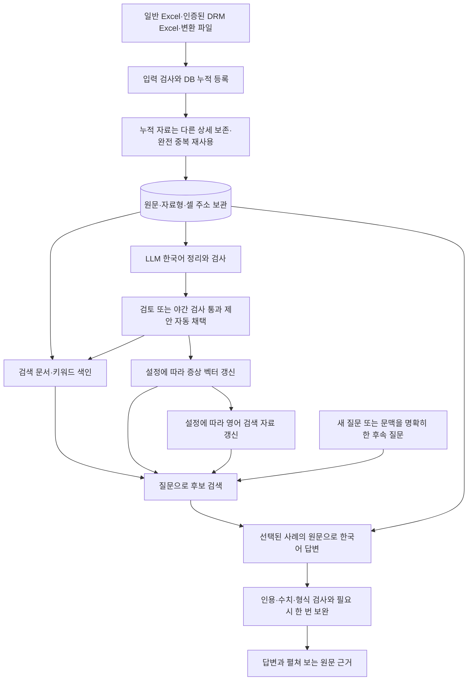

# 시스템 개요

기준일: 2026-09-29 · 상태: 현재 기능의 문서화. [목차](index.md) · [출처 목록](raw/2026-09-29-출처목록.md)

## 무엇을 돕는가

문제 현상을 입력하면 Excel에 기록된 유사한 CS 사례와 과거 조치·결과를 찾습니다. 작성자의 표현 차이와 다국어 기록은 검색용으로 정리하되, 답변의 사실 근거는 DB에 보존한 원래 셀입니다. 현재 장비의 원인을 확정하거나 현장 작업을 자동 지시하는 시스템으로 검증된 것은 아닙니다.

출처: [README](../README.md), [임원 보고서](../docs/임원보고서.md), [사용자 요구](raw/2026-09-29-대화-요구사항.md).

## 전체 흐름

같은 CS의 누적 상세를 별도로 보관하고 접수 건수는 CS 번호로 집계합니다. [새 양식·상세 행 요구](raw/2026-09-29-누적양식-상세행.md)를 반영했습니다. 일반 다듬기는 수정 제안을 만들며 바로 채택하지 않습니다. 영어 번역·임베딩은 선택 기능이고 실패가 이미 확정된 검토 저장을 취소하지는 않습니다. 건수 질문과 오류 경로는 [상세 플로우](../docs/전체-프로그램-플로우.md)에 있습니다.

## 구성요소의 역할

| 구성요소 | 역할과 경계 |
| --- | --- |
| Python 웹 UI·CLI | 파일 등록, 진행 관리, 검토, 검색, 질문을 같은 처리 함수로 실행 |
| SQLite·FTS5 | 원문·검토·검색 문서·번역·벡터 저장과 키워드 검색 |
| LM Studio·OpenAI 호환 API | 답변 모델과 임베딩 모델을 호출하는 연결 방식 |
| 답변 모델 | 문장 정리, 영어 번역, 질문 정리, 한국어 답변 생성 |
| Qwen3 Embedding 0.6B | 증상 문서·질문을 수치 벡터로 변환. 문장 생성과 별도 역할 |
| FAISS FlatIP | 메모리에서 유사 벡터 검색. 벡터 원본은 SQLite에 보관 |
| 별도 모델 실험 | 후보 순위·조치 선택 평가. 실행 성공만으로 운영에 연결하지 않음 |

Mac 예제는 `openai/gpt-oss-20b`, Windows 예제의 API 모델명은 `gpt-4`입니다. Windows의 실제 기반 모델 GPT OSS 120B는 사용자 설명이며 예제 별칭과 구분합니다. 모델 파일이 현재 로드되어 있는지는 이 문서화 작업에서 점검하지 않았습니다.

출처: [Mac 예제 설정](../mac_config.example.json), [Windows 예제 설정](../windows-demo/config.example.json), [검색 구현](../ragkit/semantic.py), [CLI](../ragkit/cli.py), [웹 서버](../ragkit/web.py).

## 지금 완료한 것과 아직 아닌 것

입력·검토·번역·벡터·질문·후속 대화 기능과 관련 검증 기록이 저장소에 있습니다. 문맥 예산 보완과 영어 지시 선택의 최근 변경은 `7c70bdd`에 포함됩니다. 모델 학습, PostgreSQL 이관, 영어 번역문의 별도 벡터, 설비별 Wiki 요약을 답변에 넣는 기능은 현재 흐름에 포함되지 않습니다.

이번에 만든 개발 위키는 이러한 설계 지식을 보존합니다. 업무 원문 검색의 일부로 자동 호출되거나 새 자료를 감시하는 서비스는 아닙니다. [결정과 다음 검증](결정과-다음검증.md), [실험과 채택 판단](실험과-채택판단.md)을 함께 읽습니다.
