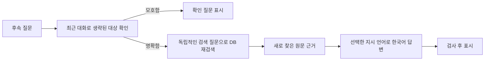

# 질문과 근거 검사

기준일: 2026-09-29 · 상태: 현재 기능. [목차](index.md) · [문장 정리와 검색](문장정리와-검색.md)

## 답변과 원문을 연결하는 방법

모델은 주장마다 근거 ID와 열을 선택하고 프로그램은 실제 원문 셀을 연결합니다. 답변 본문에 원문 전체를 반복하지 않고 인용을 펼쳐 원문·조치 결과·셀 주소를 확인합니다. 날짜를 답변에 쓰면 해당 날짜 열의 근거가 필요합니다. 인용 중복을 줄이는 요구가 필수 날짜·현상·조치 근거를 빼도 된다는 뜻은 아닙니다.

숫자·부호·순서·대표 단위와 인용 ID·열·응답 형식을 검사합니다. 날짜 구분자의 정상적인 차이는 별도 처리하지만 다른 날짜나 근거 없는 날짜는 거절합니다. **검사 통과는 문장 의미 전체와 실제 조치 효과를 보증하지 않습니다.** 과거 정상화·재발·미실시·부분 개선·관찰 한계는 원문으로 확인해야 합니다.

조치와 결과의 보조 연결은 원래 `조치내용(n)`에서 명확히 읽히는 표현을 사용합니다. 채택문·번역으로 없는 성공 결과를 만들지 않습니다. 새 누적 양식을 포함한 모든 서술을 완벽하게 해석하는 규칙으로 간주하지 않습니다.

출처: [답변 검사](../ragkit/llm.py), [조치 결과 연결](../ragkit/cslist.py), [조치 결과 검사](../tests/test_action_outcomes.py), [답변 기준 평가](../docs/답변모델-기준평가-20260928.md).

## 참고 사례 수와 긴 요청

참고 사례 수는 기본 3, UI에서 1~100 또는 자동을 선택합니다. 자동은 상위 후보에서 사례 전체를 순서대로 선택하며 원문 셀을 잘라 맞추지 않습니다. 사례 수, 주장 수, 인용 셀 수는 서로 다른 개념입니다. 누적 양식의 참고 사례 제한은 선택된 상세 문서 수이며, 전체 접수 집계의 CS 번호 수와 다릅니다. 화면에는 업무 CS 번호를 표시하되 내부 상세 ID·인용 셀 위치는 구분하여 유지합니다. [입력 정책](입력과-데이터보존.md), [상세 인용 검사](../tests/test_history_input.py)를 참고합니다.

모델의 지원 최대 문맥과 서버에 실제로 적재된 문맥은 다릅니다. Windows 예제의 `max_tokens`·`context_window`는 131,072이고 추론은 `high`지만, 모든 서버 요청에 그만큼의 출력이 확보된다는 뜻은 아닙니다. 입력·출력 예약과 실제 서버 한도를 고려해야 합니다. 초기 요청 자체가 한도를 넘으면 참고 사례 수나 설정을 조정합니다.

답변이 잘리거나 근거 검사에 실패하면 **최대 한 번** 재요청합니다. 보정 요청은 다음 순서로 예산에 맞춥니다.

1. 같은 질문·원문 + 실패 응답 + 보완 지시.
2. 공간이 부족하면 실패 응답을 제외하고 보완 지시를 전달.
3. 보완 지시조차 들어가지 않으면 최초 질문·동일 원문으로 재생성.

출력 여유와 원문은 유지합니다. 다시 실패하면 실패로 안내하고 기록합니다. 야간 전처리의 반복 정책을 사용자 질문 답변에 적용한 것은 아닙니다.

출처: [예산 선택·보정 요청](../ragkit/llm.py)의 `select_answer_cases`·`answer_retry_messages`, [Windows 예제](../windows-demo/config.example.json), [질문 기능 설명](../README.md).

## 후속 질문과 지시 언어

브라우저의 **최근 답변에 이어서 질문**은 최근 대화로 대상을 파악하고 DB를 다시 검색합니다. **문맥을 반영한 검색 질문**에서 해석을 확인할 수 있습니다. 과거 답변을 새로운 사실 근거로 넘기지 않으며 모호하면 확인 질문을 표시합니다.

세션에는 최근 5문답을 서버 메모리에 보관하고, 대상 확인에는 최근 최대 3문답 중 예산에 맞는 문답을 사용합니다. 실패 응답은 대화에 넣지 않습니다. 새 대화·서버 재시작·24시간 세션 만료로 초기화되며 기존 진단 로그까지 지우는 기능은 아닙니다. 후속 질문에는 대상 확인용 모델 호출이 추가됩니다.

**영어 지시 · 한국어 답변**은 답변·보정·후속 질문 정리의 지시 언어를 선택하는 기능입니다. 기본은 한국어이며 원문·열 이름·인용 검사를 유지합니다. 문장 다듬기의 지시 언어, 영어 번역 질문 병용과는 별도입니다. 영어가 더 정확하다고 입증되어 기본값을 바꾼 것이 아닙니다.

출처: [웹 세션·대기열](../ragkit/web.py), [질문·보정 프롬프트](../ragkit/llm.py), [영어 답변 지시문](../ragkit/assets/answer_prompt_en.txt), [지시 언어 실험](../docs/영문-프롬프트-비교-20260928.md).

## 확인한 범위

`7c70bdd` 변경의 기록은 모의 모델 오프라인 회귀, HTTP 세션 분리, Mac 브라우저 동작과 독립 Windows 압축 해제 검사입니다. Windows GPT OSS 120B 실기기의 이번 기능 응답 품질은 미검증입니다. 이전 28문항 지시 언어 실험의 점수를 이 변경 이후 품질로 재사용하지 않습니다. [실험과 채택 판단](실험과-채택판단.md)을 참고합니다.
